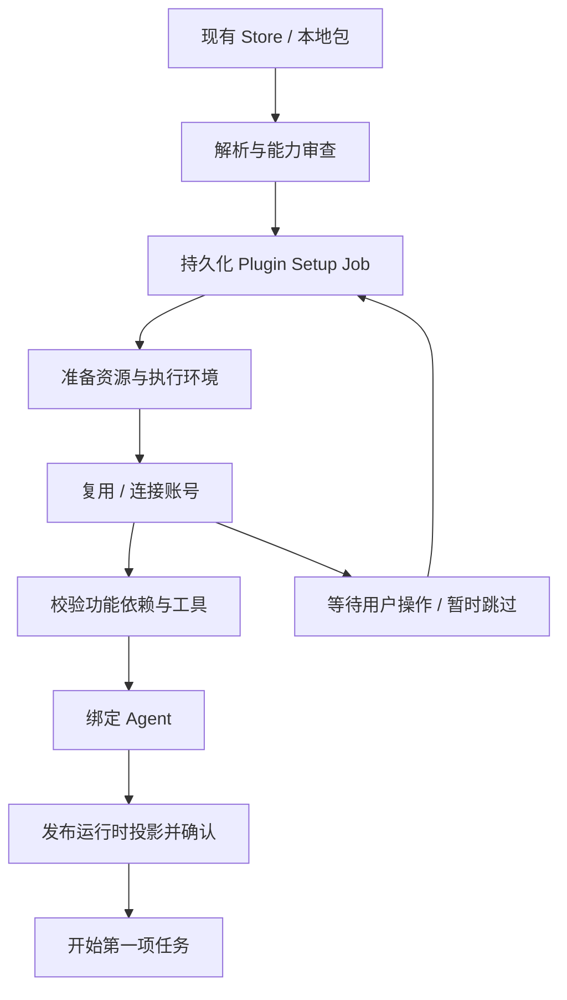

# Accio Plugin 调研与 xopc 丰富插件方案

调研日期：2026-10-18（用户时区）。xopc 基线：`572d18980`，package version `0.0.395`。Accio 本机安装包：`@phoenix/desktop 0.34.4`。

## 1. 结论与建议

Accio 最值得借鉴的是把 Plugin 做成可交付的业务能力：用户选择一个任务领域，宿主完成资源准备、账号连接、工具可用性验证、Agent 绑定，再把用户带到可开始工作的入口。

xopc 已经有 Store、Portable Agent Plugin、Native Extension、Connector、托管 CLI、Skills、Workflow 和 Agent 权限体系。建议在这些能力之上增加统一的 **Plugin Setup 与运行时投影层**，沿用现有 Store 分发，不再建设另一套市场、OAuth 或通用 Agent Runtime。

建议优先级：

1. **P0：安装到可用的完整流程。** 声明依赖、下载资源、复用连接、授权、检查工具、选择使用的 Agent、第一条任务入口，支持失败后继续。
2. **P1：插件作为业务能力包。** 增加任务入口、轻量编排上下文、组件清单、按功能计算的就绪状态；让用户不必自己理解 Skill/MCP/CLI 的区别。
3. **P2：声明式执行能力。** 引入受控任务脚本、执行者配置、输入输出契约和产物校验，复用现有 Workflow、delegation、process 与 Connector policy。
4. **P3：开发者交付工具。** authoring schema、预检、离线 fixtures、失败恢复测试、发布契约和端到端业务样例。

不建议第一版直接兼容 Accio 全量格式，也不建议直接给 Portable Plugin 增加任意宿主内 JavaScript Hook。Accio 的业务包与其宿主工具、账号中心、运行环境有深度耦合；借鉴产品与契约设计的收益高于兼容原包。

## 2. 证据范围与可信边界

本次结合三类证据：

- 用户提供的安装截图：1688 Purchasing Toolkit、Gmail。
- Computer Use 实际操作：Accio 插件市场、Shopify 插件详情、CLI 详情、Agent 绑定面板、Gmail 安装到授权步骤及取消、插件 Chat 入口。
- 本地静态代码：用户导出的 12 个插件，以及 `/Applications/Accio.app/Contents/Resources/app.asar` 中的编译代码。

插件导出目录：

`/Users/micjoyce/AccioWork/2026-10-18-22-36-35-543-850223e4/installed_plugins`

宿主编译代码仅复制到 `/tmp/xopc-accio-plugin-research` 做静态分析；没有执行提取出来的 Accio 代码，没有把第三方代码复制进 xopc 仓库。本文源码位置中提到的 ASAR 成员，是安装包内成员名；可读副本行号是本次 esbuild 格式化生成的定位辅助，不是厂商原始源码行号。

Gmail 实测停在授权阶段后取消。没有批准 Google 邮箱访问，没有发送邮件或运行商家业务操作；不能据此宣称已验证授权成功、工具真实调用或所有取消残留。界面恢复为可安装状态，浏览器清单中没有发现仍打开的相关 OAuth 页。

下文区分“观察到的行为”“静态实现”和“给 xopc 的建议”。静态代码存在不能证明所有分支在当前账号、平台或所有插件上均可达。

## 3. 实际用户体验

### 3.1 安装是一条动态生成的业务流程

Gmail 实测路径：

`插件详情 → Install → Initialize resources → Authorize accounts → 自动打开授权页 → Load executable tools 等待`

取消后弹窗先进入退出状态，再返回插件详情；市场仍显示安装入口。

用户的 1688 截图还展示了：

- 已有 `ali1688` Connector 时，初始化步骤展示“复用已有配置”的提示。
- 账号授权支持 `Skip for now`。
- 前置步骤未完成时，工具加载有锁定标识。

这些设计降低了用户的操作成本：连接器注册、资源安装和执行能力准备由宿主串联，用户只处理需要自己介入的登录或选择。

### 3.2 插件详情是业务能力的统一视图

Shopify 详情实测展示：

- Bound agents：当前绑定 Shopify Expert，可打开 Manage。
- Sub Agents：商品/集合编辑、主题装修、店铺验收、页面验收四种执行者。
- CLI Tools：Shopify CLI `4.8.0`，含命令示例。
- App Authorization：账号连接状态和 Connect。
- Skills：20 个技能。
- 元信息：版本、来源、Skill/CLI/Auth 数量等。

Agent 绑定面板显示 `1 / 14 selected`，支持 Enable for all agents 和逐 Agent 选择；与插件关联创建的 Shopify Expert 开关不可取消。此次只读取面板，没有保存更改。

这说明插件安装状态、Agent 绑定和账号连接状态是不同维度。不能把“安装”简单理解成全局向所有 Agent 注入全部技能。

### 3.3 安装之后还有使用入口

点击已安装插件的 Chat 入口进入对应业务 Agent 的空白工作界面，出现业务任务分类与示例问题。本次观察到 Deal Negotiation Expert 的接待策略、买家背调、回复建议等入口。

需要注意：这些首页内容不能全部归因到导出包的 `recommend.json`。例如导出 `multi-channel-inquiry-plugin/resources/recommend.json` 只有三个 WhatsApp 入口，而 UI 展示更广的谈单入口。说明完整体验还可能来自绑定 Agent、服务端配置或宿主聚合；离线导出目录不足以完整复现产品首页。

## 4. Accio 如何实现安装引导

### 4.1 Manifest 与扫描器先生成安装描述

`plugin.json` 声明业务资源与组件，扫描器解析包后，`PluginManager._installFilesImpl` 返回一个安装描述，大致包括：

```text
pluginId
cliTools[]
dependencies[] / pythonDependencies[]
connectors[] / mcpServers[]
connectorBlocking / connectorCanSkipBlocking
connectorAuthDisclosure
agentCount
warnings[]
```

该方法还包含下载票据、包下载与 SHA 校验、解包、元数据扫描、身份检查、生命周期锁、目录切换和注册失败恢复。部分受信插件走专门的身份检查分支，不能笼统说所有插件具有同一发布者认证机制。

定位：ASAR `out/main/gateway-worker.js`，函数 `_installFilesImpl`；本次可读副本约 163030 行起，返回安装描述约 163160 行。行号仅用于本次副本定位。

### 4.2 前端按描述追加步骤，不同插件显示不同流程

`out/renderer/assets/plugin-install-dialog-CfPhtA-X.js` 的安装步骤 reducer 与执行分支显示：

```text
install_files
  → install_cli          （存在 CLI 时）
  → install_dependencies （存在 Node/Python 依赖时）
  → authorize            （存在 Connector/MCP 时，内部有子项）
  → activate_tools
  → create_agent         （包带顶层 Agent 时）
  → Agent 绑定/完成后的入口（依具体包与安装结果）
```

UI 的三步不代表内部只有三个固定操作。CLI 和依赖步骤由安装结果动态追加，授权步骤对多个账号/服务分别管理状态。

步骤状态包含 `pending/running/action_required/success/error/skipped`；还有 child 状态、warning、错误类别和定点重试。CLI 安装前端分支最多自动尝试三次，尝试之间等待两秒。这是本次构建的实现细节，并非建议 xopc 无差别照搬重试策略。

### 4.3 连接复用有真正的注册层支持

1688 截图中的提示，对应宿主编译代码里的 warning code：`plugin_connector_config_reused`。

注册逻辑查找已有 connector owner，为重复 Connector 生成警告，对新配置集合排除已复用项，并保留插件对连接的引用；注册/发布出错时还包含投影回滚处理。

因此“复用连接”不仅是隐藏重复授权按钮，它涉及 Connector 身份、配置所有权和生命周期。xopc 借鉴时应该进一步按宿主 owner、账号、权限范围和 Agent 访问策略匹配，不能只凭一个显示名称复用账号。

定位：ASAR `out/main/gateway-worker.js`，搜索 `plugin_connector_config_reused`。

### 4.4 授权可阻塞，也可跳过

本地 1688 Connector 配置可见：

```json
{
  "blocking": true,
  "canSkipBlocking": true,
  "authType": "mcp-oauth2",
  "toolServerName": "accio",
  "toolName": "start_ali1688_auth"
}
```

宿主支持多种授权交互，包括 OAuth、凭据表单、托管店铺与 CLI 登录。UI 按 Connector 配置决定是否允许跳过，并对必需子项聚合状态。

设计上的重要区别：允许“安装时跳过”不能等同于“运行时依赖已满足”。用户可以先获得本地能力，涉及对应账号的任务仍需在使用前连接。

### 4.5 “加载执行工具”对应实际运行时发布

UI 的 `activateTools` 调用最终落到 `activateInstallToolDiscovery`，再进入工具发现激活逻辑。

静态代码可见工具发现状态：`preparing/activating/ready/failed/inactive`。实现会检查运行时依赖是否就绪，刷新宿主 MCP 工具发现，验证返回的 acknowledgement，并记录 `scopeRevision/scopeGeneration`；失败会标记不可用并尝试撤回工具发现状态。另有启动修复路径。

Agent 插件投影会综合 binding revision、inventory revision、是否 installed/enabled、policy gate、tool discovery ready 等信息计算 `activePluginIds` 与不可用绑定。

因此，这一步的意义是把准备完成的能力发布到当前运行时，并获得确认。xopc 应借鉴这种“发布后确认”，避免文件已装好但当前 Agent 实际看不到工具。

定位：ASAR `out/main/gateway-worker.js`，`activateInstallToolDiscovery`、`activateToolDiscoveryTransition`、`recordAcknowledgedToolDiscoveryScopeAsPublished`，及 `agentPluginProjectionCache` 附近。

### 4.6 资源与执行环境由宿主管理

宿主 CLI 安装分支支持：

- `npm-package`
- `node-cli`
- `python-cli`
- `python-package`
- `bundled-binary`

CLI 有受管理根目录、安装 generation、状态记录和完成标记；Python 依赖有插件自己的托管 venv、依赖键、索引配置、缓存、安装/物化错误分类、重试熔断与修复逻辑。Agent 运行环境按插件和 Agent 绑定注入所需 CLI 路径。

这解释了用户感知的“下载资源、准备能力”：插件不仅分发 prompt，也声明了宿主需要准备的执行环境。

但 venv、托管目录、PATH 注入并不等于操作系统沙箱；无法仅由这些代码推断所有任意脚本都被安全隔离。

定位：ASAR `out/main/gateway-worker.js` 的 `installDeclaredCliTool`、`installDeclaredPythonDependencies`、`buildAgentCliToolBindingFromProfile`；以及 `out/main/chunks/pe-local-cli-runtime-D0TCTvZG.js`。

### 4.7 中断、恢复与取消不是只有 UI 状态

安装对话框的取消分支会停止后续调度，对新安装调用卸载清理；重装分支明确不做同样清理。如果在文件安装尚未返回时取消，会有有限等待；代码也明确记录无法确定 pluginId 时可能留下文件。不能据此宣称取消具有绝对原子性。

宿主还存在 checkpoint 型安装 orchestrator 和 `PluginInstallJobService`：保存已完成 CLI、依赖与授权步骤，并可以返回 `action_required`。这证明其构建包含可恢复安装任务机制，但前端弹窗也保留独立的流程状态；不能把全部安装场景都描述成同一个后台 Job。

对 xopc 的建议是统一为宿主持久化 Setup Job，UI 只显示状态和发起动作，CLI/Web/Desktop 共用同一编排服务。

## 5. 导出包的组成与规模

统计排除 `.DS_Store`，按目录现状计算；不代表市场上的全部插件：

| 插件 | 直接 Skills | 嵌套 SKILL.md | SubAgents | CLI 声明 | 文件数 |
| --- | ---: | ---: | ---: | ---: | ---: |
| 1688-seller-assistant | 18 | 0 | 1 | 1 | 782 |
| accio-site-builder | 18 | 22 | 2 | 1 | 811 |
| alibaba-com-seller-assistant | 43 | 6 | 2 | 1 | 1138 |
| documents | 2 | 0 | 0 | 0 | 80 |
| ecommerce-automation-toolkit | 17 | 3 | 0 | 1 | 640 |
| geo-agent | 14 | 0 | 0 | 6 | 79 |
| global-lead-radar | 2 | 0 | 0 | 0 | 60 |
| knowledge-base-plugin | 1 | 0 | 0 | 0 | 4 |
| multi-channel-inquiry-plugin | 3 | 0 | 0 | 0 | 25 |
| presentations | 1 | 0 | 0 | 0 | 72 |
| shopify-plugin | 20 | 0 | 4 | 1 | 342 |
| spreadsheets | 1 | 0 | 0 | 0 | 9 |
| **合计** | **140** | **31** | **9** | **11** | **4042** |

总大小约 122.92 MiB。直接与嵌套 Skill 数量分开统计，嵌套资源不能直接当作面向 Agent 的公开 Skill。

常见结构：

```text
plugin.json
prompt.md 或 prompt/
skills/<id>/SKILL.md
skills/<id>/references|scripts|assets/
clis/clis.json
connectors/connectors.json
subagents/
hooks/
resources/i18n.json
resources/recommend.json
templates/、schemas/、tests/（按需）
```

包既有只有 Skill 的轻量内容包，也有同时包含执行代码、子 Agent 和生命周期治理的复杂业务包，不能用最复杂的国际站插件作为所有插件的最小模板。

## 6. 值得借鉴的业务执行设计

### 6.1 Skill 负责语义，脚本负责确定性工作

`multi-channel-inquiry-plugin` 是较好的最小研究样本：三个 Skill 分别负责分析、圈选、回复，通过统一快照、圈选结果、回复草稿衔接。

脚本承担分页、过滤、去重、排序、身份映射、哈希、消息新鲜度检查、发送与回执状态；模型只提交最小语义结果。正常查询由一个脚本在内部完成所有分页，减少 Agent 的逐页调用和 JSON 包装错误。

最值得迁移的是这种责任分配，而不是照搬 `accio-mcp-cli`。xopc 应提供受当前 Connector 账号与权限约束的任务调用通道，批处理仍走原有授权边界。

### 6.2 机器交接使用结构化产物

询盘流程有四类 Schema：快照、圈选、回复草稿、发送日志。人工阅读报告不再作为下游机器输入。

发送脚本检查 `runId/snapshotHash/selectionToken` 一致性、目标覆盖、正文与占位符、账号及消息新鲜度，使用原子写入和文件锁记录发送状态。`prepared → attempting → result` 的状态阻止同一记录被直接重复发送；响应不确定时进入核查路径。

这些是业务正确性机制。文件哈希、JSON 中的“已确认”字段本身不能证明用户确实授权；xopc 仍应由宿主保存并验证真实操作授权，不能让模型写一个 `confirmed=true` 就放行发送。

证据：`multi-channel-inquiry-plugin/scripts/reply-follow-up/send-whatsapp.mjs` 的 `checkDraftFreshness`、`prepareSendJournal`、`markSendAttempt`、`recordSendResult`。

### 6.3 子 Agent 是有职责的执行者

Shopify 插件将商品/集合写入、主题装修、店铺验收、单页面审计分别交给专门执行者。声明包含 tools、skills、加载模式、timeout、model、systemPromptFile 等。

`indexed` 与 `systemPrompt` 区分“只加入可发现索引”和“预加载完整规则”。这种声明适合复用 xopc 的 Workflow 与 delegation，但有效权限必须取宿主、父 Agent、插件授权与执行者声明的交集。插件作者不能通过 `tools: inherit` 扩张父权限。

也有刻意不使用 SubAgent 的轻量插件，说明“更丰富”不等于“所有业务必须多 Agent”。

### 6.4 上下文渐进加载与预算

国际站插件把固定不变量、紧凑路由索引、冲突细则、场景 card、Skill 细节和工具结果后提醒分层。字符预算在代码中明确声明，如固定 prompt 4200、路由索引 3050、场景 card 各自限额；文档也强调字符预算不等于模型 Token 账单。

触发词用于提前加载上下文，不能直接成为业务执行授权。遗漏时由真实选择的 Skill/执行者触发补齐。这比把所有业务流程塞进常驻 prompt 更可维护。

xopc 已经有 metadata-only Skill 索引、Skill allowlist、tool gating、lazy capability packs，因此应在现有机制上增加插件作用域与任务级上下文，不必重写技能发现系统。

证据：`alibaba-com-seller-assistant/prompt/cgs-context/README.md`、`hooks/cgs-progressive-context.js`；xopc `src/agent/skills/format-skills-prompt.ts`、`src/agent/skills/types.ts`、`src/agent/agent-manager.ts`。

### 6.5 推荐入口与多语言资源

`recommend.json` 将用户任务文案关联到 `skillId`；`i18n.json` 将插件、技能和展示文案分别本地化。安装成功后直接展示“整理收件箱”“分析询盘”比展示十几个底层组件更容易开始使用。

xopc Store 已经有 branding/localizations，因此需要补充任务入口与本地安装后的呈现，不能把已有本地化能力误判为完全缺失。

## 7. 不值得直接照搬的部分

1. **超大业务 Hook。** 国际站 `pre-tool-use.js` 5483 行、`post-tool-use.js` 3724 行，包含路由改写、重试账本、跨轮状态、结果交付等。可见功能很强，也说明自然语言调度与业务协议纠缠后会产生高维护成本。优先抽成任务协议与宿主状态机。
2. **硬编码宿主工具名。** `accio-mcp-cli`、`sessions_spawn`、`workctl`、Accio 内置工具与 runtime env 不是通用标准。直接搬文件会出现“可读到 Skill，实际执行不通”。
3. **包字段不统一。** 有的 `author` 是字符串，有的是对象；`skills` 有字符串、数组和缺省；包有时按路径约定发现资源。xopc 应采用明确版本化扩展 schema。
4. **资源声明可能漂移。** GEO manifest 的 `recommend.json/i18n.json` 路径在插件根目录不存在，实际文件位于 resources。宿主可能有 fallback，但至少说明离线清单不能单独保证正确性，需要发布预检。
5. **`forceUpdate` 不应直接获得强制升级权限。** xopc 应继续按用户更新策略和新增能力复审处理，尤其是 CLI、脚本、域名与账号权限变化。
6. **插件全局绑定容易扩大上下文。** UI 可以“全部 Agent”，但应是用户可控设置；默认行为应结合业务 Agent 与现有权限，避免每装一个业务包就污染所有对话。
7. **安装完成与授权完整的口径需要更细。** Shopify 市场有 Chat 入口，但详情显示 Auth 0/4。部分能力可以无需账号，因此应呈现“哪些任务可用”，而非一个全局布尔值。

## 8. 与 xopc 现状对照

| 能力 | xopc 当前证据 | 建议 |
| --- | --- | --- |
| Store 分发 plugin/extension | `src/extensions/marketplace.ts`、`agent-plugins/sources.ts` | 继续复用 |
| Portable Agent Plugin | `plugin.json + skills + mcp.json`，不作为 Native JS 导入 | 保持基础可移植契约 |
| 安装与更新 | inspect/reviewHash、不可变 revision、integrity、rollback、保留数据 | 在其上编排 Setup |
| Native Extension | hooks、tools、services、UI contributions、connectorDependencies | 复杂宿主集成继续用此边界 |
| Connector 安装与账号 | 连接表、账号选择、scope/policy、OAuth、CLI/Composio/MCP 等 | 引用已有服务，避免插件自己持有凭据 |
| 托管 CLI 下载 | `src/connectors/cli/installer.ts` 有平台分发、校验与版本探测 | 扩展为可复用 provisioner，不另写 npm 安装器 |
| 按 Agent 技能选择 | Skill allowlist/denylist、tool gating | 增加 pluginId 级绑定并映射至现有策略 |
| 按需能力 | `metadata.xopc.activates_capabilities` | 增加声明到现有 catalog 的映射 |
| 子任务执行 | Workflow runner、structured_output、delegation policy | 用插件执行者配置复用 |
| 插件资源/授权安装向导 | 当前 Portable Plugin 对话框未统一编排 | P0 主要增量 |
| 安装后第一条任务 | 组件管理与就绪提示已有，缺少通用 starter 声明 | P0/P1 补齐 |

### 一个具体的现状问题

`AgentPluginStore.get()` 的 readiness 主要根据包完整性与解析 diagnostics 推导；并未在此读取实际 OAuth/CLI/账号连接健康。

`AgentPluginDialog.installPlan()` 在安装后发起 activation，随后按 `activationEligible` 展示“现在可以直接在对话中使用它”。MCP 连接配置位于按需展开区域，HTTP OAuth 还显示 `xopc mcp login <id>` 命令。

这意味着我们已有自动启用，不能说还停留在“安装后必须手动启用”。真正的问题是**启用成功未必意味着业务所需账号和工具可用**。P0 应先把这个成功口径改准，再做分步 UI。

此外，Connector 自身已经有安装、授权、健康检查 UI，以及 connection recovery service。丰富 Plugin 需要把它们组合到插件流程中，不应在插件模块重新实现一套授权恢复。

## 9. 兼容性实测

使用 xopc 当前 `inspectAgentPlugin` 对原目录做只读检查：12/12 manifest 被拒绝。全部缺少 xopc 要求的 Agent Plugins 1.0 `$schema`；其中六个还使用字符串 author。

随后只在临时目录写入 manifest 和顶层 SKILL.md 副本：补齐 `$schema`，把字符串 author 转为对象，其余内容不变；调用同一检查器。结束后删除该临时目录。

| 插件 | 顶层 Skills | 静态检查通过 | Skill diagnostics |
| --- | ---: | ---: | ---: |
| 1688-seller-assistant | 18 | 12 | 6 |
| accio-site-builder | 18 | 18 | 0 |
| alibaba-com-seller-assistant | 43 | 11 | 32 |
| documents | 2 | 2 | 0 |
| ecommerce-automation-toolkit | 17 | 17 | 0 |
| geo-agent | 14 | 2 | 12 |
| global-lead-radar | 2 | 1 | 1 |
| knowledge-base-plugin | 1 | 0 | 1 |
| multi-channel-inquiry-plugin | 3 | 3 | 0 |
| presentations | 1 | 1 | 0 |
| shopify-plugin | 20 | 20 | 0 |
| spreadsheets | 1 | 1 | 0 |
| **合计** | **140** | **88** | **52** |

失败包括：Skill name 使用展示名称或不匹配目录、metadata 含嵌套对象/数组而 Portable Plugin 校验要求 string map、description 超长、未转义冒号导致 YAML 解析失败等。

通过只是静态元数据通过。此次临时样本没有复制脚本、资源和模板，也没有加载插件运行时；这不是可运行率测试。未知 manifest 字段会被当前 xopc 报告并忽略，因此即便修好格式，Accio 的 prompt、CLI、connectors、subAgents、hooks 也不会自动启用。

## 10. xopc 丰富 Plugin 的建议架构

### 10.1 保留分发类型与运行边界

用户看到统一的“插件”，开发者仍有明确的两类产物：

- Portable Agent Plugin：标准 Skills/MCP，可选 xopc 的声明式业务扩展。
- Native Extension：需要宿主 Hook、后台服务、自定义 UI 或原生工具注册时使用。

丰富度放在可组合的 contribution 与 Setup 协议中，不必创造第三套市场包类型。插件执行 npm/native 代码的权限不能因为 UI 统一而被隐藏。

### 10.2 建立统一解析后的组件清单

由标准 manifest、版本化 xopc 扩展与 Store 元数据解析成内部 descriptor：

```text
ResolvedPluginDescriptor
  identity / artifactRevision / provenance
  skills / entrySkill / taskStarters
  connectorRequirements / resourceRequirements
  executorProfiles / workflows / outputContracts
  bindingDefaults / compatibilityRequirements
  diagnostics / requestedCapabilities
```

Store 的 displayName/branding/localizations 为展示提供数据，包内声明提供可验证的能力契约；避免远端商品描述单方面扩大本地执行能力。

Portable Plugin 可把声明放在现有 `extensions` 对象的 `xopc` 命名空间，使用独立 `schemaVersion`。这是提议，当前代码尚未实现此解析。

```json
{
  "$schema": "https://agent-plugins.org/schemas/1.0.0/plugin.schema.json",
  "name": "mail-assistant",
  "version": "1.0.0",
  "author": { "name": "Example" },
  "extensions": {
    "xopc": {
      "schemaVersion": 1,
      "entrySkill": "mail-assistant",
      "connectors": [
        {
          "id": "composio-gmail",
          "capabilities": ["email.search", "email.read"],
          "requiredFor": ["inbox-summary"],
          "setup": "skippable"
        }
      ],
      "taskStarters": [
        {
          "id": "inbox-summary",
          "title": "整理最近七天的重要邮件",
          "skill": "mail-assistant",
          "prompt": "整理最近七天的重要邮件，并列出需要跟进的事项。"
        }
      ]
    }
  }
}
```

这个例子是“技能 + 已有 Connector”的邮件插件，不需要再打包第二个 Gmail MCP。需要自带 MCP 的包仍使用标准 `mcp.json`，并在内部统一转换成 setup requirement。

### 10.3 宿主持久化 Setup Job



状态需要分别保存：

- package：下载、校验、安装、revision。
- setup step：pending/running/waiting_user/succeeded/skipped/failed/cancelled。
- runtime：未发布/发布中/已发布/失败。
- feature：哪些任务可用、缺哪个账号/资源/权限。

Job 绑定 pluginId、artifact revision、reviewHash 和幂等键；更新包后不能继续执行旧版本的 setup plan。步骤记录 attempts、错误类型、是否可重试、受影响功能和已创建资源。

UI 关闭与 Job 取消应有明确差别。恢复只继续缺失步骤；重试授权错误不应重装全部资源；重复点击不能启动多份安装进程。交互上提供“继续设置”“仅重试失败项”“暂时跳过”“查看详情”。

### 10.4 资源准备与账号授权有不同的生命周期

资源包括本地包资产、可校验下载、托管 CLI、必要运行时。下载声明至少有版本、平台、大小/哈希、目标归属；大资源显示大小和可感知进度。无字节总量时展示阶段，不伪造百分比。

预检只解析，不下载或执行。资源安装通过受控 provider/provisioner 完成，不允许 manifest 中随意写 postinstall shell。Node/Python 任意包安装可以先限于受支持、受审查的 runtime 类型；隔离缓存和插件环境，避免全局 npm/pip 污染。

账号授权由 Connector 服务提供真实状态。复用条件包括 owner、connector、账号、scopes、allowedAgentIds 与用户账号选择；若增加权限，重新走原有授权流程。把“拥有这个 Connector 的定义”和“有权使用某个账号”分开。

卸载或取消时只清理 Job 自己创建、且无其他引用的资源；共享 Connector 不删除，远端授权不自动撤销。更新失败保留旧版可用能力，重新绑定受支持的新 revision。

### 10.5 运行时只投影当前 Agent 可用的能力

```text
有效插件组件 =
  已安装且完整的 revision
  ∩ 已启用的 Plugin
  ∩ 当前 Agent 的 Plugin 绑定
  ∩ 当前 Agent 原有 tools/skills policy
  ∩ 当前账号授权与资源就绪状态
```

投影输出短的插件路由提示、公开 Skill 索引、允许的工具、受控 CLI 上下文、执行者配置与不可用原因。不要默认递归暴露包内所有辅助 Skill，不要默认把完整 prompt.md 加进全部 Agent 的常驻上下文。

绑定记录放宿主配置/存储，插件只建议默认值；用户选择优先。投影缓存应包含包 revision、绑定 revision、授权状态 revision 和资源状态，变化时使受影响 Agent 的现有运行环境刷新。

### 10.6 执行者、脚本和工作流复用现有运行时

执行者声明建议只包含：用途、关联 Skills、允许工具/Connector 动作、模型 intent、预算/超时、输入输出 schema。优先 `models.intents`，避免包内硬编码具体商业模型和地区路由。

执行脚本分两种：本地确定性处理与外部业务动作。前者有明确 cwd、输入文件、输出目录、资源限制；后者通过 Connector broker 访问已授权动作，不给脚本任意导出整套 tokens。

UI Action/业务授权应由宿主保存实际用户输入与目标，绑定 payload hash、账号、权限和有效期，再由执行层校验。脚本生成的状态只是业务数据，不能替代宿主授权。

含任意 JS Hook 的高级业务应继续走 Native Extension。声明式规则先覆盖常见需要：required capability、输入校验、输出校验、工具调用约束、任务交付校验。

### 10.7 插件就绪应按任务呈现

例如 Gmail 助手：

```text
插件已安装
✓ 邮件写作与模板：可用
○ 收件箱整理：连接 Gmail 后可用     [连接]
○ 发送邮件：需要发送权限及具体操作授权

[先开始写邮件]  [继续连接 Gmail]
```

如所有核心能力都依赖 Gmail，可显示“已安装，待连接”，同时允许关闭后在详情继续。不要把“暂时跳过”当作失败；不要把“授权页已打开”当作已授权；不要把“工具发现成功”当作一次真实业务执行成功。

## 11. 分阶段实施与验收

### P0：让现有插件从安装走到可用

范围：

- 统一 descriptor 和 Setup Job；Portable Plugin 的 `mcp.json` 转为要求项。
- 支持引用已有 Connector，复用现有安装/OAuth/健康检查与静态密钥服务。
- 统一安装向导、可跳过项、失败继续、真实成功文案。
- 受支持资源 provisioner；使用现有托管 CLI 能力，首版不承诺通用 Python/npm 环境。
- 插件/功能就绪清单与 task starters。

验收样例：

1. 纯内容插件：无需授权，安装后直接使用。
2. Gmail 助手：新账号授权后完成；取消授权保存待连接状态；恢复设置不重下包。
3. 两个插件共享 Gmail：账号和权限足够时复用；卸载一个不破坏另一个。
4. CLI 插件：显示资源准备、校验与启动探测；失败重试不重复发布工具。
5. 更新期间包改变：旧 Job 失效，审查与新 revision 一致。
6. 关闭对话框/重启 Gateway：Job 可查询和恢复，不仅存在浏览器 useState。

### P1：业务能力包与 Agent 绑定

范围：pluginId 级 binding、轻量 entry skill/路由提示、公开/内部 Skill 边界、任务入口、功能级 ready/degraded/setup_required。

验收：插件只在绑定 Agent 的允许范围生效，未绑定 Agent 的上下文和工具集合不变；授权到期可定位受影响任务；安装成功后一个点击能进入真实任务。

### P2：可执行的业务任务契约

范围：executor profile、Workflow 模板、受控任务脚本、输入输出 schema、统一运行产物/执行回执。

建议用“小型询盘分析 → 圈选 → 草稿”或“文件分析 → 校验报告”做首个端到端样例。先证明语义与确定性处理可协作，再扩到真实发送、店铺写入等操作。

### P3：作者工具与发布质量

检查 manifest schema/路径、公开 Skill 与目录一致性、资源哈希/平台、Connector 引用、任务入口指向、依赖版本、执行契约、离线 fixtures、升级/回滚/取消/部分失败。已有 xopc 测试体系继续复用。

重点指标：安装到首次成功任务的转化率、各阶段耗时、授权完成率、可恢复失败率、重复安装/重复授权次数、按任务统计的就绪率。不要仅用“ZIP 下载成功”衡量安装成功。

## 12. xopc 建议改动落点

以下为后续设计/实施范围，本次未修改运行代码：

| 位置 | 建议职责 |
| --- | --- |
| `src/extensions/agent-plugins/validation.ts` | 解析可选版本化 xopc 声明，输出组件/依赖，保留标准校验 |
| `src/extensions/agent-plugins/store.ts` | 继续负责包 revision、receipt、完整性与回滚 |
| 新的 plugin setup service/repository | Job、步骤、幂等、等待用户、恢复与资源 ownership |
| `src/connectors/`、`src/connectors/cli/` | 账号与资源服务，复用原有 policy 与凭据边界 |
| `src/agent/skills/skill-sources.ts` | Plugin binding、公开组件投影，保留原有来源优先级 |
| `src/agent/agent-manager.ts`、Workflow/delegation | 投影刷新、懒加载能力与执行者运行 |
| `src/gateway/hono/routes/agent-plugins.ts` | Setup 查询/动作接口与更新广播 |
| `src/gateway/hono/routes/lazy-bundles.ts` | 新路由映射与正负断言，真实鉴权 Gateway 验证 |
| `web/src/features/extensions/agent-plugin-dialog.tsx` | 安装向导和功能就绪展示；复用 Connector 交互组件 |
| Store package detail contract | 组件摘要、task starters、兼容要求；以本地校验的 manifest 为能力权威 |

## 13. 关键证据索引

Accio 导出包（相对于用户提供的 installed_plugins 根目录）：

- `1688-seller-assistant/plugin.json`、`connectors/connectors.json`、`clis/clis.json`
- `shopify-plugin/plugin.json`、`prompt.md`、`skills/shopify-execution/SKILL.md`
- `accio-site-builder/plugin.json`、`prompt.md`、`resources/README.md`
- `alibaba-com-seller-assistant/plugin.json`、`prompt/cgs-context/README.md`、`hooks/cgs-progressive-context.js`
- `multi-channel-inquiry-plugin/README.md`、`prompt.md`、`resources/recommend.json`、`schemas/`、`scripts/reply-follow-up/send-whatsapp.mjs`
- `ecommerce-automation-toolkit/plugin.json`、`clis/clis.json`
- `geo-agent/plugin.json`、`clis/clis.json`

Accio 本机安装包成员：

- `package.json`：宿主版本。
- `out/renderer/assets/plugin-install-dialog-CfPhtA-X.js`：动态安装步骤、授权、重试、取消。
- `out/renderer/assets/plugin-agent-binding-panel-CPK5NKPM.js`：Agent 绑定。
- `out/main/gateway-worker.js`：安装描述、Connector 复用、资源与工具发现发布、投影及 checkpoint orchestrator。
- `out/main/chunks/pe-local-cli-runtime-D0TCTvZG.js`：本地 CLI runtime 管理。

xopc 事实以当前实现为准。`docs/design/agent-plugins-implementation.md` 的历史 P3/P5 OAuth 恢复描述与当前 `docs/extensions.md` 存在差异，因此本文优先采用当前源代码与用户指南，不把历史交付记录当作当前支持能力。
