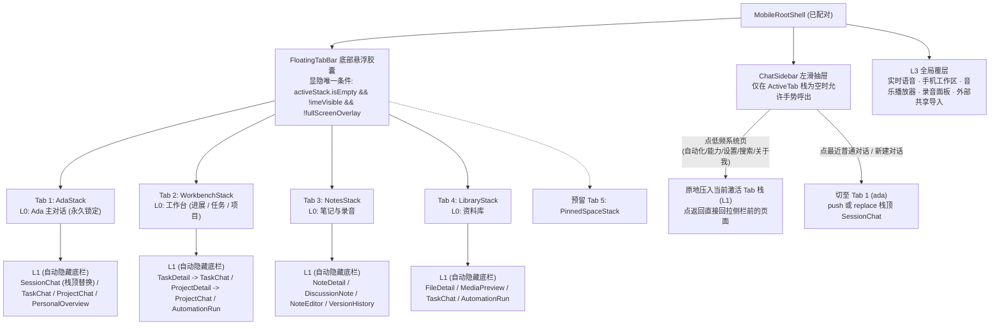

# xopc 移动端底部 Tab 与路由架构设计

> 适用范围：**仅针对原生移动端三端（iOS / Android / HarmonyOS）**，`web/` 保持不变。
> 设计基线：2026-11-27，参考 Meta Muse 移动端信息架构与 [移动端 P0 导航规范](mobile-p0-navigation-2026-11-11.md)、[三端信息架构盘点](mobile-information-architecture-audit-2026-11-11.md)。

---

## 1. 背景与产品设计理念

当前三端移动端采用「单根 Chat + 左滑侧栏抽屉 + 单栈 Push」模式，在高频使用中暴露了四个问题：
1. **高频切换路径过长**：对话、工作台、笔记、资料库之间切换必须反复「拉侧栏 → push → 返回」，三端被迫引入 `reopenSidebar / returnToSidebar` 补丁。
2. **Ada 主身份易被顶掉**：切去普通历史会话后，主屏不再是 Ada，缺少“一键回家”的稳定锚点。
3. **侧栏头部拥挤**：7 个固定功能入口把真正需要高频浏览的“最近对话列表”挤到下半屏。
4. **单栈混装脆弱**：一级功能区与二级详情页共用一个栈，导致三端返回逻辑和冷启动合成路径分裂。

### 核心设计理念：从「会话工具箱」走向「个人代理 OS」

> **1 个不可替代的主关系（Ada）负责承接意图，3 个平级工作空间（工作台 / 笔记 / 资料库）把结果从聊天流里解放出来，其余长尾普通会话与低频系统配置全部下沉至左侧抽屉。**

- **高频外露**：日常 90% 的闭环（「找 Ada 交代 → 去工作台看进展/审批 → 去笔记随手记/录 → 去资料库找交付物与文件」）在底栏拇指区 1 步可达。
- **低频下沉**：自动化、能力中心、关于我与目标、系统设置、普通历史会话列表收纳进瘦身后的左侧抽屉。
- **可演进**：首期采用 4 固定槽，数据结构预留第 5 动态槽（支持未来把自定义 Space / 本地应用 Pin 到底栏）。

---

## 2. 整体信息架构

### 2.1 底部 Floating Pill（4 固定槽 + 1 预留动态槽）

| 槽位 | Tab ID | 图标与短标签 | 挂载的 L0 根页 | 角标 / 状态 | 心智边界 |
|---|---|---|---|---|---|
| **1** | `ada` | **Ada 头像** + `Ada`（随自定义名同步） | 个人助理唯一主对话（永久锁定 `personalAgent.conversationId`） | `personalUnread` 未读数 / 运行态光点 | 长期主伙伴、语音通话、内联审批与执行 |
| **2** | `workbench` | 工作台图标 + `工作台` | 三端现有工作台（`进展 / 任务 / 项目` 三分页） | `pendingAttention` 待处理数 | 待我决定、已交付成果、进行中任务与项目 |
| **3** | `notes` | 笔记图标 + `笔记` | 笔记列表与录音捕捉 | 有待恢复录音时显示提示点 | 我随时记的 / 录的（输入态） |
| **4** | `library` | 资料库图标 + `资料库` | `SpaceLibrary`（交付成果 / 文件 / 生成媒体） | — | 整理好的交付成果、文件与媒体（资产态） |
| *5（预留）* | `pinnedSpace(id)` | 空间自定义缩略图 | 未来支持 Pin 到底栏的自定义 Space / 应用 | — | 动态快捷锚点，默认不展示 |

> **长期演进预留**：短期内三端 `Notes` 与 `SpaceLibrary` 均为成熟独立页面，拆为 4 槽落地最快、改动最小；长期可在内容模型收敛后评估将两者合并为统一的「资料 / 空间」Tab，为动态 Space 或主动建议腾出空间。

### 2.2 左侧抽屉（`ChatSidebar`）瘦身结构

移除已上移到底栏的 `工作台 / 笔记 / 资料库` 与重复的 `我的助理` 行，将首屏主体空间还给最近对话：

```text
ChatSidebar（左侧抽屉）
├─ 顶部：xopc 品牌 + 关闭
├─ 搜索对话（胶囊 → L1 ConversationSearch）
├─ 低频系统区（紧凑 3 项）
│   ├─ 自动化（Automations）
│   ├─ 能力中心（Capabilities）
│   └─ 关于我与目标（AboutYou / Goals）
├─ 对话列表区（首屏主体）
│   └─ 最近普通对话（置顶优先，支持重命名 / 置顶 / 多选删除 / 分页加载）
└─ 底部固定栏：新建对话（主按钮） + 设置（齿轮）
```

### 2.3 视觉与防误触底线

1. **标签可读性**：底栏采用悬浮胶囊（Floating Pill），使用 **图标 + 极短 2 字标签**（或未选中纯图标 + 选中态胶囊展开短标签），避免纯图标歧义；触摸热区不小于 `44pt / 44dp / 44vp`；减少透明度偏好下自动降级为实底 + 1px 描边。
2. **Ada 主屏三层叠放治理**：
   - **键盘弹起必藏底栏**：输入态下底部 Floating Pill 立即隐藏，输入框直接贴合键盘，不出现“底栏顶在键盘上方”或二次跳动。
   - **滚动收起大头像**：消息向上滚动阅读长文本时，顶部居中 Ada 大头像平滑折叠为紧凑单行顶栏，释放阅读区。
   - **物理间距防误触**：键盘收起态下，输入框位于底栏胶囊上方 **`10–12pt/dp/vp`**，输入框用实底高对比表面、底栏用轻半透明胶囊，清晰区分交互边界。
3. **全局悬浮条避让协议**：音乐迷你条（`GeneratedMusicDock / XopcMusicMiniPlayer`）和笔记录音悬浮面板统一消费壳层注入的 `bottomChromeInset`（底栏显示时 = `Pill 高度 + 间距`，隐藏时 = `0`），停靠于 `SafeAreaBottom + bottomChromeInset + 8`。

---

## 3. 四级路由分层与显隐铁律



### 层级真值表

| 层级 | 条件 | 底部 Tab | 顶栏左侧 | 左侧边缘右滑 | 典型页面 |
|---|---|---|---|---|---|
| **L0 · Tab 根页** | `activeStack.isEmpty` | **显示**（键盘起时隐藏） | `=` 打开侧栏 | 拉开左侧抽屉 | `AdaRoot`、`WorkbenchRoot`、`NotesRoot`、`LibraryRoot`（及未来已 Pin 的 `SpaceRoot`） |
| **L1 · 栈内推送页** | `activeStack.count > 0` | **强制隐藏** | `< 返回` | 系统原生右滑返回 | `SessionChat`、`TaskDetail`、`TaskChat`、`ProjectDetail`、`ProjectChat`、`NoteDetail`、`FileDetail`、`PersonalOverview`、`Automations`、`Capabilities`、`Settings`、`ConversationSearch` |
| **L2 · 局部弹层** | 临时表单 / 操作面板 | 被弹层遮盖 | 关闭 / 取消 | 下拉关闭 | `ActionPanel`、`ChatOptions`、`ShareSheet`、`GatewayProfiles`、`RenameSheet` |
| **L3 · 全局跨 Tab 覆层** | 持续运行态 | 独立覆层 | — | — | `RealtimeVoiceCall`、`PhoneWorkspace`、`GeneratedMusicPlayer` |

### 两条全局公式（替代所有硬编码路径判断）

```text
showBottomTabBar      = activeStack.isEmpty && !imeVisible && !fullScreenOverlayActive
allowSidebarEdgeSwipe = activeStack.isEmpty && !fullScreenOverlayActive
```

---

## 4. 三端统一导航状态与路由规则

### 4.1 统一状态契约

```ts
type MobileTab =
  | { kind: 'ada' }
  | { kind: 'workbench' }
  | { kind: 'notes' }
  | { kind: 'library' }
  | { kind: 'pinnedSpace'; spaceId: string };

type MobileRoute =
  // 对话域
  | { kind: 'sessionChat'; conversationId?: string; draftId?: string; agentId: string; title?: string }
  | { kind: 'taskChat'; taskId: string; conversationId?: string; projectId?: string; title?: string }
  | { kind: 'projectChat'; projectId: string; conversationId?: string; title?: string }
  | { kind: 'automationSetupChat'; projectId?: string; prompt?: string; personalSchedule?: boolean }
  | { kind: 'conversationSearch' }
  | { kind: 'personalOverview'; allowsConversationSharing: boolean }
  // 工作域
  | { kind: 'taskDetail'; taskId: string }
  | { kind: 'taskEditor'; taskId?: string; projectId?: string }
  | { kind: 'projectDetail'; projectId: string; initialSection?: string }
  | { kind: 'automations' }
  | { kind: 'automationRun'; runId: string }
  // 笔记与资料域
  | { kind: 'noteDetail'; noteId: string }
  | { kind: 'noteEditor'; noteId?: string; projectId?: string }
  | { kind: 'discussionNote'; noteId: string }
  | { kind: 'fileDetail'; fileId: string }
  | { kind: 'sessionFiles'; conversationId: string }
  // 系统与个人域
  | { kind: 'capabilities'; section?: string }
  | { kind: 'settings'; section?: string }
  | { kind: 'aboutYou'; itemId?: string }
  | { kind: 'personalGoals' }
  | { kind: 'shareCenter' };

type MobileNavState = {
  selectedTab: MobileTab;
  stacks: Record<TabKey, MobileRoute[]>;
  sidebarOpen: boolean;
};
```

### 4.2 普通对话（`sessionChat`）完整生命周期规则

1. **统一宿主栈**：无论从哪个 Tab 拉开侧栏点普通历史会话或「新建对话」，均执行：
   `sidebarOpen = false` → `selectedTab = ada` → `adaStack` 压入 `sessionChat`。
   *原因*：防止同一条普通会话在多个 Tab 栈中重复挂载导致流式订阅和草稿冲突；同时完全保护 `workbench / notes / library` 各自的栈和滚动位置。
2. **连续切换普通对话：Replace 栈顶，绝不无限叠栈**：
   - 在 `sessionChat(A)` 内通过顶栏快捷切换入口切换到 `sessionChat(B)` 时，直接替换栈顶：`[AdaRoot, sessionChat(A)]` → `[AdaRoot, sessionChat(B)]`。
   - 无论连续切换多少条普通会话，按一次 `< 返回` 永远一步回到 `AdaRoot`。
3. **顶栏补轻量「切换会话」入口**：
   - 普通对话顶栏布局：`[ < 返回 ]  [ 会话标题 + Agent 副标题 ]  [ 切换会话 / 菜单 ]`，让习惯多会话快速切换的老用户无需先退回 Ada 也能 1 步选下一条普通对话。
4. **新建草稿原地晋升（Draft → Persisted）**：
   - 发送首条消息、服务端返回真实 `conversationId` 时，**原地更新栈顶 `sessionChat` 的 `conversationId`**，禁止 `pop + push`，确保键盘不收起、页面不闪烁、流式输出不断裂。
5. **从「搜索对话」进入普通对话（保留搜索前驱）**：
   - 命中普通对话 A 时直接压在 `ConversationSearch` 之上：`[..., ConversationSearch, sessionChat(A)]`；点 `< 返回` 先回搜索结果页，方便继续筛选下一条。
   - 若命中并点击的是 Ada 主对话，则切到 `selectedTab = ada` 且清空 `adaStack`。
6. **状态隔离红线（核心技术要求）**：
   - `AdaRoot (L0)` 与 `SessionChat (L1)` **必须各自持有独立的 `conversationId` 绑定与页面会话状态**，禁止共用单个全局 `selectedConversation / activeChatId`，避免压入普通对话时冲掉底层 Ada 主对话的消息列表、草稿或正在流式输出的回复。
7. **删除 / 404 / 前后台 / 冷启动**：
   - 当前打开的普通对话被删除或不可用时，自动 `pop()` 退回 `AdaRoot` 并清理本地草稿。
   - 切后台再回前台：原样保留在 `sessionChat`。
   - 杀进程冷启动：默认落在 `AdaRoot`（底栏可见，强化 Ada 第一入口；最近普通对话位于侧栏首条）。

### 4.3 任务对话与项目对话规则

- **就地压栈**：遵循 [mobile-p0-navigation-2026-11-11.md](mobile-p0-navigation-2026-11-11.md)，由哪个 Tab 发起就压入哪个 Tab 栈：
  - `AdaRoot` 或 `SessionChat` 任务卡 → `adaStack`: `[..., taskChat(id)]`
  - `Workbench → TaskDetail` → `workbenchStack`: `[taskDetail(id), taskChat(id)]`
  - `Workbench → ProjectDetail` → `workbenchStack`: `[projectDetail(pid), projectChat(pid, cid)]`
  - `Library` 来源任务 → `libraryStack`: `[taskChat(id)]`
- **防环去重**：在 `taskChat(id)` 查看 `taskDetail(id)` 后再点「继续任务」，若 `stack[last - 1] == taskChat(id)` 则直接 `pop()`，不重复压栈。

### 4.4 侧栏低频页与 Tab 切换规则

- **侧栏低频页（`自动化 / 能力 / 设置 / 搜索 / 关于我`）**：关闭侧栏后**直接压入当前激活 Tab 的栈顶（L1）**；点 `< 返回` 回到拉侧栏前的页面。彻底删除 `reopenSidebar` 和 `returnToSidebar`。
- **Tab 切换保活**：切到另一个 Tab 时完整保留原 Tab 的栈和滚动位置。
- **再次点击当前已选中 Tab（Active Re-tap）**：
  - `activeStack.count > 0` → 执行 `popToRoot()` 回到根页；
  - 已在根页 → 滚回顶部（`ada` Tab 滚回最新消息底部；`workbench` 切回默认 `进展` 分页并滚顶）。
- **Ada 未读消隐条件**：仅当 `selectedTab == ada && stacks[ada].isEmpty && !sidebarOpen && appInForeground && !fullScreenOverlayActive` 时才标记已读；压入 `sessionChat` 或切去其他 Tab 后立即恢复红点计数。

### 4.5 系统返回键 / 手势消费优先级（Android & HarmonyOS）

单入口按严格顺序每次只消费一层：
1. 收起软键盘 / 关闭输入扩展面板（`actionPanel`） / 关闭 L2 弹层（Sheet / Dialog）
2. 关闭左侧抽屉（`sidebarOpen = false`）
3. `activeStack.isNotEmpty` → `activeStack.pop()`
4. `activeStack.isEmpty && selectedTab != ada` → 切回 `selectedTab = ada`
5. 已在 `ada` 根页 → 交还系统退到后台

### 4.6 推送冷启动 / 站内链接 / 外部共享 / Gateway 切换

| 外部触发目标 | 目标 Tab | 合成栈（保证返回有合理上级） |
|---|---|---|
| 推送 / 链接指向 Ada 主对话 | `ada` | `[]`（直接落 `AdaRoot`） |
| 推送 / 链接指向普通会话 `cid` | `ada` | `[sessionChat(cid)]` |
| 推送指向任务详情 `tid` | `workbench` | `[taskDetail(tid)]` |
| 推送冷启动指向任务对话 `tid` | `workbench` | `[taskDetail(tid), taskChat(tid)]` |
| 推送指向自动化运行 `rid` | `workbench` | `[automations, automationRun(rid)]` |
| 外部共享保存到笔记 `nid` | `notes` | `[noteDetail(nid)]` |
| 外部共享发送到某普通会话 `cid` | `ada` | `[sessionChat(cid)]` |
| 打开应用设置某分区 | 当前 Tab | `[..., settings(section)]` |

- **切换 / 移除 Gateway Profile**：原子性清空全部 Tab 栈（`stacks.clearAll()`）、关闭侧栏、重置 `selectedTab = ada`、清理旧 Gateway 未读和返回上下文。
- **未来动态 Pin 空间裁决**：收到 `space(spaceId)` 路由时，若 `spaceId` 已 Pin 在底栏，切至 `pinnedSpace(spaceId)`（L0，底栏可见并高亮）；否则压入 `libraryStack`（L1，隐藏底栏）。

---

## 5. 三端原生改造落点

| 平台 | 核心改造文件 | 关键改动 |
|---|---|---|
| **iOS (SwiftUI)** | [AppState.swift](../../apps/mobile-ios/XopcMobile/App/AppState.swift)、[AppRootView.swift](../../apps/mobile-ios/XopcMobile/App/AppRootView.swift)、[ChatSidebarView.swift](../../apps/mobile-ios/XopcMobile/App/ChatSidebarView.swift) | `homePath` 升级为 `selectedTab + tabPaths`；根部用 `ZStack` 保活 4 个独立 `NavigationStack` + 自定义 `FloatingTabBar`；新增 `.sessionChat` 路由并隔离 `AdaRoot` 与 `SessionChat` 的会话状态；侧栏精简；移除 `reopenSidebar`。 |
| **Android (Compose)** | [MainScreen.kt](../../apps/mobile-android/app/src/main/java/ai/xopc/mobile/ui/main/MainScreen.kt)、[ChatSidebar.kt](../../apps/mobile-android/app/src/main/java/ai/xopc/mobile/ui/main/ChatSidebar.kt) | 抽出 `MobileTabNavState`（4 条 `SnapshotStateList` + `rememberSaveableStateHolder`）；10+ 分散 `BackHandler` 收敛为 1 个优先级入口；挂载 `FloatingTabBar` 响应 `WindowInsets.isImeVisible`；隔离 Ada 与普通对话状态；移除 `returnToSidebar` 与 `linkedDetails`。 |
| **HarmonyOS (ArkUI)** | [HomeView.ets](../../apps/mobile-harmony/entry/src/main/ets/view/HomeView.ets)、[ChatSidebar.ets](../../apps/mobile-harmony/entry/src/main/ets/view/ChatSidebar.ets)、[home.ets](../../apps/mobile-harmony/entry/src/main/ets/model/home.ets) | 改为 4 个保活的 `Navigation(tabStacks[tab])` + 自定义悬浮 `XopcFloatingTabBar`；`XopcWorkbenchView` 升级为 `workbench` Tab 根页（左上角由返回改为 `=` 抽屉）；新增 `session-chat` 独立页；移除 `returnToSidebar`。 |

---

## 6. 三端统一真机验收清单

1. **底栏与键盘联动**：在 `Ada` 根页反复唤起/收起键盘，确认底栏平滑隐藏/恢复且不跳动；输入框与底栏间无误触；长对话滚动时 Ada 大头像正常折叠。
2. **多栈独立保活**：在 `工作台` 进入某项目详情，切到 `Ada` 发消息再切回 `工作台`，确认仍停留在项目详情；再次点击底栏 `工作台` 一键回到根页。
3. **普通对话全链路**：从 `工作台` 拉侧栏打开普通对话 A → 切到普通对话 B（Replace 栈顶）→ 点 `< 返回` 一步回到 `AdaRoot` 且底栏恢复；验证底层 Ada 草稿与流式输出未被普通对话覆盖。
4. **新建草稿晋升**：侧栏点「新建对话」发送首条消息，确认晋升真实 ID 过程中键盘不收起、页面不闪白、流式输出连续。
5. **任务对话返回与防环**：从 Ada、普通对话、工作台任务详情、资料库四个入口打开同一任务对话，均能返回各自直接来源；`TaskChat → TaskDetail → 继续任务` 不重复压栈。
6. **异常与冷启动**：推送冷启动直达任务对话时，依次返回符合 `任务对话 → 任务详情 → 工作台`；删除当前正在浏览的普通对话自动退回 `AdaRoot`；切换 Gateway 清空全部旧栈。
