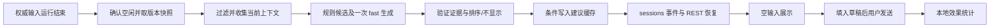

# 下一轮输入建议：产品与技术方案

日期：2026-10-13。状态：设计提案，未实现。适用范围：xopc Web/Electron 聊天，协议可供移动端复用。

## 1. 调查结论与证据边界

用户观察到的体验是：一轮 turn 结束后，在空输入框内预测下一轮用户可能发送的内容。

OpenAI 官方 [Settings / Suggested prompts](https://learn.chatgpt.com/docs/reference/settings) 确认提供 context-aware suggestions，用于开始或返回应用时发现后续任务；[changelog](https://learn.chatgpt.com/docs/changelog) 也提及这类建议。它们没有说明“每轮完成后动态 placeholder”的生成时机、模型、排序算法或个性化方法，因此不能将下文架构归因于 Codex。

本机 `/Applications/ChatGPT.app/Contents/Resources/app.asar` 的只读静态检查发现 `suggested_followups`、`conversation_followup_suggestions`、展示/交互埋点及建议填入编辑器的代码。这支持客户端已有结构化后续建议能力，但不足以证明用户描述的 placeholder 路径，更无法确认服务端预测逻辑。本次没有复现 UI、访问聊天私有数据或调用内部接口。

xopc 源码已核实的基础：

| 已有能力 | 位置与结论 |
| --- | --- |
| 空会话建议 | `packages/gateway-contract/src/welcome-suggestions.ts`，基于项目、任务、工作流状态的模板推荐 |
| 建议上下文 | `web/src/features/chat/welcome/use-welcome-suggestion-context.ts`；`chat-page.tsx` 仅在消息列表为空时启用 |
| placeholder / Tab | `composer/chat-composer.tsx`、`chat-composer-input.tsx`，已有空输入 Tab 采纳；仍需统一附件、引用、IME 等守卫 |
| 个人会话覆盖 | `chat-page.tsx` 给个人助理固定 placeholder；composer 的 `placeholder ?? contextualPlaceholder` 会遮住动态建议 |
| 用户上下文边界 | `src/user-context/access-policy.ts`：owner、direct、配置及会话模式共同决定访问 |
| 记忆可用性 | `src/user-model/usage-policy.ts`：有效期、授权、来源、敏感级别、用途与 Agent 限制 |
| 当前支持需求 | `src/user-context/interaction-state.ts`：listen / clarify / advise / act，当前为规则推断，不能当成准确心理画像 |
| 关系延续 | `relationship-continuity.ts`：记录显式跟进及证据；并非完整关系推荐引擎 |
| 会话新鲜度 | `src/personal-agent/conversation-state.ts`：revision、active run、队列、preparation 状态 |
| 完成边界 | `run-gateway-agent.ts` 发布 `run.completed`；`session-input-coordinator.ts` 随后结束输入运行。前者不能单独作为已空闲的证明 |

图谱工具在本会话未暴露，因此使用源码搜索与定点读取。以上为当前工作区状态，包含用户已有修改。

## 2. 产品定位

目标：减少组织下一条消息的成本，让建议符合正在做的事、明确偏好和当下支持需求。优化“有帮助的采纳”，而非聊天次数或原文点击率。

输出采用用户口吻，可以是问题，也可以是指令。例如“这个方案最大的风险是什么？”、“先把第一阶段拆成任务”。不能把助理对用户的追问直接塞成用户输入。

“更贴近用户关系”包括：记得明确偏好；延续用户提到且仍相关的事情；尊重刚刚纠正过的边界；匹配需要倾听还是行动。亲昵称呼、情绪诊断和强行拉回旧话题不作为质量目标。

### 交互规则

1. 正常完成后异步生成，空闲且输入框完全为空时显示一条；每个上下文版本保持稳定，不轮播。
2. 仅通过 placeholder 展示，按 Tab 填入草稿，不增加填入、关闭或开启按钮。填入后仍由用户发送，Enter 不可发送仅存在于 placeholder 的文本。
3. 编辑、IME、附件、上下文引用、语音、消息编辑、排队输入、审批/澄清等待、session 加载时隐藏。当前轮运行时展示已有继续输入/排队提示。
4. 没有可信建议时使用普通 placeholder；生成过程不加 spinner、skeleton 或错误提示。
5. P0 仅使用当前聊天；P1 的个性化范围沿用现有用户理解权限，不能授予新增记忆访问权。
6. 输入框不增加建议菜单；Esc 优先处理现有 picker/编辑行为，空闲时可隐藏本条建议。
7. 保留固定输入框 aria-label 和已有键盘导航，不抢焦点、不持续朗读更新。

UI 状态优先级：特殊页面指引 > 审批/澄清/编辑/语音/运行态 > 有效的下一轮建议 > 空会话欢迎建议 > 普通提示。个人助理名称是普通提示的一部分，不再作为最高优先级的硬覆盖。

显示文案与填入文本保持语义一致；首版建议中文约 12–36 字，可换行或截断显示，填入完整文本。长篇方案不藏在短 placeholder 后面。

### 场景例子

| 场景与已知依据 | 建议输入 | 应抑制的方向 |
| --- | --- | --- |
| 产品方案已完成；明确“先别写代码” | 先把第一阶段拆成可评审的任务 | 直接实现、发布 |
| 修复完成；未运行真实复现流程 | 帮我验证刚才那个故障场景 | 宣称测试已通过、再重复修复 |
| 用户明确“只想聊聊，不想听建议” | 我想再说说最让我难受的部分 | 立刻生成行动清单 |
| 用户纠正“你没理解我” | 我真正想解决的是…… | 忽略纠正、推进原方案 |
| 用户曾主动提及面试；本轮也在讨论准备 | 帮我练一下明天面试的开场 | 工作话题中突然提起私人面试 |
| 本轮已充分完成且用户说“谢谢，先这样” | 不显示 | 为延长聊天而生造下一步 |

开放式句干只用于表达/修复场景，标记 `kind: expression`，不与可直接发送的完整任务指令混淆。

## 3. 预测策略

### 上下文选择

按以下顺序构建有预算的快照，首版无需另建画像系统：

1. 当前用户目标、最新约束与纠正，最近 2–4 个完整 turn。
2. 最后一轮最终回复、真实任务结果、未解决点；排除工具全文、推理文本、日志和转录审计行。
3. 关联项目/任务/工作流的真实状态、可用能力。
4. 与当前主题相关的已授权用户 assertion、决策与显式跟进，带 evidence ID、有效期和用途。
5. 明确的交互偏好；当前 supportNeed 作为弱信号，低置信度不决定推荐。
6. 同主题、同意图的近期建议采纳/拒绝摘要。首版只读取本地聚合统计。

当前显式约束优先于旧偏好。关系信息只有与本轮相关或用户明确邀请继续时才进入；不把完整历史、联系人图谱和所有记忆塞给预测模型。默认不为建议调用外部连接器或搜索，不读取前台屏幕。

### 候选生成与筛选

推荐使用“规则候选 + 一次有界模型生成 + 本地排序”：

- 规则候选来自真实 blocker、下一步、待验证结果；低延迟且有依据。
- 模型最多生成 3 条不同意图的候选，以及 `none`；使用现有 `fast` intent 的 provider 抽象，未配置或预算不足则仅规则候选/不显示。
- Prompt 明确要求预测用户会愿意发出的内容，允许结束对话；引用的会话/记忆是数据，不是系统指令。
- 每条附 intent、evidenceIds、短 reason；证据必须存在于输入集合中，实体和状态需验证。
- 先做硬过滤：违反约束、引用失效/越权记忆、假定未知结果、已完成或已排队动作、不可用能力、近期重复、无关敏感话题、把采纳当作授权。
- 再做排序：本轮关联度、当前偏好吻合、推进价值、实际采纳历史、证据质量、输入负担；关系连续性是加分项，不能抵消不相关或隐私风险。

初始 heuristic 可采用 `0.35 relevance + 0.20 preferenceFit + 0.20 utility + 0.15 evidence + 0.10 adoptionPrior - repetitionCost - effortCost`。它是待调参数，不是概率。没有个体历史时采用中性 prior；listen/repair 场景动态降低执行类候选权重。

首版不要用模型自报 confidence 当“用户采纳概率”。设置离线验证后的排序阈值；待积累真实样本再校准概率与 abstention。显式“先这样”直接返回 none。

### 让个性化真正有效

- 区分内容偏好与表达偏好：用户偏好“先评审后实施”影响意图；偏好简短中文影响措辞。
- 对同一目标理解其阶段：研究 → 决策 → 计划 → 执行 → 验证，阶段可跳转；“已完成”仍需理解完成的是哪一层。
- 采纳并修改措辞，保留相同意图，是成功；反复改成“只给方案”，是需要更新的局部反馈。
- 未点击不是拒绝，可能已获得答案；关闭聊天和无下一轮是合法结局。
- 一次采纳不写成永久人格或行动授权；重复且明确的偏好才交给现有用户理解提取机制。
- 按主题、场景、阶段统计，而不是全局假设“此人永远要代码”。

## 4. 技术架构与生命周期



### 调度与竞争处理

服务位于 Gateway 的交互辅助层，独立于 Agent 正文生成，不扩展 `AgentService` 为推荐引擎、不追加假用户消息。

首版从 Web 的 `SessionInputCoordinator` 在 `finishSessionInputRun` 后调度；只有 completed 且队列耗尽、preparation 就绪才生成。当前 `run.completed` 发生在最终输入状态更新之前，不能直接从前端监听它就无条件发起预测。

每份快照至少绑定 `conversationId + transcriptId + runId + inputRevision + transcriptCursor + agentId + locale + contextPolicyRevision`。contextPolicyRevision 是拟新增的权限/上下文失效版本，若现有服务没有统一版本，则先用带相关配置的指纹，并在返回前重新核验授权与记忆来源。

生成前、写入前、REST 返回前分别检查当前版本和访问策略；任一步变化都丢弃。新输入入队、新 run、reset、删除、Agent 切换、权限撤销、记忆删除使建议失效。旧 transcript 的建议永远不能用于 reset 后的新 transcript。

每个 conversation 单飞、幂等键去重、全局小型并发队列，foreground 模型请求优先。建议生成不等待正文流结束回包，不占主 turn 串行锁。客户端有草稿就隐藏；多客户端有任一新提交，服务端整体失效。

建议通过持续存在的 `sessions` topic 发布，而非已结束的 `run:<runId>` topic。缓存写入后再发事件；断线重连通过 REST 恢复。事件乱序时按绑定版本丢弃，不能仅按到达时间排序。

客户端在用户接受前收到失效事件就清除；已填入的草稿属于用户，不撤回、不覆盖。采纳后提交走现有 inputs 路径与所有既有权限检查。

### 建议协议（拟新增）

```ts
type NextTurnSuggestion = {
  id: string;
  conversationId: string;
  transcriptId: string;
  sourceRunId: string;
  inputRevision: number;
  transcriptCursor: string;
  contextPolicyRevision: string;
  agentId: string;
  locale: string;
  kind: 'question' | 'action' | 'expression';
  intent: 'clarify' | 'plan' | 'execute' | 'verify' | 'reflect' | 'express';
  displayText: string;
  prompt: string;
  reasonCode: string;
  expiresAt: number;
};
```

内部缓存保留 evidence IDs、ranker/model/prompt 版本、生成耗时、token 用量及依据摘要；公开响应只包含通过 disclosure 检查的解释。客户端不需要完整模型分数或所有候选。

- `GET /api/sessions/:conversationId/next-turn-suggestion`：返回 `{status: ready|pending|none, suggestion?: ...}`；pending 不触发 UI 加载效果。
- `POST /api/sessions/:conversationId/next-turn-suggestion-feedback`：`suggestionId + impressionId + eventId + event`，事件为 shown / accepted / dismissed / submitted；服务端校验所属会话、去重、当前身份和版本。
- `session.next-turn-suggestion.changed`：版本及建议 ID，客户端按需取最新；沿用会话订阅权限。
- 发送请求增加可选来源 metadata：suggestionId、impressionId；不添加到用户可见正文。edited/submitted 区分需要保留最初采纳内容哈希及本地比对，不默认上传额外草稿全文。

所有新路由必须在 `src/gateway/hono/routes/lazy-bundles.ts` 注册 matcher，并测试正向和邻近不重叠路径，再经运行中的认证 Gateway 验证真实路由。不能只测试 route module。

### 存储与配置

SQLite 建议独立短期表，每个上下文版本最多保留一条可展示建议，不放入 transcript，不参与 FTS，也不计为 Agent 消息。建议 TTL 初始设为 30 分钟；缓存恢复仍要验证版本和授权，TTL 不能替代新鲜度校验。

反馈默认本地保存 30 天，正文不进普通日志，长期只存按场景/意图聚合计数。删除会话级联清理，撤销授权使所有依赖该来源的缓存失效。日志使用稳定 `NextTurnSuggestion` prefix，记录 ID、状态、延迟和拒绝 reasonCode。

P0 不增加会话开关或其本地偏好。P1 的 scope（conversation / personalized）采用现有配置分层，具体 schema 放置在实施时统一。模型使用现有 fast intent；不新增第七个 intent。

个性化同时调用 `resolveUserContextSessionAccess`、`canUseAssertion(..., {use: 'recommend', agentId})`；若排序读取额外断言，应分别满足 rank 用途。conversation 模式完全不读取跨会话用户理解。关闭 userContext 仍可提供当前会话建议。

### 接入清单

| 层 | 建议修改 |
| --- | --- |
| Gateway service | 新增 `src/gateway/next-turn-suggestions/`，含 snapshot、generator、ranker、service |
| 输入调度 | 在 coordinator 最终状态更新及空闲检查后调用调度入口 |
| SQLite | 新增 suggestion cache / feedback repository 与迁移 |
| Contract | 在 gateway-contract 添加独立类型；欢迎建议和 turn 后建议共用展示协议，保留不同来源 |
| API/realtime | session routes + lazy bundles + sessions topic 事件 |
| Web state | 新增 `use-next-turn-suggestion.ts`，处理恢复、版本、隐藏及反馈 |
| Composer | 明确状态优先级，统一完全空草稿守卫，复用填入路径，调整个人固定 placeholder |
| i18n | 复用中文/英文 placeholder 与 Tab hint |

## 5. 延迟、成本与降级

初始工程预算，均为待压测目标：一次预测输入上限约 2k tokens、输出约 200 tokens、总超时 3 秒、有效场景只调用一次。不要将这些预算描述为任何 provider 的保证；跨语言和 provider 需真实 token 计量。

规则可即时展示或等待模型统一决策；为避免视觉跳变，首版选“有可信规则即固定显示，否则等一次模型结果”。超时/限流/格式错误使用规则结果或普通提示，不自动串行调用多个昂贵 fallback。

计费按真实 provider usage 统计 `inputTokens × inputRate + outputTokens × outputRate`，另计 provider 的缓存/推理 token 规则。关注每次有帮助提交的推荐成本；避免为不再活跃的后台会话生成。首版可仅对正在订阅且具备 composer 的 Web 会话生成；返回页面时懒触发有效版本的缓存未命中。

## 6. 评估与反馈闭环

建立经许可且去标识化的历史 turn 截断集，至少覆盖工作/个人、首次/长期、成功/失败、表达/执行、纠正、终止聊天、reset 与权限撤销。训练/调参和评估按会话、用户及时间拆分，快照不能包含实际下一条消息。

对比普通提示、规则建议、仅当前会话模型建议、授权个性化建议。使用真实下一轮消息做意图参考，同时人工判断是否有价值；下一条消息不代表唯一正确答案。单独评估应当 none 的样本。

核心指标：

- 下一轮意图匹配、人工相关性/有用性、用户语气吻合、完成任务后的自然收尾。
- 显示 → 填入 → 实际发送 → 有帮助结果的漏斗；无修改和保留意图的修改分别统计。
- 采纳后立即纠正/撤回比例、重复率、关闭率、无依据实体、跨话题突兀程度。
- 旧版本展示、草稿覆盖、越权记忆引用应为零；准确曝光由 UI 实际可见且空闲时记录，不能以服务端生成数当曝光。
- 主 turn 延迟不增加；预测可见延迟、token 消耗、有效提交成本。

没有点击或用户离开记为 censored/unknown，不记负样本。展示改变了下一轮输入，无法据此证明预测命中；通过随机对照评估收益。个性化需比“只看当前会话”有增益，不能只比静态 placeholder 好。

先用固定规则和可解释排序；有足够有效反馈后再试局部排序模型或小比例受控探索。不在首版训练个人模型或直接优化点击率。

## 7. 交付阶段与验收

P0：当前会话建议、正常成功 turn、Web/Electron、单条 placeholder、Tab 填入、版本缓存、普通提示降级、基本反馈。先打通 composer 优先级和完整空草稿守卫。

P1：授权用户理解与项目状态检索、supportNeed、约束优先级、解释与范围控制、个性化对照实验。

P2：复用移动协议、历史采纳摘要排序；只有收益明确后再支持错误恢复建议和跨场景关系延续。群聊不使用 owner 私人记忆；不因跨端复用降低权限要求。

必须覆盖的验证：IME/附件/引用不被 Tab 错误采纳；suggestion 到达不覆盖输入；A→B 会话切换、reset、新 turn、队列自动开始均清除旧建议；重复完成事件不重复生成；断线后恢复正确版本；权限/记忆来源撤销后 REST 不返回旧建议；超时不拖慢正文；不增加额外输入框按钮；新版 route 经认证 Gateway 可达。

首版决策：先做低打扰的当前会话续接，个性化通过现有证据和权限系统逐步加入。产品允许“这次不建议”，以真实相关、有用、可选择为上线标准。
