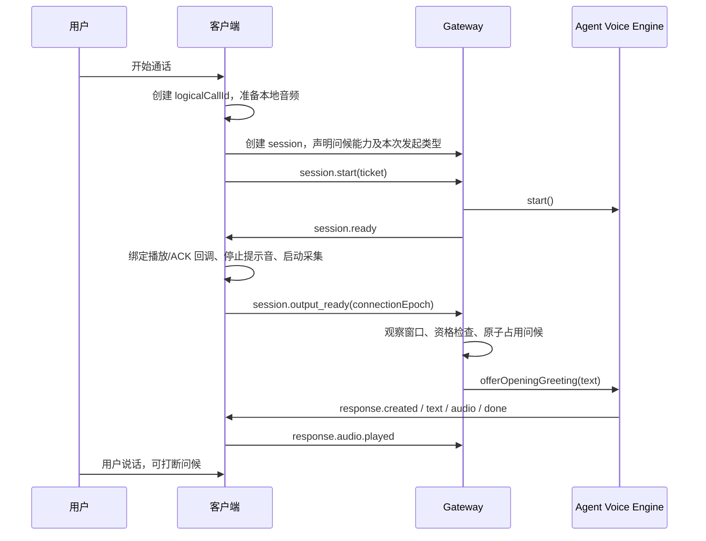

# Personal AI 实时助手连接问候：产品与技术方案

日期：2026-10-11。状态：已实现，待真实云端 TTS 与真机通话验收。Web/Electron 和三个移动端已接入。

## 1. 产品决策

用户主动开始 Personal AI 实时助手通话后，助手先说一句简短、自然的问候，确认已经接通，然后留出空间让用户说话。

推荐默认文案：**「嗨，{称呼}，我在。」**。当前用户资料以 `callName` 存储用户确认的名称/称呼，直接复用它；无名称时说「嗨，我在。」。英语为「Hi, {name}. I'm here.」，无名称时省略名字。语言沿用本次通话语言，缺省使用客户端语言，不根据姓名猜测语言。

第一版使用有限的本地文案模板与当前选定音色，不调用 LLM 生成开场。这样可以控制长度、耗时和内容，也不会因问候触发工具或后台任务。人格通过声音、称呼和简洁表达体现。后续再考虑基于已确认上下文的开场。

### 触发与不打扰规则

| 场景 | 行为 |
| --- | --- |
| 用户点击开始 Personal AI 实时助手通话 | 音频输出与输入链路就绪后，短暂观察，再问候一次 |
| 打开 Personal AI 页面、连接普通 Gateway WebSocket | 不触发 |
| 语音听写、普通 Agent 通话、natural 模式 | 不触发；第一版限定 Personal AI assistant 模式 |
| 自动重连、备用地址切换、同一通话暂停后恢复 | 不重复问候 |
| 用户结束通话后重新点击开始 | 视为新通话，可再次问候 |
| 用户在问候开始前已经开口、提交文本，或会话已有运行 | 跳过问候，不延迟到后续空闲时补播 |
| 用户正在听问候时开口或点击停止播放 | 结束问候，接续用户输入；不重播 |
| 客户端输入静音 | 仍可问候；静音只控制麦克风。音频输出未就绪时不播放 |
| 问候失败、超时、用户挂断 | 放弃本次问候，保持正常通话能力 |

问候推荐 1 句话、2–4 秒。连接完成后观察约 300 ms，未发现用户输入且会话空闲时开始；超过客户端就绪后 2 秒仍未发送首帧，则取消。以上是初始目标，需要真实 TTS 与各端测试校准。麦克风采集从就绪起正常运行，不能等问候结束才启动。

只采用已经确认的称呼，不提及任务结果、个人隐私、推测情绪或上次话题。不使用「我一直在等你」等制造依赖的表达，不循环追问用户，不因用户沉默继续说话。

### 界面与偏好

- 连接中继续沿用现有呼叫提示；就绪时停止提示音，问候期间显示现有「正在说话」状态，完成后回到聆听。
- 字幕显示实际问候文本，使用现有实时回复区域；不插入伪造的用户消息，不出现任务执行卡。
- Personal AI 语音设置增加「连接时打招呼」开关，默认开启。它与后台「主动消息」偏好独立：关闭后台跟进不会关闭用户主动拨打后的问候。
- 单次问候失败以普通已连接状态结束，不显示页面级错误或要求用户重连；服务端记录诊断。

## 2. 当前代码与关键约束

本次代码核查发现：

1. `src/voice/realtime/runtime.ts` 在 `engine.start()` 完成后发送 `session.ready`，目前没有连接问候调度。
2. `src/voice/realtime/agentEngine.ts` 已包含流式 TTS、PCM 帧、播放 ACK/背压、停止与回声处理。`offerTaskUpdate()` 通过 `runAssistantTurn()` 再执行 Agent，不能直接用它播放问候。
3. `web/src/features/voice/realtime/use-realtime-voice.ts` 在连接 Promise 返回后才设置 `clientRef`、启动采集。服务端在发送 `session.ready` 后立即发问候，存在客户端尚未完成本地准备的竞态。
4. `src/personal-agent/repository.ts` 已按 conversation 查询 Personal AI，并提供显示名、用户称呼和音色偏好，可复用；不能通过 conversation ID 字符串形式识别 Personal AI。
5. `packages/realtime-protocol/src/voice.ts` 为 v3 协议，创建请求、响应和事件使用严格 schema。扩展字段必须有兼容协商，不能直接向所有旧端发送新字段或新事件。
6. 各移动端已有连接恢复，需要区分用户发起的一场通话与每次 Gateway `sessionId`。当前 `sessionId` 与 `connectionEpoch` 不能直接承担跨重连问候去重。

另见 [移动端实时语音调查](./mobile-personal-ai-voice-investigation-20261011.md)：该记录仍列有云端 TTS 故障与后台最终回复未接入实时播报的问题。本方案复用 TTS 时必须验证实际服务状态；问候设计本身不解决这些问题。

## 3. 技术架构

Gateway 负责资格判断、去重、文案和调度；客户端负责告知本地音频已经就绪，并正常播放 response。四端共享行为契约，避免每端自行决定问候文本与播放时机。



### 3.1 协议与兼容

建议在 v3 上使用显式能力协商，媒体帧格式保持不变：

- status 响应新增可选顶层 `openingGreeting` 能力标识。现有 status 顶层为非严格对象，旧 Web 解析器可忽略未知顶层字段；移动端仍需兼容测试确认。不要直接向严格的 `capabilities` 对象追加字段。
- 新客户端仅在 status 宣告支持时，在创建 session 请求中发送可选 `openingGreeting: { logicalCallId: UUID, initiation: 'user' | 'recovery', supportsOutputReady: true }`。该字段表示客户端支持就绪事件，实际就绪仍需后续事件确认。
- Gateway 仅对已协商的请求在创建响应中返回 `openingGreeting: { accepted: boolean, greetingResponseId?: string }`；接受时预分配 response ID，供客户端识别可选开场。未协商请求的响应维持原结构。新端连旧 Gateway 时省略上述请求字段，并保持无问候的现有行为。
- 新增客户端事件 `session.output_ready: { connectionEpoch }`，仅在服务端接受能力后发送。Gateway 验证已认证、session 已 ready、epoch 一致，同一 epoch 的重复事件幂等忽略。
- 问候完全使用已有 `response.created`、`response.text.*`、`response.audio.*`、`response.done/cancelled` 和 PCM 帧，不修改这些事件 payload。来源标记保留在引擎和日志内部。

事件名称表示输出就绪，但发送条件包括本地采集已开始或明确静音。未收到此事件时绝不启动问候，不影响正常输入。若各端协议兼容测试证明不能扩展 v3，再升级协议版本，不能绕过严格校验。

不需要为问候增加独立 REST 路由。如实施中增加或移动认证 API，必须同步 lazy-bundle matcher、映射测试及真实鉴权 Gateway 路径验证。

### 3.2 一场通话的身份与去重

`logicalCallId` 是新字段，由客户端在用户点击开始时生成；自动恢复与暂停恢复保留，用户结束后重新开始则生成新值。Gateway sessionId 与 connectionEpoch 仍用于单次连接身份与媒体隔离。

服务端以 `(principalId, conversationId, logicalCallId)` 作为去重键，不能信任客户端提供的身份或资格。`initiation='recovery'` 一律跳过开场，即使上一连接尚未播放问候。这样恢复连接的目的始终是继续交流。

推荐用 SQLite 的有界通话开场记录，存储状态、关联 session/response、时间和 skipReason；不保存完整问候正文或凭证。使用唯一约束与原子状态更新取得唯一发送权。终态保留 24 小时后清理；待发送状态有截止时间，Gateway 重启后过期记录直接放弃，不重新播报。初始状态：

```text
pending -> claimed -> completed
                   -> interrupted / failed / expired
pending -> skipped / expired
```

占用后发生故障也不自动重播，保证同一通话最多一次播放尝试。音频设备上的「确实被用户听见」无法严格证明；`completed` 仅表示音频播放 ACK 已满足完成条件。记录发送首帧和完成 ACK 分开统计，不能把 TTS 成功当作播放成功。

### 3.3 直接播报入口

给 `VoiceEngine` 增加可选 `offerOpeningGreeting({ greetingId, text, deadlineAt }): Promise<OpeningGreetingResult>`。返回值明确区分 `completed`、`skipped`、`interrupted`、`failed` 和 `expired`，不能用单一 boolean 兼指接收与播放完成。

Agent 引擎抽取共用 response 生命周期和语音输出，增加内部来源 `user_turn | task_update | opening_greeting`。问候直接进入已有 TTS，不走 agentBroker，不产生 task.created，不触发工具，不新增 LLM 调用。

复用 `claim.tts` 的冻结配置，包括个人音色、输出格式、PCM 分帧、背压、播放 ACK、取消与资源释放。短文案必须直接 flush 给 TTS，不能被已有首句分段的最小字符数阈值卡住。截止时间覆盖 TTS 准备与首帧生成，取消时释放迟到的 provider 连接。

问候、用户回复、后台播报共享一个活动 response 和排队机制。只有空闲时才允许问候取得播放权；取得后其他回复必须等待它终止或明确取消，不能并发发送音频。

未来后台最终回复也可复用抽出的直接文本播报基础能力，但该结果交付改造是独立工作，本期不扩展 outbox 语义。

### 3.4 用户输入优先与回声

观察窗口、TTS 准备、首帧发送前都检查输入代次、turn 状态、文本输入和 session busy。任一真实输入发生后，待播问候立即作废；终态不能回到 pending。

问候未开始播放时，VAD speech_started 就足以保守跳过：可能少说一次招呼，也不能抢用户第一句话。已有文本请求或 Agent 运行时同样跳过，不能只检查音频输入。

播放期间，VAD 和 partial ASR 可能包含扬声器回声，复用现有 finalized non-echo 判定与 PlaybackEchoCandidates。问候加入 audibleText 和尾部回声候选；用户点击停止立即取消，确认非回声发言后取消问候并提交完整输入。问候始终允许用户打断，不受普通回复 bargeIn 关闭设置限制。第一版沿用现有 final-ASR 打断时机，不能承诺仅靠 VAD 即时停声；需要通过真机测试评估延迟。

挂断、旧 socket 回调、epoch 失效和新连接替换时取消定时器及 TTS。旧 response 音频不能流入新连接；重复 ready/ACK 不得重新调度。

### 3.5 存储、偏好与错误

问候字幕只属于当前通话，不写入普通聊天 assistant 消息或 LLM 历史；去重记录承担运行审计。如未来需要历史展示，应增加明确的 call event，避免每次通话把「嗨」塞进模型上下文。

在 Agent Catalog 的个人资料中新增结构化 `voiceCallPreferences.openingGreetingEnabled`，默认 true；不混入影响人格提示词的 responsePreferences，也不复用后台 proactivity。扩展现有 Personal AI 设置接口与校验、四端设置和 repository 投影；本次连接冻结偏好，下次新通话应用更新。

问候的失败与普通问答失败区分：发送取消/完成事件清除客户端 response 状态，记录 opening_greeting_failed，继续聆听。四端按创建响应中协商的 `greetingResponseId` 识别开场，不对这次没有音频的可选开场弹出 NO_RESPONSE_AUDIO 提示，不通过文案猜测。引擎沿用该 ID；未问候时不发送对应 response。

不得吞掉 STT、鉴权或媒体传输的致命错误。2 秒内未出首帧只终止问候，底层会话错误仍按现有恢复策略处理。

## 4. 实施拆分

| 步骤 | 主要改动位置 | 完成标准 |
| --- | --- | --- |
| 1. 契约与设置 | `packages/realtime-protocol/src/voice.ts`、Agent Catalog profile schema、Personal AI 设置接口和 repository | 能力协商、偏好、logicalCallId、就绪事件和问候 response 身份定义完整 |
| 2. 语音输出 | `src/voice/realtime/engine.ts`、`agentEngine.ts` | 直接短文本播报，完整取消/ACK/资源释放，零 Agent 与工具调用 |
| 3. 服务端策略 | `runtime.ts`、`runtime.types.ts`、新增 greeting policy 与 SQLite repository/migration | Personal 身份和权限校验、输入优先、截止时间与原子去重 |
| 4. Web/Electron | `voice-session-client.ts`、`use-realtime-voice.ts`、Personal AI 语音设置 | 音频就绪 ACK、逻辑通话身份、字幕和开场失败静默降级 |
| 5. 移动端 | Android `RealtimeVoiceController.kt`、iOS `RealtimeVoiceTransport.swift`/`RealtimeVoiceCall.swift`、HarmonyOS `service/voiceCallTransport.ets`/`service/voiceCall.ets` | 同一就绪与重连契约，设置开关与行为一致 |
| 6. 回归与实际播放 | 协议、runtime、engine、各端语音测试及真实 TTS/设备 | 通过下列验收，再默认开启 |

本期优先把自然开场做完整。按时间问好、随机生成、继续上次话题、播报待办结果和音频缓存均留待后续；不添加冷却规则导致用户明确重新拨打后毫无回应。

## 5. 验收与可观测性

必须覆盖：

1. Personal assistant 新通话在本地就绪后问候一次；使用所选语言、称呼与音色，无工具调用，无新增用户消息/聊天历史。
2. 就绪事件重复、请求重复、连接备用地址、自动恢复、暂停恢复和 Gateway 重启不会重复开场；用户重新发起能再次问候。
3. 麦克风先开口、文本先发送、已有运行、观察窗口内输入和 TTS 准备中输入都跳过；不会在用户结束第一轮后补播。
4. 播放期间真实语音打断、停止、挂断、尾部回声与 ACK 堵塞正常；用户输入不丢失，不产生第二段并发音频。
5. TTS 超时/失败、迟到音频、关闭 provider 和旧 epoch 均释放资源；问候失败后下一轮问答仍正常，不误触发重连或缺少音频警告。
6. 听写、普通 Agent、natural 模式、开关关闭均无问候；新旧客户端/Gateway 双向兼容，旧端不收到未知事件或 payload。
7. Web/Electron、Android、iOS、HarmonyOS 分别验证蓝牙/扬声器路由和权限准备，确保第一帧听得见；使用真实云端实时 TTS 完成问候与下一轮问答，模拟测试不能代替设备验证。

记录结构化日志：`conversationId`、`logicalCallId`、`sessionId`、`connectionEpoch`、`greetingId`、`responseId`、阶段、skipReason 和耗时；沿用 `createLogger` 对象优先规范，不记录称呼、全文和凭证。

指标区分资格数、跳过原因、播放尝试数、首帧发送耗时、客户端首帧实际调度耗时、完成 ACK、打断数和失败数。目标为本地就绪到首个音频实际播放 P95 ≤ 1.5 秒，2 秒未出首帧取消；该数值是待验证目标。服务端发送时间不能代替客户端播放指标。

上线前最小门槛：四端功能回归通过，真实 TTS 问候和下一轮问答均成功，同一 logicalCallId 重复播放次数为零。若真实 TTS 尚不可用，保持功能关闭并保留已完成的设计与测试，不能把「已连接」当作「问候已播放」。

## 6. 实施记录（2026-10-11）

- v3 使用 status 顶层 `openingGreeting`、创建请求可选能力与 `session.output_ready` 协商；仅协商成功时返回 greetingResponseId。旧服务端不显示新设置、不接收新增 profile 字段。
- SQLite v243 增加唯一通话开场记录。客户端恢复声明直接跳过；已占用记录在播放失败、打断或进程重启后均不重播。观察窗口由连接持有，收到就绪事件后先原子占用，再开始 300 ms 观察；因此没有独立持久 pending 状态。进程异常退出可能保留 claimed，表示尝试结果未知，24 小时后清理。
- 开场直接走现有语音 response 生命周期，使用固定 response ID；不执行 agentBroker，不写入聊天历史，不产生任务事件。开场总是允许用户打断，普通回复仍沿用原有配置。
- 四端在播放与输入链路就绪后发就绪事件；停止/恢复保留或更新逻辑通话身份。开场无音频时静默结束，普通回答无音频仍显示原有诊断。
- 当前语音通话期间文本提交会被现有 SESSION_BUSY 规则拒绝；开场仍检查已有运行，不改变该输入限制。
- 已完成本地模拟 TTS、真实 WebSocket、数据库、Web、Android、iOS 模拟器与 HarmonyOS 编译验证。尚未证明真实云端 TTS 与真机扬声器/蓝牙上首句可听见；P95 延迟目标也尚未测量。
