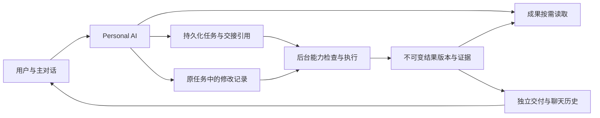

# Personal AI 整体优化方案：成果读取、任务交接与持续修改

日期：2026-10-15。状态：阶段 A、B、C 已实施并完成分阶段真实链路验证。实现、证据与边界分别见 [阶段 A](./technical/personal-result-reading-stage-a-2026-10-15.md)、[阶段 B](./technical/personal-task-handoff-stage-b-2026-10-15.md)、[阶段 C](./technical/personal-task-revision-stage-c-2026-10-15.md)。阶段 D 的服务端观测、性能预算门禁和隔离真实链路验收已实施，见 [阶段 D](./technical/personal-performance-stage-d-2026-10-15.md)。跨端真机、生产容量与长期 SLO 仍需独立验收。本文其余后续目标、建议接口和长期运行指标仍是设计目标，不代表已经提供或完成生产验收。

## 1. 目标与核心决策

保留快速主对话、持久 Task、后台 Router 和独立成果交付。Personal AI 始终负责理解用户、掌握工作状态、读取已有成果、协调执行和解释结果；耗时执行由后台承担。

优化边界从“主 Agent 只留少量工具、遇到大内容就转发”调整为：**默认上下文小，信息可以按需完整访问；前台操作有界，后台执行持续推进；每次交接和修改都有来源、版本与完成证据。**

用户应当能够在同一个聊天中完成以下连续操作，而不用理解内部 Agent 和 Task 的分工：

1. 交代目标，继续聊天，收到可用成果。
2. 对成果任意位置提问、核对依据、比较版本。
3. 修改执行中的要求，知道要求是否已经落实。
4. 在完成后继续修改，保留旧版本与修改关系。
5. 遇到失败、重启、授权过期或执行者变更时，从已有工作恢复。

覆盖文字、图片、文档、表格、演示文稿、代码、连接应用查询和多文件成果。不能以扩大报告读取上限作为整体方案，也不要求每次对话增加一次规划或判断模型调用。

## 2. 当前基础与缺口

以下区分源码事实、已有验证记录与拟新增能力。相关实现路径均相对仓库根目录。

| 领域 | 已有基础 | 本方案补齐内容 |
| --- | --- | --- |
| 前台工具 | `src/personal-agent/policy.ts` 的固定工具面；本地读取有输出预算 | 从工具数量约束转为职责、耗时和输出预算约束；补成果统一读取 |
| 成果上下文 | `src/session/session-context-for-llm.ts` 为后台结果投影前 1,200 字符及成果引用 | 保留摘要投影，同时提供确定、可分页、可检索的完整读取入口 |
| 文件与附件 | `factory.ts` 配置 12,000 字节本地读取门槛；`read_media` 对 Personal 限制为文本 | 大文件可按范围读取；复杂解析异步建立可读表示；已有成果优先复用解析结果 |
| 提交与分配 | `personal_task submit` 本地持久化，禁用自动复制整段对话，后台生成契约和选择执行者 | 原请求与关键引用由宿主持久化，避免需求仅存在于模型重写的 brief |
| 运行中协作 | 协作表、wait、answer/instruct、投递、ack、动态上下文与最终核验已经实现 | 统一修改版本、采用证据与竞态检查，补完成后继续修改 |
| 连接应用 | 共用 Task 协作；独立账户授权、只读执行和来源结果存储 | 在相同读取/修改协议中保持账户、范围、授权与查询时间语义 |
| 交付 | 成果快照、outbox、独立附件消息、回复整理、重试与历史恢复 | 可追溯成果版本、最新版本选择，以及纯文字在持续聊天期间的可达性 |

已有协作验证应继续复用，不能把它们当成不存在而另建一条调度链路：

- [普通 Task 协作 P0](./technical/personal-task-collaboration-p0-2026-10-14.md)。
- [连接应用协作 P1](./technical/personal-connected-collaboration-p1-2026-10-14.md)。
- [工具优化与性能样本](./technical/personal-tools-optimization-2026-10-14.md)。
- [成果交付](./personal-agent-result-delivery.md)和[回复整理](./personal-agent-reply-synthesis.md)。

这些记录证明了特定场景的实现与验证，不代表所有格式、完成后修改和生产 p95 已验收。

## 3. 统一工作模型

不新增一个“总管 Agent”，不建立与 Task 平行的工作系统。沿用以下实体，并补齐关系和版本：

| 实体 | 职责与身份 |
| --- | --- |
| Conversation / Input | 用户交互及原始输入；稳定 `conversationId` 与输入 ID |
| Task / Contract | 用户委托的持续目标及当前验收要求；独立保存契约版本 |
| Collaboration entry | 问题、回答、指令、ack、进度和结果的有序记录 |
| TaskRun / Assignment | 某次执行尝试及其执行者 epoch；完成后修改通常产生新 Run |
| Context snapshot / edges | 交接时选中的来源、固定版本、授权范围及遗漏信息 |
| Result revision | 一次不可变成果集合与说明；关联 Run、契约和采用的修改要求 |
| Delivery | 某个结果版本向指定聊天的交付状态；区别于执行、验证和用户接受 |

“结果已生成”“按当前要求验证通过”“消息已持久化”“用户已看到”“用户已接受”分别表达。没有客户端回执时不声称用户已看到。

## 4. 成果读取：摘要默认加载，正文按需访问

### 4.1 一个模型入口，复用已有存储

建议新增窄工具 `personal_result`，只读，不承担制作、任意命令或外部写入。工具数量从十二变成十三本身不应成为阻碍；需要测量真实提示词成本与调用成功率。

| 命令 | 用途 |
| --- | --- |
| `list` | 当前聊天/指定 Task 的成果目录，支持稳定分页 |
| `get` | 结果版本、成果清单、正文目录、来源、验证状态及读取能力 |
| `read` | 固定版本上的正文、章节、页、单元格区域或文本范围 |
| `search` | 指定成果/结果版本内的片段检索，返回定位信息及上下文 |
| `compare` | 两个确定版本的变化摘要；昂贵比较返回持久化准备状态 |

底层复用 `TurnOutcomeDeliverable`、文件资源、媒体存储、Task 结果、连接应用结构化结果、现有 FTS 与 context snapshots。已有全文索引不能覆盖新成果时，为成果补索引，不默认建设第二套向量库。结果目录是投影，不复制文件字节和整个 Task 状态。

模型接口名称与参数在契约设计阶段定稿；这里只固定行为要求。

### 4.2 可达性与完整性契约

每次读取至少返回：`resultId`、`resultRevision`、成果引用及内容版本、定位、实际范围、是否完整、下一游标、来源与提取状态。搜索返回的每条命中都能转为精确读取。

- 每次输出默认至多 8,000 字符，元数据计入预算；实际返回范围决定下一游标。
- 游标绑定成果版本、范围和调用权限，不能读到一半静默切换新文件。
- 明确区分“当前片段完整”与“整个成果已读完”。标注 `omitted`、`nextCursor` 和不可读取原因，不能用摘要假装全文。
- 大文件不因总大小而拒绝范围读取。底层使用受限流式读取或可定位表示，禁止每页都重新载入完整大文件。
- 不默认遍历全文；用户要求完整审阅且超过单轮预算时，委派基于同一版本的审阅任务，回传可追溯结论。
- 原始正文与提取文本分别标识；OCR、公式缓存、格式丢失等限制必须可见。
- 读取只限当前聊天可访问的成果。跨聊天、项目和账户资料继续走现有权限检查，持有 ID 不等于拥有权限。

### 4.3 格式适配与准备状态

| 成果类型 | 直接读取与后台准备 |
| --- | --- |
| 文本、Markdown、代码 | 行/章节范围读取与检索；代码可附关联 diff、验证记录 |
| CSV、表格 | 表/范围/字段读取；说明公式与显示值来源，避免整表塞入上下文 |
| PDF、Word、演示文稿 | 后台提取页/段落/幻灯片与来源映射；准备好后本地范围读取 |
| 图片、音视频 | 元数据、已有描述/转录及时间定位可读；新的视觉分析、转录或重处理走后台 |
| 连接应用结果 | 读取已保存条目、覆盖范围、来源及查询时刻；刷新外部数据是新执行，不能伪装成读取缓存 |
| 无法解析的格式 | 保留文件下载/预览能力，明确缺失解析能力，支持针对该成果的后台处理 |

发布成果时异步准备索引和可读表示，按内容哈希与解析器版本缓存。原文件交付不等待解析。首次追问遇到尚未准备的内容时，返回 `preparing + preparationId`，已有提取进度与失败原因可查；去重相同准备请求，不生成重复业务 Task，也不让前台等待长解析。

对外部活文档，固定已有结果快照及查询时刻；如用户要看当前内容，重新检查权限并执行刷新。缓存必须遵循原资源保留与撤权策略，不能成为绕过权限的副本。

### 4.4 主对话上下文

保留有界背景目录，不再把“前 1,200 字符”作为唯一结果理解路径。默认投影包括结果 ID/版本、目标摘要、状态、主要结论、限制、成果目录和读取入口；全文留在结果存储。

目录需覆盖纯文字结果，即使执行者没有发布附件。只有前缀、没有可恢复完整正文的历史记录必须标明不完整，不能合成一个假的全文结果。

用户在界面选择文件、页或版本时，客户端发送结构化选择引用；宿主校验归属后提供给模型。未显式选择时，结合最近相关任务和成果目录解析“这份”“上一版”；有多个合理候选且会影响执行时再澄清。

## 5. 任务交接：原始意图、引用、能力和版本一并交付

### 5.1 快速提交边界

前台只完成目标理解、必要澄清和一次本地持久化。提交事务中同步保存 Task、原输入关联、关键引用和待分配记录，立即返回真实状态。目录展开、文件解析、能力探测、契约生成和 Router 模型调用均在事务外后台执行。

原始请求由宿主根据当前输入 ID 捕获，不要求主模型再复制一遍；主模型补充意图解释与选中的必要历史引用。保留“不复制整个主聊天”的原则，但不能把模型的一次改写当成唯一事实来源。

### 5.2 交接上下文清单

扩展现有 context snapshots / edges，形成版本化交接清单，不复制一份平行的 Task 数据库。

| 信息 | 保存规则 |
| --- | --- |
| 原输入 | 输入 ID、原文快照、原 transcript；用户原话和模型解释分别标识 |
| 任务要求 | 目标、输出要求、明确约束、用户指定的 Agent/Skill、必要假设 |
| 输入引用 | 成果/文件/消息/项目事实的稳定 ID、版本、必要范围及用途 |
| 修改基线 | 当前协作序号、适用契约版本、基准结果版本 |
| 授权范围 | 来源作用域、连接器/账户、允许操作；执行前仍检查当前权限 |
| 完整性 | 已选来源、摘要/截断标记、未解析指代、不可访问来源及缺失事实 |

执行者可按引用补读获准原文；交接快照为审计和重启恢复保留确定依据，实时权限仍然优先。历史删除和权限撤回后的快照访问遵循原数据治理规则。

普通 Task 的长任务书也必须有正式分页读取路径；当前动态指令中 12,000 字符的任务正文片段不能成为唯一入口。连接应用已具备专用完整任务书读取，普通 Task 采用同样的完整性原则。

### 5.3 后台能力校验

后台从原请求、brief、输入类型与明确要求提取最小能力清单，再交给现有匹配器与 Router。硬条件由程序校验；角色、案例和质量偏好由 Router 比较，不能把角色名称当成运行就绪证据。

- 校验工具注册、策略、模型配置、必需 Skill、输入/输出处理能力、当前账户授权。
- 不用昂贵外部探测阻塞提交；探测有超时和缓存，配置/权限变化使缓存失效。
- 宿主清单检查与契约生成并行；必要时合并同一次后台模型调用，避免固定增加多轮理解链。
- 契约保留每项要求来源：用户明确要求、已有上下文，或系统推导。系统推导不得覆盖用户约束，也不得自行扩大权限。
- 执行前重新校验条件；无法满足则明确阻塞原因、自动尝试同范围可行路径，或提出确实缺失的问题。
- 暂时保留单个根执行者。复合任务需要其覆盖全流程或具备已验证的内部协作能力；否则显式阻塞或按现有工作流拆分，不能选中一个角色后假定其无所不能。

当前 24 个合格候选的比较上限作为已知边界保留。后续若改为分批筛选，必须另测召回和延迟；本方案不通过静默丢候选解决它。

## 6. 后续修改：从理解指代到验证采用

### 6.1 同一入口，不同生命周期

扩展现有 `personal_task` / `personal_request` 协作能力。建议增加统一 `revise` 行为，参数包含目标 Task/Request、基准结果版本、用户要求、原输入关联、期望版本及幂等键。运行中的 `answer` 和 `instruct` 继续可用。

| 用户意图或状态 | 行为 |
| --- | --- |
| 询问已有成果 | 读取指定版本，不创建执行任务 |
| 分配前补充 | 更新原任务交接清单；让旧分配快照失效，使用最新要求 |
| 运行中补充 | 写入同一 Task 协作记录，保留现有 steer/wait/ack 流程 |
| 已完成后修改同一成果 | 在同一 Task 开启新的工作修订，建立新契约版本并创建新根 Run；旧 Run 保持终态 |
| 新目标、独立工作或用户要求分支 | 创建关联 Task，固定原成果版本作为输入，不复制整个历史 |
| 已取消任务的后续修改 | 必须来自用户明确继续/修改意图，经过当前权限与状态校验；迟到事件不能自动复活任务 |
| 账户/操作范围变化 | 走现有授权校验或新 Request；文字指令不能更换已运行 Request 的绑定账户或开放写操作 |

同一任务复用原执行者需要重新验证其可用性，不能永久绑定已经失效的执行者。重新分配保留修订与成果关系，通过 assignment epoch 拦截旧执行者提交。

完成后的重开、契约修订、新 Run 创建和修改记录必须具有一个可恢复的命令边界。优先通过现有 `TaskApplicationService` 实现组合命令并复用事务/幂等，不由模型顺序调用多个低层命令拼出半完成状态。

### 6.2 修改采用账本

保留现有 `pending → delivered → confirmed` 状态，并为每条用户修改增加结果侧采用记录：`applied`、`partially_applied`、`not_applied` 或 `superseded`。采用状态须关联具体结果版本、证据及验证结论；ack 只表示收到并解释要求。

修改解释按规范协作序号处理；后来的明确纠正可覆盖早先要求，但不覆盖无关要求。记录 `supersedesEntryIds`，保留原文；不能用一句“采用最新要求”代替逐项判断。

模型解释不确定时保留歧义，只有会改变成果或行动范围的关键歧义才向用户提问。宿主负责版本检查，模型负责语义解释，核验器负责根据可观察成果判断落实程度。

### 6.3 发布竞态

每次结果发布绑定 `contractVersion`、`assignmentEpoch`、本工作修订和实际覆盖的指令序号/集合。

1. 完成事务读取当前应采用的要求，检查发布结果对应的版本。
2. 存在尚未采用的新指令时，保存旧结果供查阅，但不能把它标为满足最新要求；继续执行或明确部分完成。
3. 成果已发布、最终文字尚未投递时收到新修改，旧文字不能声称新要求已满足。
4. 不静默删除已交付旧成果；明确展示历史版和新修订状态。
5. 两个客户端并发修改基于期望版本检测冲突；可并存的指令顺序追加，覆盖冲突返回当前状态供重新理解，禁止静默最后写入获胜。
6. 对外副作用之前，在工具调度边界检查取消、账户权限及适用要求版本。已经开始的外部动作不承诺可撤销；需要回执与恢复判断，避免盲目重试。

已存在的任务版本字段可能因其他状态变更增加，不能直接充当语义修改版本。实现时分清聚合并发版本、契约版本、指令序号、成果版本及执行 epoch。

## 7. 成果版本与交付闭环

### 7.1 不可变结果、明确最新版本

一个 Result revision 保存完整文字、选中的最终成果、来源、限制、验证结果、采用要求及前序版本。复用现有 outcome 快照；仅在缺少可引用关系时补结果版本索引和必要字段，不复制整份存储。

文件已有 `FileResource.revision`、artifact/sourceFile 身份用于定位内容；逻辑成果修订另存关系，不能把可变路径或临时下载 URL 当成版本。连接应用的刷新记录查询时刻与覆盖范围，区别于对旧快照重新筛选。

完成后修改只选择该修订明确发布的成果，不能继续按 sourceFileId/artifactId 无差别汇总历史 Run，把旧附件重新当新结果交付。旧聚合逻辑需要在版本索引切换时同步调整。

结果正文、成果可读表示和交付消息互相关联。用户问第三节时读取原结果，问“你刚才那句话”时可查交付消息；两者不能混成同一来源。

### 7.2 独立交付与有界等待

- 附件继续通过现有 outbox 独立持久化和通知，不等待主模型或解析索引。
- 完整原始文字先存为可读取结果，不能只剩 Composer 摘要。
- Composer 只组织表达，不负责成果验收、事实补全或后续动作授权。模型失败不影响原始结果访问。
- 纯文字结果不能无限等主对话空闲。建议完成后 5 秒仍无法发布整理文字时，通过原 outbox 投递一次带真实结论、限制及完整读取入口的确定性结果消息，不启动主 Agent 回合，不抢占语音。
- 超时消息与整理稿采用同一逻辑文字交付键进行原子竞争，只有一方成为本次最终通知；失败恢复不得再重复通知。更自然的后续说明按显式版本更新协议或用户请求处理。
- 跨端尚不支持消息更新时，优先保持单次独立交付，不能通过覆盖“最新 assistant 消息”更新。

上述 5 秒为初始待测策略。结果消息延迟与语音播报时机分开；语音播报可等待合适间隙，聊天中的可读成果不可因此不可达。

### 7.3 保留与故障处理

新结果引用旧成果作为修改基线时，保留策略应保护其可读性。文件缺失、解析失败、资源过期、权限撤回、对话删除和 reset 都返回明确状态。普通 Task 与连接应用当前 reset 策略不同，本期保持并测试，不以读取统一为理由隐式统一投递策略。

重新通知只重试投递，重新解析只重试准备，重新制作才创建新执行。三个入口必须分开，防止修复“没看到结果”时重复付费或重复外部动作。

## 8. 主对话响应速度与资源预算

### 8.1 前后台分工

前台允许：本地目录、状态、缓存全文片段、已保存结果检索、提交、修改和取消命令。复杂解析、视觉理解、全文审阅、外部刷新、深度比较和制作放后台。

每次读取有结果预算、时间预算和当前回合总预算。建议初始本地读取目标 p95 ≤ 150 ms；超过约 300 ms 的冷准备切为异步，返回准备标识。查询必须可取消；超时不能留下无限扫描。

不把前台超时简单转换为新的业务 Task。索引准备是去重基础设施工作；只有真正需要推理/加工的用户目标才进入 Task。

前台输入、任务控制命令、交付写入优先于后台批处理。解析使用有界并发与独立 worker/进程，避免占满事件循环；执行、Router、Composer 的模型并发和共享提供方限额也要分别观测。仅分开运行锁不足以隔离 CPU、数据库锁和模型配额竞争。

### 8.2 性能验收目标

先以同一设备、数据量、模型和网络测当前基线，再比较修改版本。下列为初始验收目标，不是已有性能承诺。

| 指标 | 目标 |
| --- | --- |
| 普通聊天首次有效回应 | p95 相对基线回退不超过 10%；没有新增固定模型调用 |
| 提交/修改本地持久化 | p95 ≤ 100 ms，p99 ≤ 300 ms；模型生成任务书耗时单独记录 |
| 热成果范围读取 | p95 ≤ 150 ms；单次输出默认 ≤ 8,000 字符 |
| 冷解析 | 前台有界返回准备状态；解析耗时按格式/大小分桶，不承诺统一完成时间 |
| 用户修改到执行者收到 | 分别统计保存、投递和 ack；长工具中的 ack 不承诺即时 |
| 成果到聊天持久化 | 无故障、无资源过载下 p95 ≤ 1 s；与 Composer 耗时分开 |
| 纯文字可达性 | 忙时不依赖空闲窗口；5 秒触发兜底策略，测试负载下目标 6 秒内持久化 |
| 追问已有可读成果 | 不新建业务 Task，不重新调用 Router；只进行必要读取和当前主模型回答 |

压测必须包含后台繁忙、多个任务同时完成、持续聊天、数据库竞争和提供方限流。整体任务完成时间、成本、信息完整度与首响应并列报告，不能只展示确认变快。

## 9. 实施顺序与代码落点

### 阶段 A：统一引用与读取底座

1. 审计所有结果路径，明确完整正文、结构化结果及成果身份的权威存储；补纯文字结果引用和版本索引。
2. 实现 `personal_result list/get/read/search`；先接文本、CSV、现有结构化结果与已有解析结果，保留格式适配接口。
3. 接入异步文档提取及缓存，补页/段落/范围来源映射；图片/音视频使用已有描述和转录能力。
4. 更新主对话成果目录和提示词，去掉“大文件只能重新委派”的绝对规则，保留完整审阅的后台执行边界。
5. 接入结果卡的结构化选择引用，打通“收到 → 追问 → 精确读取”。

主要落点：`packages/gateway-contract/src/turn-outcome.ts`、`task-result-delivery.ts`、`files.ts`，`src/tasks/task-result-delivery-*`，`src/personal-agent/prompt-context.ts`，`src/session/session-context-for-llm.ts`，`src/agent/tools/` 与 `factory.ts`。

### 阶段 B：可靠交接与后台就绪检查

1. 在提交边界捕获原输入与必要引用，扩展 context snapshot/edges。
2. 普通 Task 与 Request 统一交接完整性标识，执行者可精确补读。
3. 后台提取能力硬条件、检查来源可达性，保留现有 Router 和执行前复核。
4. 契约要求记录来源，测试模型重写和截断不会丢失约束。

主要落点：`src/agent/tools/personal-task-tool.ts`、`personal-request-tool.ts`、`xopc-use-tool.ts`，`src/tasks/task-context-repository.ts`、`task-context-assembler.ts`、`task-allocation-service.ts`、`task-contract-planner.ts`，`src/agent-matching/`。

### 阶段 C：完成后修改与结果版本

1. 用现有协作协议实现统一 revise 命令和原子重开/新 Run；增加基准成果版本。
2. 将采用要求与结果版本、验证证据关联，完成事务检查过期结果。
3. 改造跨 Run 成果选择、最新版本目录及新旧结果呈现；接入轻量 compare，昂贵比较异步执行。
4. 覆盖并发修改、完成边界修改、重分配及连接应用范围修改。

主要落点：`src/tasks/task-application-service.ts`、`task-collaboration-*`、结果快照与 outbox，`src/agent/tasks/task-judge-service.ts`，`src/personal-agent/request-result.ts`、`request-delivery.ts`、`reply-composer.ts`。

### 阶段 D：交付时限、跨端与性能验收

1. 增加忙时文字结果兜底与整理稿原子去重。
2. Web、Android、iOS、HarmonyOS 验证结果选择、旧版/新版、预览下载与历史恢复。
3. 完成性能基线、质量评测和真实 Gateway 验收；更新产品文档与旧设计中的冲突条款。

每阶段交付可独立验证的完整场景；A 解决信息可达，B 保证交接，C 保证持续工作，D 验证整体体验。不得仅上线文本读取后声称整体闭环已完成。

## 10. 验收矩阵与证据

| 场景 | 必须证明 |
| --- | --- |
| 大报告第 3 节追问 | 定位并读取该节，引用正确版本；不新建 Task，不靠摘要猜测 |
| 表格核对某一数字 | 返回实际区域和计算来源，区分公式/缓存值；必要重算走后台 |
| 图片或音视频修改 | 精确引用原成果，保留描述/转录来源；新加工生成新版本 |
| 原文末尾有关键禁止项 | 超过 12,000 字符仍能完整读取并纳入执行约束 |
| “按昨天口径处理这份文件” | 正确引用历史依据；缺失依据时明确缺口，不自行补造 |
| 执行中连续追加与纠正 | 指令不丢失，ack 与采用分离，最终证据覆盖有效要求 |
| 完成事务附近新增要求 | 旧结果可查但不冒充新结果；只有当前修订产生最新完成状态 |
| 完成后再改三轮 | 同一 Task、不同 Run/结果版本；旧 Run 不复活，旧成果可比较 |
| 多任务与多文件指代 | 明确选中对象与基准版本，不串 Task、账户或附件 |
| 连接应用历史结果追问 | 读取已存结果不触发外部刷新；刷新和改账户走正确授权路径 |
| 无权限/撤权/解析失败 | 返回真实状态，不通过缓存、引用或后台委派绕过边界 |
| 断线/重启/重复请求 | 提交、修改、准备与交付分别幂等；不重复外部执行 |
| 持续聊天与 Composer 故障 | 原始成果可读，附件照常交付，纯文字有界可达且不重复 |
| reset/删除/取消/重新分配 | 遵循既有目标策略，旧 epoch 不发布新的正常完成结果 |
| 老版本历史结果 | 有完整来源可回填；只有摘要时明确不完整，不编造缺失正文 |

验证分四层：契约/状态机测试、真实带鉴权 Gateway 集成、真实模型连续场景、四端实际展示。复用已有 smoke 脚本并扩展，不用新增 prompt 字符串断言代替采用效果验证。

记录每个请求的输入、Task、Run、契约、交接快照、结果版本、指令序号和交付 ID，以及各阶段耗时。日志仅保留标识、计数及有界预览。评测除时延外，还统计需求遗漏、错误引用、未落实却宣称完成、重复执行、重复交付及任务转发次数。

## 11. 兼容、发布与退出条件

新增持久字段和协议使用明确版本；老客户端继续收到可识别的既有附件/文字交付。新版本关系采用兼容元数据或显式协议升级，不能直接改变旧契约字段含义。

历史回填在后台按批执行，仅使用可验证的完整结果和成果引用；失败不阻塞启动。新格式解析、读取入口、修订命令和忙时兜底分阶段启用，使用同一权威存储与既有调度入口。关闭新增入口不能删除已保存版本，回滚部署前检查迁移兼容性。

需要新增 Gateway API 时，同步 lazy-bundle matcher、正向与非重叠映射测试，并通过运行中的鉴权 Gateway 测真实路径。模型工具调用和客户端预览共用权限解析，不能各自维护一套访问规则。

总体完成条件：用户交代一个包含真实输入的任务，持续聊天，收到成果，任意位置追问，执行中纠正，完成后连续修改，并在重启后继续；整个过程中主对话性能达标，来源与版本可追溯，最终结果确实采用有效要求。
