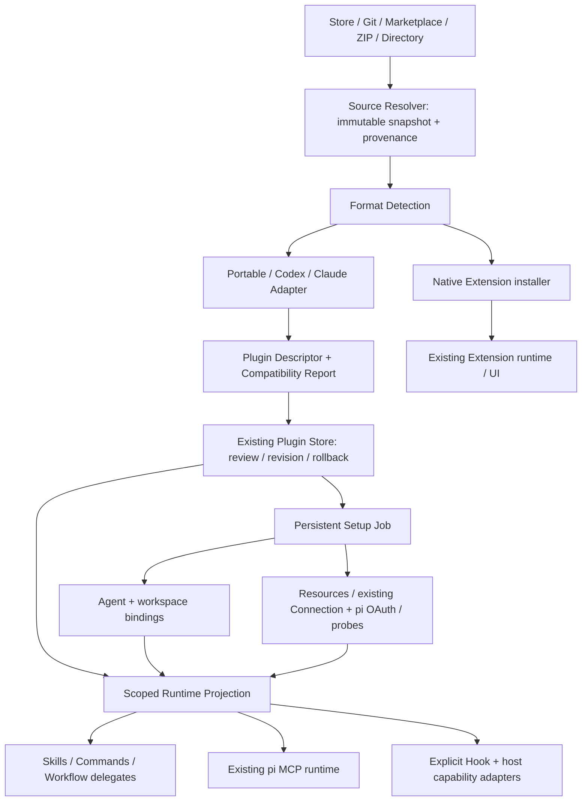

# xopc Plugin 生态兼容、安装准备与精品能力包技术方案

状态：P0～P2 首个里程碑已有本地实现，P3～P5 待实施。调研日期：2026-10-18。当前支持边界见 [使用说明](../agent-plugins-compatibility.md)，实施与验证见 [交付记录](./plugin-p0-p2-implementation-2026-10-19.md)；尚未发布上线。

方案范围：沿用 xopc 现有 Plugin / Extension 机制，设计 Codex、Claude 插件导入与运行适配，吸收 Accio 的安装体验，并拆分实施任务。本文保留原始方案及其估算，后续实施以交付记录为准。

## 1. 核心决策

采用 **开放安装 + 精品推荐 + 统一准备流程**：

1. 用户可以从 Git 仓库、第三方 marketplace、ZIP、本地目录自行安装插件，不要求先进入 xopc Store。
2. 官方 Store 只推荐经过实际任务验收的精品；少量 Skill、纯文本或未经官方认证，不构成阻止用户自行安装的理由。
3. Codex / Claude 的包由格式适配器转换成内部组件描述，继续使用现有 Plugin Store、Skill、pi MCP、Workflow、Connector 和权限体系。
4. Native Extension 保留宿主级工具、服务、UI 等扩展能力；第三方 Plugin 中的脚本、Hook 不自动成为 Native Extension。
5. 安装结果区分“文件已安装”“能力可用”“场景已验证”。每项声明都有兼容结果，不能静默忽略组件后宣称完整兼容。
6. 持久化 Setup Job 串联资源准备、账号连接、工具检查、Agent 绑定和首次任务入口。弹窗是 Job 的视图，后台是状态权威。

对外表述应是“支持安装 Codex / Claude 插件，并展示各项能力的兼容情况”。不能承诺所有依赖特定宿主的插件都能原样运行。

## 2. 证据与当前基础

### 2.1 已完成的调查

- [Accio 交互、安装机制与业务包调查](./accio-plugin-research-2026-10-18.md)：包含 Computer Use 实测、12 个导出插件、宿主安装代码的静态分析，以及证据边界。
- [Store 价值审计与清理记录](./store-plugin-value-audit-2026-10-18.md)：线上原有 84 个 Plugin 中，79 个是高度同质的轻量内容包；已按授权清理这些包和 9 个演示 Extension。保留 5 个 Plugin。保留代表有继续评估价值，不等于已获精品认证。
- 本地 OpenAI 插件样本固定在提交 `11c74d6ba24d3a6d48f54a194cd00ef3beea18f9`：180 个 `.codex-plugin` 包，154 个有 `.app.json`，72 个有 skills 目录，14 个有 agents 目录，6 个有 commands 目录，8 个有 `.mcp.json`。这些计数存在重叠，不代表当前官方市场总量或运行兼容率。
- 本地 Claude 样本包含 Superpowers：存在 marketplace、Skills、SessionStart Hook。不能通过“Skill 文件读入成功”认定整个插件运行成功。

### 2.2 应复用的 xopc 实现

| 现有模块 | 已有能力 | 本次扩展点 |
|---|---|---|
| `src/extensions/agent-plugins/validation.ts` | Portable `plugin.json`、Skill / MCP 校验、路径约束 | 变为分格式解析 + 共同约束；保留现有严格校验 |
| `src/extensions/agent-plugins/sources.ts` | Store、本地目录、ZIP、直接 HTTPS ZIP | Git / marketplace 解析、固定提交、来源身份 |
| `src/extensions/agent-plugins/store.ts` | 不可变 revision、reviewHash、安装锁、回滚、完整性检查 | 格式版本、来源身份、组件投影、准备状态关联 |
| `src/extensions/agent-plugins/auth.ts` | 宿主持有凭据引用，按端点指纹关联 | 与共享连接的授权边界衔接 |
| `src/extensions/agent-plugins/mcp-adapter.ts` | 稳定 MCP 命名空间、根目录 / 数据目录变量投影 | 多方言 MCP、连接配置、按 Agent 投影 |
| `src/agent/mcp/` | 配置合并、pi MCP 执行与凭据、工具发现、网页登录桥接 | 接受 Plugin 的有效连接描述，复用现有授权能力 |
| `src/connectors/` | 托管分发、连接恢复、账号与 Agent 策略 | 准备资源与复用连接 |
| Skill / Agent / Workflow | 渐进加载、Agent 策略、委派及结构化执行 | 插件组件绑定、命令与子 Agent 适配 |
| Native Extension | 工具、Hook、服务、配置、UI 贡献 | 精品宿主能力的独立运行边界 |
| Gateway / Web 安装界面 | 检查、权限审阅、安装、激活、更新、回滚 | 安装 Job、兼容预览、继续配置与任务入口 |

当前存在四个直接影响用户体验的缺口：

- `isAgentPluginArchive` 只识别根 `plugin.json`，无法直接接受大量 `.codex-plugin` / `.claude-plugin` 包；也没有 Git / marketplace 安装来源。
- Plugin 的 `readiness` 主要反映包诊断和完整性；已有 `setup_required` 类型，并未形成连接和工具状态驱动的准备流程。
- 已激活 Plugin 的 MCP 和 Skills 进入全局来源，缺少插件级 Agent 绑定。现有 Agent 策略可过滤部分能力，但不能替代明确的绑定模型。
- 安装界面会在包安装后激活；成功提示未充分区分账号、工具和业务场景是否就绪。

**MCP 授权无需重建。** `connection-setup.ts` 已将网页登录接到 pi，凭据与执行仍由 pi 管理。但是 `startMcpAuthorization`、配置指纹等依赖 `config.mcp.servers[serverId]`，Gateway 的 server 授权入口也检查该配置；Plugin 动态投影的服务器未完整进入这条路径。应统一连接描述和解析入口，不能只在 UI 增加一个登录按钮。

现有授权尝试保存在进程内 Map，重启后不能恢复。Setup Job 可持久化“等待重新登录”等阶段，不能伪装恢复已丢失的 OAuth 会话。

## 3. 产品边界与用户入口

能力中心提供两个平行入口：

- **精选插件**：官方维护场景、兼容说明、资源与账号引导、验收记录。
- **从来源安装**：粘贴仓库 / marketplace / ZIP 地址，或选择宿主可访问的目录；支持私有仓库和固定 ref。

两种入口安装后进入同一列表、同一详情和同一准备流程。第三方来源不强制转存到官方 Store，不自动发布用户的私有包。

详情主视图展示“能完成什么、还需配置什么、哪些 Agent 可用、从哪里开始”。Skill / MCP / Hook 数量、原始 manifest 和执行细节放在展开区域。

源仓库不能通过自己的 name、marketplace 名称或图标获得“官方”身份。来源验证与精品认证分开保存。

## 4. 总体架构



Source、Format、Setup、Runtime 四层各自负责一件事：取得确定内容、解释声明、使依赖就绪、向当前 Agent 暴露能力。Store 负责分发，不承担运行时权限；模型不决定某项准备是否成功。

### 4.1 内部描述模型

以下是拟议的契约字段，实施时应拆成模块类型，不直接作为最终 API schema：

```text
PluginDescriptor
  descriptorVersion / dialectProfile / adapterVersion
  identity: installId / declaredName / sourceKey
  source: kind / canonicalOrigin / subdir / resolvedCommit / artifactHash
  manifest: normalized metadata + rawManifestPaths
  components[]: componentId / kind / sourcePath / semanticConfig
  dependencies[]: ownerComponent / target / requiredness / evidence
  capabilities[]: execution / network / credentials / lifecycle / host tools
  presentation: displayName / icon / tasks / setup hints
  compatibility[]: component / support / reason / remediation
```

组件 `support` 使用 `supported | needs_adapter | unsupported | invalid`；运行状态另算。缺少账号不是格式不兼容；格式支持也不代表已经获得账号或执行权限。

原包按下载快照原样保存并校验哈希。派生描述、兼容索引、运行投影放在宿主管理的 revision 元数据中；不改写上游 Skill 内容来掩盖不兼容。

`reviewHash` 覆盖原包内容、解释器版本、投影与执行能力计划。解析器升级导致语义变化时重新计算审阅差异，不能沿用旧结论直接增加执行能力。

### 4.2 身份、版本和命名冲突

当前 Plugin ID 等于 manifest name。目标应支持不同来源的同名插件：`installId` 是宿主稳定身份，`sourceKey` 来自规范化来源及子目录，`declaredName` 仅作包内名称。

新安装采用来源限定身份；已有安装保持 ID、路径、MCP ID 和凭据引用。引入带版本的 receipt 阅读器，旧 receipt 通过默认映射识别，不在首次读取时重命名目录。旧来源不足以证明身份时，由用户显式关联来源后才启用更新。

组件内部使用 `installId + localComponentName`。Skill 展示名、frontmatter name、运行时唯一 ID 分开；同名时显示来源别名，包内引用优先在本包解析。MCP 投影沿用现有命名空间策略，显式保留旧 ID 映射，避免升级后要求用户无理由重新登录。

同一包包含多个 manifest 时采用确定性规则：Native Extension 标记沿用现有优先级；合法 Portable 根清单作为通用内容权威，读取对应平台 overlay；只有缺少该清单才识别兼容清单。已声明的通用清单损坏时报告错误，不通过换方言绕过校验。独立 Codex 与 Claude 清单同时存在且语义冲突时要求选择目标方言并展示差异。

## 5. Codex / Claude 兼容策略

### 5.1 格式层

Codex 需要支持通用根清单和 `.codex-plugin/plugin.json` 兼容格式。平台 overlay 按官方规则解释，不能通用递归合并；声明的相对路径以插件根为基准。[OpenAI 打包规范](https://developers.openai.com/plugins/build/plugins)

Claude 使用单独的解析配置，保留默认发现、显式组件路径和覆盖规则的区别。不能把它当成“换个隐藏目录的 Codex 清单”。[Claude Plugin reference](https://code.claude.com/docs/en/plugins-reference)

| 内容 | 目标处理 | 第一阶段边界 |
|---|---|---|
| manifest、元信息、图标 | 按方言归一化；图标读取受包路径限制 | 支持，不注入包内 HTML |
| Skill 与资源 | 读取合法声明，建立组件索引和包内引用 | 支持通用内容；宿主工具依赖单独报告 |
| MCP stdio / HTTP | 转成已有 pi 配置，变量与凭据由宿主解析 | 优先支持；旧 SSE 等以实际 pi 能力为准 |
| user config / 环境变量 | 类型化表单，敏感值为凭据引用 | 可识别变量与安全上下文优先 |
| commands | 转成用户显式调用入口，保留名称空间与参数语义 | 后续阶段，不伪装成自动执行 Skill |
| agents | 转成隔离的执行者描述，映射现有 Workflow / delegate | 后续阶段，不自动创建永久业务 Agent |
| hooks | 逐事件、逐输入输出协议适配 | 后续阶段；不支持时明确停用 |
| OpenAI `.app.json` | 平台应用依赖，由有认证记录的连接适配器承接 | 不因存在 app ID 就算可用 |
| LSP、输出样式及其他平台组件 | 识别并列入报告，按组件添加适配 | 未实现则明确不支持 |
| 平台 settings / model / 权限建议 | 可选配置建议或受控映射 | 不直接覆盖 xopc 全局配置 |

每个方言解析器有固定 `dialectProfile` 和 fixtures；上游新增字段保留到诊断中，不能静默丢弃后给出“完整支持”。发布说明列明验证过的格式范围。

### 5.2 Marketplace 与包来源分开

支持解析 OpenAI 的 `.agents/plugins/marketplace.json` 和 Claude 的 `.claude-plugin/marketplace.json`。先读目录，再让用户选择条目，最后获取具体包；浏览目录不运行其中命令或安装所有包。

目录中的相对路径基于 marketplace 仓库快照；禁止逃出根目录。通过远程 JSON 取得、没有对应仓库内容的相对路径条目，应提示需要仓库来源，不能猜测本机路径。

Claude marketplace 条目可能参与组成清单，需按其 `strict` 等规则处理，而非始终只读包内文件。实现前将合并、冲突和默认组件规则固化成测试，尤其覆盖 marketplace-only 清单。动态 command 来源先识别并报告不支持，后续通过独立执行能力审阅开放。[Claude Marketplace reference](https://code.claude.com/docs/en/plugins/marketplace-reference)

Git 来源记录仓库、子目录、用户请求的 ref 和最终 commit。更新必须先解析新的确定提交、展示差异、生成新 revision。私有仓库使用宿主配置的 SSH / credential helper，凭据不进 URL、receipt 或日志。

Git 和归档获取使用受控临时目录、大小 / 超时限制、子目录约束；不运行仓库脚本、Git Hook 或自动初始化 submodule。HTTPS 重定向单独验证目标和边界，不能为支持 GitHub 下载而放宽所有现有下载保护。

### 5.3 Skill 的兼容不是简单放宽 YAML

现有 Portable Skill 校验继续保持。新适配器分别处理各格式允许的 frontmatter，再映射到内部 metadata；原始扩展字段保留，不把对象强行序列化成无语义字符串。

明确识别 Skill 对宿主的引用：文件读取、命令执行、浏览器、交互提问、委派、平台应用工具等。扫描结果只是兼容线索，动态生成的工具名或资源路径仍可能漏检；无法确定时标为“运行未验证”，不能按文本扫描结果承诺业务可用。

宿主工具适配需要输入、输出、错误和权限契约。禁止仅将两个名称相近的工具互相别名；无法保持语义时给出具体差异。用户可安装内容，但依赖缺失的任务入口不能显示为已就绪。

### 5.4 `.app.json` 是最重要的兼容风险

本地样本中 154 / 180 个包带有 `.app.json`，说明优先完成 Skill + MCP 导入之后，仍会遇到大量平台应用依赖。该比例只针对固定样本。

应用 ID 不能直接转换成公共 API 地址、账号授权或 xopc Connector；同一品牌也不保证工具语义相同。设计 `PlatformCapabilityAdapter` 注册表：

```text
platform + externalAppId + adapterVersion
  -> connector type / connection requirements
  -> exact tool contract mapping
  -> account + scope requirements
  -> conformance fixtures / unsupported operations
```

适配器由宿主或受审阅的 Native Extension 提供。源插件不能声明自己已通过适配认证。缺少适配器时，详情说明“需要 OpenAI 平台连接，目前这些任务不可用”，允许使用独立的其他组件。

对于公开 MCP，可在端点、工具契约、账号范围确实匹配时使用；对于仅存在平台应用的能力，应通过供应商 API / 自有 Connector 实现并验收。绝不读取 Codex / Claude 账号缓存来假装继承授权。

OpenAI 官方 Claude 导入指引也有组件范围限制，因此“官方可导入”不能作为 xopc 运行等价的证明。[OpenAI Claude 插件导入说明](https://developers.openai.com/plugins/guides/submit-claude-plugin)

### 5.5 Commands、Agents 和 Hooks

Command 是明确的用户动作入口，保留插件名称空间、参数插值边界和工作目录；不能因为安装就自动执行。Claude 的组件约定需与普通 Skill 的渐进发现分开处理。[Claude 组件说明](https://code.claude.com/docs/en/plugins/components)

Agent 映射到已有委派执行器，模型别名通过 xopc 模型策略解析；不支持的模型要求显示配置提示。权限为宿主策略、当前 Agent 权限、插件授予权限、子任务请求的交集。导入 `tools` / `permissionMode` 等字段不能提升权限。临时执行者与用户主动创建的永久业务 Agent 分开。

Hook 必须定义兼容契约：事件触发时机、matcher、stdin、stdout、退出码、阻断行为、超时、取消和异步执行。先支持少量能保持语义的 command Hook，再扩展其他类型；不能只按事件名字相近连接到 Native Hook。

Hook 进程在可写数据目录和明确 workspace 中执行，包根只读；使用限定环境、进程清理和现有权限机制。其脚本属于任意代码执行能力，需要在安装审阅中明确列出。现有执行器未提供的隔离能力，不得用“沙箱”文案代替实现。

如果插件依赖 Hook 强制确认、保护写入或初始化上下文，该 Hook 不兼容时，对应任务保持阻塞或由用户明确选择仅启用独立组件；不能静默跳过保护继续执行业务动作。

## 6. Plugin Setup：安装到首次可用

### 6.1 服务端持久化 Job

```text
inspect -> review -> commit_package
  -> prepare_resources -> configure_connections -> verify_components
  -> bind_agents -> complete
```

实际步骤由依赖图生成，不需要资源的插件不出现下载步骤。独立资源可并发；授权、安装提交和依赖操作保持顺序。Job 具备 `jobId / owner / installId / packageRevision / planHash / revision`，所有写操作带幂等键。

步骤状态：`pending | running | action_required | succeeded | failed | skipped | cancelled`。Job 另有 `interrupted` 表示进程重启或执行结果待确认；步骤持久化开始、结果、错误代码、重试范围和资源引用。重复请求不能启动重复授权或重复安装进程。

包内声明只能提供依赖和展示信息。步骤执行器、成功判断、可否跳过、权限检查由宿主控制。Job 保存脱敏进度，Secret、OAuth code 和 authorization URL 不写入持久事件或日志。

### 6.2 资源准备

优先复用 Connector 托管分发和现有执行设施，新增 `ResourceProvisioner` 接口，而非再写一套通用脚本安装器：

- 运行环境：检测 Node / Python 等宿主依赖；检测不执行包内命令。
- 包级依赖：精确版本、锁文件、隔离目录；安装脚本是否运行是单独能力，不能默认执行任意 `postinstall`。
- 二进制 / 模型 / 资源：声明平台架构、版本、大小、来源和摘要；下载可重试，校验后原子发布。
- 包含的脚本 / 二进制：保留原始文件完整性，执行前检查平台和权限。

只看到 `npx`、`uvx` 或 shell 命令不能推导出可信安装计划。可识别的声明式模式转为显式准备；不可识别的命令展示实际执行内容和来源，留待相应执行能力阶段。

资源缓存以内容哈希 / 平台 / 锁文件为键，引用计数回收。可变数据仍放现有 plugin-data 一类目录，不写入不可变包 revision。更新不自动迁移业务数据；需要迁移时使用显式版本契约。

远程 Gateway 的安装、命令和资源下载发生在 Gateway 所在机器。UI 必须说明目标宿主，本地目录选择不假装能传给远端；上传归档可作为独立受限通道。

### 6.3 连接与账号

将现有配置服务器、Connector 和 Plugin 投影解析成统一的有效连接描述，提供给 `probeMcpConnection` 和授权桥接；保持 pi 对 MCP 执行和 OAuth 凭据的所有权。

需要一起修改配置指纹、凭据别名、鉴权 owner、配置生命周期和授权取消，不能把 Plugin 配置临时复制进全局 `xopc.json` 后遗留另一份注册表。

连接复用基于供应商、端点指纹、认证模式、账号、scope 和授权主体。相同 server name 不能证明可以复用；端点相同也不能把账号 A 的权限自动授予所有插件。OAuth scope 增加时重新请求授权；凭据存储引用和 Plugin 访问授予分开。

必要连接阻塞其依赖任务；可选连接允许稍后配置。第三方包没有明确依赖关系时，不猜测所有 Skill 都独立可用：展示“部分能力未验证”，用户可显式启用可独立确认的组件。

授权尝试进程重启后失效时，Job 回到可重新登录状态。若正在取消时授权已完成，仅停止后续准备并报告实际状态；取消安装不能宣称远端授权已经撤销。

### 6.4 就绪与绑定

对每个组件计算：`ready | setup_required | degraded | blocked | disabled`。插件汇总状态由选中能力及依赖决定，另外保存 `verification: unverified | contract_checked | scenario_verified`。

- 包校验完成：仅代表安装成功。
- MCP 连接和工具发现完成：代表工具可连接，不代表工作流通过。
- 契约检查完成：代表必需工具及参数满足已知适配契约。
- 场景验证完成：代表指定版本、平台、账号权限范围中的验收任务通过。

绑定记录描述 Plugin、Agent、workspace 范围及启用组件；兼容现有用户级安装。新装默认让用户选择当前 Agent，不自动启用全部；旧安装迁移为显式 legacy-global 绑定以保留既有行为，并可在详情调整。

在 Skill、MCP、命令、委派和 Hook 投影前统一求有效权限。项目级配置只有在用户信任项目并启用后才生效；仓库内清单不能自动启动服务。Agent 绑定不替代账号选择或权限审批。

运行时缓存键至少包含包 revision、绑定 revision、连接配置 / 授予 revision、适配器版本。撤销绑定、断开账号或更新后使相关投影失效；已经执行中的任务进入现有取消 / 策略检查流程，不只刷新界面。

### 6.5 取消、升级、回滚、卸载

- 关闭弹窗保留 Job；明确的“取消安装”才取消后续步骤、清理临时文件和本次持有的资源引用。
- 新安装未完成时默认停用；旧版本升级失败继续使用旧 revision。取消不删除共享连接、不卸载别的插件需要的资源。
- Job 检查 revision 后再提交，避免旧任务在用户更新 / 卸载后重新激活插件。
- 更新审阅包含新增网络、凭据、生命周期执行、资源及行为变化。权限未增加但 Hook / 脚本内容改变，也要呈现版本差异；不把“能力集合相同”等同“可无感运行新代码”。
- 回滚包 revision 后重新计算依赖和连接状态。存在不可逆数据迁移时展示不兼容，不能把文件回滚称为业务数据回滚。
- 卸载删除绑定和自身投影，按所有权释放资源；共享账号保留。远端授权撤销作为单独、明确的用户动作。

## 7. 面向用户的交互

安装弹窗采用固定响应式尺寸、固定头尾、内部滚动，沿用现有语义 token、Skeleton 和项目 Select。

1. **选择来源 / 插件**：marketplace 先展示候选；显示来源和固定版本。
2. **确认能力**：用任务语言展示可用、需配置和当前不支持；展开查看执行、网络、账号和 Hook。
3. **准备所需资源**：逐项进度、下载大小、已复用的资源；失败显示可重试原因。
4. **连接账号**：说明账号用途；“复用现有连接”“连接其他账号”“稍后配置”按实际权限和依赖出现。
5. **检查可用性**：检查依赖和工具契约；不运行发邮件、下单、删数据之类的业务写入来做健康检查。
6. **选择使用范围**：当前 Agent / 多个 Agent，必要时选择项目；显示实际授权边界。
7. **开始任务**：给出具体示例、输入要求和产物；配置未完成时提供“继续配置”。

例如一个带有平台应用依赖的插件，可以明确提示：“已安装 6 个技能；2 个任务需要连接服务；1 个任务依赖尚未支持的平台工具。”这比统一绿色成功更有帮助。

借鉴 Accio 的动态步骤、账号复用、可跳过项、Agent 绑定和任务入口；将多个前端 / 后台状态源收敛为服务端 Job，避免重新打开弹窗就丢失准备进度。

Onboarding Skill 作为用户进入配置引导的内容入口，所有授权、下载安装与成功判断仍通过受控宿主 API 完成。包内自然语言不能自行标记授权完成。

## 8. 精品 Plugin / Extension 的交付方式

一个精品包至少交付：明确任务、所需连接 / 资源、结构化产物或可检查结果、异常恢复、首次使用入口和可重复验收。Skill 数量和包体积不作为价值指标；单个短 Skill 也可能有价值，但不应批量包装成没有独特能力的“工作台”。

继续沿用已有 `extensions["ai.xopc"]` 命名空间，增加独立版本的扩展协议，容纳任务入口、依赖关系、资源、配置展示和验收说明。第三方缺少该字段仍可安装，通过宿主推导基础准备流程。

精品可由两类资产组成：

- Portable Plugin：领域知识、MCP、资源与任务声明，可提供 Codex / Claude 兼容清单。
- Native Extension：确实需要宿主 UI、专有工具、长期服务或平台能力适配时使用，独立声明运行能力与依赖。

两者可在产品中作为一个解决方案展示，但安装计划必须分别审阅、独立记录 revision 和兼容版本。不要在 Portable 包出现任意 TS / JS 时自动转为宿主内执行。

优先用三个类型验证设计：

| 场景 | 验证目标 | 验收例 |
|---|---|---|
| Expo 类开发能力包 | 多 Skill、项目上下文、命令与工具依赖 | 在样例项目完成指定修改并产生可检查产物 |
| Superpowers 类 Claude 包 | commands / agents / Hook 语义边界 | 生命周期内容注入与委派符合契约；未支持部分明确可见 |
| Linear / Notion 类协作包 | OAuth、账号复用、平台工具适配 | 读取指定范围、生成草稿；写入需用户实际授权后验证 |

这些是验收对象，不代表对应上游包已经完整兼容。线上保留的 5 个 Plugin 先逐个完成任务验收，未通过的不挂精品标识；用户自行安装入口始终独立于推荐目录。

## 9. 实施拆分与验收门槛

以下工作量为粗略工程量，包含相应开发与自动化验证，不包含外部 OAuth 审核、供应商合作或每个精品内容的长期维护。P0～P2 约 5～8 人周；全部阶段约 12～20 人周。平台应用适配按供应商另估，不能用一个统一日期承诺全量生态兼容。

### P0：契约、样本和兼容报告（约 1 人周）

- 建立 descriptor、diagnostic、dialect profile 和 capability 类型。
- 固定现有 Portable、Codex 和 Claude fixtures：包含 manifest-only、marketplace-only、重复名称、路径覆盖、混合格式和平台应用依赖。
- 实现只读解析报告；旧 Portable 行为不变。样本清单记录 commit、来源和许可证，避免将无许可的完整包直接提交仓库。
- 建立功能矩阵：每条声明对应组件与诊断；禁止“识别到包名就通过”。

验收：能解释所有固定样本的声明和不支持原因；不执行包代码、不启动 MCP、不读取账号、不安装资源。

### P1：开放来源与基础导入（约 2～3 人周，依赖 P0）

- 增加多格式识别、来源限定身份和 receipt 兼容读取。
- Git / subdir / ref、两类 marketplace、ZIP / 本地目录；固定提交、完整性和来源预览。
- 优先打通 Skill、标准 MCP、变量及基础配置表单；其他组件显式保留兼容诊断。
- UI 增加“从来源安装”，CLI 与 UI 使用同一解析 / 审阅服务。

验收：两个第三方来源的同名包可共存；可安装确定的纯 Skill 包和标准 MCP 包；卸载 / 更新 / 回滚保持来源及凭据身份；平台应用包不会被误报完整可用。

### P2：安装准备、授权和绑定（约 2～4 人周，依赖 P1）

- 持久化 Setup Job、幂等、进度事件、继续 / 取消 / 重启恢复。
- 将动态 Plugin 连接接入现有 pi 授权桥接；连接复用、账号选择、凭据授予、端点指纹。
- 资源 provisioner、组件就绪和契约探测；Agent / workspace 绑定与运行投影。
- 动态步骤弹窗、插件详情和首次任务入口。

验收：从来源安装一个 OAuth MCP 插件，完成配置并仅在选定 Agent 可见；关闭界面再打开可继续；重启后重新登录提示准确；取消不删除共享账号；准备失败仍保留旧版运行。

**P0～P2 是首个可发布里程碑**：自由安装 + Skills / MCP 实用兼容 + Accio 式准备体验。公开说明 commands / agents / hooks / 平台应用依赖的具体状态。

### P3：Commands、Agents 与宿主工具契约（约 2～3 人周，依赖 P1，发布依赖 P2）

- 命令入口、参数语义、名称空间和包内引用。
- 执行者配置投影到已有 Workflow / delegate；模型选择和权限交集。
- 针对真实高频包添加有限、经过契约测试的宿主工具适配。

验收：代表性 Claude 包的用户命令和委派任务可完成；参数、模型缺失、权限不足有确定结果；无法映射的调用不会被猜测执行。

### P4：Hook 兼容（约 2～3 人周，依赖 P3 的执行契约）

- 先实现实际需要的生命周期子集，逐事件定义协议、阻断、超时与取消。
- 脚本审阅、限定执行上下文、环境变量和进程清理。
- Hook 的默认发现与显式声明组合规则按方言测试，避免重复执行。

验收：Superpowers 类样例在已支持范围内语义一致；阻断 / 失败 / 超时均不继续受保护动作；禁用或卸载后不再触发生命周期脚本。

### P5：平台连接适配与首批精品（约 3～6 人周起，依赖 P2 / P3）

- 按实际需求优先选择 1～2 个供应商，实现平台应用契约适配。
- 完成 2～3 个精品能力包的首次使用、错误恢复和实际任务验收。
- Store 展示支持矩阵、验收版本、环境和维护状态；发布流水线增加契约门禁。

验收：每个精品至少一个完整用户任务、一个授权异常、一个部分配置场景和一个更新 / 回滚场景；提供可复查的结果。不得以 180 个包“可解析”作为全量兼容完成标准。

### 9.1 代码落点

以下新增目录名为建议，既有职责优先原位扩展：

| 工作 | 主要落点 |
|---|---|
| 格式适配与共同校验 | `src/extensions/agent-plugins/{validation,formats,descriptor}*` |
| 来源与 marketplace | `src/extensions/agent-plugins/{sources,source-http-fetch,marketplaces}*` |
| receipt / identity / 更新 | 现有 `store.ts` 及相应 repository helper |
| Setup 与资源计划 | `src/extensions/agent-plugins/setup/`，复用 `src/connectors/` |
| 连接桥接 | `src/agent/mcp/{config,native-mcp,connection-setup,credential-store}.ts` 及 Gateway MCP routes |
| 绑定和运行投影 | `mcp-adapter.ts`、Skill sources、Agent manager、现有策略入口 |
| 命令与执行者 | 现有 chat commands / Workflow / delegate，新增薄适配层 |
| HTTP / CLI | 现有 Agent Plugin routes、CLI 扩展管理入口 |
| UI | `web/src/features/extensions/`、能力中心、现有连接配置组件 |
| 精品内容 | 独立 `xopc-plugins` 仓库；宿主能力放 Native Extension |

新增或调整认证路由必须同步 `lazy-bundles.ts`、正向与相邻负向匹配测试，并通过运行中的 Gateway 验证真实带认证路径。

### 9.2 建议 API 契约

沿用现有 inspect / install / activation / update / rollback / auth API，先扩展响应，不立即引入第二套插件管理 API。新操作示意：

```text
resolve source / inspect -> candidates + provenance + compatibility + reviewHash
install(reviewHash, selection, idempotencyKey) -> receipt + setupJobId
GET setup job -> revision + steps + redacted required actions
POST setup action(expectedRevision, action, idempotencyKey)
update bindings(expectedRevision, agentIds, workspaceScope, components)
```

`action` 必须是预定义的重试、开始登录、提交配置、跳过可选项、取消或继续等类型。不能暴露一个接受包内任意命令的通用 Setup 执行端点。Job owner 与访问主体绑定；流式事件仅为通知，刷新后以 Job 查询结果为准。

## 10. 验证与发布

必要测试围绕语义和恢复，而不是复制实现：

- 方言 fixtures：路径基准、默认发现 / 覆盖、marketplace 合成、可选字段、未知组件、身份冲突。
- 来源测试：固定 commit、恶意归档路径、软链接越界、下载限制、失败回收、私有凭据不泄漏。
- 运行契约：Skill 包内资源、MCP 工具形状、命令参数、委派权限、Hook 输入输出与阻断。
- 状态恢复：Job 重复请求、断连、进程重启、授权取消竞态、卸载后旧任务提交、升级失败保留旧版。
- 权限边界：不同 Agent、不同账号、scope 增加、连接复用、项目可信状态、失效缓存。
- 真实集成：带认证 Gateway 的安装路径；OAuth 用受控测试服务覆盖流程，真实供应商账号验收另行显式记录。探测默认只读，业务写入使用专门测试对象并经授权。

不在本轮宣称已运行上述测试；它们是实施阶段的验收要求。

发布顺序：内部固定样例 → 用户可选启用来源导入 → 基础兼容正式开放 → 逐组件增加支持 → 精品上架。每次显示真实支持矩阵，并保留对新增执行适配器的独立开关。

衡量指标：安装到首次任务完成率、需要配置的退出率、错误恢复率、按能力计算的就绪率、更新回退成功率。安装次数、Skill 数量和可解析包数只作诊断指标。

## 11. 原始方案交付说明（2026-10-18）

本轮完成 Accio 的交互与机制调查、Store 价值审计及已授权清理，并给出上述技术方案。方案不引入另一套 MCP / OAuth / Agent Runtime，也不要求第三方先发布到 xopc Store。

下一步从 P0 开始，以完整兼容报告约束实现，再交付 P1～P2 的首个可用里程碑。首先承诺用户可自由安装并理解实际可用范围，随后用 Commands / Agents / Hooks 和经过验收的平台适配扩展运行能力。
