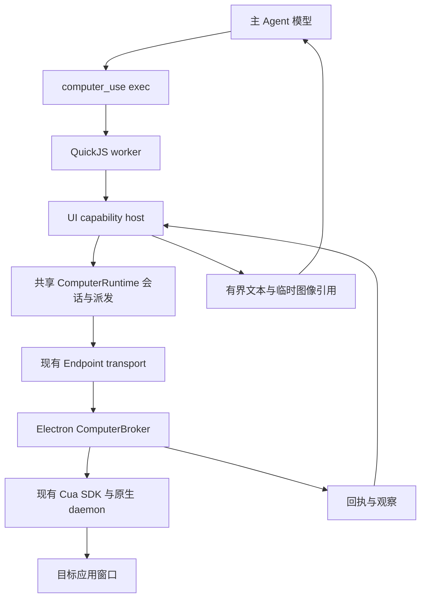

# 主模型可编程 UI 与原生输入计时方案

日期：2026-10-27。本文为原始技术方案。首轮计时、原生采样及可编程 UI 预览已实施，进展与未通过项见 [实施记录](./computer-use-programmable-ui-validation-2026-10-27.md)；真实模型性能、网络验收和发布门槛尚未完成。

目标：让主 Agent 直接编排 UI 操作，减少独立 GUI 模型请求，复用现有沙箱、电脑会话、原生驱动和执行回执；同时把原生输入的黑盒耗时拆成可归因的测量。

## 1. 决策与范围

1. 在现有 `computer_use` 增加 `op: exec`，沿用 `discover/open/close/report`。先支持单应用、单窗口，不新增通用宿主 JS 执行服务。
2. 执行代码使用已有 `@earendil-works/pi-codemode` 的 worker + QuickJS。新增 UI 专用宿主适配器，不放开现有通用 codemode 的写工具权限。
3. 主模型模式直接产生受约束动作，不经过 `predictComputerStep`。现有 GUI 模型 `step/run` 保留；打开会话时确定模式，会话内不隐式切换模型或执行模式。
4. 第一阶段持久化的是电脑会话与有界内存 JSON 状态，不承诺任意 JS 顶层变量、函数和闭包跨调用保留。这与完整 REPL 有区别，避免为了对象存活重造执行器。
5. 第一阶段保留 broker 的完整新鲜度校验、现有观察和 200ms 渲染等待。先测量，再独立优化；不把取消校验当作提速方案。
6. 浏览器继续使用现有 `BrowserRuntime`；本阶段不把 DOM/CDP 能力并入原生驱动，不增加 authenticated Gateway API 路由。

## 2. 可复用实现与真实缺口

| 现有位置 | 复用内容 | 必要调整 |
| --- | --- | --- |
| `src/agent/embedded/codemode-extension.ts` | QuickJS 集成经验、执行预算、嵌套工具前后钩子 | 抽取小型共用 hook/budget 适配；UI 不用其落盘 store/output 路径 |
| `@earendil-works/pi-codemode` | `CodemodeSandbox`、宿主 globals、超时、内存上限、JSON store | 单独实例化 UI 沙箱，仅注册 UI 能力 |
| `src/computer/runtime.ts` | owner/endpoint/session、串行化、动作预算、pending、dispatch、释放 | 将观察/受保护派发从模型预测中抽出，两个模式共用 |
| `src/computer/broker.ts` | 本地授权、精确目标、新鲜度、回执去重、取消 | 增加分段计时；不执行模型代码 |
| `src/computer/semantic-actions.ts` | snapshot ref 解析、原生 grounding | 供直接动作路径复用；增加严格语义 selector 解析 |
| `src/computer/task-state.ts` | text/field/selected 验证、历史、无进展检测 | 直接动作同样记历史；验证返回范围保持不变 |
| `electron/computer/cua-driver.ts` | 已驻留的私有 SDK/daemon、原生输入、窗口观察 | 给实际 SDK 调用包计时，不再启动一套驱动 |
| `electron/computer/execute-command.ts` | 元数据/图像传输、失败保留已执行回执 | 测量 frame upload 和命令处理 |
| `src/computer/evaluation*.ts` | 独立 oracle、缺失值、成对比较 | 增加执行模式与性能附件，避免混用不同任务样本 |

当前有两个不能忽略的约束：

- `runtime.open` 要求独立 GUI model binding，并立即构造 adapter。直接模式不能只跳过一次预测，否则仍要求配置无用的 GUI 模型。
- 当前截图不进入主 Agent transcript；通用 codemode 的 store 会追加 `codemode-store`，溢出输出可能写入 `.xopc/codemode-output`。直接复用整个 extension 会改变隐私和生命周期边界。

## 3. 目标链路



QuickJS 运行于 Gateway 进程的 worker；操作能力经现有 endpoint 发送至 Electron。Electron 不接收代码，只接收现有类型化 `observe/act/release` 命令。

### 会话和模型绑定

`open` 增加 `planner: 'gui' | 'agent'`，默认 `gui` 保持现有调用语义。`agent` 模式是显式选择，不发生自动模型 fallback。

- agent 模式从当前受信任 turn context 解析真实主模型、provider、凭据版本及数据接收方；模型名和 origin 不由脚本传入。
- 将会话的模型绑定改为带判别字段的 planner binding：GUI 维持现有 profile；agent 记录主模型绑定。不要伪造一个 GUI profile 满足旧 schema。
- 同时更新 control contract、broker 授权信息、endpoint 描述修订和 readiness。此变更要求匹配的 Gateway/Desktop 版本；旧版本明确拒绝，不试探降级。
- agent 模式不要求 `models.computerUse`，要求当前执行身份允许电脑工具、主模型可使用工具且接收图像。非视觉主模型第一阶段不开放；不静默转发截图到另一个模型。
- 会话内主模型或接收方改变，停止并释放会话后重新打开。close/reset/取消/runner eviction/endpoint 断开时清理 UI 内存和临时图像。

### 对外操作

新增输入草案：

```ts
{ op: 'exec', code: string, maxActions?: number, timeoutMs?: number }
```

默认每次 6 个输入、上限 12，默认 deadline 120 秒，仍受会话 80 次动作、15 分钟等现有配置约束。脚本长度上限 64 KiB；建议 UI worker 内存上限 64 MiB，普通 JSON store 上限 64 KiB/64 个键。具体上限由宿主收紧，脚本不能提高。

宿主暴露下列异步方法，均有 Zod 运行时校验；沙箱声明的 JSON Schema 仅提供类型说明，不能代替输入校验：

| 方法 | 行为 |
| --- | --- |
| `ui.observe({visual?: boolean})` | 返回当前窗口的有界语义状态、snapshotId、覆盖完整性；visual 请求临时图像交付 |
| `ui.act({snapshotId, action, expect?})` | 使用当前快照与已有 `ComputerAction` 执行一个输入，返回回执、新观察及条件验证 |
| `ui.resolve({snapshotId, role, label})` | 在当前完整 native tree 精确匹配唯一控件，返回当前 ref；不接受模糊匹配或第一个候选 |
| `ui.waitFor({expect, timeoutMs})` | 有界观察轮询；没有输入，不调用 GUI 模型 |
| `ui.verify({expect})` | 复用现有原生条件验证，返回 satisfied/not_met/unavailable |
| `ui.emitScreenshot({snapshotId})` | 请求将已观察图像交给当前主模型，不把 base64 返回 JS |

另提供现有 `text/exit/store/load`。store 只在宿主内存合并，不写 session custom entries。宿主 globals 的命名空间能力可映射到 `ui.*`，不需自定义 JS 引擎。

示例为拟议 API，并非当前可运行接口：

```js
let state = await ui.observe({ visual: false });
const field = await ui.resolve({
  snapshotId: state.snapshotId, role: 'AXTextField', label: 'Title'
});
const result = await ui.act({
  snapshotId: state.snapshotId,
  action: { kind: 'setValue', ref: field.ref, text: 'UI execution test' },
  expect: { kind: 'field', label: 'Title', value: 'UI execution test' }
});
text({ receipt: result.receipt, verification: result.verification });
```

后续动作必须使用前一结果的新 snapshot/ref；不能把第一帧的 refs 重复用于整段脚本。纯语义定位不完整或有歧义时返回候选/错误，交主模型重新观察。图像才能决定下一步时，输出截图并结束本次脚本，等下一轮模型决策；代码循环本身不会获得视觉理解能力。

### 串行、错误与回执

- `exec` 获得一次 owner operation 锁；内部调用共享的 observe/dispatch 方法，不能递归调用会再次获取同一把锁的 public `runtime.execute`。
- 同一 UI session 只允许一个宿主调用在途。脚本使用 `Promise.all` 发起 UI 操作时拒绝并行，不能依赖调度顺序悄悄执行。
- 所有操作仍需经过现有 host before/after policy hooks。内部操作使用受信任父调用上下文，不接受脚本自报的 owner/session/grant；共享派发负责生成 envelope 和 actionId。
- 不直接放行通用 `codemode` 到 `isComputerLeaseTool`。入口仍是 `computer_use`，其子操作被约束在同一电脑能力范围，不能调用 shell、任意 MCP 或 browser。
- 已完成/执行不明/授权拒绝/用户 Stop 等情况沿用现有回执与关闭逻辑。脚本抛错后保留已执行步骤的事实，永远不重跑整个脚本。
- 陈旧快照导致未派发时返回新观察需求，不自动重跑用户代码。主模型重新生成剩余动作；GUI 模式继续使用现有有限 rescue。
- `ui.waitFor` 的每次采样计入独立 host-call/observation 预算并受 deadline 限制；它不计成 completedInputs。建议单脚本最多 64 个宿主调用，防止纯观察循环绕过动作预算。
- 脚本返回后立刻封禁新的宿主调用、取消未 await 的调用，并等待所有在途操作确认终止。仅停止 QuickJS worker 不能证明原生输入已经停止；不明状态继续保留 tool gate。
- `verified` 只代表 supplied expectation。原生派发成功、脚本完成、模型文字结论都不等于业务成功。

## 4. 主模型观察与截图生命周期

P0 实现“主模型看到图像”必须同时实现临时图像交付，不能先把截图作为普通 tool image 写入 SQLite。

1. `ComputerRuntime` 沿用现有 invocation-bound 单次消费 frame 上传。收到图像后注册到新的 `ComputerLiveObservationRegistry`，绑定 conversation、transcript、run、session、模型接收方、snapshot 和 generation。
2. JS 只得到元数据；图像字节不进入沙箱、store、console、工具参数或 spill output。`emitScreenshot` 只能引用当前有效 snapshot，不能访问任意路径或历史图像。
3. tool result 持久表示只包含有界文本和不可复用的临时引用。复用现有模型请求 wrapper，在每次实际 provider 请求组装完成后、发送前，将本轮主动请求的引用投影为 image content；模型侧输出“已过期”时必须重新观察。
4. 投影验证当前模型/owner/run/generation。每张图像只属于一次逻辑模型请求；同一请求的内部传输重试在其受限生命周期内读取，结束后清零，不绑定到后续 provider fallback。
5. 持久化、会话广播、FTS、JSON 导出、compaction、模型调试日志和输出文件均不得出现像素/base64/data URL。模型响应完成/失败/取消、引用过期或会话释放时清零图像；不得清零正在进行的请求仍需使用的缓冲区。
6. P0 允许必要语义文本进入正常 transcript，和现有 computer_use 一致；不宣传为“屏幕内容全部不落盘”。脚本源和打印文本遵守现有敏感信息规则，不能把实际窗口内容混入性能报告。

这部分与 pooled runner、请求 wrapper 和 transcript guard 的集成是独立交付门槛。只完成沙箱，尚不能算完成直接视觉操作。

## 5. 原生输入耗时：当前已知事实

证据来自 `computer-small-goal-validation.md` 的 2026-10-20 计算器优化后单次成功 run，非新测量：

| run 范围 | 毫秒 | 含义 |
| --- | ---: | --- |
| elapsed | 47,585 | 9 个输入、2 次 GUI 模型请求 |
| phase.model | 17,487 | GUI 模型请求及响应处理 |
| phase.dispatch | 26,436 | endpoint act 的端到端等待 |
| phase.observe | 1,351 | 显式/额外稳定性观察 |
| 其余 | 2,311 | 以上分段未覆盖的编排等开销，不能全部归为网络或轮询 |

dispatch 的已有子测量：precheck 1,524ms、input 22,605ms、postObserve 2,240ms，合计 26,369ms；与 dispatch 相差约 67ms。input 包含 identity/校验/SDK 调用/200ms 等待，不能把 22,605ms 全部称为 OS 输入。

9 次非 wait 动作的固定 grace 理论值约 1,800ms，实际调度可能更长；余下约 20,805ms 仍没有细分证据。不能据此断言是 SDK 固定 sleep、socket 或 OS accessibility 慢。该计算器记录使用 driver 0.28.2，后续 TextEdit 已升级到 0.36.0；需在当前驱动上重测。

## 6. 计时设计

### 同一 trace，不混用时钟

关联键沿用 reportId/sessionId/actionId/invocationId/requestId，新增有界 `spanId/parentSpanId`。各进程用 `performance.now()` 测 duration；墙钟仅作关联展示，不跨进程相减。所有失败在 finally 结束 span，未知测量保持 null。

一级计时互斥，二级计时是父阶段的拆分，展示时不重复相加。统计明确区分输入次数、SDK 次数、观察次数和稳定性采样次数。

| 层级 | 建议字段 | 精确计时边界 |
| --- | --- | --- |
| Gateway | `endpointRoundTripMs` | invocation 发起至完整结果可消费 |
| Electron | `commandWallMs` | executeComputerCommand 进入至结果构造完成 |
| Electron | `brokerWallMs` | broker.command 调用前后；与 upload 分离 |
| Electron | `frameUploadMs` | context.uploadFile await 全过程；失败同样记录 |
| Broker | `authorizationMs` | 本次 requestApproval 检查，和 pending 等待分开 |
| Broker | `pendingWaitMs` | envelope 进入 pending 到终态决定的累计驻留时间，单独展示、不逐轮累加 |
| Broker | `precheckMs` | 当前已有，完整 fresh target/digest 校验循环 |
| Broker | `inputMs` | 当前已有，driver.perform 全过程 |
| Broker | `postObserveMs` | 当前已有，第一次动作后 broker.observe 全过程 |
| Driver/input | `identityCheckMs` | processIdentity/assertWindowApp 等执行前身份检查 |
| Driver/input | `actionValidationMs` | validateAction、原生目标定位；嵌套子测量不重复计时 |
| Driver/input | `windowsInputGuardMs` | Windows 键盘/编辑目标检查，macOS 不适用 |
| Driver/input | `sdkCallMs` | 每个实际 client.click/pressKey/hotkey/callTool 等 await；统一 helper 包装 typed/untyped 两条路径 |
| Driver/input | `resultValidationMs` | SDK 返回到结果路由/拒绝校验与 JSON 解码结束 |
| Driver/input | `renderGraceMs` | performInput 返回后实际等待时长 |
| Driver/input | `unattributedMs` | inputWall 减去互斥已测子项，保留调度/其他剩余项 |
| Driver/observe | `identityMs/stateRpcMs/decodeProjectHashMs` | 身份、getWindowState await、图像解码/AX 投影/完整摘要构造 |

补充字段：sdkMethod、actionKind、deliveryMode、attemptCount、frameBytes、pixelCount、treeCoverage、captureCount、precheckSamples、stabilitySamples、receipt.dispatch。仅记录白名单枚举、计数与尺寸，不记录控件标签、窗口文本、键入内容、脚本源或像素。

**P0 的 sdkCallMs 仍是黑盒 RPC 总时长**，包含 SDK 编解码、socket、native daemon、OS 调用及驱动内部确认。没有驱动内部 span，就不能分别给这些项填数。若它占主要成本，P1 在固定版本 driver 增加 requestId 对应的 daemon queue/targetResolve/nativeDispatch/ackWait span；需审查上游源码和重新打包验证，不能靠外层减法推断 OS 耗时。

### 协议和报告

- 复用现有 `nativeMs` 汇总，增加可选 `timingV2` 树形附件；保留原 precheck/input/postObserve 字段定义，不悄悄重定义。
- 当前 Runtime Reply 与 timing schema 是 strict，新增字段必须同时修改发送端、接收端和契约测试。公共共享计时 schema 放 control-contract，避免桌面公共类型反向依赖 runtime 实现。
- trace 在内存中有界保留（建议每会话最多 256 个 operation 根记录，每根最多 32 个子 span），溢出标记 truncated/dropped，不把缺失阶段记为零。
- 完成/失败记录都纳入汇总；回执重发/去重不产生第二条执行测量。已完成输入后上传失败仍保留 completed receipt 和局部 timing。
- 输出 per-action/per-method 的 count、P50/P95、总时长和测量覆盖率；明确样本总体。父 span 不与子 span 混合聚合。
- `endpointRoundTripMs - commandWallMs` 只标为 transport/orchestration residual，不能命名为纯网络延迟；不完整测量时 residual=null。
- 第一阶段通过已有 report 和私有验证 JSON 导出，不新建业务表或 Gateway API。

## 7. 文件级实施拆分

### P0a：先完成计时基线

修改 control-contract、`diagnostics.ts`、`broker.ts`、`runtime.ts`、`electron/computer/cua-driver.ts`、`execute-command.ts`，增加 `native-timing.ts` 小型单调时钟测量 helper。修改现有 native fixture harness 输出 timing 附件，新增 `scripts/benchmark-computer-input-live.mts` 编排重复实验。

在 disposable fixture 对 activate/setValue/typeText/pressKeys/scroll 分别采样；先预热再测，冷启动单独记录。每类建议 30 次，目标不具备能力则标 unsupported；文本、滚动均独立读取结果，避免操作不同或实际没有生效。再跑计算器和 TextEdit 与历史目标相同的当前驱动基线。

这一步不引入主模型模式、不调小等待。交付实测分项，确定是否需要驱动内部 span。

### P0b：共享会话核心与直接动作

从 runtime 抽出 `session-core.ts`：负责 session lifecycle、observe、ground、dispatch、receipt、budget、release。保留 `ComputerRuntime` 为公开调度层；GUI adapter 只留在 GUI 分支。禁止复制一套 broker/endpoint/driver。

增加 `program-host.ts`，负责 snapshot registry、严格 selector、UI 原语与只读/控制准入。更新 binding/readiness/settings 的 planner 选择、tool schema/manual；旧 GUI 路径通过原有回归。

### P0c：沙箱、主模型观察与会话集成

增加 `program-runtime.ts` 和 `live-observations.ts`，用现有 QuickJS worker 承载 `exec`；接入 agent 的请求 wrapper、取消、runner eviction 和 transcript 生命周期。UI 输出无磁盘 spill；输出超限返回截断信息，动作回执不能被截断丢失。

提取并复用现有 nested hook 接线。UI globals 每次宿主调用都经过同一宿主策略；不要用一个泛化 codemode 白名单修改绕过控制门禁。保持 personal_main/worker 的现有执行身份约束。

### P1：按证据优化

如果 sdkCall 占比高，先查驱动内部确认；如果模型占比高，改善直接模式的动作合并和主模型观察。事件驱动等待、轻量 AX 观察、动作相关状态校验各自作为单独实验，不与第一阶段混测。

## 8. 验证和交付门槛

自动化重点覆盖：

- 新模式无需 GUI 模型也能 open，实际模型接收方来自 turn；切模型后旧图像/会话不可复用。
- 每个直接动作仍经过 host hooks、broker grant、fresh target/state、actionId 去重；只读会话不能输入。
- CPU 死循环能停止；UI Promise.all 被拒绝；脚本退出时没有残留宿主输入；取消/断线/未知派发不触发整段重放。
- 旧 refs、同名多控件、partial tree、目标切换、超时、预算和 preexisting 条件，维持现有结果语义。
- 屏幕图像只出现在本轮授权模型请求中，SQLite、日志、广播、导出、store、compaction、spill 文件均无图像；关闭/取消/失败后 registry 无残留。
- fake monotonic clock 验证互斥阶段、嵌套阶段、失败和去重统计；typed SDK 与 untyped SDK 两条路径都被计时。

真实验证顺序：无模型 native fixture → 当前 GUI 模式基线 → 同主模型的 agent 模式。对完整任务报告总耗时，而不是用 GUI 模型请求归零宣称性能提升；主模型请求、token、失败与人工接管都计入成本。

试点固定计算器、TextEdit、设置导航任务，每任务至少三次，在相同设备/驱动/初始状态下配对。主模型相同；GUI 路径另记录其 GUI 模型。各任务使用独立 oracle，既展示全体运行分布，也展示双方成功的配对耗时，避免失败提前退出看起来更快。

建议试点目标：成功率不下降、无未知输入重放/错误成功声明，成功配对任务的耗时中位数下降至少 30%。这是验收目标，不是当前已测结果。试点通过不替代现有 60 任务 × 3 次发布门槛；新模式不能凭 fixture 直接宣称 Codex 等效。

## 9. 依据

- 当前源码：`src/computer/`、`electron/computer/`、`packages/computer-control-contract/`、`src/agent/embedded/codemode-extension.ts`。
- 已安装 pi 公共声明：`@earendil-works/pi-codemode` 的 CodemodeSandbox/tools/globals/store；`pi-coding-agent` codemode 的 appendEntry/output 保留行为。
- 历史实测：`docs/design/technical/computer-small-goal-validation.md`。
- 当前知识图谱工具不可用，本次使用源码检索；没有修改并行进行中的 phone use 文件。
