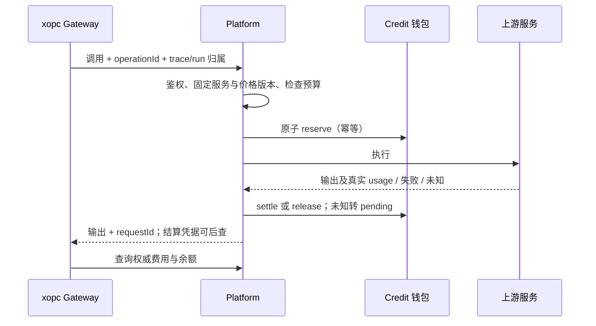

# XOPC 统一 Credit 计费技术方案

日期：2026-10-11。状态：原始技术提案；platform 首阶段已等值迁移并部署，客户端后续实现见 [Credit 客户端实现](./credit-billing-client-implementation.md)。以下完整目标不等于全部已上线。

## 1. 建议与范围

建议用户统一使用 **Credit（积分）** 消费 XOPC Cloud，平台保留真实用量和供应商成本。文本 token、图片张数、音频时长、字符数仍是底层计量维度，经过已发布价格表转换为 Credit；用户看到余额、任务消耗和预算。

第一阶段上线「统一 Credit 钱包 + 充值包 + 全能力结算 + 预算 + 消费明细」。订阅套餐、每日赠送、结转及自动充值放在后续阶段，避免余额迁移与订阅状态机一起上线。

覆盖 xopc-platform 的 billing、Model Gateway、Console；覆盖 xopc Gateway、Web/Electron、Android/iOS/HarmonyOS 和 CLI 的协议与展示。BYOK 继续由用户自己的供应商账户支付，保留本地 token/成本统计，不扣 XOPC Credit。托管电脑、搜索、连接器仅在确认已经有可靠平台计量的路径上纳入；本地运行工具不因耗时而收积分。

本文的兑换比例、价格算例、过期与退款策略是建议值，不是已经确定的商业政策。没有读取生产数据库，现状以两个本地仓库源码为依据。

## 2. 当前实现：已经有账本，但不是产品意义上的 Credit

| 位置 | 核实的现状 | 改造含义 |
| --- | --- | --- |
| platform `packages/billing/src/money.ts` | `ATOMIC_PER_YUAN=1_000_000`，金额按整数计算 | 现有扣款单位是人民币百万分之一 |
| platform `packages/billing/src/credits.ts` | `CreditLedger` 有批次、预留、分配、结算；summary 返回 CNY、`availableAtomic` | 不能因为类名叫 CreditLedger 就直接认定它是积分钱包 |
| platform `packages/billing/src/schema.ts` | `model_credit_account`、`billing_lot/hold/allocation/entry`；purchase/grant 两种来源 | 可复用领域行为，但单位必须明确、历史必须保留 |
| platform `packages/billing/src/orders.ts` | 充值商品目前为 ¥10/¥50/¥100；付款金额直接换 atomic；退款按 `/10_000` 换分 | Credit 商品与支付金额解耦后，这些公式必须替换 |
| platform `apps/model-gateway/src/repository.ts` | 统一 reserve/settle；已有用户、Workspace 和 token 限额 | Credit 预算与资源限额分开处理 |
| platform `apps/model-gateway/src/model-billing.ts` | 展示请求预留、实扣、释放及价格快照 | 增加单位、价格版本、供应商成本与任务归属 |
| platform `packages/shared/src/model-services.ts` | language/image/stt/tts/omni，发布配置内有 prices | 在现有发布流程增加明确 Credit 价格 schema |
| platform `apps/model-gateway/src/app.ts` | `/account/summary` 的 `balance.credits` 直接取 `balance_credits` | 当前接口没有告诉客户端该数字实际是 CNY atomic |
| platform Console `lib/money.ts`、`ModelBillingPage.tsx`、`CreditActivity.tsx` | 同样叫 credits 的字段使用 `cnyAtomic` 格式化 | 展示逻辑整体换成 Credit；订单仍显示人民币 |
| xopc `src/providers/xopc-cloud-account-service.ts` | 校验整数 credits，无单位/精度 | 必须升级契约，不能靠前端猜换算比例 |
| xopc `web/src/features/settings/models-hub/xopc-cloud-account-card.tsx` | 将上述整数直接显示为 credits | 存在单位语义错配，需要随平台切换修复 |
| xopc `src/usage/`、SQLite usage repository、gateway-contract usage、Web usage 页面 | 记录 token 与估算 USD，含后台调用类别 | 是观测数据，不是平台权威扣费；增加结算引用 |

另两个现有行为要保留其保护目的：`CreditLedger.finish` 将实扣限制在预留内；ModelRepository 有未核实用量超过 24 小时后平台承担费用并释放的逻辑。新的长任务预留需要租约/心跳和明确 pending 对账状态，不能简单继承固定时间释放后又补扣。

## 3. 竞品参考与取舍

调研以 2026-10-11 读取的官方页面为准；价格规则可能变化，不复制竞争对手的具体套餐数字。

| 产品 | 官方规则摘要 | 对 XOPC 的启发 |
| --- | --- | --- |
| [Manus Credits](https://manus.im/help/credits) | 将 LLM、虚拟机、第三方 API 消耗映射为 credits；任务复杂度和时长影响消耗；平台技术故障有退款规则 | 统一多能力单位，并把一次任务的多次调用聚合展示；收费基础必须有可审计计量 |
| [Lovable Plans and credits](https://docs.lovable.dev/introduction/plans-and-credits) | 官方文档包含按工作量消费、credit 批次及到期明细、用量分类，以及长任务消费检查点 | 提供余额来源、到期提示、任务费用和长任务预算交互；首版简化批次种类 |
| [Cursor Models & Pricing](https://cursor.com/docs/models-and-pricing) | 不同模型价格影响包含用量的消耗；支持用量面板及额外消费 | 保留高级用量明细，让高成本模式和预算可见 |

推荐「统一钱包 + 能力价格表 + 任务汇总」，不在第一版引入多种不可互换的钱包，也不把“一条消息=固定 1 Credit”用于所有 Agent 任务。固定消息价难以覆盖长上下文、多轮工具调用和实时语音。

## 4. 单位、兑换与定价

### 4.1 三种概念严格分开

- `MoneyMinor`：支付币种的最小单位，例如人民币分。用于订单、退款、发票、支付对账。
- `CreditMicro`：消费权益单位。建议 `1 Credit = 10_000 microcredits`，所有钱包、预算和结算使用整数。
- `UsageQuantity`：token、图、毫秒、Unicode code point、请求数等真实计量；不直接等于 Credit。

API 整数使用十进制字符串，内部 BigInt 计算并校验数据库整数范围。禁止 `Number` 浮点金额运算；显示精度不会改变账本精度。列表展示最多 4 位小数，对小于展示精度的正值显示 `<0.0001`，不显示为免费。

### 4.2 推荐起点

建议初始标准兑换 `¥1 = 100 Credits`。因此 `1 CNY atomic = 1 microcredit`，迁移余额可精确一比一复制整数，减少舍入风险，但两者业务语义仍不同。¥10 的标准充值包发放 1,000 Credits；赠送另列批次，不混入可退款购买部分。

初始能力价可以将当前人民币售价按同一倍率转换，从而只改变单位，不主动改变现有用户的消费能力。未来商品可配置 `amountMinor`、`purchasedCreditMicro`、`bonusCreditMicro`，不再用付款金额实时推算积分。标准兑换变化仅作用于新商品，不重估旧余额或旧订单。

### 4.3 能力价格表

| 能力 | 用户价格说明 | 底层结算维度 |
| --- | --- | --- |
| 文本/推理/Codex | 以 Credit 消费，按实际使用；高级详情展示输入/输出单价 | 输入、输出、缓存读写；reasoning 与 output 是否重叠由 adapter 明确 |
| 图片 | 按张，显示尺寸/质量对应的 Credit | 成功交付张数与规格；需要 token 计价的上游另有成本记录 |
| STT | Credit/分钟 | 有证据的音频毫秒，按比例结算 |
| TTS | Credit/千字符 | Unicode code points；未来按音频 token 的服务使用独立 meter |
| Omni 实时语音 | 会话 Credit 预算，结束后实扣 | 文本/音频输入输出 token；有可靠时长价格的服务可选择时长 meter |
| 平台托管搜索/连接器 | Credit/次或供应商声明的单位 | 成功调用、操作类型、供应商 usage；尚无计量则不宣称已支持 |
| 云计算资源（后续） | Credit/分钟等明确资源规格 | 平台资源计量，避免把 Agent 等待和本地工具耗时收费 |

公共服务绑定不可变 `priceVersion`。自适应路由更换供应商，用户仍按请求开始时公共服务价收费；平台记录目标供应商成本。昂贵目标不能触发未告知的用户加价；成本超过运营阈值则禁用该目标、换已批准目标或明确拒绝。

公式：`ratedMicro = ceil(sum(quantity × rateMicro / divisor))`。只在一次结算的总量上舍入，实时语音按累计量与已记账量的差额结算，不能每个音频帧向上取整。

示例（虚构价格）：文本输入 100 Credits/百万 token、输出 400 Credits/百万 token；10,000 输入 + 2,000 输出 = 1.8 Credits。图片 8 Credits/张，3 张 = 24 Credits。实际单价需依据当前服务售价、真实用量分布和成本验证，不能由此示例直接发布。

售价与供应商成本是两张独立快照。运营用历史成本回放测算毛利、渠道费用、退款和失败补偿；不在用户请求途中按最新汇率临时调售价。

## 5. 钱包、支付和退款

复用现有 lot/hold/allocation/平衡分录算法，新增明确 Credit 单位的 v2 钱包表与投影（建议 `billing_credit_*`），旧 CNY 表转为历史只读。迁移后只有 v2 钱包接收新写入，不双写或维护两个可消费余额。

批次含：account/owner、kind、source、issued/available microcredits、expiresAt、退款关联订单、商品版本、原币种/实付金额、区域/商户。第一版保留 purchase/grant；赠送原因区分 trial、promotion、compensation、migration。订阅批次与周期另阶段加入。

消费顺序：符合当前调用用途的赠送批次按到期时间优先，再使用购买批次。保持现有组织调用仅消费授权赠送额度的边界，不把组织任务切换为扣个人购买积分。购买积分首版建议不设到期；赠送到期按原规则继承。预留期间过期的赠送积分，结算释放时记过期，不能复活。

现金支付事实与积分账本保持独立：验证付款成功后按订单内不可变发放快照幂等 issue；新价格、重复 webhook、补查或客户端重试都不能改变已下单商品。发票使用实付现金金额。

退款按该订单购买批次的未消费权益计算，不按当前兑换率。若付款 M 分购买 P microcredits，可退累计上限为 `floor(M × cumulativeRevokedPurchaseMicro / P)`，本次退款取累计上限减已成功退款金额；不超过原付款余额。剩余可退购买积分须减去消费与退款冻结。订单赠送单独记来源，按商品条款处理联动撤销；无法撤销已消费赠送时采用明确可审计政策，不能由前端决定退款额。退款批准时冻结对应购买权益，渠道确认成功才完成撤销；失败/拒绝释放冻结，unknown 持续对账，不能重复消费。渠道金额舍入残差随累计计算处理，避免多次退款多退。

## 6. 调用结算与任务预算



状态至少覆盖 reserved、running、pending、settled、released；结算事实增加 rated、charged、absorbed。不得仅记录 `min(rated,reserved)` 后丢弃超额：超出预留由平台承担并明确记录 absorbed，不能事后扣成负数。

- 短调用按可验证输入量和输出上限预留；费用超过请求上限直接拒绝，并区分余额不足、预算不足和资源限额。
- 长任务按调用分段预留。platform 提供持久 budget scope，同一账号/任务的并发子调用在同一事务检查「已结算 + 未完成预留」。scope 归属由服务器授权，不能让客户端换 runId 绕过用户日预算。
- 实时语音按累计 usage 续预留，达到预算边界结束会话。输出已经发生但尚未报告的 usage 需安全余量；若上游没有可靠中间计量或取消能力，则首版限制时长、预留完整会话上限，不承诺精确中途硬停。
- Agent 达到 Credit 预算，在安全的调用边界暂停；保存进度，用户续预算后继续。不把调用超时认定为免费，也不自动重新提交未知状态的付费生成。
- 平台技术故障且无有效交付：释放预留；已经扣费则按原分配补偿 Credit，供应商费用由平台承担。用户主动停止、部分交付或上游已处理：按已确认可计费用量结算，界面说明实际消耗。
- usage 缺失：pending，重查供应商/relay 记录；最终无法核实按已发布规则由平台承担，释放预留并保存 reason。禁止拿本地 token 估算冒充实扣。
- 每个上游 attempt 独立成本记录；一个逻辑 operation 的用户费用只结算一次。网络传输重试不能隐式制造第二次消费。业务级重复生成明确作为新操作。

保留 token/minute、并发、速率等资源控制，Credit 预算不能替代它们。平台全局风险阈值分别控制 Credit 售价消耗与供应商现金成本。

## 7. 服务契约与接口

在 platform shared 增加 `CreditAmount`、`CreditPricePolicy`、`CreditBalanceSummary`、`BillingReceipt`，不继续对外暴露无单位 `credits: number`。版本化价格配置示例：

```json
{
  "schemaVersion": 2,
  "priceVersion": "language-standard-v2",
  "unit": "credit",
  "microPerCredit": "10000",
  "meters": [
    { "dimension": "input_tokens", "rateMicro": "1000000", "divisor": "1000000" },
    { "dimension": "output_tokens", "rateMicro": "4000000", "divisor": "1000000" }
  ]
}
```

账户摘要新增 v2 契约，返回 available、usageReserved、refundReserved、purchased、granted、expiring、updatedAt；全部 microcredits 字符串，并声明单位/精度。历史记录附 `unit=CNY_ATOMIC` 或 `CREDIT_MICRO`，跨迁移时间窗分别汇总，不把两个裸整数直接相加。

接口建议沿用已有路径前缀，通过明确版本协商升级；下列新能力的最终路由在实施时对齐现有认证结构：

| 接口能力 | 责任 |
| --- | --- |
| `/account/summary` v2 | 余额、最近 Credit 实扣、预留、临近到期和购买入口 |
| 价格目录 | 随服务发布提供 Credit 单价、计量维度、版本、预留限制 |
| 已有 `/api/v1/billing/products/orders/transactions` | 商品权益快照、现金支付、积分流水；订单金额保留原币种 |
| 只读 receipt / usage 查询 | request/operation/runId 对应权威状态、实扣、价格版本 |
| budget scope 创建/查询/调整 | 显式授权任务预算、并发原子校验、余额不足原因 |
| xopc `/api/models/xopc-cloud/account-summary` | 代理新版只读摘要；既有路由随契约升级 |
| xopc `/api/usage/*` | 分开返回 cloud charged credits 与 BYOK estimated cost |

沿用现有 `account:usage` 只读边界，实施时校验它是否覆盖 receipts；否则新增最小只读 scope。模型调用凭据不能直接获得购买、退款和运营权限。OAuth 读余额失败显示不可用，不显示 0，也不扩权自动重登。

标准 OpenAI 响应保留原 usage 和 token 语义，不把 Credit 填入 total_tokens。响应头返回稳定 requestId；流式与 WebSocket 无法依赖最终 HTTP header 时，通过已有事件扩展或 receipt 查询拿结算。初始预留只显示「预留」，不能当作实扣。

## 8. 两仓库改造清单

### xopc-platform

1. `packages/billing`：新增单位类型、v2 钱包 schema、原子预算、幂等迁移、商品快照与退款换算；复用平衡分录和支付 worker 的事务边界。
2. `packages/shared/src/model-services.ts`：新增版本化 Credit meters、展示单价和预约策略；修改服务编辑、校验、诊断与发布指纹。未配置完整价格不得发布 metered 服务。
3. `apps/model-gateway/src/repository.ts`、`app.ts`、`model-billing.ts`：调用只写新钱包，更新摘要、运营赠送、额度审批、用量聚合、pending 对账、receipt 与预算校验。
4. `image-repository.ts`、`audio-repository.ts`、`audio-billing.ts`、`omni-repository.ts`、`omni-relay.ts`、`realtime-audio-relay.ts`：逐个明确计量维度、价格快照和续预留。Codex 专有认证/路由保持原授权边界，仅调整确实经过平台的收费路径。
5. `apps/console/server/src/billing-routes.ts`：商品权益、充值、退款、发票、对账分别使用正确单位；核对 `model-proxy.ts` 的转发匹配。
6. Console `ModelBillingPage.tsx`、`CreditActivity.tsx`、充值/额度页面及相关 API 类型：替换人民币余额格式，增加批次、任务聚合、Credit 价格编辑。人工 Omni 结算表单目前存在展示单位与 `Number(credits)` 整数提交的混用，也需一起修正。
7. 支付渠道继续人民币分结算；营销试用/赠送脚本、Workspace budget、default trial 配置与部署说明全部检查单位。生产赠送不能通过开发测试触发。

### xopc

1. `src/providers/xopc-cloud-account-service.ts`：新版 schema、单位/精度、状态；`xopc-cloud-model-source.ts` 读取新版价格元数据且与 pi 模型 token cost 字段分开。
2. `src/gateway/hono/routes/models.ts`：升级摘要代理；新增 billing/receipt/预算 Gateway 路由时必须同步 `lazy-bundles.ts` 与映射测试，并从真实认证入口验收。
3. `src/usage/types.ts`、`recorder.ts`、`src/storage/sqlite/ai-usage-repository.ts` 和追加迁移：保存平台 requestId/operationId、settlementStatus、chargedCreditMicro、priceVersion、billingSource；补查幂等更新。receipt 缺失记 pending/unknown。
4. `packages/gateway-contract/src/usage.ts`：新增权威扣费与计费来源字段，同步 Web 与三端契约。一个请求多条本地观测记录只挂一个实扣归属，防止重复汇总。
5. `xopc-cloud-account-card.tsx`、`usage-settings-page.tsx`、i18n：余额与本期消费以 Credit 为主，token 折叠进详情；BYOK 显示供应商估算，不能与云端 Credit 相加。
6. Agent/automation/task/voice 执行：贯穿本地 conversation/run/trace 与平台请求关联；覆盖 compaction、标题、摘要、委派、重试等后台调用。标题/压缩等产品维护调用建议由平台承担，后台自动化则显示任务预算与消耗；平台通过可信服务操作标识执行豁免，不能接受客户端任意 `free=true`。
7. Android/iOS/HarmonyOS：账户/设置页消费相同 Gateway DTO，展示 Credit、消费详情、低余额和预算暂停状态；第一阶段沿用受支持的平台购买入口。原生内购及支付入口合规沿用既有支付专项，不能因为改成 Credit 就假定外链充值在所有发行渠道可用。
8. Electron 复用 Web，CLI 提供余额/任务消费查询与明确错误原因。BYOK、未登录和离线场景保持真实状态。

## 9. 用户界面

账户区：可用 1,280.50 Credits；预留 36 Credits；7 日消费 219.30 Credits；临近到期积分另列。主操作为充值和查看消费。

任务完成：显示「本次使用 12.40 Credits」；详情包括对话推理、图片、语音、搜索与后台步骤。实时状态显示已确认消费及预留，pending 显示待结算，不能显示 0 Credit。总额来自平台权威数据；本地分类只有关联完整时才标记完整。

长任务：启动时设置消费上限，预计区间仅在有校准证据时显示；达到阈值提醒，达到上限在安全边界暂停。购买成功先同步服务端余额再恢复用户选择的任务，避免自动重发生成操作。

平台价格编辑器：运营填写「Credits/百万输入 token」「Credits/张」「Credits/分钟」等；显示转换预览与历史成本回放结果。用户价格变动必须新版本发布，正在运行的请求继续原快照。

沿用现有设计系统、Select、Skeleton 和固定尺寸详情弹窗。资金订单界面仍显示 ¥，消费界面显示 Credits，两者各有明确标题。

## 10. 迁移与发布

1. **盘点/预演**：冻结迁移规格，导出只读快照，核对账户=可用批次合计、预留分配与分录平衡；回放所有能力价格，输出差异报告。遇到单位不明或历史孤立余额阻止迁移。
2. **部署准备**：先发布可识别新版协议的客户端与 Gateway；钱包切换之前仍标明旧单位。旧客户端若未协商新版就返回升级要求，不能把新版数值塞入旧 `credits:number` 造成静默错算。
3. **写入屏障**：平台暂时停止新调用预留、新订单创建和人工调整。已有调用正常结算；payment webhook 继续验证并持久化 inbox，权益发放在屏障内排队。退款与支付 worker 写入也纳入屏障。
4. **排空/处理存量**：running 完成，pending 用量人工/供应商核验；未知按已公布旧政策处理。若仍存在活跃 hold，不直接切换。未付款订单保留旧商品与权益快照，晚到付款按固定迁移率发到新版；退款中的冻结按来源与订单映射迁移或先排空。
5. **原子开账**：以 `migrationId + legacyLotId` 幂等复制每个剩余批次、来源、到期和退款依据到新钱包；记录旧单位/金额、新权益、兑换版本及开账分录。按建议比例整数值相同，但不能省略开账事件或覆盖历史交易。
6. **校验/切换**：迁移总量、逐用户余额、购买/赠送分量、冻结、退款权利全部核对；切到唯一 v2 写入者，再处理排队支付事实，恢复新调用和商品购买。
7. **观测**：灰度账号验证后扩大；监控重复扣费、pending 时长、余额差异、rated/charged/absorbed、成本/售价、退款差额。保留旧账只读查询。

开流量前失败可恢复备份；新账开始写入后禁止整库回滚丢弃付款与消费。故障时停止新消费，保留支付事实 inbox，通过向前修复/补偿恢复；回滚代码必须认识新单位和新 schema。

## 11. 实施阶段与验收

| 阶段 | 交付 | 放行条件 |
| --- | --- | --- |
| A 规则与契约 | Credit 单位、价格版本、商品/退款政策、能力 meter 清单 | 历史用量回放没有非预期涨价，所有金额来源明确 |
| B platform 核心 | v2 钱包、支付/退款、所有已收费能力、receipt、原子预算 | 并发/幂等/成本吸收/对账测试通过 |
| C xopc 全端 | 余额、Credit 用量、后台归属、预算状态、版本协商 | Web/Electron/三端/CLI 同账号展示一致 |
| D 迁移上线 | 预演报告、屏障、开账、灰度和恢复手册 | 逐账户与支付渠道对账一致，真实认证链路通过 |
| E 商业扩展 | 订阅、周期发放、结转、自动充值 | 单独的生命周期、退款与防重复发放验收 |

必要验证：

- 精度：输入/输出/缓存不重叠，累计音频结算不逐帧舍入，字符含 emoji，安全整数/数据库边界明确。
- 钱包：并发请求不透支；预留/释放/结算幂等；预留跨赠送过期不复活；实扣不超授权额；分录合计为零。
- 支付：重复/乱序 webhook、晚到成功、优惠商品、部分退款与多次退款累计不多退；购买和赠送权益不可混退。
- 执行：文本流中断、图片部分完成、STT/TTS、Omni 缺失 usage、用户取消、重试/fallback、进程重启和 pending 恢复。
- 归属：同一账号多设备共享余额；组织调用不扣个人购买批次；相同平台请求本地多 observer 不重复统计。
- 协议：旧客户端明确升级，新客户端历史金额不误当 Credit；BYOK 不扣云端积分，余额接口失败不伪装成余额为零。
- 集成：通过真实 Gateway 鉴权与 lazy matcher 验证；平台支付 sandbox 和 mock provider 先验证，再经受控小额真实调用验收。
- 迁移：相同快照重复执行结果一致，支付在屏障期间不丢失；部分执行故障可恢复；新账写入后按向前恢复演练。

本文是已完成的设计交付；上述测试是实施放行要求，尚未执行，也不代表已经完成生产计费认证。

## 12. 建议先确定的商业参数

建议首版采用：¥1=100 Credits；标准充值包先复用 ¥10/¥50/¥100 档位；购买积分不设到期；赠送按批次规则；当前售价等值迁移；平台技术失败按原批次补偿；不自动充值；后台产品维护成本由平台承担。订阅和额外奖励额度在成本回放后定价。

仍需业务确认的是上述比例及政策、哪些后台能力属于付费服务、每任务/日预算默认值，以及套餐推出节奏。这些参数未确认不影响先实施单位类型、协议和迁移预演，但不能据此直接发布线上商品或修改现有余额。
