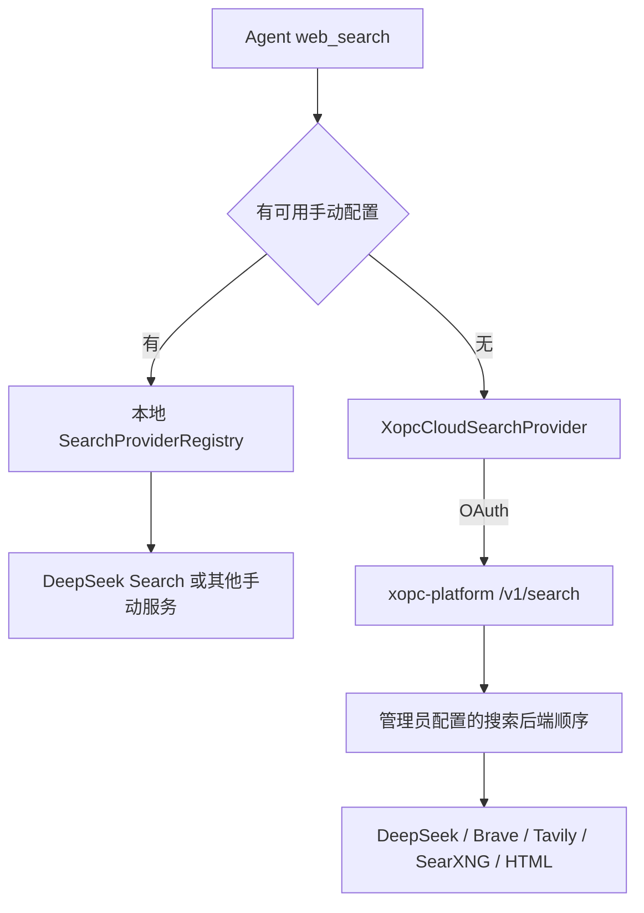

# DeepSeek Search 接入调研与设计

日期：2026-10-17。状态：Search 配置与运行链路已实现，完成自动化测试及两次真实 DeepSeek Search 冒烟。

## 1. 结论与范围

建议沿用现有 SearchProvider 和 hosted search 架构，新增 `deepseek` 搜索后端，同时覆盖：

1. **xopc 自定义搜索**：用户自行配置 DeepSeek API Key，设备直接请求 DeepSeek；通过 JSON、CLI、Web 设置管理。
2. **xopc-platform 搜索配置**：管理员在现有「云端搜索」页面配置独立 Key、启停、主备顺序、运行限制和在线测试。
3. **xopc-cloud 使用体验**：平台将 DeepSeek 作为托管搜索上游；客户端继续使用 OAuth 和 `xopc-cloud` 搜索协议，用户无需填写上游 Key。

这里将 xopc-cloud 理解为 xopc-platform 的托管能力，而非第三个独立仓库。已核对本机 xopc、xopc-platform 源码；当前会话未提供 codebase-memory 图工具，代码发现使用源码检索。平台工作区存在未提交改动，本次不修改其运行代码。

一期实现 Search。Fetch、搜索正文返回、平台租户自行托管搜索 Key，分别作为后续能力，避免与现有全平台管理员配置混在一起。Search 可用于任意支持工具调用的模型，不要求当前对话使用 DeepSeek 模型。

## 2. 官方 API 核对

官方资料：

- [使用指南](https://api-docs.deepseek.com/zh-cn/guides/search/)
- [Search Reference](https://api-docs.deepseek.com/zh-cn/api/search/)
- [Fetch Reference](https://api-docs.deepseek.com/zh-cn/api/fetch/)

Search 为独立 JSON API：`POST https://api.deepseek.com/v1/tools/search`，使用 Bearer Key。`query` 为 1–128 个 Unicode 字符，`count` 为 1–50；可选 `ori_question`、IP 本地化参数 `localization`、正文开关 `need_content`。返回标题、URL、短摘要 `snippet`、长摘要 `summary`，以及正文、日期和评分等。[来源：Search Reference](https://api-docs.deepseek.com/zh-cn/api/search/)

Search、Fetch 均为每千次有效成功请求 5 元；空搜索和失败不收费。两者各自按账号限 5 QPS，更换同账号 Key 不增加额度。408、429、5xx 可等待重试；402 需充值。指南中 **2026-11-01 起收费**的说明特指 Harness/Claude Code/Codex 服务端工具调用，不能据此假定此次直接调用免费。[来源：指南](https://api-docs.deepseek.com/zh-cn/guides/search/)

Fetch 接受单个 HTTP(S) URL，返回标题和 Markdown 正文，属于另一项能力。[来源：Fetch Reference](https://api-docs.deepseek.com/zh-cn/api/fetch/)

## 3. 当前代码链路与差距

| 层 | 当前实现 | 接入影响 |
| --- | --- | --- |
| xopc 配置 | `src/config/schema.ts:195` 的 provider enum 为 brave/tavily/bing/searxng | 增加 deepseek，并同步手写验证 |
| 配置解析 | `src/agent/tools/search/resolve-config.ts` | 保留 Key 引用解析，增加可选地址的透传 |
| 搜索执行 | `src/agent/tools/search/registry.ts` | 新增适配器；保留手动配置优先规则 |
| 工具参数 | `src/agent/tools/web.ts` | 通用参数只有 query/count；运行时最多 20 条 |
| Web 设置 | `web-search-config-api.ts`、`web-search-settings.tsx` | union、选项、序列化、提示均需扩展 |
| Gateway 配置 | `src/gateway/config-tools-web.ts` | 当前仅 SearXNG 保留 url；其他类型会丢弃 |
| CLI | `src/cli/commands/search.ts` | 类型清单、帮助、schema、add/update 逻辑需同步 |
| 云能力发现 | `src/providers/xopc-cloud-model-source.ts` | 解析 `/v1/models` 的 `xopc.search`，已有布尔能力位 |
| 云请求 | `src/agent/tools/search/providers/xopc-cloud.ts` | OAuth 请求 `/v1/search`；云端最多 10 条 |
| 平台管理 | `apps/model-gateway/src/search-configuration.ts` | enum、数组 `.length(4)`、数据库 CHECK 均固定四种 |
| 平台执行 | `apps/model-gateway/src/search.ts` | 统一规整、顺序降级；当前所有空结果最终变成不可用 |
| 平台路由 | `apps/model-gateway/src/app.ts` | 已有管理 GET/PUT/test 和 OAuth search 路由 |
| 平台 UI | `apps/console/web/src/pages/SearchConfigurationPage.tsx` | 类型、Key 输入和名称映射需增加 deepseek |
| Console 代理 | `apps/console/server/src/model-proxy.ts` | 现有 search/test 已在允许列表，可复用 |

xopc 当前优先级：**存在启用且配置可用的手动 provider 时，仅尝试手动 provider，再按现有规则回退 HTML；否则尝试 xopc-cloud，再回退 HTML**。不是“只要 providers 数组非空就禁用云搜索”。

本地 `SearchError` 对 401/403 采取停止策略，避免绕过拒绝；平台则在各后端失败后尝试下一后端。两者边界不同，接入时不应把平台策略直接复制到客户端。

## 4. 目标架构



继续区分两个身份：直连结果 `source/provider=deepseek`；托管结果 `provider=xopc-cloud`，实际上游只通过现有诊断和 `x-xopc-search-upstream` 暴露。平台 Key 不下发设备。

## 5. xopc 配置与交互

建议配置：

```json
{
  "tools": {
    "web": {
      "search": {
        "maxResults": 5,
        "providers": [
          { "type": "deepseek", "apiKey": "DEEPSEEK_API_KEY" }
        ]
      }
    }
  }
}
```

`DEEPSEEK_API_KEY` 在此使用现有配置引用解析语法；该环境变量必须已设置。当前解析器在变量缺失时可能保留原字符串，DeepSeek 路径应明确报配置未就绪，避免将变量名当 Key 发出。仅存在模型 Key 不应自动启用付费搜索；用户应显式添加搜索 provider。

CLI 增加 `xopc search add deepseek`，沿用安全 Key 提示，也支持 `--key DEEPSEEK_API_KEY`。Web「搜索」设置增加 DeepSeek，展示 Key、禁用开关及高级 API 地址。

地址设计：xopc 复用可选 `url`；平台复用 `baseUrl`。默认 `https://api.deepseek.com`，兼容尾部 `/` 和 `/v1`，统一构造 `/v1/tools/search`，禁止重复 `/v1/v1`。只接受 origin 或 origin+/v1，不接受 query、fragment、userinfo、任意 endpoint 路径；自定义地址指向用户明确选择的兼容代理。云端地址必须经现有或新增的出站地址校验，拒绝内网、metadata 和重定向导致的凭据转发。若无明确代理需求，可以首版 UI 隐藏高级地址，但实现和验证契约保持一致。

Key 沿用现有掩码和 reveal 机制。修复 `applyToolsWebPatch` 按数组下标复用旧 Key 的风险：类型变化时不能把旧 Brave Key 带入 DeepSeek；不复用跨类型掩码。增加 provider 后的重排也必须验证不会串 Key。

## 6. 适配器与统一数据

新增 `src/agent/tools/search/providers/deepseek.ts`，平台在 `search.ts` 增加对应 adapter。两端保持同一组协议 fixture，暂不为一次接入新建共享 npm 包。

一期请求固定：`{ query, count, need_content: false }`。不发送 `ori_question`，因为工具层没有可靠的原问题上下文；不把 region=cn/global 直接写进 localization，也不自动转发终端 IP。

映射规则：

| DeepSeek | xopc / 平台 |
| --- | --- |
| title / url | 标题、链接，检查类型和 HTTP(S) URL |
| 非空 summary，缺失则 snippet | description，最多 800 字符 |
| date | 平台现有可选 publishedAt；本地一期可忽略 |
| rerank_score / authority | 一期不重排、不设置硬过滤阈值 |
| content / site_icon | 一期不返回、不自动获取图标 |

保持上游顺序、按 URL 去重、限制响应体和结果数量；平台沿用现有 2 MiB 上限，本地使用同等上限。禁止把 `content` 填入 description。搜索失败信息不直接回传上游任意原文，避免意外包含敏感请求内容。

数量维持现有产品上限：本地 20、云端 10，均在 DeepSeek 允许范围内。配置可写 50 与工具只返回 20 的现存差异，应在设置提示中说明；提高整体上限另行评估。

**查询长度**用 Unicode code point 计数，如 `Array.from(query).length`。不静默截断，避免破坏站点或日期操作符。直连超过 128 返回明确的长度错误；平台可以记录该后端 `unsupported_query_length` 并尝试能接受该请求的后端，若全部不支持则返回 400。不要把平台原有 600 字符限制全局收紧至 128。

**能力参数**：本地一期不扩展 Agent schema。平台已有 language/freshness 参数，可在 DeepSeek adapter 中映射为 `lang:`、`after:`/`before:` 查询语法，生成后再次校验长度；用户原有语法保留，冲突时跳过该后端并说明原因。无法支持的参数不能悄悄丢弃。region 无直接等价映射；safeSearch 也没有对应官方字段，显式 strict 请求应跳过 DeepSeek。moderate 默认值不代表安全过滤保证，需要修正文档。

云 manifest 的 freshness/language/region 应依据实际可用后端及映射能力计算，避免继续全部硬编码 true；采用保守声明。保持 v1 基础结构和客户端容错，新增可选限制字段可后续单独演进；若新增，必须同步 `model-catalog-types.ts`、远端解析及 `model-catalog-persistence.ts`，否则重启会丢失元数据。

## 7. 平台配置与数据库迁移

继续使用现有管理 API：`GET/PUT /api/v1/models/admin/search`；Console 经过现有代理访问。配置增加 `deepseek`，apiKey 的 undefined=保留、null=清除、string=替换语义不变；沿用现有加密、掩码与管理员授权。独立于平台 DeepSeek 模型 provider 的 Key 配置，避免一个全局模型连接被隐式选中。

数据库迁移必须是显式、幂等且事务化的：

1. 按 db.ts 现有版本/迁移约定登记迁移，不仅修改 CREATE TABLE IF NOT EXISTS。
2. 重建 `model_search_backend`，扩展 type CHECK；保留全部旧记录、加密 Key、顺序和开关。
3. 追加禁用的 DeepSeek 行，放在末尾，不改变原主备顺序。管理员启用后可将其移到首位。
4. 完整验证迁移前后行数、顺序唯一性、密钥解密与重启幂等性。

配置数组改为按已注册类型验证唯一性和完整集合，服务端归一化旧四项请求：保留缺省 DeepSeek 当前配置，不因旧管理页面保存而清掉新 Key。禁止用 `.length(5)` 替换 `.length(4)` 后直接发布；这会破坏旧页面及新旧服务交替部署。数据库迁移后回退旧服务不受支持，回滚需恢复备份或使用认识新后端的兼容版本。

在线测试扩展原 `/search/test` body 的可选 `backend: 'deepseek'`：指定后端时不降级，明确测试已保存配置且可能产生费用；未指定仍测试整条路由。增加参数无需新代理路径。应显示延迟、实际后端、结果数、失败分类；不返回 Key、不记录搜索词。

## 8. 空结果、错误、超时与限流

平台将“某后端成功返回空数组”与网络/服务故障分开。空结果可继续尝试后端；全部结束后，只要存在合法空响应且没有全局授权拒绝，返回 200+空数组；只有所有尝试都失败才返回不可用。客户端现有空数组即成功的行为可保留。

| 情况 | 建议策略 |
| --- | --- |
| 400 / 不支持的长度或参数 | 相同请求不重试；按可用能力选择其他后端 |
| 401/403 | 本地保留拒绝即停止；平台上游凭据故障可按管理员路由降级，用户 OAuth 拒绝必须在路由入口停止 |
| 402 | 不重试；平台标记上游余额不足并按配置降级，不能伪装成用户的 xopc-cloud 余额不足 |
| 408/429/5xx | 有总预算时最多一次短退避重试，尊重 Retry-After；重试也占上游限流额度 |
| 用户取消 | 立即停止网络、排队和后续后端尝试 |

当前本地 registry 默认 10 秒，云 provider 内部 30 秒，平台每后端默认 15 秒且可能多次尝试。需要统一一次搜索的 deadline：建议直连维持 10 秒；云调用给 30 秒整体预算，平台路由内部也设整体预算并为返回留出余量，单后端 timeout 不得超过剩余预算。仅把 DeepSeek adapter timeout 改长不会生效，因为外层先超时。

平台入口现有用户/全局 RPM 继续保留；新增 DeepSeek **账号组**粒度的出站节流，覆盖普通搜索、在线测试、重试和所有租户。建议默认保守平滑 4 次/秒，并在 429 时冷却；5 QPS 是上限，外部同账号流量仍可能触发限流。短队列受 deadline/取消控制，满载时降级或返回限流。不能按 API Key 分桶来增加吞吐。

单进程可用进程级共享调度器；多实例上线必须使用共享原子限流或统一出站服务，不可每实例各放行 4 QPS。本地工具每次新建 registry，限流器也不能只放在新建 adapter 实例中；本地多进程/多设备无法单独保证账号总限流，应处理上游 429。

## 9. 云端成本与计费

当前 `/v1/search` 未接入 request-unit 预留/结算；`docs/hosted-search.md` 也明确搜索计费尚未启用。此次增加 paid upstream 时必须明确谁承担费用。

建议一期平台承担成本：DeepSeek 默认禁用，由管理员填 Key、设定路由后启用；用现有入口限额加上游节流控制规模，补充日成本预算/熔断及成功非空请求计数。按 0.005 元/有效请求估算，10 万次约 500 元；这里只是上游成本，不是拟定用户售价，实际结算以供应商账单为准。

发生客户端超时而上游已经成功时，平台仍可能承担成本；不能把“客户端收到失败”当作“上游未计费”。日志计数是成本估算，不能冒充账单实测。多后端降级也可能产生多笔上游费用。

如果产品决定向用户扣点，必须先单独设计 search request 单位、幂等结算、失败/空结果释放、收据和额度不足响应。不要复用 LLM token 计费，不在本次 adapter 中静默引入扣费。

## 10. 实施顺序与验收

| 阶段 | 内容 | 完成条件 |
| --- | --- | --- |
| A | 两端 adapter 和协议 fixture | 查询边界、规整、错误、取消均通过 |
| B | xopc schema、PATCH、CLI、Web/i18n | 新增、读取、掩码保存、切类型、禁用、删除与重启一致 |
| C | 平台 DB 迁移和 Console | 旧四项配置迁移/保存不丢失，DeepSeek 可单独测试 |
| D | 云端限流、deadline、空结果及能力声明 | 并发不会突破进程/集群预算，老客户端仍可用 |
| E | 管理员启用小流量与成本观测 | 真机工具调用、OAuth、取消、故障降级通过，再扩大 |

必要测试：

- 128/129 Unicode 字符、emoji、空白、搜索操作符；计数上下限和 URL `/v1` 归一化。
- summary/snippet 回退、null 字段、畸形 JSON、超大响应、不安全 URL、空数组。
- 401/402/403/429/504、重试预算、取消排队、指定后端测试不得被 fallback 掩盖。
- 自有 DeepSeek 配置压过云搜索；空 Key/禁用项不意外禁用云；Key 重排/切类型不串用。
- 云端 DeepSeek 主用失败后降级；只有 DeepSeek 且无结果返回 200；授权失败不得触发上游请求。
- 老数据库升级、新建数据库、迁移重复执行、旧四项管理请求、密钥保留和清除。
- `xopc.search` 发现/持久化、旧客户端兼容、平台禁用后客户端刷新。
- 真实 Gateway 中经认证访问配置路由；如增加任何 Gateway 路由，必须同步 lazy-bundles matcher 和映射测试。
- 本地 CLI、Web、Agent `web_search`、云端 OAuth 搜索各跑一次真实链路。真实上游已分别通过本地 adapter 和平台 SearchService 冒烟；完整 HTTP/OAuth 集成验证使用模拟上游。

## 11. 后续 Fetch 设计边界

若后续接入 DeepSeek Fetch，应建立独立 fetch provider 配置与云能力声明，接入 `web_fetch` 内容获取层，再让 `web_extract` 选择是否复用 Markdown。继续执行 URL 安全与网站 blocklist 检查，明确私网 URL、跳转、正文上限和服务端抓取带来的数据流变化。Fetch 使用独立限流桶和费用计数；不能仅因 Search 已启用就自动替换抓取路径。

## 12. 发布前待实测

- 测试账号是否已开通接口、代理路径是否完整支持 Search、实际延迟与质量。
- 429 的 Retry-After 行为、账号共享流量、多实例节流。
- language/freshness 操作符组合的检索效果及长查询限制。
- 用户希望的“平台自定义”如包含每租户 BYOK，需新增租户隔离配置和独立路由设计；当前平台搜索配置为全平台管理员配置，无法直接满足。

完整质量评估、并发配额和账单验证仍需专项数据；单次冒烟仅证明接口连通与协议兼容。

## 13. 首期实施与验证记录

已完成 xopc JSON/CLI/Web 自定义配置、DeepSeek adapter、Key 掩码与类型隔离、平台加密配置和幂等迁移、Console 后端配置与定向测试，以及现有 OAuth 云搜索协议接通。保留手动可用配置优先、云端自动发现和原后端顺序降级；合法空结果经后续降级无命中后返回空数组。

验证结果：xopc 相关 13 个测试文件、109 个用例通过；平台相关 4 个文件、109 个用例通过，另有 1 个原有显式真实 GUI 用例跳过。测试包括真实本地 HTTP 服务上的管理配置、OAuth 能力发现、云搜索、授权拒绝和定向后端测试，上游 DeepSeek 使用模拟响应。两端 TypeScript 检查、两端 Web 生产构建、修改文件 ESLint 通过。临时配置目录中的真实 CLI add/list/remove 验证通过。

上线边界：进程内按实际发起时间共享 250 ms 间隔，覆盖排队取消和 429 冷却；多实例仍需共享出站限流。尚未实现平台日成本预算/扣点结算，DeepSeek 默认禁用；平台可先依靠现有用户/全局 RPM 与上游预算控制小流量。Fetch 与真实供应商延迟/检索质量专项评估不在本次完成范围内。

真实上游冒烟：使用环境已有 Key，分别经 xopc DeepSeekProvider 和平台 SearchService 各请求一次，均成功返回 3 条规范化结果；平台 upstream=deepseek、attempts=1。未向配置文件写入该 Key，未输出密钥或上游完整响应。
