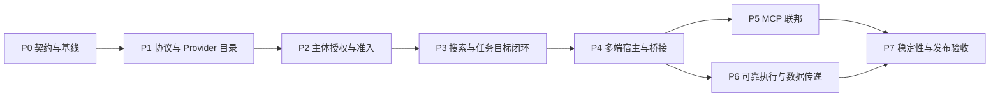

# Device Capability Federation 实施计划

> 2026-11-05 · 实施中。对应 [整体技术方案](./device-capability-federation.md)。实际进度、自审与验证证据见 [实施记录](./device-capability-federation-implementation-status.md)。
>
> 实施约束更新：不保留旧 Endpoint parser、旧绑定 API、兼容 facade 或双写路径。Endpoint 统一升级 v3，外层 Realtime 独立保持 v2。下文原规划中的兼容建议由本约束取代；历史数据库升级资产继续保留。
>
> 规划时 schema 为 269；本次追加 v270 Bridge 类型迁移，保留已有支持版本的完整升级链。

## 1. 交付范围和顺序

目标：新增一种设备或普通工具能力，通过端侧适配器、manifest 和用户授权接入，通常无需修改 Gateway 核心。现有来源验证、deferred tool search、Computer / Browser 专用运行时和 pi MCP 所有权继续保留。

两个交付点：

- **交付 A（P0–P3）**：现有内置能力完成跨设备发现、明确选择、连续执行与错误恢复。同一对话可从 Web 调用连接远端 Gateway 的 Mac。
- **交付 B（P4–P7）**：完成多端 SDK、设备侧 MCP 接入、可靠执行和通用硬件扩展验收，证明核心机制可复用。



P5 和 P6 在契约明确后可以独立开发；P4 的各平台适配也可独立推进。这里表达任务依赖，不要求并行 Agent 或新增服务。

交付 A 不承诺任意 MCP 工具、移动端后台常驻或任务跨重启自动恢复。交付 B 中也只发布平台与执行器实际支持的 feature。

## 2. 代码核对：复用、扩展和重构

“复用”表示保留机制，不表示完全不改调用接口；“重构”表示职责需要拆开，不能只添加条件分支。

| 现有模块 | 核对到的行为 | 处理方式 | 阶段 |
| --- | --- | --- | --- |
| `src/endpoint-tools/auth.ts`、`turn-context.ts` | 签名身份与来源 claim 验证 | 复用；扩展签名契约时增加版本测试，不弱化来源验证 | P1–P2 |
| `packages/realtime-client/src/index.ts`、`src/realtime/runtime.ts` | ticket、连接、心跳、Endpoint 消息承载；后者含独立 Desktop 授权检查 | 复用传输；接入版本协商和扩展消息，保留 Desktop 边界 | P1 |
| `src/endpoint-tools/runtime.ts` | 单一设备能力运行时，组合注册、调用、授权、上传等 | 扩展组装 Provider 目录与准入服务，不建立平行运行时 | P1–P2 |
| `src/endpoint-tools/registry.ts` | 在线连接、工具和策略校验耦合；目录仅 hello 注册，连接删除后工具消失 | 重构为连接 registry + Provider/catalog 视图；保留旧 facade | P1 |
| `src/endpoint-tools/policy.ts` | 精确工具名、kind 前缀和固定 schema 准入 | 保留内置分支，新增 manifest admission；拆分身份、schema、策略校验 | P2 |
| `src/endpoint-tools/grant-service.ts` | 仅位置读取；60 秒、参数绑定、单次、内存授权 | 保留兼容实现；抽取授权租约机制，新增通用任务 / 资源授权，不能把它直接当通用授权复用 | P2 |
| 原持久会话绑定 | 会话到 endpoint 的全局绑定 | 删除旧服务、API、repository 与自动改绑；改为固定主体、连接 epoch 和 transcript 的任务目标 | P3 |
| `src/endpoint-tools/target-resolver.ts` | 候选只有来源、绑定和已有 grant | 重构为可见目录发现与执行解析两个动作 | P2–P3 |
| `src/agent/external-tools/types.ts` | turn context 有 origin，没有完整执行主体与授权上下文 | 扩展宿主可信 execution context，不能从模型参数推导跨设备权限 | P2 |
| `src/agent/external-tools/endpoint-provider.ts` | 展平候选工具，运行时核对 revision；有位置、终端和图片专用投影 | 复用 provider 接口及调用校验；拆分目录、执行 adapter、结果 projector | P3、P5 |
| `src/agent/embedded/external-tool-discovery.ts` | 物化具体 `device__...` 工具，deferred，内部执行走受保护的 registry | 保留；扩展 Provider 身份、namespace 说明和契约指纹 | P3 |
| `src/agent/embedded/tool-search-extension.ts` | native 按需加载与 connector 搜索共用入口 | 保留；增加结构化设备候选与不可执行状态，不新增第二个搜索入口 | P3 |
| `src/agent/embedded/session-runner.ts`、`tool-metadata.ts` | 目录在 runner 创建前物化；连接和授权变化触发失效，活动回合对连接变化延迟刷新 | 重构失效分类及安全刷新；新工具进来与授权撤销不能用相同粗粒度处理 | P3 |
| `src/computer/runtime.ts` | 显式 binding 优先于 turn endpoint；创建的 Session 已保存 endpointId | 复用 Session、观察与动作保护；替换初始目标解析并加强资源上下文 | P3 |
| `src/browser/remote/device-target.ts` | 新的 Desktop 来源优先于历史 binding，与 Computer 优先级不同 | 接入共享目标上下文，明确迁移优先级 | P3 |
| `packages/endpoint-tools-client/src/index.ts` | registry 构造后静态；controller 提供进度、确认、上传和取消，断线清内存；拒绝 execution / operationQuery | 分层演进为 Device Host SDK；可靠执行另做 feature，不向原 controller 偷塞后台任务 | P1、P4、P6 |
| `electron/computer/desktop-host.ts` | 管理身份、连接、原生工具与 broker；endpointId 带随机实例 ID；当前连接使用基础 controller | 复用系统适配器与 broker；抽离 Host 组装，按稳定 Provider ID 关联连接 | P1、P3–P4 |
| `electron/gateway/selected-gateway.ts`、`desktop-transport.ts` | 本地 / 远端 Gateway 选择与传输已存在 | 复用；增加切换隔离验收，不重做连接设置 | P4 |
| `web/src/features/endpoint-tools/host.ts`、`endpoint-tool-bridge.tsx` | Web Host 和 Electron main Host 桥接已存在 | 复用生命周期入口，接入新 SDK；避免渲染进程重复注册原生 Provider | P4 |
| `src/endpoint-tools/bridge.ts`、`bridge-host.ts` | 已有传感器适配、签名 Node Bridge；桥接身份目前以 desktop 方式接入 | 复用驱动接口，改为通用 Provider 声明，停止将新硬件绑定 desktop 语义 | P4 |
| `src/agent/mcp/native-mcp.ts`、`transport.ts`、`tool-catalog.ts` | Gateway MCP 投影、OAuth 和执行由 pi 负责 | 保持；设备侧 adapter 只复用适当的协议组件，不能搬用带 Gateway 状态依赖的整个模块 | P5 |
| `src/capabilities/runtime/external-operations.ts` | 已有持久 operation、digest、去重、unknown 和恢复模式 | 优先复用通用账本；扩展设备回执关联 | P6 |
| `src/storage/sqlite/desktop-operation-repository.ts`、`desktop-execution-repository.ts` | Desktop 专用 intent、grant、receipt、review 和停止校验 | 复用思想及可共享原语；不把 Desktop tool / workspace 限制直接推广到所有硬件 | P6 |
| `src/storage/sqlite/endpoint-tool-invocation-repository.ts` | 审计状态只有 running / succeeded / failed，已有 operationId 关联 | 扩展展示真实效果状态；不能用 failed 代替 unknown | P6 |
| `web/src/features/endpoint-tools/management-*`、`device-detail-drawer.tsx` | 已有设备管理、在线状态和调用审计 UI | 复用页面和 API，扩展 Provider、状态原因、执行目标与效果状态 | P2–P6 |

### 2.1 需要特别处理的现有约束

1. Endpoint v2 使用严格 schema，kind 仅为 web / desktop / mobile / browser；工具名需小写点分段、outputSchema 必填且最多 100 个工具。任意 MCP 工具无法原样塞入该 schema。
2. `EndpointToolPolicy` 会检查 `${kind}.` 前缀和精确名称。只放开工具名会失去准入约束，只增加枚举又无法实现开放扩展。
3. Electron 当前 endpointId 含随机实例部分，不能直接作为离线设备或重连后 Provider 的稳定 ID。
4. `ExternalToolService` 使用词面 relevanceScore；pi native search 使用自己的 BM25。不能假设增加向量索引后，下游重排不会丢弃结果。
5. Web / Electron 的确认位必须与本地 descriptor 一致。跳过重复确认必须端到端支持授权租约，不能仅将 Gateway 的 `confirmationRequired` 改成 false。
6. 输入路径验证了 Gateway principal 和 origin，但 Agent 的设备上下文不等于完整的执行主体。可复用 command receipt 中的 principalId 关联；仍需补齐排队、恢复和执行前撤销检查。
7. 当前 Desktop 持久执行服务端基础设施与当前 Electron 基础 Host 不是完整闭环。不能仅凭存在相关表和类型宣布可靠执行已完成。
8. 移动端原生实现不是 TypeScript SDK 的直接消费者，需要相同契约、测试向量和平台实现，不能只修改 npm package 后宣称三端已适配。

## 3. P0：契约定稿与回归基线

**依赖：无。产物：可实施契约、兼容矩阵、基线结果；不发布新行为。**

工作单元：

- P0.1：定稿稳定身份：Device principal、Provider localId / Gateway ID、connection epoch、toolRef、resourceRef、executionRef、invocationId / operationId。明确多连接冲突策略，不能按最后上线或昵称自动归并。
- P0.2：定义 v3/扩展目录、候选结果、状态原因、执行上下文、交互与回执的最小 schema，以及错误码和各自适用场景。
- P0.3：制作可复用测试夹具：两个 Gateway、两个设备、同名工具、一个只读传感器和一个可记录次数的写工具；先验证现有内置路径，不调用付费模型。
- P0.4：记录现有设备与工具发现的回归结果、初始 prompt 工具集合、重连行为和本地 / 远端差异。

代码落点（后续实施）：优先放入 `packages/endpoint-tools-protocol/src/` 的新增 Provider 契约模块，以及现有测试目录；拟议新文件须在实施 PR 中标明。

验收：

- [x] 文档明确“不支持 / 离线 / 不可见 / 无授权 / 结果未知”，不把同一错误复用为所有失败。
- [x] raw MCP tool name 可保留，Gateway 物化名稳定且可消歧；名称归一化碰撞有确定处理。
- [ ] 新身份不按 IP、昵称或 platform 自动合并；多浏览器标签页不意外共享资源。
- [x] 基线运行结果可复现；已有失败独立登记，不能作为新变更通过的证明。

主要风险：契约设计过大。退出条件是内置能力、第三方 MCP、硬件 bridge 三类样例均能表达，而非首版实现所有可选 feature。

## 4. P1：版本化设备协议与 Provider 目录

**依赖：P0。产物：不改变旧设备权限的新目录基础。**

建议拆成三个 PR：

1. **P1.1 协议**：统一 Endpoint v3，拒绝 v1/v2，不保留旧 parser 或降级执行。Gateway 和所有内置客户端同步更新。外层 Realtime 保持独立 v2。
2. **P1.2 注册与存储**：Provider 目录和在线连接分开管理。内置能力保留可信契约，动态能力需按声明准入。历史目录只恢复离线声明，不恢复连接与租约。
3. **P1.3 最小 SDK 支持**：`EndpointToolRegistry` 增加 Provider 容器和原子替换；共用 `EndpointToolHostController`。加入目录 revision、ack、撤回、状态 TTL 与安全重同步。

涉及现有文件：`packages/endpoint-tools-protocol/src/index.ts`、`packages/realtime-protocol/src/index.ts`、`packages/realtime-client/src/index.ts`、`src/realtime/runtime.ts`、`src/endpoint-tools/registry.ts`、`runtime.ts`、`src/gateway/hono/routes/endpoint-compatibility.ts`、`src/storage/sqlite/schema.ts` 及升级链。

拟议新增组件：Provider registry、catalog repository / validator、Provider registry SDK。它们组合进原 `EndpointToolRuntime`，不能另起一个全功能 DeviceRuntime。

验收：

- [x] v1/v2 Endpoint 消息明确拒绝；所有内置客户端统一 v3，版本不符提示升级。
- [x] 同设备两个 Provider 使用同名工具，身份与调用均不冲突。
- [ ] Electron 重连后 Provider 身份稳定，connection epoch 更新，旧连接迟到消息被拒绝。
- [x] 同一稳定 Provider 的并发连接冲突按 P0 明确策略处理，不能静默选一条执行。
- [x] 无效、超限或版本冲突更新被拒绝，目录不出现半更新；撤回后旧契约不可执行。
- [x] Gateway 重启只恢复离线元数据；不因目录仍存在就显示在线。
- [x] 数据库从所有受支持版本升级通过，迁移失败回滚；版本号在实现时分配。

主要测试：协议 package 测试、`src/realtime/__tests__/runtime.test.ts`、`src/endpoint-tools/__tests__/runtime-e2e.test.ts`、`src/storage/sqlite/__tests__/schema-upgrade.test.ts`；新增加原子目录与 Provider repository 用例。

## 5. P2：执行主体、能力准入与通用授权

**依赖：P1。产物：可以安全发现其他设备能力，仍不默认获得执行权限。**

建议拆为两个 PR：

- **P2.1 执行主体贯通**：从 HTTP / command / channel / automation 接受入口生成宿主可信主体引用，经过排队、run 和工具执行上下文传递；复用输入回执的主体关联。持久化的是身份与授权关联，不是 token，也不是永久有效的权限快照；执行时重新检查撤销、Agent policy 和资源范围。
- **P2.2 Admission 与授权**：将内置工具策略保留为 trusted contracts，增加 Provider manifest admission；抽取 grant 生命周期，保留原位置授权兼容实现，新增通用任务 / 工具 / 资源授权。复用设备授权面板展示准入和授权范围。

涉及路径：`src/gateway/security/gateway-principal.ts`、`src/gateway/hono/routes/session-input-handler.ts`、`session-command-handler.ts`、`src/gateway/service/session-command-service.ts`、`session-input-coordinator.ts`、`src/agent/external-tools/types.ts`、`src/endpoint-tools/policy.ts`、`grant-service.ts`、`target-resolver.ts`、相关 SQLite repository。

准入应明确：配对仅允许发布声明；Provider 安装批准某组契约；任务授权允许特定资源上的操作。新增工具或权限扩大不继承旧授权。未知 annotations 不能获得 batchRead、免确认或自动重试资格。

验收：

- [x] 设备凭证不能枚举其他不可见设备的名称、目录或资源，也不能选择其他设备。
- [x] owner / 显式授权用户可以发现并选择目标；仅来源设备身份不足以构成跨设备授权。
- [x] 模型伪造 targetRef、grantId、providerId 或 readOnlyHint 不能扩大权限。
- [x] 可发现但未授权的候选有明确恢复动作，不被物化为可执行工具。
- [x] 排队期间权限撤销、输入恢复和授权过期均在下发前重新检查。
- [x] 自动化没有来源设备时，使用其绑定授权主体与范围，不默认借用 Gateway 管理权限。
- [ ] 已授权操作不重复询问；原生系统权限或 picker 仍由目标端验证，确认策略两端一致。
- [x] 原位置单次授权、设备请求 proof 和 Desktop execution authority 用例继续通过。

主要测试：`src/endpoint-tools/__tests__/grant-service.test.ts`、`policy.test.ts`、`auth.test.ts`；输入 HTTP / coordinator 和 command 测试；拟议 admission、execution-principal 和通用 grant 用例。

## 6. P3：tool search、任务目标与内置能力闭环

**依赖：P1–P2。产物：交付 A。**

建议拆成三个 PR：

1. **P3.1 设备发现**：`EndpointToolProvider` 使用经过主体过滤的统一目录；分开 executable tools、targetCandidates、capabilityCandidates 和 sourceErrors。保留现有 nativeSources，增加 namespace summary / instructions 和设备可检索字段；不走旧 `xopc_tool_execute` 公开路径。
2. **P3.2 任务目标**：新增宿主 TaskTarget / ExecutionContext 服务，选择引用可由 deferred 的通用目标选择工具或 UI 消费；执行前验证范围。把 Computer 和 Browser 初次目标解析接到共享规则上，持续操作使用已有 Session 并关联 executionRef；保留底层 broker 和安全检查。
3. **P3.3 动态加载与界面闭环**：补齐目录版本事件和 runner 刷新；设备管理 UI 显示可用原因，聊天显示真实执行设备并提供歧义选择，不要求切换聊天入口。

关键实施细节：

- 删除旧会话绑定 API、运行时和自动改绑调用。任务目标优先于来源；来源型读取始终指向消息来源。连接变化不改变已选择目标。
- 搜索后若目标唯一且已授权，可直接加载该设备的具体工具；有歧义时返回候选，模型或用户选择，宿主验证后加载。目标选择不隐式授予权限。
- 第一次 `discover` 和后续 `open` 共享目标上下文，appRef / windowRef 绑定 Provider 与资源；另一设备即使碰巧有相同 ref 文本也不能使用。
- `run-for-session.ts` 当前只在回合前物化目录。必须实现安全边界上的工具注册 / 移除与 catalog snapshot；如果 pi API 不能安全热更新，重建 runner 并保留原输入与检查点后继续，不能执行已过期闭包或要求用户重发整个请求。
- 新增目录或普通状态变化不随意 abort 无关回复；授权撤销和已删除工具立即阻断后续下发，不能等活动回合结束。
- 通用 provider 拆出结果 adapter 接口；已有位置最小投影、图片清理和终端专用控制继续保留。

涉及路径：`src/agent/embedded/external-tool-discovery.ts`、`tool-search-extension.ts`、`tool-metadata.ts`、`session-runner.ts`、`run-for-session.ts`、`src/agent/external-tools/endpoint-provider.ts`、`types.ts`、`index.ts`、`src/computer/runtime.ts`、`src/browser/remote/device-target.ts`、`device-runtime.ts`、Web 设备管理和聊天组件。

验收：

- [ ] 真实带认证 Gateway 路径：Web 发消息 → 远端 Gateway → 在线 Mac → 查询 / 操作计算器 → 原对话收到结果。先用确定性模型 / 工具驱动夹具，发布前再做真实模型与原生 GUI 验证。
- [ ] 两台设备、同名工具：明确选择 A 后，discover / open / observe / action 均只发往 A；A 中途离线不把动作发往 B。
- [ ] 更换聊天入口、steer 或继续同一任务不会静默改写执行目标；新步骤可明确选另一个目标。
- [ ] 明确设备离线、没有可见匹配、缺少能力、无授权和目录失败能分别反馈；“未找到”不伪称物理设备不存在。
- [x] 任意默认 prompt 不出现完整设备 schema；tool search 只加载匹配契约，恢复历史 loaded state 时验证当前指纹。
- [x] 同一回合出现新授权 / 新能力后可以继续发现并执行；旧契约调用被拒绝，刷新不丢用户输入、不重复副作用。
- [x] Computer / Browser 不再各自隐式套用不同目标优先级；通用搜索仍不暴露底层 control RPC。
- [ ] 最小 GUI 操作闭环走现有专用保护，不能通过 arbitrary MCP / shell 绕过本地拒绝。

主要测试：`src/agent/embedded/__tests__/external-tool-discovery.test.ts`、`tool-search-extension.test.ts`、`session-runner.test.ts`、`src/agent/external-tools/__tests__/endpoint-provider.test.ts`、Computer / Browser runtime 与 remote-device-target 测试；扩展现有 Gateway native tools smoke。

## 7. P4：多端宿主 SDK 与硬件桥接

**依赖：P3 的完整闭环；平台 SDK 的实现可在 P1–P2 契约稳定后提前准备。**

建议拆成平台独立 PR：

- **P4.1 Node / Electron / Web**：演进 `packages/endpoint-tools-client`，将 Provider registry、同步 invocation controller、状态发布和平台端口拆开；`DesktopEndpointHost` 只负责 Electron 系统适配和进程生命周期。Web 复用已有 Host 入口，Electron renderer 不再另发布同一原生 Provider。
- **P4.2 移动端契约适配**：Android `DeviceTools.kt`、iOS `DeviceEndpointHost.swift`、Harmony `realtimeClient.ets` / `deviceTools.ets` 接入相同协议与授权语义；复用 `scripts/devices/generate-mobile-tools.mts` 生成目录及 revision，增加公共签名 / 序列 / 取消测试向量。平台执行器保持原生实现。
- **P4.3 Headless bridge**：扩展 `bridge.ts` / `bridge-host.ts` 为通用 Provider bridge；使用可配置驱动接口接入新传感器和一个有副作用的测试执行器，保留硬件 resourceId。新协议下不要求假装成桌面应用。

为各端提供同一组协议符合性用例，而不是把 TypeScript controller 当作 Swift / Kotlin / ArkTS SDK 已实现。第三方 MCP 托管首版在 Node / Electron，移动端不强制具备本地 MCP 进程能力。

验收：

- [ ] Web、Electron、Android、iOS、Harmony、headless bridge 都能发布至少一种原生能力，并通过相同 Gateway 契约被发现和调用。
- [ ] 每端完成真实生命周期验证：后台、锁屏或页面关闭时状态准确，不能宣称任意后台执行。
- [ ] Electron 切换本地 / 远端 Gateway，旧调用、租约和授权上下文失效；Provider 身份按 Gateway 隔离，本地文件策略仍由设备持有。
- [x] 新硬件样例仅增加适配器、manifest 与样例配置，Gateway 核心执行代码无新增硬件型号 / 工具名分支。
- [x] 原移动端工具目录生成 `--check` 通过，三端签名与 descriptor hash 测试向量一致。
- [ ] Node bridge 正常关闭和信号退出能撤回目录、取消本地调用；退出异常由在线租约过期处理。

主要验证：package tests、`electron/computer/__tests__/desktop-host.test.ts`、Web Host / management 测试、现有 Electron local-connection 验证脚本；各平台原生构建、单元测试及真机 / 模拟器记录。

## 8. P5：设备侧 MCP 联邦

**依赖：P2、P4 的 Node Host。产物：第三方能力接入，不需要修改 Gateway 核心。**

建议拆成两个 PR：

1. **P5.1 MCP adapter**：设备侧提供独立 Node adapter，连接受用户配置的 stdio / HTTP MCP Server，投影 tools、Server instructions、资源引用、list change 和断线撤回。执行仍经现有 Endpoint invocation，凭证留在设备。
2. **P5.2 交互与兼容**：根据实际协议版本适配 elicitation / input_required；把一般交互路由到原会话，本地系统权限仍由设备完成；保留 requestState 与 invocation 关联，不能因多轮输入产生新的写意图。用 fixtures 覆盖支持矩阵。

新 adapter 可作为拟议独立 workspace package 或现有 Node Host 子模块，具体包名在 P0 定稿。不得向跨平台 `endpoint-tools-client` 核心引入 Node 子进程或 Electron 依赖；不得把 `src/agent/mcp` 内依赖 Gateway 配置、数据库和 pi session 的代码整块搬到设备。

首版支持已验证 MCP 版本和功能子集；Tasks、sampling、任意 MCP App HTML 等未完成的能力明确不发布。合法 MCP 工具允许没有 outputSchema，结果按标准 content 和大小策略验证；内置工具保持严格 schema。

验收：

- [x] 设备本地 stdio MCP 和受控 HTTP MCP 各接入一个 Server；远端 Gateway 发现、调用、读取结果，无需访问设备入站端口。
- [ ] 两个 Server 均名为 `search` 的工具可消歧；原名、物化名和 Provider 说明可追踪。
- [x] Server 工具变化、退出和断线撤下旧工具；初次失败写调用不因重连被自动重放。
- [x] Server 未经审核新增工具或扩大 schema / 权限时，不能继承旧准入。
- [x] MCP 资源读取仍回原 Provider；设备路径不能被 Gateway 当作本机路径使用。
- [ ] 用户输入匹配原调用和主体，超时 / 拒绝后结束正确；未启用 sampling 的 Server 不能借模型请求获得新权限。
- [x] Gateway 直接配置的 pi MCP、OAuth 和已有 connector search 回归通过，无第二套 Gateway MCP 管理器。

测试 fixture 只运行受控本地 Server，不访问用户现有凭证或付费服务。生产凭证集成在独立验证环境进行。

## 9. P6：可靠执行、任务恢复与跨设备数据

**依赖：P3–P4。产物：执行效果可解释、可查询；不承诺所有 Provider exactly-once。**

建议拆成三个 PR：

- **P6.1 调用状态与账本**：复用 `executeExternalOperation` 和既有 capability_operations；关联 Provider、resource、authorization、operation 和 invocation。扩展审计 UI 区分任务状态与效果状态，不重建一个平行任务数据库。
- **P6.2 设备回执与资源租约**：Device Host 协商 reliable-execution feature，提供持久去重、接收 / 开始 / 结束回执、状态核对、确认取消和资源 fencing。基础 controller 继续只做同步模式，不支持的 Provider 返回明确能力边界。Desktop 特殊恢复逻辑保持专用 adapter。
- **P6.3 数据传递与恢复**：复用 upload-service 和文件结果投影，增加短期、作用域明确的 artifact transfer；在现有 run / step 保存等待交互与执行上下文，Gateway 重启后先核对状态。任务选择其他设备属于新执行意图，不是重试原调用。

验收：

- [x] 注入四类断点：下发前、设备接受后、效果发生后但结果发送前、Gateway 提交结果前。每类状态与允许恢复动作符合契约。
- [x] 支持去重的测试执行器在重试同 operation 时只产生一次可计数效果；相同 ID / 不同参数拒绝。
- [ ] 不支持去重的 MCP 写调用断线后为 unknown，不重放、不自动切换 Provider 重做。
- [ ] 取消请求与确认停止分别记录；设备未确认时不能展示为已停止。
- [ ] 两任务争用同一 GUI / 摄像头时按资源租约串行或拒绝；不同独立只读资源可并发。
- [ ] 手机产生文件 → 授权传给 Mac → Mac 返回结果，路径与来源不混淆；未授权接收方拿不到 artifact。
- [x] Gateway / 设备重启不把未知效果改成 failed 或成功；不持久化 token、完整屏幕或无限原始结果。
- [ ] 资源 / 授权撤销与客户端断线不会留下可复用旧控制 handle。

主要测试：通用 external operations、Endpoint invocation、上传服务、Desktop operation repository 和 schema upgrade 测试；新增故障注入集成测试及资源竞争用例。

## 10. P7：稳定性、兼容发布与扩展验收

**依赖：P5–P6。产物：交付 B，可发布。**

工作单元：

- P7.1：对协议、目录、schema 编译、并发、队列、媒体和日志施加有界预算；控制流不能被大数据占满，单 Provider 故障不能影响其他设备和 Agent 回复。
- P7.2：完整兼容矩阵、增量迁移、打包检查、灰度与回退验证；先 Gateway，再 SDK 和各端。回退不删除用户数据库，不以降版本二进制强行读取更新后的 DB；优先禁用 feature 或回滚兼容应用层。
- P7.3：引入一个团队未预置名称的第三方 Provider / 硬件样例，验证不修改核心即可接入。记录改造前后性能与 token 开销。

验收：

- [ ] 单设备超大目录、非法 schema、慢响应、消息洪泛、频繁重连时，其他设备与会话仍可服务，限流有明确错误和审计。
- [ ] 主体隔离、工具变更、旧 epoch、旧授权、来源伪造的负面用例全部通过。
- [x] 30 × 50 工具规模下按方案记录搜索 p50 / p95、目录刷新、内存及 event loop 延迟；150ms 搜索 p95 和 2s 目录刷新是待测预算，必须注明硬件与网络环境。
- [ ] 中英文检索数据集报告 Recall@k 和明确目标准确率；没有错误设备执行 / 越权用例通过，不用少量成功对话替代系统测试。
- [ ] 空闲 prompt 不随完整设备目录增长；真实模型验证记录实际加载工具数量和选择路径。
- [x] Node 与 Electron 包含所需迁移资产；旧版本数据库升级、失败回滚和快照检查通过。
- [x] 所有新增认证 API 的 lazy-bundle 映射有正向与非重叠断言，真实认证 HTTP 路径可达。
- [ ] feature 关闭后只撤下新能力，新旧身份不重复发布；已有内置工具、聊天、直接 MCP 和 channel 路径正常。

当前证据按阶段记录在 [实施与自审记录](device-capability-federation-implementation-status.md)。未勾选的复合项需要补齐其余场景。双设备 MCP 文件传递已验证，仍需原标准中的手机与 Mac 真机组合。Gateway 重启可接回仍在同一设备进程中等待回答的表单；已执行的动作不会因接回而重发。打包版 Gateway 的功能开关回退已在隔离数据库中演练。移动端构建和 Harmony 协议生命周期测试已通过，真机前后台、锁屏和权限撤销仍需验收。

## 11. 检查方式与证据

以下命令是实施阶段使用的验证入口，不代表本次已经执行。按改动范围选定项目与文件，避免只运行默认 unit 而漏掉 component、integration、packages 和 computer-desktop。

```bash
pnpm run typecheck
pnpm vitest run --project=packages packages/endpoint-tools-protocol/src/index.test.ts packages/endpoint-tools-client/src/index.test.ts
pnpm vitest run --project=unit src/endpoint-tools/__tests__ src/agent/embedded/__tests__/external-tool-discovery.test.ts src/agent/embedded/__tests__/tool-search-extension.test.ts
pnpm vitest run --project=component src/gateway/hono/routes/__tests__/lazy-bundles.test.ts src/gateway/hono/routes/__tests__/endpoint-tools-routes.test.ts
pnpm vitest run --project=integration src/endpoint-tools/__tests__/runtime-e2e.test.ts
pnpm vitest run --project=computer-desktop electron/computer/__tests__/desktop-host.test.ts
pnpm run test:web
pnpm -C web run type-check
pnpm -C web run lint
pnpm exec tsx scripts/devices/generate-mobile-tools.mts --check
pnpm run test:tool-discovery:gateway
pnpm run test:native-tools:gateway
```

新增测试应加入所在项目，不以命令能运行零测试视为通过。Gateway smoke 的本地配置和 fixture 要求按脚本读取后执行；Electron 真实验证需要先构建相应 artifacts。移动端使用各平台既有构建 / 测试脚本；实施到 Kotlin、Swift、ArkTS 和 Gradle 时再按相应技能执行，不在本次规划中触发构建。

每个阶段交付：变更文件清单、契约差异、测试输出、场景结果、已知限制、兼容与禁用方式。与真实模型 / GUI 无关的阶段使用确定性测试；交付 A 和 B 需要真实运行链路验证，但真实模型成功不替代权限和故障测试。

## 12. 范围控制与完成定义

- 复用现有设备、会话、输入、run、operation 和上传模型，新增数据仅填补 Provider、admission、task target 和设备回执等缺口。
- 不一次重写 `EndpointToolRuntime`、不替换 pi MCP、不引入独立工作流引擎、不为了设备接入重做 Gateway 连接设置。
- 不承诺手机任意后台执行、所有工具自动重试、第三方 Server 代码符合其声明或多设备全局事务。
- 新设备接入的开发者文档必须能从零完成一个示例；同样示例至少用于两个不同类型设备，证明契约可复用。
- 各阶段状态见实施记录。P3 通过代表内置跨设备能力闭环完成，P7 通过才代表整体验收完成。
