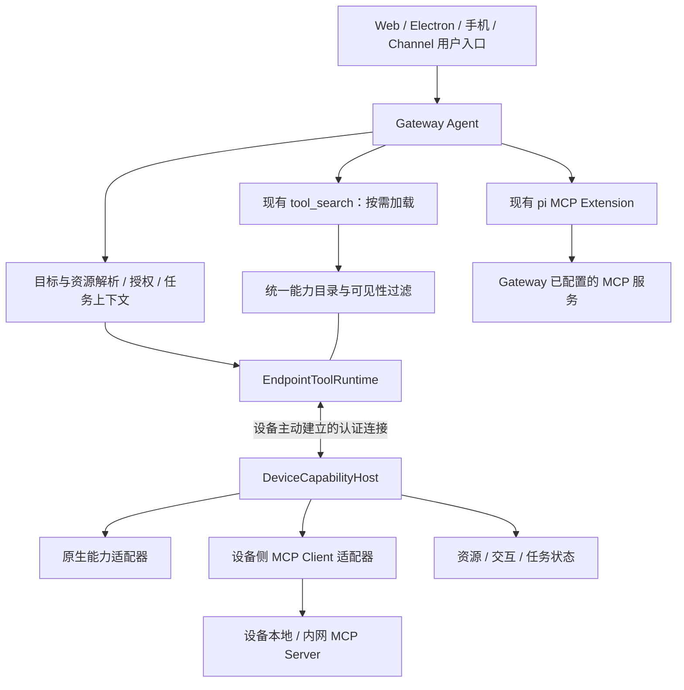

# Device Capability Federation：设备能力接入与远端 Agent 调度方案

> 2026-11-05 · 技术提案，尚未实施。基于当前工作区代码和公开一手资料调研；下文的新接口、模块和验收指标均为设计目标，不代表已经具备的功能。
>
> 本提案扩展 [Device Tools 技术方案](../device-tools-technical-spec.md) 的跨设备发现与第三方能力接入范围，保留其来源验证、权限检查、deferred tool search 和本地执行边界。现有行为见 [Endpoint Tools](./endpoint-tools.md)。本次不修改这些已实施契约。

具体代码拆分、复用 / 重构清单和阶段验收标准见 [实施计划](./device-capability-federation-implementation-plan.md)。

## 1. 决策

采用 **设备能力宿主 + MCP 能力契约与本地适配 + Gateway 统一目录和调度**。

- Gateway 在本地还是远端，不影响设备能力的身份、发现、授权和执行语义。
- Web、Electron、移动端、无界面硬件都可以提供能力。聊天入口和执行者是独立角色。
- 设备主动建立经过认证的连接；设备不需要开放入站 MCP HTTP 端口。
- 原生工具和设备托管的第三方 MCP 工具共享 MCP 风格的工具契约、Server 说明与结果模型。
- 设备能力继续通过当前 `materializeNativeExternalTools` → deferred tools → `tool_search` → 加载匹配工具 → 调用的路径使用。完整目录不注入默认模型工具声明。
- Gateway 复用 `EndpointToolRuntime` 承载设备控制、调用与生命周期，不建立第二套设备执行运行时。Gateway 直接配置的 MCP 仍由 pi `createMcpExtension` 管理。
- 不把物理设备强制等同于一个 MCP Server；一台设备默认提供一个原生能力 Server，也可以托管多个第三方 Server。

“一个设备是一个 MCP Server”可以作为产品理解；实现上必须区分设备身份、能力 Server、连接实例和具体资源。标准 MCP 负责能力互操作，xopc 负责设备注册、认证、可见性、目标选择和执行可靠性。

### 1.1 核心目标与稳定性边界

产品目标是：**保持 Gateway 的接入、发现、授权和执行机制稳定，通过端侧适配器与数据化契约扩展设备种类。** 新设备、新工具、新资源原则上不需要修改 Gateway 核心或新增按设备类型分支。

稳定不代表协议永不演进。普通能力通过 manifest 和 schema 扩展；新增流式传输、后台任务等协议语义通过可选 feature 协商；无法兼容的变化提升主版本并给出明确升级路径。

| 层 | 固定职责 | 扩展方式 |
| --- | --- | --- |
| Gateway Core | 设备信任、连接生命周期、能力目录、授权、执行关联、结果与事件路由 | 通用算法与版本化协议；不感知具体硬件驱动 |
| Agent Integration | tool search、按需加载、工具保护、任务上下文 | 复用现有 Agent pipeline；按 schema 调用动态工具 |
| Provider Contract | 工具定义、Server 说明、资源范围、策略与执行特征 | 通过 manifest 和目录 revision 发布 |
| Device Host SDK | 连接、发布、调用分发、取消、交互、回执、状态上报 | Web / Node / 原生平台实现共享语义的 SDK |
| Device Adapter | 摄像头、文件、桌面、打印机、传感器、MCP Client 等实现 | 插件或设备固件；具体 SDK 和驱动留在端侧 |

领域专用执行器可以继续存在，例如 Computer Runtime。它们属于通过公共接口调用的能力实现，不在 Gateway 的设备连接、目录或通用调用代码中增加 `if platform === ...` 的行为分支。

### 1.2 固定控制面，开放能力面

控制面只提供有限、版本化的语义：建立信任、连接、发布 / 撤回目录、报告状态、调用、进度、交互、取消、查询与结果。

能力面由动态 schema 描述具体操作：Gateway 不需要理解打印机纸张参数、相机焦距或温度传感器单位，校验 schema 和策略后路由给执行器即可。通用能力标签帮助检索和候选分组，但不是必须在 Gateway 逐项新增的工具枚举；领域之间的参数 / 资源可替换性也不能仅凭相同标签推断。

端侧最小注册形态如下。它是拟议 SDK 数据模型，不是要求直接照搬到当前 wire schema：

```typescript
interface CapabilityProviderDefinition {
  localId: string;
  contractVersion: string;
  summary: string;
  instructions?: string;
  tools: CapabilityToolDefinition[];
}

interface CapabilityToolDefinition {
  name: string;
  description: string;
  inputSchema: Record<string, unknown>;
  outputSchema?: Record<string, unknown>;
  policyRef: string;
  execute(
    args: Record<string, unknown>,
    context: CapabilityExecutionContext,
  ): Promise<CapabilityResult>;
}
```

`CapabilityExecutionContext` 由 SDK 提供调用身份、取消信号、期限、进度、交互和授权资源引用。`CapabilityResult` 使用有界 MCP content / structuredContent，并由 SDK 绑定真实执行来源。`execute` 留在设备，发布时只序列化契约；`policyRef` 必须匹配 Gateway 已准入策略，不能由设备凭字符串自授权限。设备身份、Provider 全局身份和 connection epoch 由认证流程关联，不接受注册函数任意指定。

设备作者主要提供工具实现、schema 和说明；SDK 承担连接与执行生命周期。小型硬件也可由桥接 SDK 代理，保留硬件 resourceId。

### 1.3 隔离故障，避免扩展影响 Gateway 稳定

- 设备执行代码不加载到 Gateway 进程；Gateway 不因注册 manifest 执行远端脚本、安装依赖或加载设备驱动。
- 每个 Device / Provider 有独立目录、消息、并发、队列和结果大小预算；排队受 deadline 约束，超限返回结构化原因。
- 目录分页、schema 深度、正则复杂度和描述大小受限；schema 编译与检索不能无限阻塞主事件循环。
- 新目录先完整验证再原子替换；拒绝无效更新，保留旧元数据供诊断，但旧版本只有在设备仍确认支持且授权有效时才能执行。
- 单个 Provider 断开或失效只影响其工具与相关任务；有界退避重连，不能拖住其他设备、搜索来源或整个 Agent 回复。
- 控制消息优先于大文件和媒体，数据传输限流并支持取消；第一版不需要另建消息中间件。
- 定期核对完整目录和在线租约，修复遗漏事件；不能只依赖一次 hello 或某个通知永远不丢失。

## 2. 外部产品调研

调研时间为 2026-11-05。下表的产品行为来自官方文档；借鉴建议是本提案的架构判断，不代表对未公开内部实现的推测。

| 产品 / 项目 | 官方公开的设计 | 对 xopc 的启示 |
| --- | --- | --- |
| OpenClaw Nodes | Gateway 运行 Agent，设备作为 Node 连接 Gateway WS，Node 执行调用并返回结果。设备声明能力、命令和权限，Gateway 另做准入检查。 | 最接近目标；大脑与执行设备可以分离，设备主动连接即可，不需要每台设备运行 Gateway。 |
| OpenClaw Node-hosted MCP | Node 在本机运行 MCP Client，连接本地进程或远端 MCP Server，将工具目录发布给 Gateway，再经 Node 路由调用。工具变化会替换目录，断线撤下旧工具，不重放发现断线的失败调用。 | 采用设备侧托管与目录联邦，避免远端直接访问本机 MCP 端口；不能只有初次注册而没有目录撤回和更新。 |
| Claude Code Remote Control | 代码会话仍在本机运行，Web / 手机是会话入口。本地仅主动发出 HTTPS 请求，不开放入站端口。 | 借鉴反向连接和入口解耦；它是本地 Agent 的远程入口，不等同于远端 Agent 调度多个独立设备。 |
| Claude Cowork Dispatch | 从手机派发任务，在保持运行的桌面上使用文件、连接器和应用。 | 任务入口与执行位置应清楚展示；设备未就绪与能力不存在需要区分。公开文档不足以证明其采用通用多设备能力目录。 |
| AWS AgentCore Gateway | 提供自然语言搜索工具，在大型工具集合中检索相关工具。 | MCP 接入与按需 tool search 可以共存；不需要把目录全部交给模型。它的文档重点是服务工具，不能直接充当设备生命周期方案。 |
| Home Assistant MCP Server | 通过 MCP 提供能力，设备控制受已暴露实体范围限制。 | 工具之外还需要实体 / 资源范围；一个服务可以管理多台硬件，不应每台灯都强制启动 MCP Server。 |
| Playwright MCP Extension | 连接用户已有浏览器状态；多个 Client 的可控标签页按组隔离，一个标签页仅属于一个 Client。 | MCP 调用还需要明确的资源归属与并发控制；“浏览器在线”不代表可以操作所有标签页。 |

来源：

- [OpenClaw remote gateways and nodes](https://docs.openclaw.ai/help/faq/remote-gateways-and-nodes)
- [OpenClaw node-hosted MCP servers and skills](https://docs.openclaw.ai/nodes/mcp-and-skills)
- [OpenClaw Gateway protocol](https://docs.openclaw.ai/gateway/protocol)
- [Claude Code Remote Control](https://code.claude.com/docs/en/remote-control)
- [Claude Cowork Dispatch](https://support.claude.com/en/articles/13947068-assign-tasks-from-anywhere-in-claude-cowork)
- [AgentCore semantic tool search](https://docs.aws.amazon.com/bedrock-agentcore/latest/devguide/gateway-using-mcp-semantic-search.html)
- [Home Assistant MCP Server](https://www.home-assistant.io/integrations/mcp_server/)
- [Playwright Extension](https://github.com/microsoft/playwright/blob/main/packages/extension/README.md)

## 3. 为什么选择目录联邦

| 候选方案 | 优点 | 主要代价 | 决策 |
| --- | --- | --- | --- |
| 每台设备开放标准 MCP HTTP，Gateway 直接连接 | 直接复用标准客户端 | NAT、移动端和 Web 入站困难；还要另做设备身份、在线状态和资源授权 | 作为可选部署方式，不作为默认设备接入 |
| 完整 MCP JSON-RPC 经反向 WS 透传，Gateway 建立设备 MCP Client | 可保留端到端 MCP 消息语义 | 需要规范自定义传输、复用 pi runtime、隔离多会话；现有 Endpoint 安全与执行契约仍需适配 | 可后续提供互操作适配器，不作为首轮改造前提 |
| 设备侧连接 MCP，发布标准化目录，Gateway 经现有设备通道调用 | 复用当前执行链路；原生与第三方能力统一；凭证和本地路径留在设备 | 需要明确投影契约，并处理交互、资源读取和版本差异 | 推荐 |
| 仅扩展固定设备 RPC / 工具名白名单 | 初期改动小 | 每新增硬件能力都要求修改 Gateway 核心 | 保留内置专用契约，不作为开放扩展模式 |

这里的“联邦”只表示多个能力宿主的目录汇入同一个 Gateway，不要求引入分布式集群、消息中间件或独立服务。

Gateway 到设备的初版 wire protocol 是 xopc 设备协议，不应宣称为标准 MCP Streamable HTTP 或完整的 MCP-over-WebSocket。MCP 兼容性由设备侧适配器和标准 Server 接口保证；如果以后提供标准 MCP 反向传输，需要单独定义并验证取消、元数据、订阅和协议版本语义。

## 4. 当前代码的实际边界

| 代码 | 当前行为 | 需要演进的部分 |
| --- | --- | --- |
| `src/agent/external-tools/index.ts` | `endpoint`、`extension`、`memory` 是 nativeSources | 保持设备走 native tool search；不恢复被拒绝的旧通用执行入口 |
| `src/agent/embedded/external-tool-discovery.ts` | 生成带稳定哈希的 `device__...` 工具、deferred 暴露、执行时验证 revision | 增加 Server 说明、设备 / 资源检索元数据、按目录变化安全刷新 |
| `src/agent/embedded/tool-search-extension.ts` | native 按需加载和其他 connector 搜索共用入口 | 支持结构化的目标歧义和不可执行候选，不能把它们加载成可调用工具 |
| `src/endpoint-tools/target-resolver.ts` | 候选仅来自来源、绑定与已有 grant | 可见目录与本次执行授权分离；发现可被用户选择的其他设备 |
| `src/endpoint-tools/policy.ts` | 精确工具名和 schema 的中心白名单 | 内置契约保留，新增已安装 Provider manifest 的准入机制 |
| `src/computer/runtime.ts` | 来源或显式绑定决定桌面 | 增加任务级目标；保留 Computer Runtime 的执行保护 |
| `src/endpoint-tools/runtime.ts` | 认证、注册、撤销、调用、上传等 | 增加 Provider 目录、原子更新和能力状态，不另建平行设备运行时 |
| `src/agent/mcp/native-mcp.ts`、`transport.ts` | Gateway 配置投影到 pi；pi 执行 MCP 和 OAuth | 保持所有权；不为设备再复制一套 Gateway 通用 MCP 管理器 |

设备的实际路径是搜索后加载具体 native 工具。`xopc_tool_describe/execute` 面向其他 external sources，不能据它们的存在误判设备执行路径。

当前 generic Endpoint provider 有意排除底层 Computer / Browser control 工具。开放新 Provider 时应保留这个保护，不能让通用 MCP 工具绕开已有专用运行时。

## 5. 总体结构



Gateway 的“统一”体现在用户可见目录、搜索入口、授权和执行记录，不要求把所有后端强行改造成同一种连接或执行运行时。

设备端分两种适配：

1. 原生能力直接以 MCP Tool 数据结构加执行函数注册，无需为手机、Web 或内嵌原生工具启动本地 HTTP Server。
2. 用户安装的第三方 MCP Server 由设备侧 Client 连接，将工具、Server instructions、资源访问和交互投影到设备能力宿主。采用可复用协议库，不手写 MCP 兼容分支。

本地进程、环境变量、工作目录、OAuth 凭证由设备维护。Gateway 发送能力调用，不能通过该协议要求设备临时执行任意安装命令。Gateway 直接配置的 MCP 则继续由原有 pi 链路运行。

## 6. 身份、目录和说明

### 6.1 身份

| 对象 | 身份与生命周期 |
| --- | --- |
| Device | 复用受信设备 principal；归属与密钥由配对确定，不按名称 / IP 自动归并 |
| Provider | Gateway 归属到已认证 Device 的稳定 Server 实例 ID；不是 Server 自报名称 |
| Endpoint / Connection | 具体客户端和连接 epoch；断开后旧 epoch 失效 |
| Tool | `(providerId, 原始工具名)`，工具名在 Server 内唯一 |
| Resource | Provider 作用域下的具体对象或不透明引用 |
| Invocation | Gateway 生成的调用身份；与 JSON-RPC request ID 分离 |
| Task target | 任务某一步实际使用的设备、Provider 和资源 |

沿用现有稳定工具名生成方式，身份中纳入 Provider；不要把会变化的昵称或连接 ID 放进稳定名称。连接 epoch、descriptor digest 和 policy revision 用于校验，不用于制造新的物理设备身份。

### 6.2 两份契约，职责清晰

**能力描述**使用 MCP Tool：`name`、`title`、`description`、`inputSchema`、可选 `outputSchema`、`annotations`；Server 额外提供简短说明和按需读取的使用文档。

**xopc 准入与执行策略**由可信 manifest / 用户配置管理：发布者与安装来源、允许发布的工具和资源、effect、数据范围、权限、前台条件、超时、可取消性、并发、恢复方式。

MCP Tool 的 hints 是声明，不能直接变成可信 `batchRead`、免确认或自动重试权限。没有 `outputSchema` 的合法第三方工具允许返回有界标准 MCP content，不假装存在完整类型保证；内置工具保留当前严格输出契约。

第三方工具的说明可以影响检索，不能扩大权限。经过配对的恶意设备仍可能谎报行为，准入不构成工具实现安全性的证明。

### 6.3 简单说明的加载

- 简短摘要用于目录检索，说明该 Provider 的能力范围、执行位置和主要限制。
- 完整 Server instructions 在加载相关工具时有界提供；工具 description 描述具体调用，避免重复。
- 按需文档适合复杂流程，不把一份完整 skill 强制作为所有设备的接入要求。
- `ToolNamespace` 已有 `description` 和 `instructions` 概念，优先扩展现有物化与加载逻辑。
- 名称、说明、资源内容全部作为有来源的文档数据处理；不注入为可以覆盖宿主权限的指令。

### 6.4 能力状态

静态契约与动态状态独立：`supported`、`admitted`、`visibleToActor`、`authorizedForTask`、`reachable`、`readyForOperation`。

动态状态包含原因、采样时间、过期时间和 revision，例如 `needs_foreground`、`permission_missing`、`resource_busy`、`sleeping`。不能用一个 foreground/offline 枚举代表所有工具的可执行性。

能力目录持久化受信身份和已准入契约；在线租约保存在运行态且会过期。Gateway 重启后不能因为数据库里有目录，就把设备标成在线。

## 7. tool search 与目标解析

### 7.1 保持现有按需加载路径

```text
连接 / 目录更新 → 验证并索引工具描述
用户请求 → tool_search(query)
          ├─ 已准入且适用于本任务 → loadedTools → 调用具体 deferred 工具
          ├─ 多个目标尚待选择 → targetCandidates → 解析 / 用户选择 → 再加载
          └─ 有能力但未就绪 → capabilityCandidates + 原因和恢复动作
```

搜索不执行设备操作、不请求敏感资源、不授予权限；检索可以在本地目录完成，不在每次搜索时广播所有设备。索引中包含 Provider 说明、工具语义、Gateway 昵称、用户标签及受信资源摘要。

先按请求主体、Agent policy 和资源可见范围过滤，再检索。已授权可用能力与可申请使用的候选分开返回；不可见设备不能泄漏名称或资源摘要。设备身份只认证本设备，不能因为连上同一 Gateway 就获得 owner 的跨设备权限。

保持现有 native BM25 路径，先补充可检索字段、中英文分词 / 别名和明确目标过滤。跨来源排序需统一契约或按来源保留配额，不将不同排名分数直接比较。未来引入向量检索时，用混合检索并做中文、英文和设备名评测；不能让当前 `ExternalToolService` 的词面重排再次丢弃语义命中。

初期允许在宿主内物化当前主体可访问的目录：它不等于把所有 schema 注入模型。只有测量证明物化或内存开销过高时，再增加按 Provider 懒加载，不先造第二个工具搜索系统。

### 7.2 目标选择规则

1. 用户明确指定的设备 / 资源优先；该目标不可用就解释原因，不能替换。
2. 连续任务已经锁定的执行目标保持不变。
3. “当前页面 / 这台手机”等指代使用已验证消息来源及其明确共享资源。
4. 用户设置的能力级默认目标可以参与选择。
5. 只有一个符合语义与授权条件的候选，可自动选择。
6. 仍有多个会影响结果的候选，返回最小必要选择；“唯一在线”不能覆盖明确的离线目标。

LLM 解释意图、提出候选选择；宿主验证候选引用、主体授权、工具与资源约束。模型选择引用不是授权凭据。无来源的自动化也可以使用已配置目标与授权，不能被迫伪造消息来源。

### 7.3 任务目标替代全局单绑定

会话可以保存默认设备偏好，但一个任务支持多个执行步骤和目标。来源上下文始终保留原身份，不随执行目标变化。

为连续操作保留 `ExecutionTarget`，关联 conversation / run / step、provider、资源、授权版本、有效期及操作 handle。它是宿主内部状态，不能成为模型可自由转交的 bearer token。

Computer / Browser 这类专用能力继续由对应 Runtime 管理会话、观察、控制和释放；其公开工具按需加载，底层 control RPC 不进入通用目录。其他工具只在需要时返回带主体、目标、资源范围和期限的 opaque handle，无状态读取不强制创建会话。

GUI、标签页、摄像头等排他资源使用资源级租约与 fencing；只读传感器可按策略并行，不锁整台设备。重连是否能恢复 handle 由执行器明确声明，默认不跨连接恢复活动控制。

### 7.4 模型决策与宿主约束

模型依据搜索结果理解能力、选择目标、生成参数、解释失败和重新规划。宿主保证引用真实、授权有效、执行上下文未被换目标、schema 合法以及调用结果与请求匹配。不能用系统提示词代替这些检查，也不针对 Mac 或某个应用写特殊设备选择规则。

有状态操作创建 `executionRef`，后续调用通过显式参数或由工具适配器关联同一上下文；一次性读取直接绑定该次调用的目标。宿主查表决定真实设备和资源，不通过模型再次传来的昵称寻找执行者。更换设备要创建新的执行上下文，旧 handle 不能被改写到另一台设备。

模型不一定总能理解用户指代。目标有歧义时，系统返回候选和选择依据，模型询问最小必要问题；模型猜测某个未发现 ID 时，执行层拒绝，不将猜测当作真实设备。

| 错误 / 状态 | 可以得出的事实 | 合理下一步 |
| --- | --- | --- |
| `target_not_found` | 当前可见目录未找到目标，不证明物理设备不存在 | 核对名称、选择候选或解释可见范围 |
| `target_offline` | 已知目标当前不可达 | 等待、提示恢复连接或评估替代目标 |
| `capability_unsupported` | 所选目标未声明所需能力 | 搜索其他已授权能力实现 |
| `authorization_required` | 存在能力，但本次任务缺少授权 | 使用结构化授权流程 |
| `resource_busy` / `needs_foreground` | 当前执行条件未满足 | 等待资源或在目标端完成交互 |
| `discovery_failed` | 目录检查未成功 | 重试发现，不能断言无设备或无能力 |
| `outcome_unknown` | 调用可能产生效果但尚未确认 | 核对执行回执，不能自动重放或换设备重复操作 |

**重新规划允许改变执行者，传输重试不能暗中改变执行者。** 无状态 PDF 转换等任务，在目标未被用户限定、数据传递获准、无未确认效果且新 Provider 的契约可满足任务时，可以新建调用使用替代者。操作特定电脑上的特定窗口则不具备这种可替换性。候选替代由任务语义和宿主验证共同决定，不用工具名称白名单决定。

## 8. 设备协议与目录生命周期

在当前设备协议上新增可协商的能力宿主扩展，保持已部署签名、device proof、Gateway 身份和执行授权边界。

拟议控制消息包括：

- `capability.catalog.replace`：带 Provider、基准 revision、新 revision 和有界完整快照；分页完整后原子发布。
- `capability.state.changed`：工具 / 资源动态状态，带序列与过期时间。
- Provider 调用沿用现有 invocation 通道，增加 Provider 定位及执行约束。
- `interaction.request/response`：与调用绑定的选择、输入、权限请求。
- 长任务查询、取消和事件独立于短调用，协商支持后才可用。

消息名是拟议 xopc 扩展，不是 MCP 标准方法。统一目录以已经验证的设备 / Provider 归属为准，客户端不能在 payload 中替换另一个 Provider。

目录更新验证 descriptor、schema 大小、工具数量、权限变化和摘要长度；通过后一次性替换。删除或修改能力立即使旧契约失效，未经新准入的工具进入 pending 状态，不自动继承旧授权。

重连产生新 connection epoch，撤销旧待发调用和旧控制租约，重新核对目录。旧连接的迟到消息一律拒绝；新连接可回报经过验证的既有 operation 状态，但不能把旧 socket 的普通结果当成新调用结果。

大文件和视频使用独立、有界、授权的数据传输，不挤占控制帧。第一版复用 Gateway 上传与短期 artifact 引用；数据始终经过 Gateway，不承诺设备间点对点通道。

## 9. 开放准入，避免固定工具白名单成为扩展瓶颈

保留内置工具的严格契约，新增 Provider 级安装 manifest：

```text
设备配对 → 允许发布能力声明
Provider 安装 / 导入 → 记录工具契约和用户授予的资源范围
目录验证 → 已准入工具才可执行
任务执行 → 再检查当前主体、请求意图、资源和本地权限
```

内置可信 Provider 的声明可以由随包版本提供；第三方 Provider 通过显式安装 / 用户配置获得有界权限。未知工具不会因为自称只读就变成无确认读取；也不要求用户每次调用重新安装或确认。

以 `(providerId, toolName, descriptorDigest, policyRevision)` 绑定准入，工具 schema 或权限扩大触发重新审核；新增同名服务或换设备不继承授权。用户授权的设备、Server、资源和任务范围需要分别保存。

原生 SDK 的文件根目录、资源限制和本地权限检查可以实际执行。对任意第三方 MCP Server，Gateway 无法仅凭 manifest 证明其代码只访问声明资源；需要设备侧隔离、服务自身权限，或用户明确接受 Provider 信任范围。

设备自己的令牌不能选择其他设备；来自该设备的用户消息若要跨设备执行，应继承经过验证的用户身份与独立用户授权，不借用 Gateway 管理员凭证。

## 10. 调用可靠性、交互和结果

### 10.1 分离任务状态和实际效果

任务状态可以是 queued、running、waiting_for_input、succeeded、failed、cancelled；另存 `dispatchOutcome`，区分 not_dispatched、confirmed_no_effect、confirmed_effect、unknown。

- 创建 Gateway invocation 后才下发；设备接受、开始和结束分别回执。
- 支持写入的设备执行器保存有界去重记录；同一 operation ID 和相同请求返回原状态，不重复动作；同 ID 不同 digest 拒绝。
- 对任意 MCP Server 不承诺 exactly-once。没有可验证回执的第三方调用断线后保持 unknown，不能自动补发。
- JSON-RPC request ID 只做协议关联；恢复重试、MCP 多轮交互和设备 operation identity 需分开映射。
- 取消请求和确认取消分开记录；确认停止前不能向用户报告“已停止”。
- Gateway 重启后核对未结束调用和设备回执，不将它们全部标为成功或可重放失败。

### 10.2 交互路由

每个交互请求包含 invocation、任务、目标主体、交互类型和期限。一般输入可以在原聊天入口完成；系统摄像头权限、文件选择器等由目标设备的原生 UI 完成。回答必须来自允许的主体，不能用任意聊天文本伪造系统授权。

权限预先授予且任务已授权时不重复询问。需要本地前台、用户手势或 OS 权限时返回结构化等待；用户完成后恢复同一任务。MCP elicitation 通过适配器映射，Server 请求模型采样不默认开放。

### 10.3 结果与跨设备传递

标准 MCP content / structuredContent 保留；附带宿主生成的设备、Provider、资源和采集时间等来源元数据。大数据返回 artifactRef，下一设备使用经过授权的传输引用，不把远端 `/Users/...` 路径当作本机路径。

跨设备传递是一次独立的数据授权决策。任务为“手机拍照，在 Mac 生成文档”时，可在原任务授权范围内传递；不能因此自动让其他 Server 获得手机相册访问权。

观察结果与长媒体按现有保留策略处理，审计默认保留身份、摘要、参数哈希和效果状态，不默认持久化完整屏幕或文件内容。

## 11. MCP 版本与平台边界

前一轮讨论引用的 MCP 2025-06-18 不能直接作为本提案的最新协议依据。

- 官方当前规范为 `2026-07-28`：无初始化握手，以 per-request metadata 标识版本；Server 提供 `server/discover` 和可选 instructions。
- 工具仍使用 `tools/list` / `tools/call`；工具变化订阅与交互需遵守所协商版本。现代交互使用 `input_required` 多轮请求，不能混用旧 Server 发请求的模型。
- 长任务已有官方 Tasks 扩展，适配器协商后可映射；不支持的第三方服务只提供有限同步执行，不能凭空增加后台恢复能力。
- 当前仓库 `@modelcontextprotocol/sdk` 为 1.32.1，其本地 `LATEST_PROTOCOL_VERSION` 为 `2025-11-25`；Gateway 主要执行库另为 pi-mcp。实现前必须分别验证实际协议支持，不能仅凭 SDK 包版本推断全部链路支持现代规范。
- 保留协议适配边界，以双方实际支持的版本运行；MCP 升级无需成为设备目录、目标解析和搜索改造的先决条件。

来源：[版本与兼容](https://modelcontextprotocol.io/specification/2026-07-28/basic/versioning)、[Server discovery](https://modelcontextprotocol.io/specification/2026-07-28/server/discover)、[工具规范](https://modelcontextprotocol.io/specification/2026-07-28/server/tools)、[传输规范](https://modelcontextprotocol.io/specification/2026-07-28/basic/transports)、[Tasks 扩展](https://modelcontextprotocol.github.io/ext-tasks/specification/2026-07-28/tasks.html)。

“都是设备”意味着统一契约，不意味着相同 OS 权限。Web 页面受页面生命周期和浏览器权限约束，手机受系统后台调度约束。设备在线也不能保证所有能力可在后台运行；推送最多作为唤醒 / 交互提示机制，不能承诺任意后台操作。硬件可由桥接宿主代理，但必须保留最终资源身份。

Apple 对不同后台任务提供不同执行机制：[Choosing Background Strategies](https://developer.apple.com/documentation/BackgroundTasks/choosing-background-strategies-for-your-app)。首版按实际平台能力报告状态，不用保活循环绕过 OS 限制。

## 12. 模块、存储与实施顺序

### M0：先验证协议适配边界

用一个原生 Provider 和一个设备本地 stdio MCP Server，在不调用付费模型的情况下验证描述发现、调用、取消、目录更新、标准资源、交互及协议版本。明确设备侧 MCP Client 的复用库与凭证存储。该阶段产出兼容性矩阵，不把未支持功能标为已支持。

### M1：实现通用设备目录与目标解析

- 扩展 `src/endpoint-tools`，新增 Provider registry / admission / capability state 组件；复用现有设备身份、调用和上传。
- 扩展 `EndpointToolProvider` 与 `DeviceTargetResolver`，先根据 actor 的可见范围发现，再区分可执行与待选择候选。
- 扩展 native materializer 和 tool search，支持 namespace 说明、设备目标、不可用原因以及目录安全刷新。
- 删除旧会话绑定运行时与自动改绑；用任务目标接通 Computer / Browser Runtime 的明确目标入口。
- 用户可在原入口看到“执行于哪台设备”和进度；对任务开始后的目标变更清楚展示。

### M2：设备侧 MCP 联邦

- 演进 `packages/endpoint-tools-client` 的 DeviceCapabilityHost，复用当前原生工具定义。
- 增加 MCP adapter，将本地 / 内网服务的 Tool、instructions、资源和交互映射到宿主。
- 发布 Provider manifest、目录替换和撤回机制；第三方 Server 的凭证与进程留在设备。
- Gateway 仍保留 Endpoint 与 pi MCP 各自的既有运行时所有权。

### M3：持久任务与硬件桥接

增强通用调用账本、设备去重回执、任务恢复、排他资源租约、跨设备 artifact 传递和后台能力适配。初版先支持有限、可取消的调用；长期任务必须独立协商，不能偷偷延长现有交互 handler。

数据优先复用现有 device、grant、binding、invocation 和 external operation 表；确需新增的 Provider / admission / target / receipt 数据通过独立增量迁移引入，保留已有支持版本的升级链。新 Gateway API 必须同时更新 lazy-bundle matcher、映射测试并通过真实带认证的 HTTP 路径验证。

不引入独立工作流引擎。先在现有 run / step 内保存目标、交互和结果引用，验证多设备任务后再判断是否需要更复杂编排。

### 发布与兼容策略

设备控制协议主版本、Provider 契约版本、目录 revision、策略 revision 和连接 epoch 分别管理。新接入先协商可选 feature；不支持某项 feature 时不暴露依赖它的能力，不能通过忽略字段产生假兼容。普通新增工具使用现有工具契约时无需提升控制协议版本。

Gateway、SDK 与内置客户端统一升级 Endpoint v3，按 Provider 准入启用能力。回退时优先撤回 Provider 的发布与执行入口，保留审计与已有数据。每项能力只有一个可执行发布身份。

M0 和每个里程碑均产出协议兼容矩阵与自动化契约测试。既有内置能力继续通过原严格策略执行，新扩展机制不意味着顺带放宽旧工具的权限。

## 13. 验收与评测

| 场景 | 必须满足的结果 |
| --- | --- |
| 浏览器发消息、远端 Gateway、Mac 操作计算器 | 同一对话完成；发现并选择 Mac，无需在 Desktop 重新打开对话 |
| 相同任务切换本地 / 远端 Gateway | 能力和目标语义相同，设备授权分别绑定 Gateway |
| 两台同名 / 同能力设备 | 明确指名、默认偏好或最小选择；不能随机选机器 |
| 明确指定的 Mac 离线、另一台在线 | 返回指定目标不可用，不自动替代 |
| 无来源的定时任务 | 使用预授权任务目标，不依赖消息来源 |
| 新传感器 / 打印机 Provider | 安装 manifest 和适配器即可接入，不修改 Gateway 核心名称白名单 |
| 两个 MCP Server 有同名工具 | 检索、执行、日志均能区分 Provider，引用稳定 |
| 未准入工具自称只读 | 不能获得免确认、批量读取或跨设备权限 |
| 工具 schema / 权限在搜索后变化 | 旧调用在执行前被拒绝并要求重新发现 |
| 设备重连与旧连接迟到结果 | 旧 epoch 不可执行；既有 operation 仅通过恢复接口核对 |
| 写操作执行后断线 | 标记 unknown 或核对回执，不自动重放 |
| GUI / 摄像头同时被两任务请求 | 按资源租约处理冲突，不能交错控制 |
| 手机拍照 → Mac 生成文档 | 来源保持手机，执行目标按步骤变化；数据通过授权 artifact 传递 |
| 手机后台 / 页面关闭 | 返回实际不可用状态，任务与 UI 不误报在线可执行 |
| Provider 移除 / 用户撤销权限 | 已加载工具、目录缓存和待执行目标及时失效 |
| 新设备类型接入 | 不修改 Gateway 核心类型判断；通过通用契约、manifest 和适配器完成 |
| 单设备洪泛、超大目录或不合法 schema | 限制该连接 / Provider，其他设备、搜索和 Agent 回复继续服务 |
| 同步目录事件遗漏 | 完整目录核对恢复正确状态，不继续执行已撤回工具 |
| 旧 SDK 缺少可选任务 feature | 现有同步工具继续可用，依赖任务 feature 的工具不发布 |
| 可替换的转换任务与指定窗口操作 | 前者可在满足授权和效果约束时重新规划，后者保持资源身份 |

检索评测至少覆盖中文、英文、混合设备名、模糊能力、多个设备、离线目标和零命中。统计 Recall@k、明确目标选择准确率、错误设备执行次数、权限泄漏、工具描述 token 开销、目录刷新和检索延迟。安全验收要求错误设备执行与越权用例为零，不代表能数学保证开放环境中的零错误。

初始性能测试规模设为 30 个设备 × 每设备 50 个工具；本机缓存搜索 p95 小于 150ms、在线目录变化在正常网络下 2s 内可见作为待验证预算，必须报告测量环境与结果。比较改造前后空闲对话的模型工具声明，完整设备目录不得随设备数增长而自动进入 prompt。

本提案完成的验证是代码路径核对与公开资料调研；尚未实现协议、运行端到端设备任务或测量以上指标。
