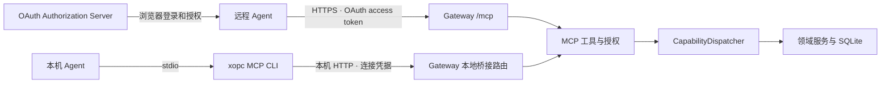

# xopc Gateway MCP Server 设计

2026-11-20 · 技术调研与实施方案

首期实现更新：使用 `xopc mcp grant`、`xopc mcp serve --stdio` 和 `xopc mcp revoke`。新入口的连接凭据通过 `XOPC_MCP_TOKEN` 注入。工具清单和配置参见 [MCP 指南](../../cli/mcp.md)。第二期已实现独立的 Streamable HTTP `/mcp`，通过外部 OAuth issuer 的 RFC 9068 JWT 和本地可撤销授权控制远程工具。远程读写已与 stdio 共享目录，开放写入时同时需要本地读写授权和 OAuth 写权限。委派已接入已有 TaskRun 队列和回执，支持按连接查询和取消。下文保留设计时的基线和备选方案。

## 决策

将 Gateway 已有的领域能力发布为一组面向外部 Agent 的 MCP tools。**本机从现成的 stdio 桥起步，远程在 Gateway 挂载独立的 Streamable HTTP `/mcp`，由 OAuth 保护。两条入口最终共享同一份工具契约和授权规则。**

先交付项目、任务和笔记的读取，再开放独立授权的有限写入。若要让外部 Agent 委派工作给 xopc，提供有持久回执、可查询和可取消的执行能力。首版工具目录覆盖明确的用户动作，配置管理、通用命令执行、设备控制、渠道发信及历史聊天导出均不进入目录。

## 仓库基线

| 位置 | 可复用的能力 | 需要补齐的部分 |
| --- | --- | --- |
| [stdio CLI](../../../src/cli/commands/mcp.ts)、[能力桥](../../../src/mcp/capability-server.ts) | `xopc mcp capabilities --allow-capability …` 已用官方 SDK，通过 HTTP 能力目录发现和调用精确允许的能力。写入有契约校验和幂等键，传输不确定时返回 `OUTCOME_UNKNOWN)。 | 模型现在需要填 `majorVersion` 和 `descriptorDigest`。CLI 按 Gateway 配置选取认证凭据，使用共享 token 或密码时按 owner 执行。启动参数是桥接进程自己的名单。 |
| [能力路由](../../../src/gateway/hono/routes/capability-operations.ts)、[Dispatcher](../../../src/capabilities/runtime/dispatcher.ts) | 已有 Zod 输入输出、按 surface 和 scope 筛选、资源授权回调、写入回执及并发冲突处理。公共契约已定义 `mcp` surface。 | 现有 HTTP adapter 的资源授权默认放行，依赖个人 Gateway 的整体权限边界。目录里有些能力会返回运行诊断和完整配置视图。外部授权需要显式的能力名单、资源边界和返回字段。 |
| [Gateway 验证](../../../src/gateway/hono/middleware/auth.ts)、[出站 MCP](../../cli/mcp.md) | 现有 owner、设备和可信代理身份。pi 已负责 xopc 作为客户端连接第三方 MCP 时的 OAuth。 | MCP 服务端需要独立资源身份和授权生命周期。设备凭据的请求证明也有自己的协议，第三方 MCP 客户端不需要实现它。 |
| [聊天提交](../../../src/gateway/hono/routes/agent-stream.ts)、[任务运行](../../../src/tasks/capabilities/runs.ts) | 聊天已有提交、按 `clientMessageId` 查回执和取消能力。任务已有 durable run 查询和取消能力。 | 外部执行需要让连接只读写自己名下的执行记录，且 Agent 的有效工具权限必须随外部授权收紧。 |

## 链路及部署



- **初始 stdio**沿用现有 exact allowlist 命令跑通本机只读体验。这个入口适用于已经信任的本机 owner。发布统一产品入口时，新增 `xopc mcp serve --stdio`，以单独签发的连接凭据访问 Gateway 内精确匹配的桥接路由（建议 `/api/mcp/bridge`）。该路由只接受该种凭据，用同一套 MCP surface 授权目录与调用。CLI 连接本机 Gateway，凭据从环境读取，退出时关闭 transport，stdout 专用于协议。由 Gateway 校验与撤销连接凭据。若宿主和 Gateway 以同一有主机文件读取权限的用户运行，这个授权限制的是该入口里的操作。首期替换旧的 `capabilities` 命令。
- **远程**激活后，Hono 将 `/mcp` 和对应的受保护资源元数据挂在通用 Gateway auth 和 SPA fallback 之前，按精确路径使用 MCP 专属鉴权。用配置的 canonical HTTPS URL 作为 OAuth resource，公网部署可只为 MCP 路径及元数据配置 ingress。每个请求都认证和构造独立调用上下文。若 Gateway 位于家中、客户 Agent 跑在云上，实际验收要验证云端能访问此 HTTPS 入口。
- **协议兼容**当前依赖 `@modelcontextprotocol/sdk@1.32.1`，本地安装源码的最新协议常量是 `2025-11-25`。现有 stdio 可继续复用它。新增 HTTP 使用成熟 v2 服务端 SDK 的 Fetch handler 接现有 Hono，支持 `2026-07-28` 并保留旧客户端的无状态兼容。首版采用短工具调用和独立的查询工具，MCP HTTP 实例可按请求创建，执行状态由 Gateway 持久化。用两代 SDK 客户端分别验证实际协议。 [新版 MCP Transport](https://modelcontextprotocol.io/specification/2026-07-28/basic/transports) · [TypeScript SDK 双版本支持](https://ts.sdk.modelcontextprotocol.io/v2/migration/support-2026-07-28) · [Hono 集成](https://ts.sdk.modelcontextprotocol.io/v2/serving/hono)

## 第一批工具

| MCP 能力 | 现有实现 | 发布边界 |
| --- | --- | --- |
| `xopc.projects.list/get`、`xopc.tasks.list/get`、`xopc.notes.list/get` | 各领域的 read capabilities | 默认只列分页摘要。按 ID 读取所需的详情。对项目路径、任务诊断、笔记关联及附件元数据逐项定义 MCP 输出字段。 |
| `xopc.tasks.create`、`xopc.notes.create/append` | 已有 durable receipt 的写能力 | 单独授予的写权限。调用方给每次写入意图一个稳定的 `idempotencyKey`。旧 revision 冲突时重新读取后再提交新的意图。 |
| `xopc.automations.list/get`、`xopc.automations.get_run` | 自动化读能力 | 后续按需加入。输出聚焦计划状态和运行摘要，诊断事件另外评估。 |
| `xopc.agents.list`、`xopc.agent_runs.start/get/cancel` | Agent 目录、Gateway 提交服务或 durable task runs | 后续阶段。目录只返回已授权可调用 Agent 的公开描述，执行名称和契约为拟议。 |

实现上将 `mcp` 加到逐项审查后的 capability definition 上。Dispatcher 当前支持 `extension` 的专用投影，可按同样方式为需要收窄数据的 MCP 能力声明专用执行或输出契约，确保结果先经验证再返回。名单、输入和输出契约集中在服务端。对列表用服务端上限和领域分页，对详情与关联资源统一做读权限检查。逐个验证过滤时的总数、游标和关联摘要也在授权范围内。

新版 MCP 工具的参数直接使用领域字段，例如 `xopc.notes.get({id})`。适配层记录能力契约与 MCP 工具 schema 的版本映射，内部使用 dispatcher 的版本、digest 和写入参数。对外工具做破坏性变更时通过新工具名或明确版本过渡，旧参数按原契约执行。成功时提供符合 `outputSchema` 的 `structuredContent` 和供旧客户端读取的简短文本。工具注解供宿主展示用，权限由 Gateway 执行。领域错误返回稳定 code，例如 `REVISION_CONFLICT`、`OUTCOME_UNKNOWN`，有回执时附 `operationId`。请求取消转成 AbortSignal，以退出读操作或阻止尚未提交的写入。写入已提交时，用原幂等键查回执。

## OAuth 和 Gateway 授权

**推荐先接一个符合 MCP 要求的 OAuth Authorization Server，xopc 承担 Resource Server 和数据授权。** 首轮使用预注册的 Codex、Claude Code 客户端完成端到端验证。有成熟 IdP 可用时，复用其登录与发令牌能力。产品若要求自托管且无需外部 IdP，可把成熟的授权服务器实现接到 xopc 的 owner 登录和同意页，作为下一阶段。验收时实际验证 issuer metadata、PKCE、RFC 8707 resource 绑定、回调约束、client identity 和撤销行为。普通 OIDC 登录能力本身无法证明该服务适合 MCP。 [MCP Authorization](https://modelcontextprotocol.io/specification/2026-07-28/basic/authorization) · [Auth0 的 RFC 8707 配置实例](https://support.auth0.com/center/s/article/mcp-audience-error-with-auth0)

1. 外部客户端请求 `https://gateway.example/mcp`，Gateway 返回带 `resource_metadata` 的 Bearer challenge。公开的 `/.well-known/oauth-protected-resource/mcp` 宣告 canonical resource 和 AS。AS 提供自己的授权服务器发现文档。
2. 客户端使用 Authorization Code + PKCE S256，申请面向该 resource 的访问权限。初始 challenge 请求最小连接 scope，例如 `mcp.connect`。预注册先覆盖指定客户端，CIMD 采用 IdP 的实际能力逐步开通。仅当目标老客户端依赖 DCR 时才评估启用受控注册。 [Codex MCP 配置与回调](https://learn.chatgpt.com/docs/extend/mcp?surface=cli) · [Claude Code MCP 授权](https://code.claude.com/docs/en/mcp#authenticate-with-remote-mcp-servers)
3. Gateway 每次验证 access token。JWT 用固定 issuer 的 JWKS 验签，校验 issuer、audience、有效期和可信客户端身份。opaque token 用可信 AS introspection。MCP token 的 audience 与 `/mcp` resource 一致，只交给该端点。
4. Gateway 维护单独的连接授权记录，包含稳定连接 ID、可信 `(issuer, subject, clientId)`、精确 capability IDs、资源范围、授权版本和撤销时间。试点用 owner CLI 管理，再接 Web 设置页，展示客户端、可读取的数据范围、写权限及最近调用。已认证但无有效 Gateway 授权的客户端没有目录或调用权限。连接的 principal ID 用于日志和回执，refresh 后保持一致。撤销后重建连接使用新的 ID。若同一宿主共用 OAuth app 和账户，三元组往往只能识别宿主级授权。需要区分宿主内不同 Agent 时，为其配置不同可验证的客户端或独立的连接凭据。
5. 最终权限取部署名单、连接授权、OAuth token scope（远程）、资源规则及领域校验的交集。默认关闭远程服务，创建连接时明确授权。读写可分别授予，显式映射为 dispatcher 的领域 scopes，永不投影 `gateway.admin`。HTTP 认证失败用标准 401 challenge，可补充 OAuth scope 的情况用标准 403，Gateway 本地授权拒绝按工具错误处理。审计记录调用 ID、连接 ID、能力、资源 ID、结果与耗时。连接在每次 list/call 重新检查，写入和回执重放前以 `assertCurrent` 复核。
6. 初期每类数据若只支持 **整个个人工作区** 授权，在界面和配置中明确显示。若要上线“仅此项目”，需要将过滤下推到领域查询，并验证详情、搜索、嵌套引用、列表总数和跨项目写入规则。传入的 `projectId` 只是查询条件。现有 Local App 的资源策略可以作为实现参考。 [Local App 资源策略](../../../src/local-apps/capabilities/resource-policy.ts)

## 外部 Agent 委派

业务示例：外部 Agent 查询某个发布项目的任务，在得到执行授权后，委派给已开放的 xopc Agent 整理发布说明，之后用一个稳定的 ID 获取结果。

- `start({agentId, prompt, idempotencyKey})` 快速提交，返回 `executionId` 和状态。用连接 ID 和幂等键绑定稳定执行记录。优先复用 durable task runs 的查询、取消和回执，再由 Gateway 适配成轻量委派工具。若复用聊天输入服务，则由 Gateway 为该连接创建自己的会话并关联输入回执，用稳定 `clientMessageId` 去重。执行提交与归属写入必须一起落盘，或使用可恢复的持久命令，覆盖在提交前后崩溃和重放的情形。
- `get({executionId})`、`cancel({executionId, idempotencyKey})` 都校验归属。返回有限的排队、运行、需用户处理、成功、失败或终止状态，状态稳定后再给结果摘要。MCP 调用断开只意味着观察停止，显式 cancel 才结束后台执行。Gateway 重启后的恢复状态以现有 runner 的实际保证为准。
- 委派入口的执行权限比查询权限更大。目标 Agent 必须被显式允许，并采用受限运行策略。Gateway 执行时落实资源与工具权限交集，覆盖嵌套委派。需要 owner 处理的审批回流到 xopc。可用稳定连接 ID 实施并发、执行预算和防循环限制。若当前 runner 无法沿委派链落实约束，先交付读写能力，执行工具等这条链路通过验收后上线。
- 首版用 `start/get/cancel` 兼容各宿主及协议版本。真正需要服务端任务互操作时，再将相同 execution 映射到 MCP Tasks 扩展。 [MCP Tasks](https://tasks.extensions.modelcontextprotocol.io/specification/2026-07-28/tasks)

## 实施顺序与验收

| 阶段 | 交付 | 通过条件 |
| --- | --- | --- |
| 1 · 本机与公共契约 | 用现有 stdio 跑通 6 个读取工具。实现共享 MCP 目录、标准输入输出、连接凭据与新版 stdio。 | 新版 CLI 能调用真实 Gateway。启动和日志不污染 stdout。撤销或缩小授权后，旧目录缓存里的工具调用也会被拒绝。 |
| 2 · 远程只读 | Gateway `/mcp`、资源元数据、外部 AS、连接授权和审计。 | Codex 和 Claude Code 实测登录、刷新、重启后读取、撤销。验证错误 audience/issuer/过期 token、无授权客户端、远程 token 调用 Gateway 通用 API 被拒绝，以及两代协议发现和调用。 |
| 3 · 窄写入 | 笔记创建/追加与任务创建。随后评估项目范围的委派执行。 | 两条 transport 返回相同领域结构。同键并发和提交后断连只产生一条写入，改变参数使用旧键会冲突。测试列表/直接 ID/关联资源的授权一致性。委派额外验证跨连接查读/取消、重启恢复与 Agent 权限约束。 |

代码落点建议为 `src/mcp/` 的工具适配层、`src/capabilities/` 的 MCP 投影，以及 Hono 的入口和管理路由。新增认证后的管理/桥接 API 按仓库规则注册 lazy-bundle matcher，增加映射断言，通过真实运行的 Gateway 验证。远程路径另外验证实际反向代理保留 Authorization、协议头及 WWW-Authenticate，并验证 Host/Origin、请求体大小和限流策略。

普通客户端接入命令示意。第一组使用现有本机实现。远程命令以服务部署及 OAuth client 注册完成为前提。

```sh
# From the same environment that launches Codex
export XOPC_MCP_TOKEN="$(xopc mcp grant | jq -r .token)"
# Configure the entry in Codex config.toml with command, args, and env_vars as in the MCP guide.
codex mcp add xopc-remote --url https://gateway.example/mcp --oauth-client-id <registered-client-id>
codex mcp login xopc-remote
```
