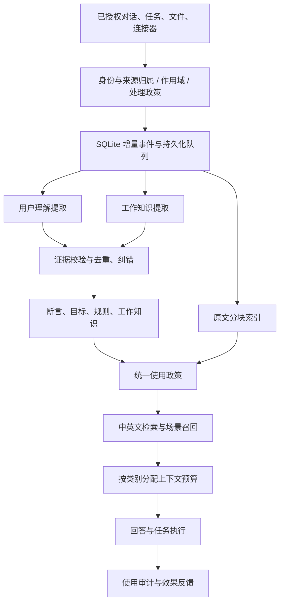

# 记忆学习与召回技术方案

- 日期：2026-10-11
- 状态：P0–P2 核心链路已实施；P3 保持评测后选择，见[实施记录](./memory-learning-implementation.md)
- 范围：用户理解、工作记忆、文件与连接器知识、上下文召回、身份与来源归属
- 基线：当前仓库源码；本机默认 `~/.xopc` 的只读统计仅作为故障样本，不代表所有安装实例
- 关联：[现有架构](./memory-architecture.md)、[用户说明](../../user-understanding.md)、[数据获取](./agent-data-acquisition.md)

## 1. 目标与决策

让助手持续知道用户正在推进什么、形成过哪些决策、产出了什么、遇到过哪些问题，并在相关任务中准确使用这些信息。

保留 SQLite、用户断言、目标、协作规则、知识条目、来源证据和作用域。不新增独立记忆服务或图数据库。首期先打通现有来源的有效使用、持久化增量学习和中文检索；向量召回作为后续可选增强，不成为启动依赖。

核心决策：

1. 用户理解与工作记忆分开提取、分开准入。完成一次任务不等于形成一项个人偏好。
2. 来源、内容可靠性、行动权限分开建模。外部知识可以辅助回答，不能提供行动授权。
3. 普通工作记忆按证据自动维护，不逐条要求确认；冲突或低质量条目暂不使用。沿用敏感信息的现有政策。
4. 工作学习以增量事件驱动，不依赖对话达到压缩阈值。
5. 主人身份、可见范围、来源授权、有效期和删除抑制必须在读取、写入和召回时一致执行。
6. 记忆可修正、可追溯。效果以任务表现和召回质量衡量，不以条目数量衡量。

非目标：自动扫描所有磁盘、自动连接新账号、从工作内容推断敏感个人属性、自动扩大任何权限、第一阶段建设完整多租户账号体系。

## 2. 当前问题与证据

调查时的本机样本：4 条 active 用户断言；177 条 active 外部原文索引；11 条 candidate 工作线索；0 条 active 工作记忆。84 次执行上下文审计只有用户断言，没有知识选中记录。未发现 transcript-synthesis 提取运行，20 个会话的压缩次数均为 0。不能仅凭这些统计判断对话复盘未运行的具体原因。

| 断点 | 当前行为 | 设计修复 |
| --- | --- | --- |
| 外部工作记忆无法进入自动上下文 | connector work_thread 写成 untrusted/candidate；维护排除该来源；上下文使用 trustedOnly | 用证据准入与使用政策替代来源一刀切 |
| 短会话学习不足 | 同一会话 10 轮才复盘，计数保存在内存 Map | 持久化游标、跨会话调度、空闲合并、事件优先级 |
| 工作经验学习依赖压缩 | 普通复盘主要提取用户断言；长期压缩晋升类型有限 | 新增独立 work-synthesis，覆盖任务、工具与文件成果 |
| 原文索引被当作学习结果 | 本地文件/连接器 pipeline 主要截取原文写 source_index | 原文分块索引与有证据的工作知识生成分离 |
| 中文与换说法召回差 | FTS5 unicode61，无中文分词与语义召回 | 中英文规范化索引、多路查询、后续可选向量 |
| 主人身份隐含 | 固定 local-owner；私聊条件未在此边界验证发送者为主人 | 显式身份绑定与 actor attribution |
| 来源变化不能完整传递 | 原文与派生记忆缺少统一依赖关系 | 版本化证据关系、更新/撤销传播 |

代码基线：`src/agent/background-review/`、`src/agent/memory/compaction-promotion.ts`、`src/connectors/connected-source-understanding.ts`、`src/knowledge/connected-knowledge-pipeline.ts`、`src/knowledge-memory/repository.ts`、`src/agent/context/execution-context.ts`。

## 3. 目标架构

权限校验先于模型读取。生成后、落库前再验证授权与 source version，避免撤销或文件变化期间写入旧结果。召回前再次校验。外部文字、工具输出和派生总结始终作为数据渲染。

## 4. 从谁的工作中学习

继续使用 local-owner 作为本机 principal，不把 Agent 当成用户身份。增加显式 actor 与来源绑定。

| 来源 | 主人归属规则 | 可学习内容 |
| --- | --- | --- |
| 已认证本机 Web/CLI | 由宿主认证上下文绑定主人，不能由模型指定 | 显式用户事实、目标、规则，以及工作知识 |
| 渠道私聊 | channel + accountId + peerId 匹配 owner binding | 绑定主人后才进入共享学习；未绑定时仅会话上下文 |
| 渠道群聊 | 不因群内某条发言自动学习共享画像 | 首期保持不进入共享记忆 |
| 任务/工作流 | actor=agent/system，携带来源任务与源会话 | 已验证成果和经验；不得自动成为主人事实 |
| 已授权工作文件 | 属于主人的授权工作范围，不代表每句话由主人写作 | 项目事实、决策、进度；作者未知不直接生成个人特征 |
| 连接器 | 连接账号与内容作者分别识别；owner/other/shared/unknown | 工作知识可以来自其他作者；个人画像只用可归属主人的证据 |

新增 owner identity binding，使用宿主取得的稳定 peer/account id，禁止凭名字、邮箱正文、文件存在于本机等信号推定本人。家庭或团队其他成员首期不建立共享画像，也不默认共享主人知识。

源文档中关于同事的事实按 person/project 归属；不能被转换为 self 的职业、偏好或承诺。

## 5. 数据模型与统一使用政策

### 5.1 三层内容

- Source：原始会话行、任务结果、文件版本、连接器记录。遵守现有 retention policy。
- Evidence：原始出处、版本、位置、作者归属、观察时间、授权范围与处理政策。
- Memory：有明确命题的用户理解或工作知识，以及它支持和被支持的证据。

沿用 `user_assertions`、`user_goals`、`collaboration_rules`、`knowledge_items`、`context_evidence` 和审计表。知识类型继续采用 decision、project_fact、task_lesson、commitment、open_question、work_thread 等。

建议增量表/字段如下，SQL 编号在实施时按仓库最新 schema 分配：

| 结构 | 关键字段与用途 |
| --- | --- |
| owner_identity_bindings | principal、channel、account、peer、verifiedAt、revokedAt；身份匹配唯一约束 |
| memory_learning_jobs | principal、sourceRef、sourceVersion、extractorVersion、policyVersion、state、leaseOwner、leaseUntil、attempt、nextAttemptAt、errorCode；持久化队列 |
| memory_learning_cursors | principal、sourcePartition、extractor、observedSequence、processedSequence、oldestPendingAt；区分看见与完成 |
| knowledge_revisions | knowledgeId、revisionId、content、changeReason、createdAt；知识纠错/更新历史 |
| knowledge_evidence_links | knowledgeRevisionId、evidenceId、relation、supportKind；支持、反驳、替代及出处定位 |
| knowledge_source_chunks | sourceItemId、sourceVersion、ordinal、locator、text/searchText、contentHash、indexVersion；分块检索与失效 |

扩展知识条目：`claimMode: explicit | observed | inferred | reported`、`verification: supported | tentative | conflicted`、`sensitivity`、`allowedUses`。有效 Agent 与授权范围从证据关系导出并在读取时检查，不由模型输出授权字段。source_index 不作为知识修订对象。

保留 originClass 表示来源，不再让它独自决定能否使用。定义 `canUseKnowledge(item, context, purpose)`，供自动上下文、knowledge search/get、项目上下文、语音以及外部 provider 共同调用：

1. principal、actor/session access 和 scope 可见。
2. 当前版本的证据授权有效，来源在现有 read policy 内，Agent 被允许使用。
3. status、valid time、expiry/review time 和删除抑制允许。
4. sensitivity 与使用目的允许。
5. verification 不是 conflicted；有可追溯支持证据。
6. 外部 reported 知识按来源事实渲染，不当作主人确认或执行指令。

外部资料满足来源授权、明确出处、无冲突、时间有效、证据校验通过时，可自动成为 active/reported 工作知识。active 表示当前可用，不表示用户确认。推断项保留标签；高影响判断只提供背景与出处，不能单凭该项作执行决定。

原文 source_index 可按查询作为带来源的材料返回，不用“可信主人事实”的条件筛掉；不得通过切换 recordClass 绕过来源内容 policy。现有 knowledge_write 不能继续无证据地固定写 active：宿主绑定当前 turn/task 证据，通过同一准入路径；没有可靠证据则写会话级 tentative note。

## 6. 学习触发与持久化调度

### 6.1 触发事件

| 事件 | 行为 |
| --- | --- |
| 用户明确记住/纠正/忘记 | 高优先级处理；通过现有工具或语义入口，动作与证据绑定；回复只声明已提交成功的结果 |
| 普通私聊结束 | 记录 pending range；3 个完整轮次或空闲 60 秒后合并学习 |
| 任务阶段完成、验证结果、用户反馈 | 提交 work-synthesis；记录任务结果状态，不把生成当成通过验收 |
| 文件导入、授权文件更新 | 更新版本与 chunks，再做局部工作提取 |
| 连接器同步 | 按 changed item IDs 入队，超出预算的条目留在队列 |
| 会话压缩 | 保留上下文恢复作用，交接知识通过统一准入去重 |

以上调度数值为初始参数，必须通过成本与时延评测校准。每个完整 turn 必须有可恢复事件；模型中止/失败仍记录事实状态，但不产生“工作已完成”的记忆。

优先级：用户显式命令 > 已完成任务/纠错 > 近期会话 > 增量来源 > 历史补处理。按 principal 公平调度，各来源防饥饿；单分区有序，同一 extractor 的范围不交叉提交。

事务边界：优先在 transcript/task/source 提交事务中追加轻量学习 outbox，不在事务内调用模型。未能同事务接入的入口用持久化 source sequence 扫描补齐，并且只有写入 job 后才能推进 observed cursor。不能依赖进程内通知保证送达。

### 6.2 执行语义

- job 幂等键为 principal + source identity/version + extractor version + policy version。权限变化不复用旧 policy 的结果。
- 状态为 queued/running/succeeded/skipped/retry_wait/failed/canceled；每次运行仍写现有 extraction audit。
- lease 初值 180 秒，运行时续租；过期任务可被重新领取，旧 worker 以 lease token 防止重复提交。
- 失败最多 3 次指数退避；blocked-by-policy 不消耗模型重试，政策允许后建立新政策版本任务。
- 落库、输出审计、游标推进在一个事务中完成。model call 可以至少一次，最终副作用幂等。
- succeeded 包含“审查后没有值得保存内容”；此时推进 processed cursor 并记录 no_durable_claim。
- 人工修正、用户忘记、来源撤销或版本变化使旧 job 失效；生成结果不能覆盖用户纠错。
- 处理进程重启时，从数据库恢复 job 和 cursor，不再从零计数。

初始批次限制：每次最多 30k 字符输入、8 条知识候选；普通对话最多 80 条消息，不足以处理全部增量时继续分页。Worker 默认并发 1，按统一用量系统记录 token、耗时与成本，支持每日本地配置的处理预算。达到预算时保留 backlog，不静默丢弃。

## 7. 两条提取链路

### 7.1 用户理解

保留当前 stable slot、纠错、merge/replace 和敏感准入逻辑。调整为持久化增量窗口；现有断言按 scope 和相关性选入比较上下文，不仅取最近 80 条。

直接陈述可形成 user_explicit；工作行为仅在多次独立主人证据下形成 user_observed/system_inferred。一个 task 意图不能使整批历史中的个人陈述全部失去资格：按候选绑定的消息与意图判断。

任务中的局部偏好保持项目作用域。画像提取不能用 assistant 自述、工具输出或已有记忆作为主人证据。推断规则不能形成 tool_gate 或扩展主动行动权限。

### 7.2 工作知识

新增 work-synthesis extractor，输入包括增量 user/assistant 行、宿主结构化任务结果、获准保存的工具证据、文件/连接器片段。工具结果是工作证据，不是主人事实。

每条候选输出：kind、subjectKey/topicKey、predicate、value、statement、scope、claimMode、证据引用与精确定位、时间、confidence、importance、候选 merge/replace target。模型只能选择宿主提供的 scope/target IDs，不能指定 principal、grant 或 Agent 授权。

工作知识应保存原因与适用条件，例如“项目 A 因 X 选择 SQLite；重新评估条件是 Y”，而非“做了数据库工作”。任务经验记录问题、原因、已验证解决方式及适用范围；失败尝试明确标记失败，不总结为解决方案。

候选准入：

1. 引用存在且匹配当前版本；文本引用能定位，结构化结果字段可校验。
2. 未被 truncation 标记的完整部分才能支持结论；不足则保留 tentative 或等待授权范围内补读。
3. statement 自包含；scope 不超出证据许可；禁止从共享项目提升个人全局特征。
4. 同一命题的独立证据不重复计数，复述/召回记忆不增加 confidence。
5. 显式用户修正优先；仅支持高价值且有证据的普通工作知识自动 active。

去重先用 canonical slot（principal + scope + subject/topic + predicate）与 source identity，随后用同 scope 的相关候选做语义比较。模型只能提议 merge，确定性校验目标与值。文本相似不等于同一命题，不能合并相反决策。

工作流/后台任务允许提交有验证记录的项目成果，但不能产生 user_explicit 断言。全局 work_thread 用于“用户当前关注的工作”，project_fact 必须绑定明确 projectId，不能靠模型猜名称归属。

## 8. 文件、来源更新与持续工作状态

授权目录建立 source version，按 hash 增量处理；watcher 作为提示，周期扫描与持久化清单作为恢复机制。不再只依据 mtime，避免旧文件复制或保留时间戳时漏采。局部文件清单不完整时不作删除推断。

原文按标题、段落、表格/代码边界切分，初始块大小 1500–3000 字符，最多 200 字符重叠。保留完整性标志、页码/行号和版本。分块只是索引表示，原始文件仍是 authoritative source；无权保留原文的来源不得持久化 chunk text。

继续复用 extractDocumentText 支持的格式；项目代码与资料使用已有授权读取与数据获取层。对大文件分批处理，扫描/抽样上限在诊断里可见。不能把抽样完成显示为全量理解。

项目 overview 保持紧凑，同时以独立知识保存决策、成果、进度、风险和未解决问题。新状态取代旧状态；完成任务更新对应 commitment/open_question，不能不断追加互相矛盾的“当前进度”。

来源修改：只重提取变化的 chunk 和受影响知识；移除失效 support 后重新计算 eligibility。来源删除/授权撤销：相关 chunks 立即不可读；派生知识只可使用仍有效且足以独立支持命题的证据，否则 withheld。不能用第二个弱来源继续泄露已撤销来源的独有细节。

用户删除：扩展现有 suppression，清理知识修订、证据链接、chunk 派生索引、缓存与审计中的已删除内容；取消对应 pending jobs。抑制检查在落库前执行，阻止处理中结果重新创建。删除记忆与删除原始会话/文件的语义继续区分。

## 9. 召回、中文与上下文预算

### 9.1 检索路径

统一 KnowledgeRetrievalService，供自动上下文、knowledge tools、project context、voice 使用。权限与有效性过滤在每条检索路线上先执行，精排和提示生成之前再次校验。

召回三路：

1. 原文/知识 lexical 检索：保留英文 token；中文连续文本生成 unigram + bigram 索引，查询同样规范化，使用有上限的 OR term。精确字符串、项目名、路径、错误码优先匹配。
2. 工作连续性：按当前 project/task/topic 取近期未关闭目标、决策与未解决问题；不要求用户再次说出原来的关键词。
3. 后续可选 semantic 检索：在同样权限边界内加入向量候选，以 rank fusion 合并；embedding model/version 可重建，失败回退 lexical，不影响启动与回答。

中文索引初期保存到普通 FTS5 searchText 列，可用确定性预处理避免依赖自定义 SQLite 扩展。用中文 unigram 提高单字查询召回，bigram 与精确命中提高排序质量；索引大小、噪声召回和不同字符/混合语言场景必须评测。不直接修改已有原始 content。

默认检索 query 从当前消息、当前工作目标、最近 2–3 轮的实体/主题构建；“继续”“那个问题”优先使用当前工作状态。宿主先做确定性构建，不为每轮固定增加一次 LLM 改写。

候选排序依据相关性、项目精确匹配、未解决状态、importance、freshness、证据质量与用户反馈。confidence 表示内容支持度，反馈只影响使用价值。多个原文片段不能挤掉全部工作总结，重复知识/同文档 chunks 按多样性去重。

外部材料显示来源、时间与 reported 标签；由此生成的建议仍服从当前指令和既有工具授权。禁止用简单的 `trustedOnly=false` 替代完整 policy。

### 9.2 注入预算

首期保留 maxChars=6000，上限不是本机故障原因。对规则、用户理解、当前工作、相关知识与来源摘录设类别预算；按当前任务调整并允许空类别借用。

初始比例：规则 15%、用户理解 20%、当前工作 25%、知识 30%、来源摘录 10%。比例是排序约束而非机械截断，未容纳的重要规则需产生明确 budget audit；不能在渲染时悄悄忽略。大块证据用摘要与可读 ID，支持工具按需展开。

每轮记录 eligible/retrieved/selected/rendered 数量与排除原因。剩余预算不足时丢整条，保留完整出处，不按字符截断成改变语义的结论。

## 10. 配置、API 与可观察性

保留现有 enabled、writePolicy、readScopes、contentSources、processingPolicy、contextPlanning 上限与现有授权收据。增加有边界的 learning 参数：idleFlushMs、maxBatchChars、maxCandidates、maxAttempts、日处理预算。已有 extraction.reviewIntervalTurns 继续作为增量普通复盘的轮次数阈值，不新增第二个同义配置。

升级不自动开启 connector 内容来源、不扩大 lookback/retention，也不替用户绑定新渠道身份。外部原文与派生记忆都需要来源读取权限；派生为 memory 不能绕过 connector content policy。需要新增权限时复用现有来源授权界面，不另建通用确认流程。

新增拟议路由：

- `GET /api/memory-learning/status`：来源覆盖、积压、成功时间、排除原因和成本。
- `POST /api/memory-learning/rebuild`：在现有授权与预算范围内排队重处理；返回 job/batch id，接口内不等待模型。
- `GET /api/memory-learning/jobs/:id`：任务与错误状态。
- `GET /api/knowledge-memory/:id/evidence`：当前用户有权查看的证据与版本。

任何新增 authenticated route 必须同步 lazy-bundles matcher、正/负映射测试，并经真实认证 Gateway 验证。接口 response 的 count 也不得泄露其他 actor/Agent 不可见内容。

诊断展示采集 → 处理 → 准入 → 召回四阶段。例如“177 条来源索引，11 条工作知识待处理，最近回答用了 0 条知识”，以及 no_owner_binding、source_not_allowed、schema_invalid、evidence_missing、conflicted、expired、no_match、budget_excluded 等原因。

提取审计需保存 objectId/revisionId，修复现有 transcript review outputs 丢弃对象引用的问题。日志沿用 createLogger，结构化字段包含 jobId、source、phase、counts、errorCode；不写原始敏感正文。

UI 复用现有理解/知识页面，只增加覆盖与处理状态、来源定位、修正/忘记/重新处理入口。遵循现有 skeleton、select、固定尺寸 modal 和语义样式规则。

## 11. 模块落点

| 模块 | 修改 |
| --- | --- |
| src/user-context/access-policy.ts、owner.ts | 宿主身份绑定与统一 session/actor access |
| src/user-context/extraction/registry.ts | work-synthesis、policy version 与能力/准入上限实际执行 |
| src/agent/background-review/ | 改为提交持久化范围，复用用户理解解析，不再拥有唯一内存计数 |
| src/memory-learning/（新增） | 队列、游标、worker、调度、工作候选解析与诊断 |
| src/knowledge/ | chunks、source versions、增量清单、原文索引 |
| src/knowledge-memory/ | revisions、evidence links、统一 reconciliation/usage policy/retrieval |
| src/connectors/ | 语义结果接统一准入；changed IDs 全量分批入队；保留 consent/actor attribution |
| src/tasks/、src/workflows/、src/session/ | 结构化结果事件、压缩产物去重接入 |
| src/agent/context/、src/voice/realtime/ | 统一检索与预算渲染 |
| src/storage/sqlite/ | schema、outbox/queue、repository 与事务恢复 |
| src/gateway/、web/ | Gateway worker 生命周期、路由、来源覆盖诊断 |

voice 等其他在途修改不属于本设计实施范围；落地时先核对用户已有变更。

## 12. 迁移与分期交付

### P0：恢复现有知识的有效使用

完成 canUseKnowledge、证据链接、reported/verification 和来源 policy 统一。接通已有 connector work_thread 的自动准入与召回。补来源与排除原因诊断。

现有 untrusted/candidate 不批量标成 active。检查 source JSON、evidence refs、当前授权与有效来源，满足条件的补证据并重新准入；只有模型旧总结且原文已不可用的条目保持 tentative，要求授权范围内重新采集。不能仅提高 confidence。

### P1：持续学习

上线持久化 jobs/cursors 与 work-synthesis，覆盖短聊、任务/工作流结果和来源变化。修复 stuck extraction 和重启恢复。既有压缩学习改用统一准入，避免重复。

历史补处理默认选近期有权限的私聊与来源，范围由现有授权/处理政策限定；预算内分批，显示进度。过往未知主人身份的渠道不纳入共享补学习。

### P2：文件与中文召回

上线 chunks、中文索引、工作连续性召回及上下文分类预算。原索引保留到新索引重建并校验完成，随后一次切换查询实现，不维护长期双套记忆逻辑。大文件覆盖和增量失效完整验收。

### P3：语义增强

先用 P0–P2 的任务评测判断 lexical 的残余失败，再选择 embedding/rerank 实现。远端 embedding 遵守原始处理政策，local_only 来源不发送远端。补成本和效果对比后发布。

每阶段是独立可交付行为，不需要等 P3 才改善可用性。运行时保留现有学习/召回开关以控制模型工作量；schema 迁移不逆向删除用户数据。回退需要兼容新 schema 的构建或备份恢复，不能假定旧二进制可以直接读取新增语义。

## 13. 验收与效果评价

以下数值为发布门槛目标，尚无已测结果。建立匿名或合成数据集，避免用本机私有邮件制作公开 fixture。

| 场景 | 验收 |
| --- | --- |
| 短聊与重启 | 2 轮后退出，重启后继续或空闲处理；不漏范围、不重复条目 |
| 明确纠错/忘记 | 已提交结果立即影响下一次召回；旧 job 不能复活删除内容 |
| 日常工作 | 任务形成决策、产物和已验证经验后，跨会话能回答原因与结果，保留项目边界 |
| 外部知识 | 授权邮件工作线索进入相关回答；邮件中的指令不能形成规则或授权 |
| 来源撤销 | revoke 后下一次请求不可召回该来源及仅由它支持的派生细节 |
| 身份隔离 | 未绑定私聊、其他 Agent 未授权来源、群聊和 temporary 共享记忆泄露为 0 |
| 中文召回 | 至少 100 个中英混合查询，覆盖短词、改写、项目名、代码/错误码；relevant Recall@10 ≥ 85%，人工判读 Precision@5 ≥ 80% |
| 冲突与归属 | 同事事实不成为 self；失败不成为成功；相反决策不 merge |
| 文件完整性 | 超限可见且可续处理；mtime 保留但 hash 变化可更新；不完整扫描不错误删除 |
| 队列故障 | 模型失败、进程崩溃、lease 过期、双 worker、授权变化均可恢复且副作用幂等 |
| 性能与成本 | 本地自动召回在 10k 知识/100k chunks 的明确硬件基线上 p95 ≤ 200ms；普通回答不等待后台学习；普通 turn ≤ 1 次合并学习调用，批处理成本可查 |

端到端评测比较现状与新实现：工作上下文回答准确率、跨会话任务延续成功率、遗漏关键决策比例、不当个人化比例、无证据记忆比例、用户纠错率、时延和模型用量。记忆数量增长不能代替通过这些指标。

验证分层：纯政策/解析/去重单测；真实 SQLite 事务与迁移测试；worker 崩溃恢复集成测试；认证 Gateway API/lazy route 测试；用户界面类型检查与构建；固定真实模型版本的效果集。实施阶段按各阶段修改跑相关测试，不要求设计稿执行运行时测试。

## 14. 首个实现切片

先完成“现有已授权外部工作知识可以被准确使用”：

1. 为 11 条样本工作线索建立可验证证据关系与准入诊断。
2. 实现统一 canUseKnowledge，并接自动上下文与 knowledge 工具。
3. 保持当前来源 opt-in 边界，解释因来源 policy 未开启而 withheld 的原因。
4. 验证已获授权线索能回答工作问题，不能改变协作规则或触发外部动作。
5. 验证撤销、删除、Agent scope、冲突处理与真实 Gateway 路径。

完成这一切片后再接持久化学习队列，能先验证“资料 → 工作知识 → 回答”的完整收益，避免先增加采集量却继续没有知识进入上下文。
