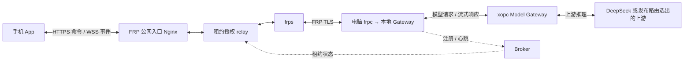

# xopc 手机连电脑的网络延迟调查与设计

2026-11-16 · 设计提案

建议保持电脑 Gateway 为会话、运行状态和工具执行的权威。先缩短移动端发消息与断线恢复的关键路径，加入同网直连，再用真机对照决定区域 FRP 和模型入口的落点。电脑到 DeepSeek 的调用独立计时、独立选路。这样可以分别改善「连不上、发不出」和「发出后很久才有正文」。

## 1. 现状

| 环节 | 代码和部署记录确认的行为 |
|---|---|
| 配对与鉴权 | 默认候选先放已连接的 Secure Link，再加入已配置的 Tailscale Serve 和自定义 HTTPS。三端只接受这三种配对路由，保存 Gateway 身份和路由。Android、HarmonyOS 一般先试当前地址，再串行试其他地址。iOS 的配对会话刷新也逐个校验地址。自动发现的同网地址未进入移动配对路由。 [Gateway 路由](/Users/micjoyce/develop/github/xopc/src/gateway/device-routes.ts:24) · [Android](/Users/micjoyce/develop/github/xopc/apps/mobile-android/app/src/main/java/ai/xopc/mobile/gateway/GatewaySession.kt:89) · [HarmonyOS](/Users/micjoyce/develop/github/xopc/apps/mobile-harmony/entry/src/main/ets/service/gatewaySession.ets:337) · [iOS](/Users/micjoyce/develop/github/xopc/apps/mobile-ios/XopcMobile/Core/Networking/GatewayPairing.swift:439) |
| FRP 数据面 | `*.frp.xopc.ai` 在 Nginx 终结公网 TLS，经本机 `:7110` 授权 relay 转 frps `:8080`，再通过已建立的 FRP TLS 通道到电脑 frpc 及 loopback Gateway。Broker 管理签名注册、心跳、域名归属和租约。Relay 主动关闭撤销租约的 HTTP/WS。仓库的 FRP 配置使用 HTTP vhost，未配置 QUIC。旧 Broker 仓库的 TLS 透传文档属于前一套架构，后来部署记录确认已切到授权 relay。 [部署记录](../security/frp-deployment-2026-09-13.md) · [frpc 配置](/Users/micjoyce/develop/github/xopc/src/tunnel/frpc-config.ts:34) · [relay](/Users/micjoyce/develop/github/xopc-platform/apps/broker/src/tunnel-relay.ts:35) |
| 移动端准备和发送 | 冷建连包括路由身份校验、可能的令牌刷新、能力检查、endpoint 注册、单次 ticket、WebSocket upgrade 和 hello/ready。现有会话发送前，iOS 串行读历史、Agent 配置及会话 context，Android 串行读历史和 Agent 配置，HarmonyOS 每次取 config，缺 transcript ID 时再取历史。按当前 iOS/Android 代码，普通老会话发消息就可能多出 3/2 个 WAN 往返，另有冷建连和附件开销。 [iOS 发消息](/Users/micjoyce/develop/github/xopc/apps/mobile-ios/XopcMobile/Core/Networking/GatewayClient+Messaging.swift:5) · [Android 发消息](/Users/micjoyce/develop/github/xopc/apps/mobile-android/app/src/main/java/ai/xopc/mobile/gateway/ConversationRepository.kt:754) · [HarmonyOS 发消息](/Users/micjoyce/develop/github/xopc/apps/mobile-harmony/entry/src/main/ets/repository/chatRepository.ets:282) · [Realtime 合约](realtime.md) |
| 命令和流 | 会话输入走 REST，Gateway 提交持久化收据后调度 run，正文从 realtime topic 回手机。Android 和 HarmonyOS 在原连接上订阅 run topic。iOS 当前为每次 run 另外申请 ticket、开一个 WebSocket，订阅从 `afterSeq: 0` 开始。可复用的恢复机制包括 `clientMessageId`、收据查询、topic cursor 和持久历史。Android、HarmonyOS 连接失败后的首次退避约 1 秒，之后指数增长。 [Realtime 合约](realtime.md) · [iOS run 连接](/Users/micjoyce/develop/github/xopc/apps/mobile-ios/XopcMobile/Core/Networking/GatewayClient.swift:319) · [Android 重连](/Users/micjoyce/develop/github/xopc/apps/mobile-android/app/src/main/java/ai/xopc/mobile/gateway/RealtimeClient.kt:81) · [HarmonyOS 重连](/Users/micjoyce/develop/github/xopc/apps/mobile-harmony/entry/src/main/ets/service/realtimeClient.ets:112) |
| 模型出站 | `xopc-cloud` 默认走 `https://router.xopc.ai/v1`，平台连接或配置可覆盖。模型 Gateway 校验授权、预留积分和上游容量、选择实际部署、发起流式推理、回写用量。普通模型最多 3 次上游尝试，部分设备模型固定 1 次。已有 adaptive routing 用近期成功率和 `averageFirstResultMs` 等评分，`firstResultMs` 取首个 canonical event，可能早于首个正文。 [默认端点](/Users/micjoyce/develop/github/xopc/src/providers/xopc-cloud-config.ts:3) · [上游执行](/Users/micjoyce/develop/github/xopc-platform/apps/model-gateway/src/app.ts:2299) · [首事件](/Users/micjoyce/develop/github/xopc-platform/apps/model-gateway/src/canonical-protocol.ts:95) · [路由评分](/Users/micjoyce/develop/github/xopc-platform/apps/model-gateway/src/adaptive-routing.ts:18) |

`link.xopc.ai` 用于扫码唤起 App。Console 提供登录及注册授权。配对完成后，聊天的设备访问和模型调用是两条独立路径。手机和电脑在同一 Wi-Fi 下使用 FRP 时，设备请求仍要经公网中继。电脑在中国大陆时，如果模型入口在境外而实际 DeepSeek 上游在境内，每一轮推理还可能从电脑出境再回国内。后一段需要以生产选中的上游、网关实际部署区域和出站观测确认。 [配对链接协议](/Users/micjoyce/develop/github/xopc-platform/docs/mobile-link-protocol.md) · [平台部署](/Users/micjoyce/develop/github/xopc-platform/deploy/README.md:5)

### 1.1 已有测量

- 2026-11-16 从开发机直连探测时，`frp.xopc.ai`、`router.xopc.ai` 和 `console.xopc.ai` 解析到同一 IPv4，当前解析器未返回 AAAA。`frp.xopc.ai/health`、`router.xopc.ai/health` 返回 200。两个 health 端点冷连接首字节约 **420–450 ms**，复用连接各四次约 **138–143 ms**。样本覆盖开发机到公开入口，真机网络、用户隧道子域、FRP 回电脑段及模型推理段需要另测。
- 10 月 29 日本机历史调查记录了 631 次 `xopc-cloud/auto` **完整模型调用**，P50 **5.16 s**、P95 **14.57 s**，样本可能命中不同上游。一次模型且无工具的 50 个成功 run，模型调用占其累计执行时间的 **97.24%**。另有一次失败尝试耗时 **122.36 s**，随后一次重试又耗时 11.35 s。历史数据缺少可关联的首正文记录。 [10 月 29 日历史调查](response-latency-analysis-2026-10-29.md)
- 11 月 11 日 Web 受控实验复用了现有 run 生命周期事件，收据到 run 关联 P50 从 **402.9 ms** 到 **2.9 ms**，发送到首个可见正文从 **461.8 ms** 到 **129.0 ms**。实验使用本地受控模型，适合作为三端 run 关联的实现参考。 [Web 对照实验](chat-performance-2026-11-11.md#realtime-run-association-and-completed-replies)

## 2. 第一阶段：缩短发送与恢复的关键路径

### 2.1 已连接状态下，普通纯文字发送只需一次写请求

- 会话进入时预取 `transcriptId`、`configVersion` 和必要的任务归属，与历史/会话头一起缓存。收到 reset、配置或会话事件时失效。短期可在会话载入路径并行读取；若测出仍存在大历史读取，提供轻量快照或复用现有会话摘要。正常发送使用已就绪的快照，Gateway 继续判定版本冲突及任务保护。新会话使用已加载的 Composer 配置。
- 本地发件箱保留业务身份。先监听 `run.started`/`run.completed`，再提交。按 `conversationId + clientMessageId + inputId` 将事件与收据对齐。遇到 POST 响应丢失，先查收据，必要时以相同命令身份重发。确定性版本冲突走刷新及显式重新提交。附件和任务继续走各自的提交与校验路径。
- 发送后立即回显，区分「待送达」「电脑已收到」「模型正在准备」「连接恢复中」。首正文按到达时间显示。页面离开或 Wi-Fi/蜂窝切换后，从 cursor 继续收流，历史快照修复 gap。电脑在运行且流仍可恢复时只续传原 run。

### 2.2 减少重连的串行操作

- 每次前台恢复与网络代际变化时，后台并行探测少量已知候选。在身份校验通过前只发探测，不携带业务凭据。缓存按 Gateway、候选、网络代际和现行安全期限隔离；能力和 endpoint 注册可复用的条件由 Gateway 明确声明，遇重启、撤销或版本变化立即重新验证。可先将兼容能力并入 ticket 响应，再以测量决定合并注册。
- HTTP 和 WebSocket 共用当前已验证路由决定。一次建连锁定 origin，校验、ticket、WS 和连接证明用同一地址。iOS 将 run 订阅合并到已有已验证的 endpoint 控制连接，保留各 topic 游标和历史恢复，附加语音连接按其协议运行。一次业务变更只用一个活跃路径，备用连接做探测及预热。先稳定可连接的路径，再择机升级，对仅有轻微改善的路径设滞回，避免来回切换。
- 文本流可从 cursor 恢复。持有 endpoint claim 的工具、上传和语音先按现有中断规则处理；活跃调用期间优先保持原路径，失效时由新连接和新 claim 恢复可恢复的部分。控制帧与媒体吞吐独立观测，若大附件确实造成同隧道流卡顿，再拆分流量或限制并发。

## 3. 第二阶段：同网直连，异地使用区域中继

### 3.1 同网优先

电脑新增受限的 LAN HTTPS 监听，将流量交给现有 Gateway 鉴权；同网发现采用 mDNS/Bonjour，也可用配对或授权路由更新返回的 LAN 候选。发现结果仅提供线索。手机用已配对的 Gateway 公钥验证带版本、有效期和设备身份的路由材料，并把 LAN TLS 证书或公钥绑定到这份签名材料。配对身份由已验证的首次配对建立。证书轮换保留同一 Gateway 身份，证书校验严格限定在该配对设备，避免对共享网络开放 owner 接口或放宽全局 TLS。

跨三端协商新增 `lan` 候选。当前客户端遇到未知 `kind` 会拒绝整个路由列表，因此新类型只发给声明支持的客户端。已配对用户通过版本化的签名路由更新发现新入口，远程回退保持可用。权限拒绝、Wi-Fi AP 隔离、DNS/DHCP 变更、双栈失败、休眠和系统回前台均纳入真机测试。iOS Bonjour 需要本地网络许可，Android 按目标 SDK 对应的局域网规则接入，HarmonyOS 单独做发现权限及兼容性验证。 [Apple TN3179](https://developer.apple.com/documentation/technotes/tn3179-understanding-local-network-privacy) · [Android 局域网权限](https://developer.android.com/privacy-and-security/local-network-permission)

### 3.2 异地优先改善中继落点

- 若中国大陆用户占主流，先试一个大陆区域的 FRP 入口，和现网做运营商分组对照。手机和电脑必须能到同一实际中继，选址分数以 `手机↔节点 RTT + 电脑↔节点 RTT`、建连成功率、丢包及负载为输入；以长尾与恢复表现确定默认区域。手机与电脑分处境内外时，选能同时稳定到达的节点。
- 给单个 Gateway 指定中继归属，使用稳定的旧公网地址或已配对身份签发的区域候选，禁止用客户端地理 DNS 把请求转到没有该 frpc 的节点。先按设备分组灰度单区域，切换通过现有租约语义完成。需要快速跨区故障恢复时，再做可同时连接的相互独立区域租约及会话代际。
- 现有 relay 依赖共享 SQLite 里的身份/租约状态。跨区方案需要权威归属、带期限租约、受控的撤销分发及分区时的拒绝策略，确保原有停用行为能关闭活动 socket。建议先完成这条路径的控制面设计，再扩展多区域运营。地域准入、数据流向和域名备案由部署方核对。 [平台身份库](/Users/micjoyce/develop/github/xopc-platform/deploy/README.md:196) · [FRP 安全和租约](../security/frp-implementation-progress-2026-09-13.md)
- FRP QUIC 可作为 **电脑到中继这一段** 的弱网对照，公网 HTTPS/WS 和地理路径仍由现有入口决定；保留 TCP 兼容性，测 UDP 被阻断的环境。旁路排查 HTTP/WS 反代的连接池、可观测到的背压及真实部署的流式缓冲配置。现有 Nginx 模板已经关闭代理响应缓冲。 [frp 传输配置](https://gofrp.org/en/docs/features/common/network/network/) · [QUIC RFC 9000](https://www.rfc-editor.org/rfc/rfc9000.html)

## 4. 模型链路单独优化

1. **复用埋点并补齐首正文。** 用 `clientMessageId → inputId → runId → modelRequestId → upstreamAttemptId` 关联移动端、电脑和模型网关。Model Gateway 增加入口/鉴权/额度预留、上游建连、首有效事件、首 reasoning/tool delta、首非空正文、结算的分段耗时。供应商内部排队和预填充如果无细项，就记录为上游等待。SSE keep-alive 只用于判断连接存活。 [现有 Gateway 首字埋点](response-latency-analysis-2026-10-29.md#首字与前端覆盖缺口) · [DeepSeek 并发与 keep-alive](https://api-docs.deepseek.com/quick_start/rate_limit/)
2. **用同一真实部署对比出口。** 固定 DeepSeek 实际模型、thinking、输入长度、工具 schema 及输出预算。用隔离测试凭据比较现网模型入口、候选大陆模型入口、电脑直连上游三组，区分冷热连接、缓存冷热与峰谷。检查电脑→入口、入口→上游的连接复用。公开 health 只用来判读客户端到入口，不进入推理质量指标。若大陆全链路收益稳定，再用 `XOPC_MODEL_ROUTER_URL` 或连接平台的端点配置灰度；生产区域入口继续走同一授权计费协议。第一阶段用单一权威账本，独立区域部署前验证幂等预留/结算、撤销分发以及账本访问 RTT，防止把跨境往返移到每次请求的鉴权/扣费上。若国内外流量确需跨境，测试供应商合规加速通道及允许的数据区域。 [阿里云加速区域说明](https://www.alibabacloud.com/help/en/ga/user-guide/overview-1/) · [模型服务加速](https://www.alibabacloud.com/help/en/ga/use-cases/ga-accelerates-ai-service)
3. **压首字长尾。** 给普通对话的上游连接、等待有效进展、流中停顿及全部尝试设置共享预算。云路由与电脑 Agent 共用一个重试预算，区分确定可重试的错误和提交结果未知。允许在未对用户或工具提交输出、且具备取消和账单处理语义时触发受控 fallback；活跃流中断按原 run 的失败/恢复语义处理。继续复用已有 adaptive routing，将真实首正文尾延迟、地域成功率与健康窗口纳入评分，先独立验证候选线路再开放自动切换。
4. **单独测试模型策略。** 短对话可对照 DeepSeek Flash 的低 thinking 或非思考模式，复杂任务保留当前推理质量。观测真实 cache hit、输入 token、thinking token 与工具往返次数，稳定可缓存的提示词前缀，按任务完成质量评估合并独立工具调用。 [DeepSeek 思考模式](https://api-docs.deepseek.com/guides/thinking_mode/) · [DeepSeek 上下文缓存](https://api-docs.deepseek.com/guides/kv_cache/)

## 5. 其他方案的位置

| 方案 | 适用场景 | 决策 |
|---|---|---|
| Tailscale Serve | 已装 Tailscale 的用户，或团队希望快速获得真实公网直连对照 | 复用已支持的候选，分别记录 direct、peer relay 和 DERP。国内网络需要按运营商实测；产品默认连接仍由 App 内配对完成。 [Tailscale 连接类型](https://tailscale.com/docs/reference/connection-types) |
| 内嵌公网 P2P | 异地大文件、语音或远控为高频场景，区域中继后仍有明显体验差距 | PoC 比较 ICE/STUN/TURN 与 frp XTCP。ICE 需要两端集成、信令、密钥绑定和中继；XTCP 需要 visitor 且受 NAT 成功率影响。先通过已可用路径服务，后台尝试直连并测量成功率和节省量。 [ICE RFC 8445](https://www.rfc-editor.org/rfc/rfc8445.html) · [frp XTCP](https://gofrp.org/en/docs/features/xtcp/) |
| 云托管 Gateway | 电脑睡眠、断电或长期离线仍要普通聊天和自动化 | 单独推进现有托管模式，将权威实例放在云端，电脑作为本地工具节点的模式需另做设计。现有迁移设计已经明确单写者；电脑离线期间，本机私有文件和本机工具会暂不可用。 [托管迁移设计](xopc-hosted-instance-migration.md) |

## 6. 验收和实施顺序

| 阶段 | 交付与决策条件 |
|---|---|
| A · 构建基线 | 先用现有 Gateway trace 和 `scripts/measure-gateway-response-latency.mts`，补三端首正文/ready 计时及模型网关关联。在同一 Gateway 上用固定响应长度和节奏的本地模型测设备侧，再用固定 DeepSeek 配置测端到端。记录 app/网关版本、冷热连接、候选与命中路由、区域和运营商、错误阶段、重试次数。统计按时收到正文的比例和失败率，再报告成功样本的分位数。 |
| B · 三端发送与恢复 | 先做热发送、run 生命周期关联与并行路由探测。可先用 HarmonyOS 跑国内真机对照，同一协议逐步铺到 Android 和 iOS。用收据丢失、Wi-Fi 切蜂窝、前后台恢复、切换中断及租约撤销验证，检查每个业务命令只产生一次执行、已配对身份持续有效。 |
| C · 路径试点 | 同网 LAN 优先。并行跑大陆 FRP、模型入口对照，FRP/模型入口分别灰度和回退。样本至少含同网、同城蜂窝、跨省、境内外、UDP 受限和电脑离线，覆盖主要运营商及峰谷。分层采样，尾延迟使用足够重复样本。 |
| D · 决定投入 | 文本 P95 仍受某段网络主导时再扩大区域覆盖。媒体主导时再投公网 P2P。离线主导时优先托管。 |

第一版建议将热态纯文字点击至本地回显的 P95 定为 **<100 ms**。点击至 Gateway 持久收据的 P95 在同网热连接上为 **<300 ms**，在同城蜂窝中继场景为 **<800 ms**。网络恢复且电脑在线后，活动流恢复 P95 **<3 s**。这些数字是试点目标，以真机基线校准。端到端模型首正文单独用同模型同负载的相对改善、失败率和回答质量验收。计时采用每台机器上的单调时钟和 trace 关联，跨机器时钟不直接相减。日志仅保留关联 ID、路由和耗时元数据。

本次调查使用当前源码、平台部署模板、历史性能记录及公开健康端点。仍待实测生产 DeepSeek 路由/区域、真实用户子域的端到端开销、移动真机网络分布和电脑睡眠占比。文中区域、先行平台和验收阈值均为试点建议。
