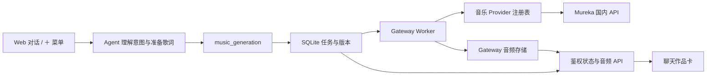

# 音乐生成技术方案

更新日期：2026-11-12。首版为 Gateway 直连的 Web 聊天闭环。面向用户的交互见[音乐产品与交互设计](../personal-ai-music.md)。

## 首发模型

默认路由为 `mureka-cn/mureka-9.5`，使用中国区 `api.mureka.cn`。国际站密钥使用 `mureka-global/mureka-9.5`，请求 `api.mureka.ai`。Mureka 有分别面向自定义歌词歌曲和纯音乐的异步提交、查询接口，与视频生成的 SQLite 入队、后台轮询和断线恢复方式匹配。歌曲请求同时传风格描述和原歌词，纯音乐请求省略歌词。两种请求均显式传 `n: 1`。[国内歌曲接口](https://platform.mureka.cn/docs/api/operations/post-v1-song-generate.html) · [国内纯音乐接口](https://platform.mureka.cn/docs/api/operations/post-v1-instrumental-generate.html)

天谱乐适合作为第二家实测对象。百炼 Fun-Music 当前文档标注邀测，且歌词和风格提示同时提供时可能只使用歌词。首发模型选择基于接口、可恢复性和产品所需输入，真实账号权限、质量、费用和延迟进入部署验收。[天谱乐](https://platform.tianpuyue.cn/docs/464626884e0) · [百炼](https://help.aliyun.com/zh/model-studio/fun-music)

## 运行链路

- **入口与工具。** 输入框 `＋` 菜单在空输入框放入可编辑示例。直接对话通过同一工具生成或查询。意图明确时立即入队。先看歌词的请求在聊天正文展示草稿，用户确认后 Agent 提交歌词。工具沿用现有 Agent 暴露策略，仅在 Web 聊天会话可用，并加入 Personal AI 的工具白名单。
- **提交与版本。** 工具返回 Job ID 后结束，Agent 可以继续回应。幂等范围为会话、transcript 和 tool call ID。相同输入重放返回原 Job，同键异参报冲突。版本提交加载当前 transcript 中已完成的父版本，复用同一 Work ID，按新请求分配版本号。未修改字段沿用父版本，切为纯音乐时清除歌词。失败的请求保留其版本号。
- **存储与恢复。** SQLite v277 增加任务和每日配额表。任务记录实际模型引用、规范输入、上游任务 ID、状态及租约。提交前持久化 submitting，收到上游 ID 后按原任务轮询。进程崩溃或提交响应丢失且无远端 ID 时标记 submission_unknown。状态查询和产物下载可重试，均针对原任务。配额按 UTC 自然日计算，在入队事务中计一次。
- **音频与鉴权。** Worker 从可信 CDN 下载有界 MP3，验证文件后原子发布到现有出站媒体目录。远端临时链接和凭据留在 Gateway 侧。状态和音频路由经 Gateway 鉴权与 lazy bundle 分发，查询限定当前会话和 transcript，音频支持 Range 和下载。聊天重置后旧任务继续完成，结果保存在旧记录中。删除会话时清理任务及音频。
- **Web 交付。** 聊天结束一轮后重新读取状态，有活动任务时继续轮询。以 Job ID 更新同一张作品卡，展示状态、标题、版本、歌词、试听和下载。改版由用户在对话里指出目标作品与变更。

## Provider 扩展契约

Provider 声明稳定 ID、模型列表、支持的模式、输入长度上限、凭据解析与音频下载域名。适配器实现以下两步：

| 方法 | 契约 |
| --- | --- |
| `submit(key, model, input)` | 把通用输入映射为供应商请求并返回稳定任务 ID。只有明确拒绝才抛出 `MusicRequestRejected`。超时、连接断开和无法解析受理响应由 Worker 记录为结果待确认。 |
| `query(key, mode, taskId)` | 规范化为排队、生成中、成功或明确失败。成功提供 MP3 下载地址及可选的毫秒时长。临时查询错误由 Worker 重试原任务。 |

新增同类异步 Provider 时，在 `src/music-generation/` 实现适配器并注册其 ID。保持 Gateway、Agent 工具和 Web 卡片使用同一契约。为新适配器验证请求映射、明确拒绝与未知结果的区别、任务查询、下载域名和音频格式。通过 `XOPC_MUSIC_MODEL=provider-id/model-id` 切换新请求。已入队任务沿用各自的模型引用，因此已部署的 Provider ID 和模型 ID 应保持可解析。

后续接入只返回字节或同步下载链接的 Provider 时，应先扩展提交结果类型和持久化协议，在提交返回后把音频或可恢复引用保存为中间结果，再推进任务状态。其他音频格式按产物保存 MIME 与格式。Cloud 接入复用同一异步能力，平台负责账号凭据、额度与上游任务，Gateway 保留会话与作品版本。跨客户端通知、作品库、取消和精细编辑可以在同一 Work/Job 契约上演进。

## Cloud 和客户端扩展

Cloud 阶段保持本地与平台各自的 Job ID。Gateway 负责 Agent 意图、版本和本地播放。平台负责托管凭据、模型目录、上游任务、额度与云端产物。模型目录只发布实测通过的模式和限制。用户可在 Agent 默认值或单个 Agent 配置音乐路由。工具继续读取最终生效的配置。

| 平台接口（拟议） | 行为 |
| --- | --- |
| `POST /v1/music/generations` | 校验租户和输入，按用户、能力和幂等键原子创建 Job 并预留额度。同键异参冲突。返回平台 Job ID。 |
| `GET /v1/music/generations/:id` | 校验归属，返回任务状态、成品引用与恢复动作。提交回执丢失时按同一幂等键找回原任务。 |
| `GET /v1/music/generations/:id/audio` | 返回可授权读取的音频。同一个成品可以重新下载，云端结算只发生一次。 |

确定失败释放额度。上游受理不明时保留有限期预留并对账。平台成功但本地保存失败时，只恢复下载。Webhook 接入后和轮询更新同一份 Job，按状态版本去重。跨客户端交付时，在成品提交事务中记录待交付事件，以 Job 和目的地去重，保留原会话及 transcript 归属。

作品库从现有 Work ID 和版本关系开始。需要跨对话访问时，引入独立的作品归属和可见性检查。视频配乐使用稳定的音频引用，由视频流程负责裁剪和混音。模型能力逐步声明时长控制、可选格式、取消、续写等差异，由工具与 Gateway 在提交前校验。

## 配置与验证

在「设置 → 模型与能力 → 创作音乐」选择中国站或国际站，点击服务商名称可保存或移除对应站点的 API Key。点击「设置」可为当前模型保存默认创作类型，明确指定歌曲或纯音乐时按请求执行。网关保存的模型优先于 `XOPC_MUSIC_MODEL`，网关保存的密钥优先于站点环境变量 `MUREKA_CN_API_KEY` 或 `MUREKA_GLOBAL_API_KEY`，最后读取通用的 `MUREKA_API_KEY`。界面保存后即对新任务生效。默认模型是 Mureka 9.5，每个 Gateway 每天最多接受 20 次生成请求，同时最多 3 个活动任务。用 `XOPC_MUSIC_DAILY_LIMIT` 调整每日请求上限。若国内账号的下载域名与默认 CDN 不同，通过 `XOPC_MUREKA_AUDIO_HOSTS` 加入核实过的完整域名，多个域名以逗号分隔。

工程验证覆盖提交去重、丢失响应、重启后查询、下载恢复、原词保留、纯音乐输入、SQLite 升级，以及实际 Gateway HTTP 路径的鉴权、跨会话隔离与 Range。上线前用部署账号实测三组输入：中文歌曲、原词保留并换风格、短视频纯音乐。记录生成耗时、成品格式、CDN 和扣费，确认下载过期前可保存同一产物。
