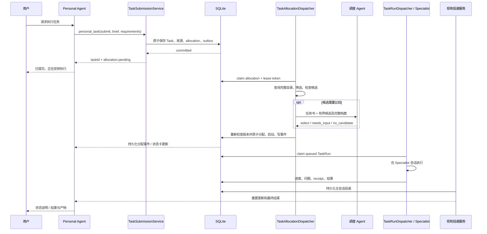

# Personal Agent 单层后台任务分配技术方案

日期：2026-10-14

状态：待实施技术方案；本文不表示功能已经实现。

目标：personal agent 一次提交完整任务书，后台选择单个 Specialist 并启动执行，分配状态、重要进度和结果可靠返回原个人会话。

## 1. 决策与范围

采用「先保存 Task，再异步分配执行者」架构。personal agent 不再承担普通委派的候选发现、match 和 agentId 选择；后台分配服务使用现有 Agent Catalog、能力档案和可用性检查，必要时调用一个专用调度 Agent 比较候选。

Task 是唯一用户任务。分配过程使用独立 allocation 记录，不创建调度父 Task、执行子 Task，也不把调度 Agent 写入 TaskRun 的 executor。整个任务同一时刻最多一个执行者、一个 active root TaskRun。

本期覆盖个人会话主动委派的普通 Agent 任务。已有直接指定执行者的 Task、Workflow、Automation 不迁移。连接应用继续走 personal_capability → personal_request，保留账号选择、连接和授权流程，不改为普通后台分配。本期不做任务拆分、多执行者并行、递归调度、运行中自动换人、执行失败后的自动重新执行。

核心约束：

- 提交确认只等待本地校验和 SQLite 提交，不等待候选检查或模型调用。
- 调度 Agent 只做选人判断，宿主负责检查、提交分配和启动执行。
- 明确指定的 Agent、Skill、输入、目标和授权边界不能被调度改写。
- 分配和通知持久化，重启可恢复；租约过期的旧调度结果不能生效。
- 分配成功不等于执行已开始，TaskRun 成功不等于 Task 已验收。

## 2. 现有实现与复用点

以下结论来自当前仓库源码；后文新增接口均为拟议实现。

| 现有模块 | 当前能力 | 本方案用途 |
|---|---|---|
| src/agent/tools/personal-task-tool.ts | create 要求 agentId；通过 createSelectedTask 创建并启动 | 增加 submit，不在个人回合内选人 |
| src/tasks/task-application-service.ts | activation.capture 保存；start 创建 root TaskRun；origin/main links、命令去重和 domain_outbox | 复用创建与启动，增加 allocate 激活入口与原子分配操作 |
| src/agent-matching/service.ts | 候选评估、模型/工具/Skill 检查；当前全量评估后分页 | 分离声明匹配和执行证据检查，供后台使用 |
| src/agent-matching/selection-repository.ts | 保存选择依据、候选证据及 Task/Run 链接 | 保存最终分配，新增 background 来源 |
| src/tasks/task-run-dispatcher.ts | Agent TaskRun 租约、心跳、并发和中断恢复 | 继续执行已分配 Task，不承担选人 |
| src/tasks/task-conversation-repository.ts | 执行会话及 assignmentEpoch | 执行会话身份继续由现有流程管理 |
| src/tasks/task-main-update-delivery.ts | 协作进度、问题和失败返回主会话，忙时延后 | 保留重要进度和 worker 问题的处理 |
| src/tasks/task-result-delivery-service.ts | 结果持久化、过期检查、产物验证、转录及 realtime 通知 | 复用执行结果投递 |
| src/personal-agent/reply-composer.ts | personal 结果摘要、回复队列和有效性检查 | 保留以个人 Agent 语气呈现最终结果 |
| src/gateway/service.ts | 执行与通知服务生命周期 | 接入独立分配 dispatcher |

当前 TaskPhase 是 backlog/ready/active/review/closed。TaskOperationalState 是执行层投影。不要直接把 allocating 当作新的 TaskPhase；它是执行者分配状态。

当前 TaskApplicationService.start 接受 executor，但不负责同步 tasks.delegateAgentId 的分配语义。本方案必须新增统一 assignAndStart 操作，避免 Run executor、Task delegate 和会话状态不一致。

## 3. 总体流程



个人模型回合以 submit 的本地提交确认结束。后台选人、创建执行会话、运行、回复合成都不持有个人会话的输入执行锁。

## 4. 提交契约

### 4.1 Personal 工具

在 personal_task 增加 command=submit。要求 objective、description、expectedOutputs、acceptanceCriteria、constraints；数组可为空，但关键完成条件应明确。requirements 可省略领域标签，后台允许从任务书补充软标签；不得补充用户未要求的硬限制。

```json
{
  "command": "submit",
  "title": "分析销售月度趋势",
  "objective": "分析销售 CSV，交付报告、图表和可复现脚本。",
  "description": "输入：media://inbound/sales.csv。按月汇总销售额、计算环比、定位下滑月份，说明清洗口径和数据局限。",
  "requirements": {
    "version": 1,
    "summary": "销售 CSV 月度趋势分析",
    "domain": "data",
    "taskType": "data_analysis",
    "inputKinds": ["csv"],
    "outputKinds": ["report", "chart", "script"]
  },
  "expectedOutputs": ["分析报告", "趋势图", "计算脚本"],
  "acceptanceCriteria": ["月度总额与原始数据一致", "脚本可以复现结果"],
  "constraints": ["保留原始数据", "缺少成本数据时不推断利润"],
  "idempotencyKey": "sales-analysis-001"
}
```

响应仅代表受理，不伪造 runId 或执行者：

```json
{
  "taskId": "<uuid>",
  "taskVersion": 1,
  "phase": "ready",
  "allocation": { "id": "<uuid>", "generation": 1, "status": "pending" },
  "accepted": true
}
```

conversationId、transcriptId、requestInputId、主 Agent 身份由宿主取当前会话，模型不能任意指定。幂等键在会话范围解析为宿主命令键，规范化输入哈希相同则返回原 Task，不同则拒绝。重试返回当前状态，不能把已经 assigned 的任务重述为 pending。

### 4.2 Task 共享契约

TaskCreateRequest.activation 新增分支：

```ts
type AllocateActivation = {
  mode: 'allocate';
  requirements: SpecialistTaskRequirements;
};
```

通过已有 Task 创建服务写入 Task 和 allocation；不在工具内部写私有旁路记录。submit 将任务书转换为现有 contract/context 字段，originConversationId 由宿主提供。本期要求无 parentTaskId，执行类型固定为 agent，不接受 workflow/human/external。allocate 不接受 delegateAgentId；用户指定执行者通过 requirements.requestedAgentId 表达，仍由后台检查。

Task 创建、origin/main links、输入引用、allocation 和提交 outbox 必须位于同一个事务。事务提交后调用非阻塞 dispatch 只是唤醒优化，周期扫描与启动扫描负责兜底。

### 4.3 输入材料

不复制整个个人会话。正文保存目标和必要背景，TaskContextRepository 保存材料引用、来源及授权范围。已上传材料使用共享 media URI；知识对象使用对象 ID 和访问规则；本地路径带来源 workspace 和访问范围，不能假设不同 Agent 的同名路径指向同一个文件。

提交阶段只检查结构、引用格式和本地可确认的授权事实；文件完整读取、远程连接和工具探测留给后台。无法访问的材料不得悄悄替换或要求主会话重复读大文件。

现有 buildTaskRunMessage 只传任务正文前 12000 字符。实施时必须保证完整验收条件与约束进入 Task execution context；超出启动消息预算时提供宿主生成的 Task/context 引用，worker 先读取完整任务书。不能依赖被截断的启动字符串作为唯一权威。

## 5. 数据模型与状态

新增 task_allocations，承担持久化分配队列；一个 Task 可有多个分配 generation，但至多一个非终态 generation。

| 字段 | 含义 |
|---|---|
| id / task_id / generation | 分配标识、任务及分配代次 |
| status | pending / selecting / assigned / blocked / failed / cancelled |
| task_contract_version / brief_hash | 分配依据；正文、约束、材料修改后旧决策失效 |
| requirements_json / authorization_ref | 规范化需求及可信授权引用，不能存模型自授的权限 |
| origin_conversation_id / origin_transcript_id / request_input_id | 提交时来源快照 |
| dispatcher_agent_id / dispatcher_agent_revision | 调度配置及审计；不是执行者 |
| selected_agent_id / selection_id / task_run_id | 已提交分配的关联 |
| version / lease_token / lease_owner / lease_expires_at | CAS 与过期 worker 隔离 |
| attempts / next_attempt_at / deadline_at | 重试预算和调度截止时间 |
| reason_code / last_error / created_at / updated_at | 状态说明与审计 |

候选评估及模型调用记录写 task_allocation_attempts：attemptId、allocationId、catalogRevision、候选 ID/revision、check 证据、模型版本、输出、耗时、最终接受/丢弃原因。有界保存，禁止记录凭据及不必要的材料正文。

索引：status+next_attempt_at、task_id+generation 唯一、可领取任务的租约索引；部分唯一索引限制每 Task 一个 pending/selecting 分配。

```text
pending → selecting → assigned
              ├────→ blocked
              ├────→ failed
              └────→ pending（可重试错误，带 next_attempt_at）
pending/selecting/blocked/failed → cancelled（用户取消/关闭）
blocked/failed → 新 generation pending（补充信息或显式重试）
```

assigned 表示执行者已提交；TaskRun 可能已 queued，也可能因依赖或审批 waits 尚未创建。没有 runId 不代表分配失败。实际执行状态仍取现有 TaskRun/waits。

TaskReadModel 增加 allocation 投影。TaskPhase 保留；TaskOperationalState 增加 allocating，分配 blocked/failed 对应 blocked/failed，attention 增加 allocation_blocked/allocation_failed。状态优先级：closed → paused/waits → active Run → 当前未完成 allocation → 既有执行投影。没有 Run 的 allocating Task 不显示 start 给普通客户端，防止绕过分配；手工指定执行者需走统一分配命令。

不要用 allocation generation 替代 assignmentEpoch：前者隔离选人尝试，后者继续隔离执行会话与结果。复用现有 ensureTaskConversation 管理执行会话及 epoch，调度阶段不创建或切换执行会话。

## 6. 后台调度与选择准确性

### 6.1 Dispatcher

新增 TaskAllocationDispatcher 和 TaskAllocationService。Gateway 启动扫描持久化队列，收到提交事件后即时唤醒，周期兜底。分配并发初始为 2，租约 60 秒、心跳 15 秒；调度模型单次超时初始 20 秒，参数可调整。这些是初始工程配置，不是实测性能。

模型调用在 SQLite 事务外执行。commit 前必须校验 lease token、allocation version、Task 状态、任务书哈希、contract version、没有 active root Run，及用户未取消/暂停。Gateway 停止时停止 claim，取消模型调用；重启后 selecting 租约过期可重新分配。由于调度没有执行外部业务动作，租约恢复可以重做选人；执行中断仍遵循现有 TaskRun 的效果检查规则。

### 6.2 调度 Agent

增加系统专用调度配置，引用一个已启用、ready 的 Catalog Agent，例如 task-router。Agent Catalog 增加显式 purpose=task_dispatcher 标记；旧 Agent 默认 specialist。所有 Specialist 枚举和匹配入口排除该角色，避免仅依靠命名约定。

调度 Agent 使用自己的有效模型配置、语言理解指令和版本。一次调度采用独立、无历史的结构化模型调用，复用模型凭据、用量和日志封装；本期不启动普通 AgentService 工具循环，不开放 exec、MCP、个人记忆、Task 创建或再次委派工具。保存 attempt 审计，不创建任务执行会话。

这保留“另一个 Agent 负责判断”的能力，同时让宿主掌握确定性启动。该 Agent 的配置界面明确其职责；其模型不可用时，只有下述确定性分配条件成立才能降级，否则进入带原因的重试/失败，不能静默选一个名字相近的 Agent。

### 6.3 两阶段候选查询

当前 matchSpecialists 是全量评估后截取，不直接作为大目录的无限检查循环。重构为：

1. **声明检索**：按 Catalog revision 缓存完整 Specialist 元数据，过滤自身、personal、dispatcher、disabled、非 ready；用户指定 Agent 时仅考虑它。标签使用规范化精确匹配，自定义标签不猜相近含义。
2. **执行条件验证**：对有希望的候选检查模型配置、工具实际注册与策略、必需 Skill、材料访问；记录 configured/verified/unknown/blocked。blocked 不可选，unknown 尝试有界补证，仍未知则不能开始。

标签属于适合程度，不是权限或硬能力证明；任务类型/领域不匹配不自动排除，否则旧档案或无档案 Agent 会被错漏。完整目录必须保留无档案的 legacy 候选。

初始每批最多 8 个完整档案，候选按 taskType、domain、输入输出覆盖排序后送调度 Agent。保留总数、剩余数及候选来源；不得把 ID 排序当作专长依据。全量元数据检索可以在内存完成，昂贵探测只在候选批次进行。

当候选超过预算时，宿主提供继续查询入口。优先扩展相同标签匹配档位，再扩展相邻档位；调度结果必须说明选择基于哪些已检查候选。若遗漏可能影响判断且未完成扩展，本期最多 3 批/24 个完整档案、60 秒总分配预算；预算耗尽进入 blocked(reason=candidate_review_budget_exceeded)，不能声称找到全目录最优执行者。此参数需通过多 Agent 评测调整。

### 6.4 确定性路径与模型路径

- 用户明确指定 Agent：宿主验证它并直接分配，无模型选人；不自动替换。
- 完整硬条件评估后只剩一个 eligible 候选，且声明覆盖任务类型与输入输出、没有需要解释的边界：可以由宿主直接分配，记录 system reason。
- 多个可行候选、档案缺失、边界需解释或请求标签不明确：由调度 Agent 阅读任务书、完整 specialties/examples/limitations 和证据，比较交付适配程度。
- 不使用模型自行报告的置信度作为跳过检查的依据。

调度返回 strict schema：

```ts
type AllocationDecision =
  | { kind: 'select'; agentId: string; reason: string; evidenceIds: string[] }
  | { kind: 'need_more_candidates'; reason: string }
  | { kind: 'needs_input'; question: string; missingFields: string[] }
  | { kind: 'no_candidate'; reason: string; reasonCodes: string[] };
```

agentId 必须来自当前已展示候选；evidenceIds 必须来自宿主证据。模型不能改 requirements、生成权限或跳过检查。输出格式错误最多修复一次；再失败进入可观测错误，不把自由文本当选择结果。

needs_input 优先利用已提交任务书和授权上下文解决；仍缺少必要事实才通过主会话提出问题，用户答案使用现有 Task context/wait 流程存储，并产生新 generation。

### 6.5 原子提交与启动

新增 assignAndStartAllocatedTask，在一个短 SQLite 写事务内完成：

1. 校验 token/version、任务书版本、任务未关闭/暂停、无 active root Run。
2. 读取最终候选当前配置并重新做本地有效性检查；远程探测不在事务里。候选相关 revision 改变则丢弃旧判断并重评；无关 Catalog 修改不强制重跑。
3. 写入 selection record（selectionSource=background，明确 reasonSource），关联已有 Task；修正 selection repository 为使用提交时 origin input/transcript，而不是后台当下的 active input。
4. 更新 Task.delegateAgentId；执行会话管理使用该执行者，不把 personal ownerId 当默认执行者。
5. 通过现有 TaskApplicationService 的 start 逻辑创建唯一 root Run，或记录其依赖/审批 waits。
6. 标记 allocation assigned，保存 selectionId 和可选 runId；写 assignment/status outbox。

启动命令键固定为 allocation:{id}:start。提交后由已有 TaskRunDispatcher 执行。进程在 commit 后、dispatch 前崩溃，由持久化队列恢复，无需重新选人。事务内失败必须回滚，不能留下“已分配”但无启动决定的半状态。明确的业务 waits 可以提交，标记 assigned + waiting。

现有 createSelectedTask 会创建新 Task，不能用于此步骤；提取共享 eligibility/selection 逻辑，再对已有 Task 执行分配。禁止后台再创建第二个 Task。

## 7. 主对话状态与结果回传

### 7.1 状态卡与 Agent 感知

新增持久化 Task status delivery，沿用“先入库、后 realtime”的可靠投递方式，不能只发 WebSocket。记录 deliveryId、taskId、allocation generation、taskRunId、eventSequence、origin 及状态摘要。

事件包括 submitted、assigned、started、allocation_blocked、allocation_failed、重要 progress、waiting 和 terminal。task.assigned 是新 domain event；其它事件优先复用现有 Task.changed、协作更新和 receipt，避免双重事实来源。

主会话展示一张以 taskId 关联的状态卡，分配后显示执行者名称、简短选择原因及状态；Task 面板提供候选证据和完整审计。卡片更新不需要 personal 模型生成一句话。状态摘要随 personal_task(get/list) 返回，也注入下一次 personal 回合的有界“本人委派任务变化”上下文，确保“界面看见”与“Agent 知道”同时成立。

重复事件按 deliveryId 去重，同 Task 按序列/代次避免旧状态覆盖新状态；已取消后到达的 assigned/started 忽略。卡片可以合并更新，审计保留原事件。离线恢复通过持久化转录/状态查询，不依赖 realtime 重放成功。

### 7.2 何时主动说话

默认 submitted 由当前 personal 回合确认；assigned/started 更新卡片和下一回合上下文，不每次唤醒模型。用户要求进度时，可用现有主更新决策机制生成简短说明。

必须进入可靠主会话处理的事件：分配失败且需要决策、必要输入/权限问题、重要执行阻塞、最终结果。主会话忙时排队，不取消或抢占用户当前输入。采用稳定 clientMessageId 和现有 submitAndConfirmTaskMainUpdate 的幂等确认模式。

分配失败没有 TaskRun，不能伪装成 TaskRun failure receipt。用 allocation 状态投递专门的失败事件；同一个失败只由一个通道触发主回复，不能同时走 status delivery、collaboration failure 和 result delivery。

### 7.3 执行结果

继续使用 TaskRunCoordinator → TaskApplicationService.completeRun → TaskResultDeliveryRepository → TaskResultDeliveryService → PersonalReplyComposer。保持 run、active execution conversation、assignmentEpoch 和最新 root Run 的过期结果检查。

对外产物继续走 immutable outbound media 或允许的已发布外部链接，不把执行者 workspace 路径当作个人会话可下载产物。结果卡显示谁执行、Run 状态、验证状态、产物可用性；personal 回复依据 receipt 精确区分执行完成、待验收、部分成果和失败。

通知或回复模型暂时失败时，结构化结果已经落库、可查询并展示；重试回复不会重新执行任务。回复合成不能成为“任务结果是否保存”的前提。

## 8. 失败、并发与用户操作

| 情况 | 处理 |
|---|---|
| submit 响应丢失 | 同键同输入返回原 Task，状态照实返回 |
| 分配 worker 崩溃或模型超时 | 租约与 token 隔离旧结果；有界退避重试，初始最多 3 次 |
| 模型返回不在候选集的 Agent | 拒绝并记录，最多一次格式/决策修复 |
| 所选 Agent 配置失效 | 提交前重评；未启动时可选择其他合法候选，不替换用户指定 Agent |
| 用户取消/关闭 | 同事务取消未完成 allocation、写取消事件；旧选人结果无法 commit |
| 用户暂停 | 使用现有 paused wait；停止 claim/commit，恢复时重新检查 |
| 用户修改任务书 | 更新 brief/context revision；旧选人结果废弃，生成新代次；无关标题修饰不必重做 |
| 用户补充必要信息 | 写 Task context，解决 user_input wait，创建新分配代次 |
| 分配期间用户要求立即指定某人 | 统一重分配命令，取消旧代次并设置 requestedAgentId，不能旁路 start |
| 依赖未完成或缺授权 | 分配可 assigned，但现有 start 返回 waits，界面显示 waiting |
| 分配后执行失败 | 现有失败回传；本期不自动重跑或换人，防止重复外部效果 |
| 原个人会话被删除 | 任务结果保留在 Task，投递标记不可达；不改投其它会话 |
| 原转录发生 reset/rebuild | 验证来源仍属于同一个人会话且未撤销；转录变化不能自动扩大授权，卡片按当前有效主转录规则恢复 |
| 同 Task 多 worker 同时选人 | CAS、租约 token、唯一未完成 allocation 及唯一 active root Run 保证一个提交胜出 |

执行中追加指令继续通过 personal_task(instruct/answer) 和协作板交给当前执行者；不触发运行中重新分配。用户取消可能与提交分配同时发生，以数据库事务顺序为准：若 Run 已创建，走现有取消 Run 和关闭 Task 流程。

## 9. 性能与公平性

分配服务使用独立并发配额，与执行池、个人会话输入队列分开。必要时对模型请求实施个人交互优先级和后台配额，避免仅仅移到后台后仍占满共享 provider 限流。

提交热路径不能触发 Catalog 全量扫描、Skill 加载、远程探测、调度模型或执行会话创建。指标区分：

- submit_host_ms：工具进入到本地提交确认。
- allocation_queue_ms / allocation_decision_ms：后台等待和决策。
- submit_to_run_start_ms：提交到实际执行开始，不能用创建 Run 时间替代。
- status_delivery_ms / result_delivery_ms：事实落库到主会话展示。
- candidate_count / inspected_count / model_calls / prompt_tokens / repair_count。
- wrong_assignment_rate / no_candidate_rate / stale_decision_rate / duplicate_run_count。

初始目标：本地健康环境、正常任务书下 submit_host_ms p95 ≤ 200ms；新增路径在主回合内零模型调用、零远程检查。后台预算 60 秒，超预算给明确状态。以上均为待验证目标，首次向用户确认仍包含 personal 模型生成任务书和回复的时间，不能宣传成 200ms 全流程。

对 10/100/1000 Agent 分别评测。revision 缓存声明资料，不缓存权限为永久有效；Skill/工具探测采用短期、按相关配置版本失效的缓存，commit 再验证所选候选。队列按优先级和创建时间公平领取，避免高频任务饿死旧任务。

## 10. 接口、UI 与实施文件

| 位置 | 变更 |
|---|---|
| packages/gateway-contract/src/tasks.ts、task-lifecycle.ts | allocate 激活分支、allocation DTO、allocating/attention 状态 |
| packages/gateway-contract/src/specialists.ts | 复用 requirements；新增 strict 调度输出契约 |
| src/agent-config/schema.ts、Agent Catalog DTO/UI | dispatcher purpose 与专用调度配置；默认 specialist |
| src/tasks/task-application-service.ts | 原子 submit、assignAndStart；命令约束与版本检查 |
| src/tasks/task-allocation-{repository,service,dispatcher}.ts（新增） | 持久化分配、租约、候选决策和恢复 |
| src/agent-matching/service.ts | 声明检索与执行检查拆分；统一排除 dispatcher |
| src/agent-matching/selection-repository.ts | background 来源、提交时来源快照、已有 Task 链接 |
| src/agent/tools/personal-task-tool.ts | submit；get/list 暴露分配状态；保留 create 供兼容 |
| src/personal-agent/prompts.ts、policy.ts、prompt-context.ts | 普通委派默认 submit；移除主回合选人要求，注入任务变化 |
| src/tasks/task-read-model-projector.ts | allocation 状态、命令和 attention 投影 |
| src/tasks/task-status-delivery-{repository,service}.ts（新增） | 状态可靠投递、顺序、去重与主会话卡片 |
| src/gateway/service.ts | lifecycle、立即唤醒、周期扫描、停止及配额 |
| src/storage/sqlite/migrations/ | 按实施时最新版本新增 migration；不硬编码下一编号 |
| web/src/features/chat/、tasks 相关 UI | 分配卡片、执行者、状态与审计；语义 tokens、skeleton |

API 优先扩展既有 Task 创建、查询和命令端点，不增加一套 personal-only Task 存储。新 activation/命令必须有 DTO 校验、来源鉴权和 actor 校验；自动分配提交接口只允许宿主内部调用。若新增 HTTP 路由，必须同步 lazy-bundles matcher、正负映射测试，并验证真实带鉴权 Gateway 路径。

旧 Task 缺少 allocation 行时维持当前行为。旧个人工具 create/agents/match 保留兼容，新增 personal 提示词默认 submit；连接应用保持原 Request 链路。通过宿主开关分阶段启用；关闭开关停止新分配提交但排空/明确暂停已有 allocation，不能让已经受理的 Task 无声遗失。

## 11. 测试与验收

### 提交与一致性

- 不带 agentId 的 submit 成功，Task、origin/main links、allocation 与 outbox 同事务；事务失败不残留半任务。
- 重复和不确定重试只得到同一个 Task；不同输入复用键拒绝；来源不能被模型伪造。
- 提交 mock 明确断言不调用匹配、Skill 探测、provider 或执行会话创建。
- 两 worker、租约过期旧 worker、取消竞态、任务书变更竞态：最多一个已提交分配和一个 active root Run。
- 分配后 commit 崩溃、dispatch 前崩溃、审批 waits、dependency waits 均恢复正确。

### 分配准确性

- 最合适候选放在旧 1000 字符摘要之外；仍能从后台目录找到。
- 多候选标签相同但 specialties/limitations 不同，验证调度比较。
- legacy 档案缺失、不匹配标签、未知标签、不具备工具或 Skill、材料跨 workspace、用户指定不可用 Agent。
- 模型选择越界候选、伪造证据、格式失败、目录变更、无关 revision 变化和候选预算耗尽。
- 固定案例集记录候选覆盖率、选择合适率和错误解释；单元 mock 不能证明模型实际选人质量，另用已配置模型离线评测。

### 主对话与结果

- 主会话运行中分配完成，卡片更新但不抢占；下一回合读到执行者与状态。
- 断线、重启、事件乱序/重复、回复合成失败仍可查看状态和产物。
- 无 Run 的分配失败可靠回主会话；不与执行失败重复通知。
- 执行产物复用现有 media 检查，结果与选择记录能关联到同一 taskId/runId。
- cancelled Task、旧 Run、旧 assignmentEpoch、删除会话的结果不污染主会话。
- Run succeeded 但 receipt 未通过验收时显示待验收，不误报任务已完成。
- 连接应用个人 Request 流程不受普通 submit 变更影响。

### 性能与端到端

- 10/100/1000 Agent 下测 submit p50/p95、分配耗时、tokens、检查次数与 provider 配额竞争。
-真实鉴权 Gateway 中提交 → 分配 → Run → 结果投递，期间个人会话可以接收另一条用户输入。
- 通过故障注入覆盖每个事务提交边界和通知边界；确认恢复不会重复业务执行。

## 12. 实施顺序

1. 共享 DTO、migration、提交服务、allocation read model 与幂等/来源测试。
2. 持久化 dispatcher、候选检索/检查拆分、明确指定与确定性路径。
3. 调度 Agent 配置、strict 判断、候选扩展、原子 assignAndStart 和竞态测试。
4. 状态投递、personal 工具与提示词、主会话卡片，接入现有结果链路。
5. 启停恢复、配额、故障注入、真实 Gateway 验证和多 Agent 性能/准确性评测。

完成标准：personal agent 可以一次提交任务书并结束当前回合；后台从完整目录选择单个可执行 Specialist；Task 与 Run 的执行者一致；主会话能看到谁在执行及真实状态，结果可靠送达；重试、重启、取消和状态乱序不会重复启动或误报完成。

## 13. 第一阶段实现记录

已实现 submit、独立 task-router（继承全局模型）、SQLite v249 分配队列、两个后台分配槽位、租约恢复、单执行者 TaskRun 启动，以及主会话状态消息和结果回复。普通委派提示词与已有持久化个人指令均升级为快速 submit；连接应用仍走原 Request 流程。

第一阶段复用现有 selectionSource=match/explicit，通过 allocation ID 和 task-router 审计区分后台决策；每 Task 一条 allocation，分配失败重试同一记录，不创建新 Task。尚未增加独立 attempts 审计表和 generation 历史。

候选从完整 Catalog 获取并检查，超过 24 个可行候选时明确受阻；多批候选扩展和检索缓存留待规模优化。状态先写主会话转录并发布 Task.changed，客户端复用状态消息及已有 Task 成果卡，不实现本文提出的统一合并状态卡。最终结果继续使用已有结果投递与 PersonalReplyComposer。

验证包含真实本地鉴权 Gateway 的 lazy 路由、后台分配、执行调度、结果保存与主会话回复；执行和回复模型使用测试替身。实际线上模型的选人质量和延迟仍需配置模型后评测，不将 mock 测试结果视为模型质量证明。

后续真实验证已通过：当前 personal 模型为 DeepSeek Flash，task-router 和执行者继承 XOPC Cloud GPT-5.5。最终提交工具耗时 13.62 ms，后台一次选中 data-analyst，执行期间主对话 1.34 s 响应新消息；执行结束后 1.50 s 回传结果。完整口径和单次测量限制见同目录 `personal-allocation-live-verification-2026-10-14.md`。

个人工具现只向模型展示提交及已有任务协调命令；历史发现、匹配和直接创建分支保留给内部兼容调用。个人上下文不再扫描或注入 Specialist 目录，也不要求主模型猜测硬工具名。用户点名的执行者由后台解析 ID/唯一显示名；用户明确请求的 Skill 仍作为硬要求验证。
