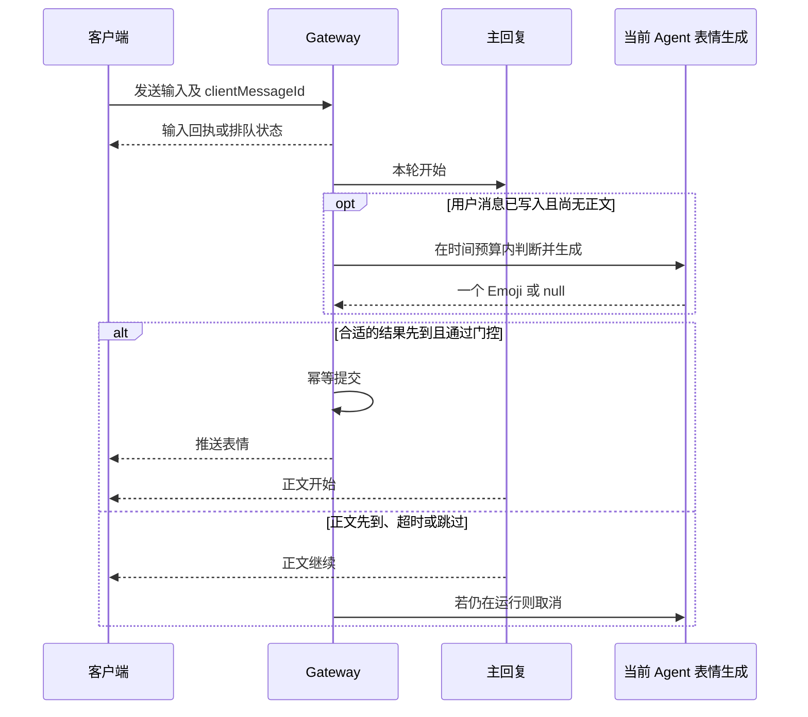

# Personal Agent 消息表情 · 技术方案

目标是让当前 Personal Agent 根据本轮语境生成一个 Emoji 或主动留空。网关只处理触发时机、校验、归属、限频和同步。客户端只渲染收到的结果。产品交互和验收基线见[产品方案](../personal-agent-message-reaction-product.md)。

## 生成方式

在运行中的 Personal Agent 下新增一个独立的、可取消的表情生成步骤。它使用当前 Agent 的身份和已有的模型授权策略，读取当前消息和少量同会话上下文，返回结构化结果。主回复流和生成步骤并行，主回复无需等待结果，也不为了让表情出现而缓冲正文。

网关现有 `runGatewayAgent` 已有 `inputIdentity`、`run.started`、运行取消信号与首段有效正文的检测。可在这里接入生命周期，在用户输入确实入库后绑定消息身份，并参照 `next-turn-suggestions/generator.ts` 复用 `resolveModel`、`completeWithResolvedCredentials` 和 `AbortSignal`。首版优先用该 Agent 已授权的低延时模型；未配置单独的可用路由时沿用同一 Agent 的有效路由，受每轮和每账户的开销预算限制。授权、路由或预算不可用时留空。单次生成，无自动重试。

上下文使用当前用户输入及最近至多两轮可见对话，初始预算合计最多 2,000 个字符。仅包含判断语气所需的用户和助理正文，去掉附件、引用正文、代码块、链接、工具记录、凭据和跨会话记忆。上下文作为不可信数据传入。生成步骤没有工具、网络访问、外部操作或消息选择权限。只继承 Agent 身份和表达风格，用固定职责提示判断语气、分辨否定与反讽，在敏感、严肃、急迫或不确定时允许直接留空。

```ts
// Proposed response format. The gateway supplies all message identities.
type AgentReactionDecision = { emoji: string | null };
```

输出为严格 JSON 对象，只接受 `emoji` 字段。值为 `null` 或一个 Unicode RGI Emoji。按实际运行时的 Unicode 数据验证完整序列（例如 Node 26 下的 `/^\p{RGI_Emoji}$/v`），接受合法的肤色、变体选择符或 ZWJ 组合，拒绝多个表情、普通文字、链接、HTML 及非预期字段。配置输入、输出大小限制。Emoji 作为纯文本渲染。模型直接给出字符，网关对输出做格式校验，校验失败就留空。

屏幕阅读使用客户端本地化的 Emoji 名称，缺少该名称时用系统读取原始 Emoji。无法稳定渲染的序列在对应客户端隐藏胶囊。

## 时序与并发



- 以每条实际被接手输入的运行时钟计时。只有当前活动 transcript 下已经有目标用户消息，且非后台/语音/审批等预先可知的场景，才允许进入候选。仅入队、失败、附件无正文、恢复旧运行和重放回执不会触发。首版若无法确定一条输入和运行的归属（如 steer 注入），跳过该输入。
- 建议初始值是约 200 ms 后仍无正文才提交一次生成请求，最快约 450 ms 展示，最晚 1.2 秒。如果生成在展示时间点前就完成，在内存里等到展示时间点，再进行最后一次仲裁。每账户限并发、每会话约 20 秒冷却，并在提交前重新检查。这些参数用于灰度调优。
- 首段有效正文、确认卡或终止（失败、取消、切换 transcript）到达时立即关闭当前候选窗口，并触发取消。门控、首段正文标记和提交在对应运行上串行仲裁。反应提交前再次核对当前 transcript、可见用户消息、有效授权和会话冷却。后到的模型结果即使无法即时取消也会被丢弃。已提交的表情表示当时已接住输入，后续回复执行失败由原状态单独说明。
- 发起辅助推理时复用现有模型调用和使用量记录，单独标注 `chat.agent_reaction`。控制排队时间，不追加模型降级链。关停开关即时取消在途工作。限流、超时、模型错误、出站失败或关闭功能时，主流程保持可用。历史读取可补偿提交后的推送丢失。

## 消息归属与同步

1. **归属与持久化。** 沿用 `SessionInputCommand` 的 `start/append` 和 `clientMessageId`，首条消息以回执映射草稿。建议新建 UI 元数据侧表，唯一键 `(conversationId, transcriptId, clientMessageId)`，包含 `emoji`、`actorAgentId`、`runId`、`createdAtMs`。由服务端从当前运行生成这些标识。事务确认目标消息依然存在，原子检查冷却并按唯一键插入，避免重试或多设备导致重复。擦除与删除遵循消息及会话生命周期，重置后旧 transcript 的结果不会进入新 transcript。
2. **历史投影。** 在 `GET /api/sessions/:key/history` 的当前页 UI 消息上批量附加可选 `agentReaction`，覆盖普通与紧凑投影；让历史返回体和 ETag 感知表情变化。正文、LLM 上下文、全文搜索和文本导出继续使用原始消息。语音和旧版客户端无需读取新字段。
3. **实时事件。** 数据库成功提交后发布建议事件 `session.agent-reaction`，包含会话、transcript、消息、Agent、运行 ID、Emoji 和时间。优先利用已鉴权的会话订阅能力，交付时验证订阅者满足同一消息读取权限。现有 `sessions.read` 检查是否已覆盖部署的会话可见性，需要与历史读取的授权逐项核对。必要时在实时交付层补上会话过滤。事件只作为低延迟增量，历史是恢复依据。
4. **客户端。** HarmonyOS、Android、iOS 和 WebUI 均用同一组消息标识合并。先到的表情暂存于当前会话缓存，对应消息到达后再挂载。账户或 transcript 切换清掉旧缓存。仅当前前台、消息可见、仍在等待正文时收到的首次实时反应播放 260 ms。历史、重放、乱序晚于正文和跨设备恢复都静态呈现。容器预留固定上边距以避免表情改变滚动锚点。

## 验证与推进

先通过固定走查样例验证 Agent 在中英文、否定、引用、反讽、混合语气和敏感场景下的表达质量。近义请求容许多种输出，断言「可接受 / 跳过」及上下文差异，避免用单一 Emoji 做黄金答案。

通过伪模型和可控时钟验证 JSON/Unicode 校验、快回复优先、队列实际开始、切会话/重置、取消信号与生成超时、幂等与限频、掉线恢复、越权订阅、旧客户端兼容和主流式回复不中断。用网关集成测试核对历史和实时得到相同目标，再用各端测试检查左上角位置、字体、主题与减少动态。

先在鸿蒙小流量灰度。观察反应用时、候选中合适回应的比例、误用反馈、重复率、额外推理用量和主回复首段耗时。埋点仅保留耗时、金额聚合及结果码，不记录原文、上下文或原始模型输出。下一个阶段依据真实可见率与误用情况调整时窗、提示和开销预算，再扩大平台与受众。
