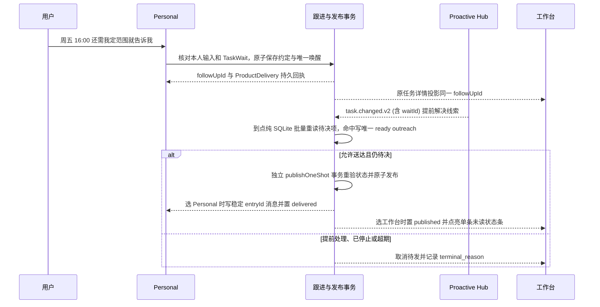

# xopc 一次性条件跟进技术方案

2026-11-24 · 技术设计（评审修订版） · 承接[最小闭环产品方案](../proactivity-minimum-follow-through-2026-11-24.md)

## 1. 落地决定与范围校准

**由 Personal 保存跟进并负责唯一发布，工作台读取同一条跟进，Proactive Hub 提供事件线索并让出已明确委托的同一次提醒。** 一个 `followUpId` 对应 `personal_attention_threads.id`（`follow_up_mode = 'one_shot'`），从一句话创建、检查、排队、发布到停止全程使用同一身份，并与工作台持续目标 `HomeFollowUps`（`home_followups`）在契约和命名上明确隔离为 `PersonalOneShotFollowUp`。

| 现有链路 | 直接复用 | 本次扩展与隔离设计 |
| --- | --- | --- |
| Personal 的 `personal_attention`、`personal_attention_threads`、`personal_wakeups`、`personal_outreach` | 工具入口、用户证据链、持久唤醒、租约与消息写入 | 新增 `follow_up_mode = 'one_shot'` 分支、Partial Unique Index 两层幂等、纯 SQLite 批量确定性检查与独立的单次送达 `publishOneShot()`（不走通用 LLM evaluator，也不因会话或设置 revision 变化把排队提醒误标 `stale`）。 [现有工具](../../../src/agent/tools/personal-attention-tool.ts) · [当前队列与发布](../../../src/personal-agent/proactivity/service.ts) |
| 工作台 Task 详情和待处理项 | 原任务、问题卡、`resolve_wait`、实时刷新 | 原事项详情挂载 `oneShotFollowUps` 共享 DTO，支持「和助手讨论」带任务引用进入 Personal、查看跟进与停止。选工作台交付且提醒发布后，在原事项呈现独立的**「约定提醒已到达」未读状态条**（区别于原任务待决表单），确认时写 `personal_outreach.acknowledged_at`。 [任务投影](../../../src/tasks/home-query-service.ts) · [任务当前操作](../../../web/src/features/tasks/task-current-action.tsx) |
| Proactive Hub、任务事件与通知分发 | 已有领域事件、信号过滤与实时网关 | 为 `task.changed.v2` 与 `task.attention_required.v2` 补齐可选 `waitId`；对受管 `(ownerId, taskId, waitId)` 在 Hub **Gate 1 入站**和**发布前**双处拦截，避免白烧 LLM 配额或产生重复提醒。 [任务事件载荷](../../../src/tasks/task-change-events.ts) · [Hub](../../../src/proactive-hub/triage-service.ts) |

**首期产品口径校准**：首期聚焦「站内一次性委托闭环的确定性工程骨架」，以 `TaskWait`（已存在且可读的 `user_input` 或 `approval` 待决项）作为业务事实源，提醒文案基于已核验的任务标题、待决原因与时限确定性生成，不调用模型编造外部看板进展。外部看板状态或不能映射到待决项的任意文本条件在入口明确提示覆盖限制。

## 2. 从一句话创建同一条跟进

### 上下文、权限与时间默认策略

1. **跨入口任务引用**：工作台任务详情提供「和助手讨论」入口，导航至 `/personal` 时仅通过路由状态把原任务作为 `SessionInput.contextRefs`（`kind: 'task'`）预填到输入框上下文芯片，**不自动发送消息**。已在 Personal 对话内的请求按以下优先级定位目标任务：本轮显式参数与 `contextRefs` → 当前会话唯一关联的开放任务（`task_origin_links`）或最近任务交付锚点。存在多个候选任务或多个活动待决项且无法由本轮文本唯一消歧时，工具返回结构化待确认候选，助手只追问一个关键问题，不落库也不声称已启用。 [会话引用契约](../../../packages/gateway-contract/src/session-input-command.ts) · [Personal 任务工具](../../../src/agent/tools/personal-task-tool.ts)
2. **本人输入绑定与反例过滤**：`personal_attention` 通过当前会话 `activeInputId`（兼容常规 `run_id` 与 `steered` 输入的 `clientMessageId`）精确绑定 `sessionInputId` 及当前 `active_transcript_id` 中对应的可见用户消息。显式一次性委托解析（`isExplicitOneShotFollowUp`）覆盖「周五 16:00 如果还需要我定范围就告诉我」「16:00 还没处理放工作台提醒我」等表达，并严格剔除否定句、引号举例和假设句。后台 `extract()` 跳过已绑定一次性跟进的用户行与一次性显式句式，防止重复产出普通关注主题。 [显式请求解析](../../../src/personal-agent/proactivity/follow-up-request.ts) · [输入到 transcript 的绑定](../../../src/storage/sqlite/transcript-repository.ts)
3. **服务端权限核对**：从当前鉴权身份与 Personal 会话推导 `ownerId`（清理服务层对 `'local-owner'` 的硬编码假设），校验 `userContext` 会话写权限、目标 `Task` 可读性、`waitId` 归属与 `active` 状态（限定 `user_input | approval` 且非连接等待）。工作台传入的 `contextRefs` 仅表达指代关系，不自动授予越权读取，也不修改 `task_origin_links`。
4. **检查时刻与透明默认有效期**：按用户配置的 IANA 时区将时间解析为 UTC 毫秒 `checkAt` 与 `validUntil`。`checkAt` 必须晚于当前时间；`validUntil` 按 **用户显式截止时间 → `task.dueAt`（若晚于 `checkAt`） → 默认窗口 `checkAt + 24h`** 依次取值，并在回执中标明来源与截止时间，避免因 `TaskWait` 无内置 deadline 而每次强制反问打断「一句话落成」。创建前同时核验 `proactivity.mode !== 'off'` 以及 `system-personal-proactivity` 调度已启用（若用户将轮询间隔改大则附带精度提示）；全部落盘成功后才返回启用回执。

### 落盘、数据库唯一约束与持久回执

- **增量 Schema（v285）**：以仓库当前 `XOPC_DB_SCHEMA_VERSION = 284` 为基线新增 `285_personal_one_shot_follow_up.sql`，保留 v202–v284 完整升级链：
  - `personal_attention_threads` 新增 `follow_up_mode`（`'recurring' | 'one_shot'`，默认 `'recurring'`）、`wait_id`、`destination`（`'personal' | 'workbench'`）、`check_at`、`valid_until`、`timezone`、`contract_key`、`session_input_id`、`last_checked_at`、`last_check_error`、`terminal_reason`（`'delivered' | 'resolved_before_check' | 'stopped' | 'expired' | 'task_closed' | 'task_deleted' | 'access_revoked' | 'conversation_reset'`）。
  - `personal_outreach` 新增 `destination`（默认 `'personal'`）与 `acknowledged_at`（用于工作台提醒幂等已读确认，避免重建 `home_attention_acknowledgements` 修改 CHECK 约束）。
- **单事务写入与唯一唤醒**：同一 `runSqliteWriteTransaction` 写入 thread、本人证据（`personal_attention_sources`）以及唯一唤醒 `personal_wakeups`（`dedupe_key = 'follow-up:' || followUpId || ':check'`，`trigger_kind = 'one_shot_check'`，`not_before = checkAt`，`expires_at = validUntil`）。既有 `enqueueDue()` 与普通 `ingestEvent()` 分支跳过 `follow_up_mode = 'one_shot'`，杜绝滚动重排唤醒。
- **数据库兜底的两层幂等**：
  1. **输入重放幂等**：建立 Partial Unique Index `UNIQUE(owner_id, session_input_id) WHERE follow_up_mode = 'one_shot' AND session_input_id IS NOT NULL`。同一 `sessionInputId` 重试直接返回原 `followUpId`（含终态），且单条输入最多绑定一条一次性跟进。
  2. **等价委托归并**：归一化硬字段生成 `contract_key = taskId:waitId:checkAt:validUntil:destination`，建立 Partial Unique Index `UNIQUE(owner_id, contract_key) WHERE follow_up_mode = 'one_shot' AND status = 'active' AND contract_key IS NOT NULL`。活动期内重复交代等价委托沿用原记录并追加证据；条件不同时不静默篡改原时限或送达位置；已结束后用户重新明确交代才创建新记录。
- **宿主持久结构化回执**：复用并扩展 `ProductDeliveryEnvelope`（新增 `kind: 'personal_follow_up'`），在 `personal_attention` 工具成功返回时通过 `appendProductDeliveryText` 与 `details.delivery` 将真实 `followUpId`、状态与约定直接写入 `toolResult` 行。即使后续流式回复中断，回执胶囊仍可从已提交 `toolResult` 稳定渲染；旧客户端自动退化为普通文本。工作台原任务详情与 Personal 回执胶囊查询同一份 DTO，停止操作直接以 `followUpId` 为准，不依赖 `outreachId` 已生成。

## 3. 检查、排队与只提醒一次

### 独立的批量检查与 Hub 双处协作

- **拆分 `evaluateOneShotWakeups()`**：沿用 `system-personal-proactivity` 定时与启动恢复，在 `drain()` 最前独立执行纯 SQLite 批量检查，**不受 Personal 前台忙闲（`isAvailable`）、免打扰（`isQuiet`）、模型配额或 `processingPolicy === 'local_only'` 阻塞**，也不受普通唤醒单次 1 条吞吐限制。离线恢复后仅在 `now < validUntil` 内核对；若已超期直接置 `expired(terminal_reason = 'expired')`。
- **命中排队与提前处理**：检查时重读 `TaskRepository.get(taskId)`、`TaskRunRepository.getWait(waitId)` 与会话权限。若 `wait.status !== 'active'` 或任务已关闭，直接置 `completed('resolved_before_check' | 'task_closed')` 并标记唤醒 `done`，零提醒静默收口；若仍 `active`，写入唯一 `personal_outreach(state = 'ready', destination = thread.destination)`（由 `UNIQUE(wakeup_id)` 保证整份委托最多一行），详情根据 `active + outreach.ready` 展示「等待送达」。
- **事件线索与 Hub 双处让出**：
  1. 在 `TaskRunRepository` / `TaskApplicationService` 产生或解决 `TaskWait` 时，向 `task.changed.v2` 与 `task.attention_required.v2` 载荷附带 `waitId`。
  2. `PersonalProactivityService.ingestEvent` 收到关联任务的 `task.changed.v2` 时立即重读 `TaskWait`：若提前解决，立刻在写事务内完成 thread、取消 pending wakeup 与 ready outreach，无需等到 `checkAt`。
  3. `ProactiveHub` 在 **Gate 1（`admitSignalAtGate1`）** 和 **发布前（`saveProactiveItem` / `deliverPendingChatEscalations`）** 按 `(ownerId, taskId, waitId)` 检查是否存在受管的一次性跟进（含已绑定并进入终态的同一次待决项），命中时直接让出（`dropped_rule` 或将旧未发候选标 `stale`），既不白耗 Fast Triage／Scout 模型调用，也不在停止或到期后把同一待决项复活为通用提醒。
  4. 一次性跟进的提醒发布只通过 `session.transcript_updated`、`personal.follow_up.updated` 与任务变更广播刷新站内两个入口，不触发 `personal.reply.delivered` 或 Hub 微信／设备升级回调。

### 唯一发布点（`publishOneShot`）

1. **与通用失效逻辑解耦**：在 `runSqliteWriteTransaction` 内锁定 `outreach(state = 'ready')` 与对应 `thread`，重验：`thread.status === 'active'`、`thread.revision === outreach.thread_revision`、`now < thread.valid_until`、当前权限有效、`Task` 未关闭且 `TaskWait` 仍为 `active`。**绝不因前台刚结束对话导致的 `context_revision` 递增，或用户刚关闭免打扰导致的 `policy_revision` 递增而将 `ready` 误判为 `stale`**。
2. **按目的地门禁**：读取最新 `settings`——`mode === 'off'` 或 `isQuiet(now, settings)` 时保留 `ready` 继续等待（不消耗推断消息的 `dailyMessages` 配额）。当 `destination === 'personal'` 时额外检查前台会话空闲且可用，以及 `active_transcript_id === outreach.origin_transcript_id`；**当 `destination === 'workbench'` 时不受 Personal 前台会话忙闲限制**。
3. **原子提交与幂等广播**：
   - **选 Personal**：同一事务内用确定性 `entryId = 'one-shot-outreach:' + outreach.id` 调用 `appendTranscriptEntry` 写入 `personal_proactive_message`，回填 `message_entry_id`，更新 `outreach.state = 'published'` 与 `thread.status = 'completed', terminal_reason = 'delivered', revision = revision + 1`。
   - **选工作台**：同一事务内更新 `outreach.state = 'published'`（`acknowledged_at = NULL`）与 `thread.status = 'completed', terminal_reason = 'delivered', revision = revision + 1`，Personal 零消息写入；工作台原任务详情与首页快照据此投影唯一一条未读跟进提醒。
   - **提交后广播与崩溃恢复**：事务提交后广播事件并回写 `notified_at`。若进程在提交后、广播前重启，`state = 'published' AND notified_at IS NULL` 仅重发实时失效事件，不会二次写消息。工作台确认调用扩展后的 `POST /api/home/attention/acknowledge`（`kind: 'one_shot_follow_up'`, `outreachId`），校验 `ownerId` 后幂等写入 `personal_outreach.acknowledged_at`，不影响原任务本身的 `TaskWait` 待处理状态。

## 4. 排队后停止，以及两端读写契约

- **同一个停止命令**：Personal 自然语言（`personal_attention` 的显式停止分支）、Personal 回执胶囊按钮与工作台任务详情按钮统一收敛到 `stopOneShotFollowUp({ ownerId, followUpId, expectedRevision, idempotencyKey })`。
- **单事务清理与竞态裁决**：
  - **停止先提交**：将 `active` 置为 `completed(terminal_reason = 'stopped')`、递增 `revision`、清空 `next_check_at`，并把关联的 `pending/evaluating` wakeup 与 `ready` outreach 全部置为 `cancelled`（清空租约与正文）。提交后返回 `outcome: 'stopped'`（「已停止」）。晚到的准备或发布事务看到 `status !== 'active'` 及 `revision` 变化立即退出，事件重放、免打扰结束与网关重启均无法复活。
  - **发布先提交**：若发布事务已先提交（`status = 'completed' && terminal_reason = 'delivered'`），停止事务识别该终态并如实返回 `outcome: 'already_delivered'`（「已提醒，跟进已结束」）及最新 DTO，不抛令人困惑的版本冲突；若已被重复停止或提前解决，幂等返回当前终态；仅当记录仍 `active` 且版本不一致时返回 `409` 提示刷新。
  - **职责边界**：停止跟进绝不自动批准、拒绝或回答原任务的 `TaskWait`；原任务仍可随时在工作台或通过 `personal_task` 正常处理。
- **对话重置与权限撤回**：`resetPersonalConversation` 将关联未完结一次性跟进置为 `expired(terminal_reason = 'conversation_reset')` 并取消 wakeup／ready outreach，工作台据此明确展示「关联对话已重置 · 跟进结束」。任务权限撤回后拥有者仍可调用停止，详情接口隐去无权读取的任务私密字段。

**路由与契约扩展**：
- 在 `packages/gateway-contract` 定义 `PersonalOneShotFollowUpDtoSchema`、`StopPersonalOneShotFollowUpRequestSchema` / `ResponseSchema`，加入 `ProductReferenceKindSchema`（`'personal_follow_up'`）、`TaskDetailResponseSchema`（`oneShotFollowUps`）与 `HomeResponseSchema`（未读工作台跟进投影）。
- 在现有 `personal-agent` 鉴权 bundle（`/api/personal-agent` 前缀）注册：
  - `GET /api/personal-agent/attention/:threadId`
  - `POST /api/personal-agent/attention/:threadId/stop`
- 在 `home` bundle 扩展 `POST /api/home/attention/acknowledge` 支持 `kind: 'one_shot_follow_up'`。补齐 `src/gateway/hono/routes/__tests__/lazy-bundles.test.ts` 的正例与非重叠断言。 [Personal 路由](../../../src/personal-agent/proactivity/routes.ts) · [路由分组](../../../src/gateway/hono/routes/lazy-bundles.ts)

## 5. 实施切片与验收矩阵

1. **切片 1：Schema v285、契约与入口落盘** — 完成 SQLite `285_personal_one_shot_follow_up.sql` 升级脚本（兼容 v202–v284 全量升级测试）、契约 DTO、显式委托解析、两层幂等落盘与 `ProductDeliveryEnvelope` 持久回执。
2. **切片 2：确定性检查、唯一发布、停止竞态与 Hub 让出** — 实现 `evaluateOneShotWakeups`、`publishOneShot`、`stopOneShotFollowUp`、任务事件 `waitId` 透传、Hub Gate 1 + 发布双处让出与工作台 `acknowledged_at` 确认。
3. **切片 3：Web 工作台与 Personal 闭环交互** — 实现工作台「和助手讨论」带 `contextRefs` 跳转、共用跟进详情／停止组件、工作台独立未读提醒条及实时刷新。

三条主验收共用同一夹具（一个已授权 `TaskWait`，15:40 交代，16:00 检查，17:00 失效；分别覆盖 `personal` 与 `workbench` 两个送达位置）：

| 分支 | 走查步骤 | 通过条件 |
| --- | --- | --- |
| **到点命中** | 一句话交代并核对持久回执；16:00 时 wait 仍 `active`；重放同一事件及 tick，模拟提交后广播前崩溃重启。 | 一条 thread、一条唯一唤醒、一个已发布 `outreachId`。选 Personal 只新增一条提醒 transcript 行，工作台仅更新状态无未读；选工作台只产生一条未读提醒（确认后消除且原 wait 保持待决），Personal 零新增提醒消息。16:05 重放无二次提示。 |
| **提前处理** | 15:40 创建后在工作台 `resolve_wait` 解决同一待决项；测试事件即时到达与事件丢失后 16:00 tick 兜底两种情况。 | 跟进置为 `completed(resolved_before_check)`，展示「事项已处理 · 跟进结束」。无已发布 outreach，两端零新增提醒与未读。 |
| **排队后停止** | 16:00 命中生成 `ready` outreach，因免打扰或前台忙等待；分别从 Personal（自然语言／回执按钮）和工作台停止；16:05 结束免打扰／前台恢复空闲（触发 `policy_revision` 与 `context_revision` 变化）、重放事件并重启网关。另测未停止时恢复可用能正常送达，不会误标 `stale`。 | 停止后两端一致显示「已停止」，原 `TaskWait` 仍可独立解决；恢复可用、重放与重启均产生零提醒。受控并发用例分别验证「停止先提交 → 零提醒」与「发布先提交 → 回执显示『已提醒，跟进已结束』且仅一条结果」。 |

补充覆盖：同一 `sessionInputId` 重试、两次等价委托归并、多待决项消歧、否定／引用／假设句拒识、过去时间拒识、默认有效期推导、对话 reset 终态原因、以及替换成第二个「评审材料待补齐」`TaskWait` 场景复用同一链路通过三分支。
