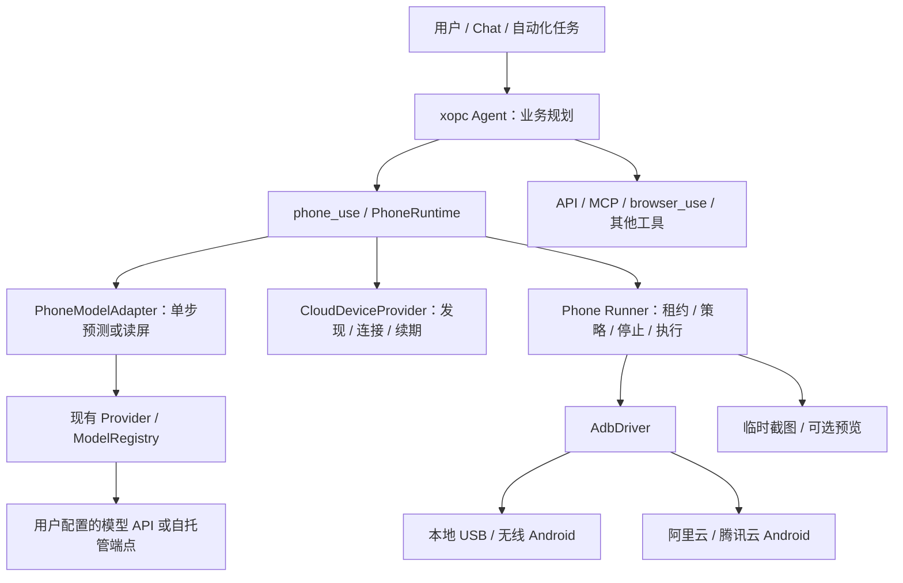

# Phone Use 调研与技术方案

日期：2026-10-23。状态：提案，尚未实现。

本次完成公开文档、固定版本源码及 xopc 当前工作区核查；未连接真机、购买云手机、调用付费模型或测量任务成功率。下文的新配置、类型、接口和目录均是拟议契约，不可直接作为当前版本配置使用。

核查基线：xopc HEAD `97ab4ebe8761ccd4caee9a6f8d19f35373713e5d`（含当前工作区）；Open-AutoGLM `86f55382982fb054e8fc98ca80609dff8a2cdc3c`；AutoGLM-GUI `b356fcaffb416c359eace4b8ee0cb85269ef973d`。工作区已有其他未提交改动，本次仅新增本文。会话未提供 codebase-memory 图谱工具，代码发现退回本地文本检索。

## 1. 建议决策

实现 **xopc Agent + PhoneRuntime + 可替换手机操作模型 + 统一设备驱动**。

- xopc Agent 负责理解需求、跨工具规划、选择设备、业务约束、结果整合。
- 手机模型负责基于当前屏幕和小目标提出一个动作，或返回读屏结果、结束建议、人工协助请求。
- PhoneRuntime 拥有有界的观察—预测—校验—执行—验证循环，负责预算、取消、恢复和证据。
- Phone Runner 在实际能访问设备的位置执行操作，持有设备连接、独占租约和停止权。
- 本地 Android 与云 Android 共用截图及输入协议；云厂商适配器只处理资源发现、认证、连接与续期。

首发建议：**TypeScript 原生运行时 + ADB Android + AutoGLM profile；同一驱动兼容用户预先建立连接的云手机。随后增加阿里云、腾讯云的自动连接适配。**

AutoGLM-GUI MCP 用于快速概念验证与对照；Midscene Android SDK 用作 TypeScript 候选引擎对照。正式实现不同时引入两个完整任务循环。

不要求用户部署 9B 模型：优先允许已有云 API，自托管兼容端点作为可选来源。模型托管位置与手机托管位置完全独立。

## 2. 几个容易混淆的层次

| 名称 | 实际含义 | 在 xopc 中的位置 |
|---|---|---|
| AutoGLM-Phone 模型 | 接收截图和指令，预测手机动作的模型 | Provider/ModelRegistry 中的候选模型 |
| Open-AutoGLM | 包含提示词、模型客户端、动作解析和设备执行的 Python 框架 | 协议参考及 PoC 对照 |
| AutoGLM-GUI | 在手机自动化基础上提供 Web、设备管理、分层规划、MCP 等能力的应用 | 产品交互和集成对照 |
| ADB | 主机与 Android 通信和执行命令的工具 | Phone Runner 的设备传输 |
| 云手机 | 托管的 Android 实例 | 另一类设备来源 |
| 云厂商 API | 获取实例、连接信息及访问令牌等 | CloudDeviceProvider 控制面 |

云手机并不自动提供任务智能；AutoGLM 模型也不直接拿到用户设备权限。模型提出动作，由 xopc 执行。

## 3. Open-AutoGLM 源码结论

### 3.1 实际闭环

`PhoneAgent._execute_step` 获取截图和当前应用，构建多模态消息，调用兼容 OpenAI 的 Chat Completions 客户端，解析动作，再交给 ActionHandler。`run` 循环执行，`step` 提供单步入口。此前截图会从上下文消息中移除，以限制图像上下文开销。[源码：agent.py](https://github.com/zai-org/Open-AutoGLM/blob/86f55382982fb054e8fc98ca80609dff8a2cdc3c/phone_agent/agent.py)

模型客户端有独立 `base_url`、`api_key`、`model_name`、生成参数；输出使用 `do(action=...)`、`finish(message=...)`，并兼容旧 XML 标记格式。[源码：client.py](https://github.com/zai-org/Open-AutoGLM/blob/86f55382982fb054e8fc98ca80609dff8a2cdc3c/phone_agent/model/client.py)

这说明可以让普通文本 Agent 调用专门的手机视觉执行能力；主 Agent 不必自己理解每一张手机截图。

### 3.2 可借鉴与必须补齐

动作包括启动、点击、输入、滑动、返回、Home、长按、双击、等待和接管。坐标按 0–1000 转为截图像素。`do(...)` 使用 AST 与字面量解析，并非执行任意 Python。[源码：handler.py](https://github.com/zai-org/Open-AutoGLM/blob/86f55382982fb054e8fc98ca80609dff8a2cdc3c/phone_agent/actions/handler.py)

生产接入需补齐：

- 源码中解析异常可转成 finish，xopc 必须将其视为协议错误，不能当作任务成功。
- Tap 的敏感确认依赖动作携带 `message`；xopc 的授权判断还需独立结合用户意图、应用范围和具体副作用。
- `Note`、`Call_API` 是占位行为；不能宣称已经具备业务 API 或可靠的信息提取能力。
- 默认人工接管是控制台阻塞输入；必须改成可持久化的暂停与恢复状态。
- Android 中文输入依赖 ADB Keyboard，并通过 Base64 广播传输；需要输入验证和异常后的输入法恢复。

输入参考：[input.py](https://github.com/zai-org/Open-AutoGLM/blob/86f55382982fb054e8fc98ca80609dff8a2cdc3c/phone_agent/adb/input.py)。跨平台 README 还提供 HDC 和 iOS/WDA 路径，但这不代表 ADB 能控制 HarmonyOS NEXT 或 iPhone；首发 Android 边界应明确。[项目说明](https://github.com/zai-org/Open-AutoGLM)

## 4. AutoGLM-GUI 源码结论

### 4.1 分层设计与用户设想接近

其 layered service 用独立决策模型创建 Planner，提供 `list_devices`、`chat(device_id, message)` 工具。`chat` 将子任务交给手机 Agent，并将内部最大步数暂设为 5，返回结果、步数和成功标志。[分层源码](https://github.com/suyiiyii/AutoGLM-GUI/blob/b356fcaffb416c359eace4b8ee0cb85269ef973d/AutoGLM_GUI/layered_agent_service.py)

xopc 应直接承担 Planner 职责。若接入 GUI 的 MCP，应使用手机执行入口，不再启用它的顶层 Planner。子执行成功标志也需要 xopc 结合证据验证。

### 4.2 值得借鉴的工程分层

| 组件 | 核查到的职责 | 对 xopc 的启示 |
|---|---|---|
| DeviceProtocol | 截图、点击、滑动、文本、导航和应用操作 | 模型输出与设备传输解耦 |
| RemoteDevice | 将设备动作映射到远程 HTTP Device Agent | Gateway 不必与 USB 手机在同一台机器 |
| Agent factory | 支持多个 agent 类型与注册入口 | 模型后端具有不同协议与运行依赖 |
| GLMParser | 解析动作，显式声明 coordinate_scale=1000 | 坐标规则必须跟随 profile |
| AsyncAgent | 流式执行、取消、状态接口 | 长任务需要完整生命周期 |
| MCP | chat、list_devices、screenshot 及异步任务接口 | 可低成本验证 xopc 调用链 |

源码：[设备协议](https://github.com/suyiiyii/AutoGLM-GUI/blob/b356fcaffb416c359eace4b8ee0cb85269ef973d/AutoGLM_GUI/device_protocol.py)、[RemoteDevice](https://github.com/suyiiyii/AutoGLM-GUI/blob/b356fcaffb416c359eace4b8ee0cb85269ef973d/AutoGLM_GUI/devices/remote_device.py)、[factory](https://github.com/suyiiyii/AutoGLM-GUI/blob/b356fcaffb416c359eace4b8ee0cb85269ef973d/AutoGLM_GUI/agents/factory.py)、[parser](https://github.com/suyiiyii/AutoGLM-GUI/blob/b356fcaffb416c359eace4b8ee0cb85269ef973d/AutoGLM_GUI/agents/glm/parser.py)、[异步协议](https://github.com/suyiiyii/AutoGLM-GUI/blob/b356fcaffb416c359eace4b8ee0cb85269ef973d/AutoGLM_GUI/agents/protocols.py)、[MCP](https://github.com/suyiiyii/AutoGLM-GUI/blob/b356fcaffb416c359eace4b8ee0cb85269ef973d/AutoGLM_GUI/api/mcp.py)。

项目提供 scrcpy 屏幕预览和手动操控；“立即中断”的宣传不能替代 xopc 对模型请求、设备进程和迟到动作的端到端实测。[项目说明](https://github.com/suyiiyii/AutoGLM-GUI)

## 5. 其他候选与技术选择

| 路径 | 优点 | 代价 | 建议用途 |
|---|---|---|---|
| AutoGLM-GUI MCP | 已有设备和执行能力，可快速联通 | Python 服务及应用生命周期；内部状态、审批和证据需映射 | PoC / 可选外部集成 |
| Open-AutoGLM sidecar | 贴近官方动作行为 | Python 打包、取消、IPC、版本维护 | 协议对照或短期桥接 |
| Midscene `@midscene/android` | Node/TS、ADB、多模型适配 | 需验证动作前拦截、预算、取消和观测契约 | P0 对照 SDK |
| xopc 原生 PhoneRuntime | 与工具策略、模型路由、任务和 UI 统一 | 需要维护少量设备操作与模型 parser | 推荐生产路径 |
| Mobile MCP | 手机设备工具与既有 MCP 接入路径 | 不自动提供专用手机模型路由或 xopc 设备策略 | 通用 Agent 直接操作的对照 |

Midscene 官方已有 Android ADB SDK，以及 AutoGLM model family 配置；这降低 TS 接入风险。但使用其完整自动执行循环前，必须证明每个副作用动作都能先经过 xopc 策略，不能仅在执行后收集日志。[Android SDK](https://midscenejs.com/platforms/android)、[模型配置](https://v1.midscenejs.com/model-api-setup)

UI-TARS 官方提供 MOBILE_USE 提示词和手机动作，可作为第二种独立 profile；其坐标后处理存在专门约定，不能复用 AutoGLM parser 后只替换模型名。[UI-TARS](https://github.com/bytedance/UI-TARS)

Mobile MCP 提供本地设备及其云设备接口，但其云服务不等于阿里云或腾讯云适配器。[Mobile MCP](https://github.com/mobile-next/mobile-mcp)

选择门槛：若 Midscene 的固定版本支持可靠的动作前拦截、AbortSignal、预算限制、独占和原始证据输出，并且在同一测试集显著减少维护成本，可用它替换内部执行适配。PhoneRuntime 公共契约保持稳定。否则保留薄 ADB 驱动，避免框架嵌套。

## 6. 云手机接入：控制面与执行面分离

### 6.1 阿里云无影云手机

官方支持 ADB；需要绑定密钥对。共享网络实例仅支持私网 ADB，VPC 网络可使用一键连接或配置私网、公网路径。云账号能够调用 API，并不意味着当前 Runner 能访问设备网络。[ADB 接入说明](https://www.alibabacloud.com/help/zh/ecp/how-to-connect-cloud-phone-via-adb)

设计 `AliyunCloudPhoneProvider`：

1. 根据明确的产品 API 版本、地域和实例 ID 查询设备。
2. 获取对应连接信息，验证 Runner 的网络可达性及密钥。
3. 生成临时连接描述，交给 Runner，再由统一 AdbDriver 操作。
4. 私网设备优先在同 VPC 部署 Runner；跨网使用受管理隧道。

`ListInstanceAdbAttributes` 是连接信息相关接口，需在 PoC 核对实例产品形态、权限和实际返回值。[接口入口](https://api.aliyun.com/document/eds-aic/2023-09-30/ListInstanceAdbAttributes)

官方 `CreateScreenshot` 是异步任务，截图上传 OSS，再查询下载地址。适合运维快照；不优先作为逐动作截图主通道，因为增加任务轮询、存储与图像清理环节。实际时延仍需测量。[CreateScreenshot](https://www.alibabacloud.com/help/en/ecp/api-eds-aic-2023-09-30-createscreenshot)

### 6.2 腾讯云手机

腾讯云 CVP 文档列出实例、访问 Token、截图、命令及 ADB 接口；详细 ADB 文档目前位于云游戏 API 体系，不能仅凭“云手机”名称假定产品 endpoint 和 SDK namespace。[云手机 API 索引](https://cloud.tencent.com/document/product/1801/122857)

已核查的 `CreateAndroidInstanceADB` 使用 `gs.tencentcloudapi.com`、版本 `2019-11-18`，返回 PrivateKey、HostName、Port、UserName、ConnectCommand；示例包含 SSH 本地转发。该接口默认连接有效期为一小时，也可指定到期时间。[ADB API](https://cloud.tencent.com/document/api/1162/118978)

设计 `TencentCloudPhoneProvider`：

1. 查询用户指定实例，调用正确 API 获取 ADB 连接资料。
2. 将私钥写入 Runner 的受限临时目录，以结构化参数启动 SSH 隧道。
3. 只监听 loopback 随机端口，再由 ADB 连接该端口。
4. 连接资料到期前重新获取；重连后重新观察，不重放先前点击。

不直接执行 API 返回的整段 ConnectCommand；解析并校验目标，生成自己的进程参数。SSH 主机身份应有受信来源；无法核验时明确要求首次绑定，不能关闭校验。

### 6.3 通用厂商接口

```ts
interface CloudDeviceProvider {
  listDevices(signal: AbortSignal): Promise<DeviceDescriptor[]>;
  prepareConnection(deviceId: string, runnerId: string,
    signal: AbortSignal): Promise<DeviceConnection>;
  renewConnection(connectionId: string, signal: AbortSignal): Promise<DeviceConnection>;
  releaseConnection(connectionId: string): Promise<void>;
}
```

`releaseConnection` 只回收连接与租约，不隐式销毁或退订实例。云实例创建、销毁、重置镜像属于独立资源管理能力，首发不开放给手机模型。

## 7. 与 xopc 当前代码的衔接

以源码为准，部分旧文档中的 Agent JSON 配置描述已落后于当前实现。

| 当前基础 | 代码证据 | Phone Use 增量 |
|---|---|---|
| Agent defaults/override 模型路由 | `src/agent-config/schema.ts`、`resolver.ts` | 新增 `models.phoneUse`，与 computerUse 并列 |
| SQLite Agent catalog | `src/agent-catalog/repository.ts`、`src/config/agent-profile.ts` | 在 catalog 的模型与工具策略中保存选择 |
| 自定义模型、协议和能力元数据 | `src/config/models-json.ts` | 增加 phoneUse profile 元数据与校验 |
| 专用 computer 工具 | `src/agent/tools/computer-use-tool.ts` | 新增 phone_use 工具，保持相似使用体验 |
| 小目标内多步闭环 | `src/computer/runtime.ts` | 借鉴预算、逐动作检查和状态返回 |
| Provider 凭据和 resolveModel | `src/providers/` | 复用，不在 Phone 设置再保存一份模型 Key |
| Endpoint tools 契约 | `packages/endpoint-tools-protocol/` | 为远程 Runner 增加私有 phone 控制契约 |
| 模型设置页 | `web/src/features/settings/computer/` | 增加手机模型、设备、诊断设置 |

当前 computer 模型路由没有 fallback，runtime 未配置专用模型会报错；Phone Use 首发沿用“显式选择、禁止静默 fallback”的原则。不能把旧 computer 方案中的主模型自动继承描述当作当前行为。

不将 PhoneRuntime 合并进 ComputerRuntime：手机有应用切换、Home/Back、IME、ADB 连接等独立语义。只提取已经证明可共用的预算、临时帧、诊断与租约小组件，避免第一版重写整个 GUI 基础设施。

## 8. 总体架构与部署



三种部署均可使用同一工具契约：

| 部署 | Runner 位置 | 连接关系 |
|---|---|---|
| 本地 Gateway + USB 手机 | Gateway 本机 worker | 本地 ADB |
| 远程 Gateway + 用户 USB 手机 | 用户电脑的受认证 Runner | Runner 主动连接 Gateway，复用 endpoint 通道 |
| Gateway + 云手机 | 同 VPC Runner 或可建立隧道的服务器 | 云控制面建立连接，ADB 执行 |

远程 Runner 不是网页浏览器。浏览器打开控制台不代表 Gateway 可以访问该电脑的 USB。首发可将 Runner 作为同机受管理 worker；远程协议沿用 endpoint-tools，待集成认证与断线停止测试完成后开放。

设备、模型服务、Runner 是三个可独立选择的对象。设备列表展示 Runner 位置和可达性，不只展示 online。

## 9. 模型与设备配置

### 9.1 三份配置，各有权威来源

1. **模型连接和目录**：沿用 providers/models.json、现有凭据解析及 ModelRegistry。
2. **Agent 手机模型与工具策略**：保存于 Agent catalog defaults/override。
3. **全局运行限制与设备绑定**：运行限制进入拟议 `xopc.json.phone`；设备记录进入 SQLite，凭据以 secret reference 关联到实际 Runner 的受保护存储。

不要把云账号 AK/SK、ADB 私钥或模型 Key 放进 Agent 提示词、任务参数和设备描述。首发只需复用项目已有安全凭据能力；不足处明确新增 SecretResolver 适配，不假设今天已有通用云凭据库。

### 9.2 Agent catalog 拟议形状

下列是 catalog 数据结构示例，不是 `xopc.json` 片段；主模型占位符必须替换为用户已有配置：

```json
{
  "models": {
    "chat": { "primary": "<existing-provider>/<chat-model>", "fallbacks": [] },
    "phoneUse": { "primary": "phone-bigmodel/autoglm-phone", "fallbacks": [] }
  },
  "tools": {
    "phone_use": { "mode": "allow", "maxCallsPerTurn": 12 }
  }
}
```

专用路由解析：Agent 非空 override → catalog defaults → `PHONE_MODEL_REQUIRED`。不自动继承 chat 模型。拟议 null 语义为“删除 Agent override，回到全局默认”；禁用能力通过工具策略 deny。须在 schema、resolver、API 和 UI 中一致实现并覆盖测试。

`maxCallsPerTurn` 只约束工具调用次数，不能代替每次 run 的内部动作和模型请求预算。

### 9.3 models.json 拟议扩展

```json
{
  "providers": {
    "phone-bigmodel": {
      "baseUrl": "https://open.bigmodel.cn/api/paas/v4",
      "api": "openai-completions",
      "models": [{
        "id": "autoglm-phone",
        "name": "AutoGLM Phone",
        "input": ["text", "image"],
        "phoneUse": { "profile": "autoglm-phone-v1" }
      }]
    }
  }
}
```

`phoneUse` 是新增字段，当前 schema 不支持。Key 由已有凭据入口配置。BigModel 官方调用示例的模型 ID 是 `autoglm-phone`；自托管 Open-AutoGLM 默认使用 `autoglm-phone-9b`，二者不能混写。以用户端点实际探测结果为准，不承诺模型永久免费。[官方模型文档](https://docs.bigmodel.cn/cn/guide/models/vlm/autoglm-phone)

### 9.4 profile 是兼容性契约

每个内置 profile 固定以下内容：API 协议、提示词版本、动作语法、坐标编码、图像缩放规则、语言、允许动作、是否支持纯读屏和结束信号。

- `autoglm-phone-v1`：AutoGLM 动作语法与归一化坐标，首发。
- `structured-phone-v1`：支持多模态及结构化输出的通用模型，评测后开放。
- `ui-tars-mobile-v1`：独立提示词、parser 与坐标转换，后续。

profile ID 是 xopc 内部协议版本，不是厂商模型版本。运行时冻结 modelRef、profile、目标 origin、凭据版本、配置 revision。不同副本或服务版本需重新诊断；模型下线、凭据撤销或连接配置变更时停止后续请求。

仅 `input: image` 不足以证明可操作手机；模型列表应过滤为已适配 phoneUse profile。未来即使允许 fallback，也需显式配置、重新建立 profile 上下文并检查数据目的地，首发不做自动切换。

### 9.5 设备配置

设备记录建议包含：deviceId、displayName、ownerId、runnerId、source、platform、providerAccountRef、region、instanceId/adbSerial、credentialRef、allowedApps、revision。运行中的 IP、隧道端口、Token 和截图不写进永久设备定义。

默认设备属于 Agent 的能力偏好或会话选择，不绑定在模型定义中。一次授权一个确定设备；有多台且无默认选择时让用户选择，禁止掉线后换另一台在线手机。

## 10. 工具与小目标执行

建议一个 `phone_use` 工具提供 discover、open、observe、step、run、status、pause、resume、cancel、close。原始 tap/swipe/shell 不作为默认公开 Agent 工具。

调用示例（拟议）：

```json
{
  "op": "run",
  "sessionId": "<returned-session-id>",
  "goal": "在外卖应用搜索冰美式，读取前三个商品的名称和价格",
  "constraints": { "effects": ["navigate", "read"], "allowPurchase": false },
  "maxActions": 6,
  "timeoutMs": 90000,
  "expect": { "kind": "extraction", "fields": ["name", "price"], "minItems": 3 }
}
```

工具参数描述目标与限制，不能自行授予权限；真正授权取用户请求、工具策略与设备策略的交集。Agent 模型填写 allowPurchase=true 也不构成付款授权。

返回结构包括 status、sessionId、deviceId、actionsExecuted、modelRequests、observedFacts、evidence、verified、verificationLevel、stopReason、nextAction。不会默认返回截图或模型原始思考。

默认建议每个小目标最多 6 个输入动作、8 次模型请求、90 秒；会话上限 80 动作、120 次模型请求、15 分钟。都是初始工程预算，需评测调优。循环检测、解析失败、等待也消耗相应预算，禁止无进展空转。

短 run 可同步返回；需要等待人工或超出交互时长时，复用现有任务/会话生命周期，以 operationId 返回及订阅事件。异步化不能导致 Agent 自动重复提交同一个业务操作。

### 10.1 单步循环

1. 检查会话所有者、设备租约、取消 epoch 和预算。
2. 获取新观察：截图、前台包名、尺寸、旋转、时间与可选 UI 树。
3. 将小目标、约束、有限动作历史、当前观察交给 PhoneModelAdapter。
4. 严格解析为一个白名单动作或只读结果；拒绝未知动作、脚本和越界坐标。
5. 检查应用范围、当前页面和副作用授权；必要时暂停到具体用户决策。
6. Runner 执行前复查有效租约与观察条件；状态变化则重新观察。
7. 执行一个动作，记录 receipt；等待页面稳定或到期后取后续观察。
8. 用观察验证进展和小目标完成条件，再继续或返回主 Agent。

对不支持只读问答的 AutoGLM profile，不假装 observe 已能可靠返回结构化信息。通过专用提取兼容性测试后启用；否则使用可用 UI 树，或显式配置的只读视觉模型。额外模型接收的数据去向必须显示在设置中。

## 11. 关键接口与坐标

```ts
interface PhoneModelAdapter {
  predict(input: PhonePredictionInput, signal: AbortSignal): Promise<PhoneDecision>;
}

type PhoneDecision =
  | { kind: 'action'; action: PhoneAction }
  | { kind: 'answer'; facts: ObservedFact[] }
  | { kind: 'complete'; summary: string }
  | { kind: 'needsUser'; reason: string };

interface PhoneDriver {
  observe(signal: AbortSignal): Promise<PhoneObservation>;
  execute(action: PhoneAction, guard: DispatchGuard,
    signal: AbortSignal): Promise<ActionReceipt>;
  stop(epoch: number): Promise<void>;
}
```

以上是责任接口示意，不是可直接编译的完整类型定义。PhoneAction 首发只包含 launch、tap、doubleTap、longPress、swipe、typeText、back、home、wait。`Note` 映射为短期观察记录，`Interact`/`Take_over` 映射暂停，`Call_API` 返回主 Agent 选择已有工具。

AutoGLM 的 `do(...)` 是数据格式。TS 实现需有限语法 parser，校验函数名、字段和类型，不使用 eval、Function 或把文本传入 shell。

统一内部坐标为观察图像像素，保存 originalSize、modelImageSize、rotation、crop、displayId、frameId 和变换矩阵。AutoGLM 的 0–1000 坐标先由 profile 转换，再经截图变换映射到设备输入坐标。边缘点必须按具体坐标约定处理并限制到合法像素；禁止忽略横屏、黑边或缩放后直接相乘。

frameId 是观测关联，不是手机状态事务。执行前的包名、旋转和新帧检查只能减少陈旧坐标风险，不能保证检查后屏幕不变。检测到用户接管或无法建立可信前提时暂停，不能承诺 ADB 下绝对无竞态。

## 12. ADB、输入与 Runner 设计

- USB 首次授权由用户在手机系统界面完成；Android 11+ 支持无线配对，但配对端口与连接端口需分别处理。[Android 官方 ADB 文档](https://developer.android.com/tools/adb)
- 每条命令固定 `-s <serial>`；禁止多设备时依赖隐式默认选择。
- 只由受管理执行器构造白名单命令及参数；不接受模型指定 shell、包安装、文件拉取或任意 URL scheme。
- 截图优先验证 `adb exec-out screencap -p`，读取二进制 stdout，校验 PNG、尺寸和字节上限，不经终端文本转换。
- 检查 adb exit code、stderr、超时和输出上限。返回 0 只代表命令完成，仍需观察 UI。
- 中文首发可使用用户明确安装并启用的、来源固定的 ADB Keyboard；记录原 IME，以 finally 恢复，并为进程崩溃后的恢复提供诊断。
- 输入 emoji、换行、空格、超长文本及已存在内容的覆盖/追加行为需分别验证。Base64 编码不等于秘密保护；密码和验证码优先人工输入。
- 不自动覆盖 `~/.android/adbkey` 或 kill 用户全局 adb server。云账号密钥隔离应在专用 worker、独立 ADB server/端口或不同 OS 运行身份中验证；未证明隔离前不宣称支持同机多凭据。
- USB 断开、unauthorized、offline、云隧道失效、手机锁屏均映射明确的诊断和恢复动作。

Runner 的设备锁必须以物理/云实例身份为键，不能只锁当前 serial 或隧道端口。协调层分配 lease + fencing token；最终执行器检查 token，拒绝旧 worker 的迟到动作。进程内 mutex 不能解决多个 Runner 访问同一台设备的问题。

## 13. 状态、取消、人工接管与恢复

```text
created → connecting → ready → observing → predicting → validating
   → dispatching → verifying → ready / completed

任意活动态 → pausing → paused / needs_user
任意活动态 → cancelling → cancelled
连接/执行异常 → failed / outcome_unknown
```

会话绑定 conversationId、agentId、runId、deviceId、runnerId、leaseId、模型绑定和授权范围；持久化的是检查点和脱敏事实，不是截图。

停止按执行端优先：增加 cancel epoch、撤销 lease 或写权限、清空待执行队列，再取消模型 HTTP、等待、ADB 子进程和隧道相关操作。迟到预测和迟到 RPC 不能重新触发输入。断线必须由 Runner 的本地 watchdog 停止，不依赖 Gateway 成功发出 cancel。

停止无法撤回已经发给 Android 的点击，也不能撤销已经提交的消息或订单。执行结果未确认时进入 outcome_unknown，重新读屏/查询业务状态后再决定；不自动重发。

人工接管时，停止自动输入，用户可在真机、云厂商客户端或后续 xopc 预览界面操作。点击“继续”后重新取屏、核对前台应用及授权并重新规划，丢弃接管前坐标动作。

首发不能可靠检测用户每一次物理触摸。提供明显的暂停/停止入口，展示控制状态，并以界面偏离和超时作为补充信号。后续伴随 App 若能提供输入事件监测，再扩展自动让权能力。

重启后将活动会话恢复为暂停或待核查，重新获取租约、连接和观察；禁止仅根据 SQLite 中最后一步自动续点。

## 14. 授权、数据与结果可信度

授权应具体到设备、应用范围、任务副作用、期限与数据目的地。用户已明确授权的常规操作可连续执行；授权外的消息发送、提交订单或删除等具体行为才请求补充决策。`mode=allow` 不代表绕过设备访问策略。

屏幕内容是第三方数据。页面上的“忽略任务、打开其他应用、读取验证码”等文字不扩大用户授权。截图、UI 树和模型输出均经过相同策略；任意命令接口不能成为拒绝后的旁路。

默认截图仅短期内存持有，按帧和会话释放，不写普通附件、聊天 transcript、长期记忆或通用日志。持有 TTL 和内存上限；崩溃转储和调试配置也需检查。授权调试录制是单独选项，应设置到期删除。

模型服务可能仍按其自身条款处理数据，xopc 的本地清理不等于供应商零留存。设置页显示“手机 → Runner → Gateway → 手机模型”，以及哪些摘要会再进入主 Agent 模型。

结果区分：

| 层次 | 能说明什么 | 不能据此说明什么 |
|---|---|---|
| 命令已完成 | ADB/驱动返回完成 | 页面已变化或业务已提交 |
| 界面有观察证据 | 可见文字/状态符合条件 | 后端持久成功或资金到账 |
| 模型声称完成 | 可以进入复核 | 自动 verified=true |
| 业务结果已核实 | 订单号、回执或独立查询支持目标 | 未检查的其他副作用 |

截图模型的复核仍可能错；无法获得独立业务证据时应写清 verificationLevel=visual。只在实际匹配完成条件时设置 verified，缺证据返回未验证事实。

## 15. 网关、存储与实时事件

拟议 API：

```text
GET  /api/phone/devices
POST /api/phone/devices/:id/diagnostics
POST /api/phone/sessions
GET  /api/phone/sessions/:id
POST /api/phone/sessions/:id/pause
POST /api/phone/sessions/:id/resume
POST /api/phone/sessions/:id/cancel
POST /api/phone/sessions/:id/close
```

实际动作走 PhoneRuntime 私有受授权通道。REST 不额外提供一个任意 adb shell 入口。设备发现/连接与控制均校验用户、Agent 和 Runner 的对应关系。

状态事件复用 gateway realtime 与 run 关联，建议 phone.session、phone.step、phone.needs_user、phone.diagnostic；事件含序号和状态 revision，客户端断线后拉取 snapshot 对齐。截图通过短期鉴权数据通道传输，WS 仅传元数据。

存储优先复用已有任务/事件索引，确需独立元数据时新增 phone_devices、phone_sessions 和有上限的脱敏 step receipts。详细 schema 在实施计划中落实；聊天仍通过既有 SQLite transcript 写链记录工具结果，不新增一套 PhoneAgent 聊天数据库。

新增认证路由必须同步修改 `src/gateway/hono/routes/lazy-bundles.ts`，添加正向及邻近负向匹配测试，并用运行中 Gateway 的真实认证路径验证。

## 16. 设置与交互

设置页建议三个区域：

1. **手机模型**：选择 Provider/模型/profile，显示 Key 状态、数据目的地和诊断结果。
2. **设备**：USB、无线 ADB、已连接远程 ADB、阿里云、腾讯云；显示 Runner、系统、前台应用、网络和控制状态。
3. **权限与预算**：应用范围、工具策略、动作和时长上限、数据保留及调试选项。

模型诊断先做不接触真实隐私的固定测试图与 parser 验证，再单独让用户选择真实设备读屏测试。设备诊断验证发现、截图、尺寸和输入能力；输入测试使用专用测试页面，不能在当前焦点框直接打字。

运行卡片显示设备、小目标、当前步骤、耗时、暂停/停止和需要用户处理的原因。成功后展示提取事实与证据等级，失败展示明确恢复方式。

首发截图预览足够完成闭环。scrcpy 与云 Web SDK 视频作为后续体验增强；视频帧不直接替代用于坐标定位的观测帧。人工预览输入也必须获得同一设备控制租约。

Web 组件遵守现有语义 token、Skeleton、PopoverSelect 和固定响应式弹窗约定，不引入第二套设计系统。

## 17. 性能、成本与评测

单步耗时近似：截图 + 上传 + 模型推理 + 校验 + 设备输入 + 页面稳定等待 + 验证。先逐项采样，再决定是否上视频、图像压缩或网络就近部署，不预设“实时”或固定秒数。

费用拆开记录：主 Agent token、手机模型图像/文本 token、模型重试、云实例时长、网络/公网/NAT/存储等。所有单价以实际账号计费及选定地域为准；本方案没有购买和报价验证。

使用相同初始状态、相同任务、相同预算比较：

- AutoGLM-GUI 原始执行（参考基线）；
- xopc + 原生 AutoGLM adapter；
- xopc + Midscene 适配候选；
- 一个通过协议诊断的通用多模态模型。

覆盖建议：24 个可复现任务 × 每任务 3 次 × 本地/阿里云/腾讯云三类设备；先在本地完成小样本，再购买单台云设备验证。任务包含中文搜索、结果提取、跨应用复制已授权信息、草稿编辑、长列表、弹窗、横屏、人工登录、断网、取消、重复点击风险和并发租约冲突。

指标：独立验收成功率、错误成功声明、人工介入率、每任务动作和请求数、成本、P50/P95 延迟、取消后迟到输入、设备冲突和结果未知率。失败任务不能从分母剔除；依赖 App 登录或云兼容性失败单独标注原因。

首发门槛建议：所有确定性故障/权限测试通过；明确业务测试集成功率目标由 P0 基线确定；取消/授权/错设备用例零已观察违规、结果未知不自动重试。零观察不代表绝对保证，报告样本量和覆盖范围。

## 18. 实施阶段与验收

| 阶段 | 工作 | 退出条件 |
|---|---|---|
| P0 可行性 | AutoGLM-GUI MCP 对照；原生 TS 单步；Midscene 能力验证；固定测试图和一台真机 | 得到可复现任务、动作前拦截/取消结论及引擎选择记录 |
| P1 本地闭环 | phoneUse 配置、ADB Runner、phone_use、预算、独占、中文输入、暂停恢复、只读提取 | 单台 Android 有人监督地完成目标并提供证据；故障测试通过 |
| P2 云连接 | 用户预连接 ADB；阿里云与腾讯云适配、隧道、密钥隔离、续期 | 每家实际账号单实例跑通；断线、到期和错实例测试通过 |
| P3 产品化 | 设置页、诊断、任务卡、事件和 remote Runner | 真实认证 API、远程停止、隐私和打包检查通过 |
| P4 扩展 | 第二模型 profile、定时任务、设备池、可选视频；另评 HDC/WDA | 各能力独立评测，不默认继承 Android 成功结论 |

P1 已连接云 ADB 的能力可早于厂商自动发现和管理上线。P2 两家厂商分别验收，不能以一家云手机测试结果替另一家背书。

无人值守任务优先专用云设备，复用 xopc 现有自动化调度。它仍要处理登录失效与用户决策，不能承诺永久在线免维护。个人真机后台定时控制需单独验证锁屏、用户干扰和执行授权。

### 建议代码布局

```text
src/phone/
  runtime.ts / config.ts / policy.ts / model-policy.ts
  adapters/autoglm.ts / action-parser.ts
  devices/adb-driver.ts / device-registry.ts
  cloud/aliyun.ts / cloud/tencent.ts
  runner.ts / lease.ts / verification.ts / diagnostics.ts
src/agent/tools/phone-use-tool.ts
src/gateway/hono/routes/phone.ts
web/src/features/phone/
```

按现有模块逐步增加；先不创建插件市场、通用 GUI 大框架或独立云调度平台。只有跨进程通信确有需要时，再建立 `packages/phone-control-contract`。

## 19. 尚需实测的事项

1. 用户实际可调用的 AutoGLM API、模型 ID、配额、图像限制、读屏/提取能力和参数兼容性。
2. Midscene 固定版本是否支持 xopc 所需的逐动作策略、取消与证据契约。
3. 阿里云所购产品形态、网络及密钥方式，腾讯云具体实例 API 与 SSH 主机认证链。
4. 云手机中目标 App 的登录、设备完整性、SIM/相机/定位等依赖；云手机不等于任意真机环境。
5. ADB Keyboard 分发、完整性校验、不同 OEM 输入权限、输入法恢复及敏感输入处理。
6. 单机多云账号的 ADB 凭据隔离、跨 Runner fencing、崩溃清理及取消后设备行为。
7. 成功率和单位任务成本；本次文档研究不足以给出可信排名或上线工期。

最终交付核心应是：可替换模型的手机执行契约、设备归属清晰的运行时、基于新观察的逐步执行、可停止恢复的任务状态，以及真实任务证据。首个模型选 AutoGLM，设备先统一到 ADB，厂商管理作为连接适配逐步补齐。
