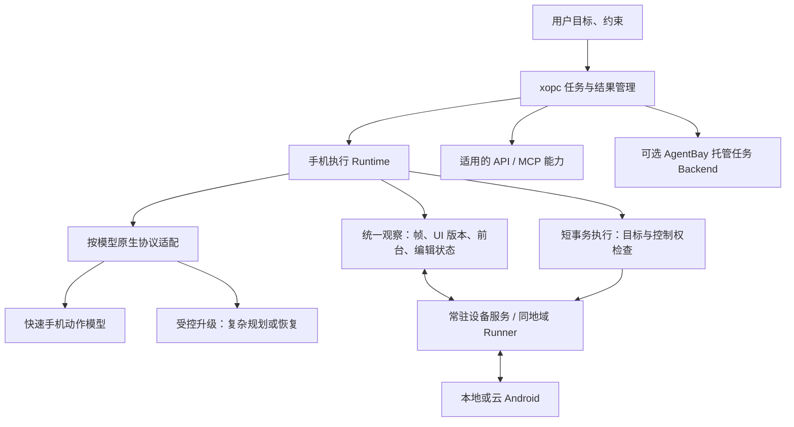

# Phone Use 执行质量与效率调研

日期：2026-10-27。代码基线：`0e9c738200df2448c2cf6c0c7bd80136634612df`。

本文记录开发前调研；后续代码实现与验证见[第一轮实施报告](phone-use-efficiency-phase1-2026-10-27.md)。

## 结论与决策

Phone Use 当前的问题同时发生在三层：**模型会走错、失败请求会长时间空转、执行器每个动作都支付较重的观察成本**。应先修复可测量的长尾与观察成本，再用同一执行器比较手机专用模型。继续堆提示词、开启已有实验分层开关、增加请求/时间预算，都没有现有数据支持。

推荐保留 xopc 的任务、权限、接管与验证框架，演进为“专用模型适配器 + 常驻设备观察/输入服务 + 按状态触发的任务升级”。云手机另做同地域 Runner 与 AgentBay 服务端执行两条对照，不立即整体替换。

本轮完成源码审阅、固定版本上游源码对照、历史轨迹重新统计、专用模拟器只读计时。**没有新发起付费模型请求，没有操控真实业务 App，没有与竞品进行同条件实测，也没有修改生产实现或用户配置。** 仓库原有的 `phoneuse-uu-remote-research-2026-10-27.md` 保持原样；其远控视频议题与本文的 AI 执行议题分别处理。当前会话没有可用的 codebase-memory 图谱工具，代码发现使用本地检索。

证据分为：本轮实测、历史实测复算、源码事实、官方说明、工程假设。下文不会把官方演示或论文成绩当作 xopc 的验收成绩。

## 1. 当前到底有多慢：可复算的数据

### 1.1 历史真实 AutoGLM 轨迹

本轮解读仓库已有的 V1/V2 逐步轨迹，按 `predict → decision/model_error` 计算完整模型适配器等待，包括网络、服务端处理、生成、读取和解析；不是纯 GPU 推理时间。

| 面板/实现 | 请求数 | 模型等待 P50 | P95 | 正常返回 P50 | 失败请求数 | 失败请求消耗/全部模型等待 |
| --- | ---: | ---: | ---: | ---: | ---: | ---: |
| V1 历史基线 | 67 | 3.622 s | 26.852 s | 3.362 s | 8 | 172.170 / 401.498 s，42.9% |
| V1 已撤回候选 | 87 | 4.322 s | 27.260 s | 3.679 s | 15 | 377.884 / 690.734 s，54.7% |
| V2 历史基线 | 47 | 3.593 s | 7.576 s | 3.541 s | 2 | 54.070 / 225.350 s，24.0% |
| V2 已撤回候选，全轨迹 | 51 | 3.767 s | 29.193 s | 3.546 s | 10 | 203.596 / 353.670 s，57.6% |

V1 基线的 8 个错误为 6 次截断、2 次协议错误；失败请求 P50 为 **26.150 s**。V2 基线为 2 次截断，候选为 7 次截断和 3 次协议错误。V2 的 98 次 API 请求均为 HTTP 200，故 HTTP 成功率不能反映可执行动作成功率。

V2 基线 prompt token 中位数为 5156、completion token 中位数为 146；候选分别为 5612、200。两臂都出现输出达到 3000 tokens 的请求。这里没有足够证据把慢归因于某一个采样参数、某个供应商限速或 GPU 性能。

**优先压缩错误长尾，比只节约 350 ms 动作等待更有潜在收益。** 即便把失败请求时间全部消掉也只是理论上界，不能把上述比例宣称为可实现提速，因为修复仍有成本且模型路径会改变。

来源：[V1 原轨迹](evidence/phone-real-app-v1-traces-2026-10-24.tar.gz)、[V2 原轨迹](evidence/phone-real-app-v2-traces-2026-10-24.tar.gz)。四组是不同历史实验，不合并为一次随机对照；V2 耗时表保留全部有轨迹的运行，不能用候选 51 次代替匹配完成率分析中的 49 次。

### 1.2 本轮只读观察计时

设备为已存在的专用 `XOPC_Android_Test_API_35 / emulator-5554`，使用生产 `AdbPhoneDriver`，交替调用 `capture/observe`，各 3 次，不切页面、不注入操作、不调用模型，不保留图像或屏幕文本。

| 路径 | 三次耗时 | P50 | 内容 |
| --- | --- | ---: | --- |
| `capture` | 238 / 149 / 141 ms | 149 ms | 截图、前台应用前后校验、显示方向 |
| `observe` | 2842 / 940 / 923 ms | 940 ms | UI 树 + 上述截图路径 |

画面尺寸为 1080×2400，PNG 约 168 KB，原生节点只有 8 个。样本很小且页面简单；第一轮完整观察明显更慢，无法仅凭这些数据区分初始化、CLI 进程启动、运行时缓存等贡献。**不能把它当作云手机 P95 或复杂 App 性能。** 但它与历史动作前观察约 0.86–0.89 s 的中位间隔相符，支持“完整观察存在近秒级成本”的判断。

历史 V1 基线普通 dispatch 中位数为 369 ms，接近驱动默认 350 ms settle；dispatch P95 为 3315 ms，包含文字输入内部确认等操作，不能把它解释为单个 ADB 点击需要三秒。

证据：[本轮原始计时](evidence/phone-execution-local-observation-2026-10-27.json)。历史 `decision → 下一 observe/dispatch_attempt` 只是动作前观察代理指标，包含检查、可能的恢复路径，不是独立埋点的 UI dump 耗时。

### 1.3 “效果差”有历史数据，不只是主观感受

| 已做实验 | 主要可比集结果 | 决策 |
| --- | --- | --- |
| V1：重排历史、加入完成进度等 | 15/21 → 9/21 | 已撤回 |
| V2：原生焦点/坐标提示、采样调整等 | 11/13 → 8/13 | 已撤回 |
| 语义执行单项 | 开发共同集 9/12 → 9/12 | 无已证收益，默认关 |
| 分层执行单项 | 9/12 → 6/12 | 默认关 |
| 语义 + 分层 | 9/12 → 5/12 | 默认关 |

这些是单模拟器、少数系统 App 的小样本，不能代表当前商业 App 总体成功率，也不能直接比较不同版本任务集。它们足以否定“已有开关一开就能解决问题”的判断。计时器数字状态、搜索输入、根页面错误 Back、长重复输出和协议失败，已有具体失败轨迹。

来源：[真实 App 对照](phone-use-real-app-optimization-2026-10-24.md)、[语义与分层实验](phone-use-semantic-planning-benchmark-2026-10-24.md)、[后续恢复优化暂停说明](phone-use-recovery-pause-2026-10-24.md)。

## 2. 代码层根因与放大机制

### 2.1 普通模型动作包含两次完整观察

`src/phone/runtime.ts` 的 `perform` 链路：

```text
run 起始完整 observe
  → 检查完成条件
  → 手机模型 predict
  → 完整 observe：复查预测是否陈旧
  → dispatch：执行输入 + 默认 settle 350 ms
  → 完整 observe：记录效果，作为下一步输入
  → 下一轮
终态匹配 → 再完整 observe 确认
```

动作后观察已经复用为下一轮输入，并非每轮无条件三次。正常 N 个模型动作的基础成本约为 **1 + 2N 次完整观察**，再加终态确认、读数、输入确认与恢复。文字替换路径会更多。

以本轮完整观察 P50 粗估，一步的两次观察约 1.88 s，再加模型约 3.4 s、settle 约 0.35 s，普通动作可能落在约 **5–6 s**。这是不同样本中位数拼出的量级估算，不是实测单步 P50，更不能相加得到 P95。长任务再叠加错误路径、重新规划与主 Agent 往返，就会显著变慢。

### 2.2 云端完整观察每次上传临时 DEX 并启动进程

`src/phone/cloud-adb-connection.ts:hierarchy` 每次都：

1. 生成随机临时路径，建立 sync，上传 `PHONE_UI_DEX`。
2. 启动 `app_process ... PhoneUiDump`。
3. `PhoneUiDump.java` 新建线程、连接 UiAutomation、读取 UI 树、断开。
4. 清理临时文件。
5. `AdbPhoneDriver.observe` 再执行截图路径。

云 ADB **已经复用认证连接**，不应误诊为每条命令重新连接。但是每轮传文件、创建 shell/exec socket、启动 Android 进程和读取全树仍然存在。`capture` 又会发起两次 `dumpsys activity`、一次 `dumpsys input` 与截图，部分并行、部分串行；公网 RTT 和云端进程开销会被放大。

本地则优先启动官方 `android layout --no-idle --flat`，失败后可能回退到 `uiautomator dump/cat/rm`；两个路径都有重试和等待。云端非 idle dump 是已有优化，但离常驻观察服务仍有距离。

### 2.3 原生 UI 是每步强依赖；全树相等又容易让预测作废

`src/phone/reliability.ts:canDispatchPhoneAction` 先核对几何和完整节点结构，仅少量系统时钟/uptime 被特殊忽略。其他无关文本、布局或焦点变化，都可能使动作作废并重新预测；空树时还要求截图字节相等。

保护陈旧点击是合理的，但“整页任何语义变化就重问模型”在推荐流、倒计时、广告和动态 WebView 中可能昂贵。**当前生产此类作废频率没有本轮实测，属于需验证的放大机制。** 优化应是目标区域、节点身份和覆盖层的版本检查，而不是删掉 freshness 校验。

另外，`phoneCompletionSatisfied` 只认原生节点；图片文字、部分 WebView/Canvas 页面即使模型看得懂，也不能满足原生完成条件。当前 screenshot reading 会标为 unverified，这种诚实表达应保留，但应为不同页面明确选择可用的结果验证器。

### 2.4 手机模型协议与官方运行时差异大

`src/phone/model-adapter.ts:createPhoneModel/buildPhoneModelContext` 当前：

- 只支持 `autoglm-phone-v1`、`structured-phone-v1` 两个 profile，且限制兼容的 OpenAI completions 图像接口。
- 每轮重建 system + 一个 JSON user 消息；最多 40 个 UI 节点、100 个应用、8 步轨迹、摘要和任务字段，附当前原尺寸 PNG。
- AutoGLM 使用自写系统提示，发送 `temperature=0/max_tokens≤3000/stream=false`；没有发送官方默认的 `top_p=0.85/frequency_penalty=0.2`。
- 不保存 provider usage、TTFT、生成速度等生产分段信息；报告主要是总耗时与计数。历史响应元数据来自评测脚本拦截，不代表生产已有同等观测能力。
- 协议/截断最多修复一次，修复前再观察，然后再付一次推理等待。

我们不是没有历史，而是**把轨迹作为 JSON 数据给模型，与官方消息轮次不同**。也不能断言参数对齐必然修复：此前 V1/V2 是多个变量的组合试验，并未构成“完整官方协议 vs 当前协议”的单变量对照。

原尺寸 PNG/base64 也不是必然瓶颈。它影响上传量与视觉处理成本，视觉 token 计费还取决于服务端预处理；本轮 168 KB 图片并不大。应按小字可读性测试分辨率/JPEG/裁剪，不能照搬视频的 960 长边或把 base64 字节数当视觉 tokens。

### 2.5 主 Agent 和手机 Agent 的往返、结果读取成本

`PhoneConfigSchema` 默认 collaborative，单次 `run` 默认 6 个动作、最多 12。direct 只改变任务委派语义，**仍受同一动作上限约束，不会自动变成持续整任务执行器**。复杂任务会返回 `action_limit` 后再经过主 Agent 规划下一段。

`runtime.execute` 在 run/step 结束且有 requestedOutputs 时，可能再做完整观察；没有 selector 的每个输出会单独调用 readScreen。无明确完成条件、模型直接 finish 的路径也会再做视觉读取。某些任务因此出现“已经到了页面，还在等待”。

需要用实际工具轨迹测量主模型往返次数。不能仅凭默认配置认定用户当前任务一定使用 collaborative，也不应在调研时修改用户模式。

### 2.6 输入动作的确认重复且 Unicode 通道临时创建

`adb-driver.ts:execute(typeText)` 的 replace 先观察字段，非空时可能依次观察全选、删除、输入结果，再叠加运行时动作前后观察；这是历史上避免拼接、误删和重复输入的修复，不能直接移除。

非 ASCII 输入通过临时 scrcpy provider 粘贴，完成后关闭；云端也如此。视频人工通道已有持久控制 socket，但 AI 自动执行仍主要走 shell input，**人工通道快并不等于模型动作链路快**。

## 3. AutoGLM 做对了什么，以及它并没有解决什么

本轮固定核查 Open-AutoGLM `86f55382982fb054e8fc98ca80609dff8a2cdc3c`。来源：[agent.py](https://github.com/zai-org/Open-AutoGLM/blob/86f55382982fb054e8fc98ca80609dff8a2cdc3c/phone_agent/agent.py)、[模型客户端](https://github.com/zai-org/Open-AutoGLM/blob/86f55382982fb054e8fc98ca80609dff8a2cdc3c/phone_agent/model/client.py)、[等待配置](https://github.com/zai-org/Open-AutoGLM/blob/86f55382982fb054e8fc98ca80609dff8a2cdc3c/phone_agent/config/timing.py)。

它的优势是手机专用模型搭配原生提示、标准动作协议、连续对话和轻量 screenshot/current_app 观察；旧图像从上下文移除，保留文本轮次。执行循环不会像 xopc 一样在每个动作前再次获取完整 UI 树。模型客户端支持流式响应并记录首 token、思考阶段结束和总耗时。

但官方不是“零等待极速执行”：设备普通动作默认有 1 s 等待，文字输入的多个阶段也各有默认等待。客户端仍读完整响应再返回动作，不能把 `stream=True` 解释为首 token 一到就执行。其确认、完成证明和异常语义也比 xopc 薄。

**可借鉴的是协议保真、较轻的观察链路和分段计时；无法仅从源码证明它在同模型、同任务下比我们快多少。** 直接复刻 Python sidecar 也不自动获得更强模型。

建议建立官方协议对照臂：同一 endpoint/model、同一初始状态、同一任务和预算，仅比较请求组织；所有动作仍经 xopc 的授权、控制权和执行器。官方原生循环可作为第二个诊断对照，但因为观察和验证契约不同，需分别报告模型正确动作率与端到端完成率。不能拿无终态验证的 finish 对比我们的 verified。

## 4. 阿里体系要分清：产品、SDK、研究模型

### 4.1 Agentic Mobile / 无影云手机：云端服务和定制环境

[官方产品说明](https://help.aliyun.com/zh/ecp/what-is-cloud-phone-mobile-use-agent)明确包含云端 Android 容器、Qwen、MobileUseAgent、定制 Android 服务和原生控件树能力。任务在云端沙箱自主执行。

可合理推断，这种部署有条件减少本地 Gateway 到手机的反复公网往返，并改善控件获取和状态管理。**公开资料没有给出其每一步内部算法、当前精确模型版本或与 xopc 可直接比较的延迟测量。** 不能把“毫秒级同步”产品表述当作模型动作毫秒级完成。

xopc 当前接入阿里云手机的 ADB，是使用它的设备底座；这不等于调用了阿里托管的 MobileUseAgent，也不意味着获得其模型与系统内执行优化。

### 4.2 AgentBay SDK：既有设备原语，也有整任务执行

固定核查 SDK `8e2fa8f20981c826eb5d247bc6701d52570e104a`：[mobile.ts](https://github.com/agentbay-ai/wuying-agentbay-sdk/blob/8e2fa8f20981c826eb5d247bc6701d52570e104a/typescript/src/mobile/mobile.ts)、[agent.ts](https://github.com/agentbay-ai/wuying-agentbay-sdk/blob/8e2fa8f20981c826eb5d247bc6701d52570e104a/typescript/src/agent/agent.ts)。

它提供 tap/swipe/inputText/UI elements/screenshot 等设备接口，以及 `session.agent.mobile.executeTask` 服务端任务入口。后者有 maxSteps、WS 事件流和用户交互回调；非流式路径的状态查询与动作循环是不同层次。

这给 xopc 两种选择：保留自有执行循环、替换设备 transport；或新增托管任务 backend，把一个授权任务交给服务端。SDK 3 s 状态轮询不能证明服务端每个动作都等 3 s。反过来，SDK 开源也不代表后端推理循环全部开源。

整任务 backend 的 PoC 必须验证可取消、人工接管、可导出的实际动作与结果证据、应用白名单和任务约束能力。工具回调不自动等于可在每个副作用前拦截；后端 success 也不能直接映射为本地 verified。用户现有云手机实例、地域和镜像是否可复用，要按实际支持验证，不能假设无缝切换。

### 4.3 Mobile-Agent-v3.5 / GUI-Owl-1.5：模型能力与按需推理

固定核查 `X-PLUG/MobileAgent@11cea575561fb7800b5fb6b6cafa56f7a91de11f`。该系列提供 Instruct/Thinking 变体，手机例程使用自己的工具协议、历史组织、图像处理和坐标转换，不能改一个 model id 就复用 AutoGLM parser。[官方 README](https://github.com/X-PLUG/MobileAgent/blob/11cea575561fb7800b5fb6b6cafa56f7a91de11f/Mobile-Agent-v3.5/README.md)

论文同时研究原生 GUI 能力和多角色协作；后者有规划、执行、反思和记忆职责，但增加角色并不自然减少推理次数。公开手机示例本身还包含每步 2 s 等待，所以不能据此称“该框架天然更快”。其训练与评测说明能力来自专用数据和环境强化学习，而不只是 runtime 提示。[技术报告](https://arxiv.org/html/2602.16855v1)

对 xopc 的合理候选是：用较快的专用 Instruct 模型做默认动作，遇到无进展/复杂规划时才升级更强模型，评估成功率、调用次数与总耗时；具体模型和托管可用性仍需独立验证。

### 4.4 MAI-UI 与后续 Qwen-UI-Agent：减少云调用、减少纯 GUI 回合

MAI-UI 研究的设备/云协同包含本地执行和轨迹监控、偏航后的错误摘要、云模型升级、共享历史。论文在其 AndroidWorld 设置中报告云调用减少 42.7%；这是特定训练系统的实验结果，不能当作 xopc 的预期收益。它也训练了 MCP 调用和与用户协作能力。[MAI-UI 技术报告](https://arxiv.org/html/2512.22047v1)

截至本次调研，官方项目已经发布后续 Qwen-UI-Agent 报告，强调真实设备评测、GUI/CLI 混合动作和动作批处理。论文的约 40% 批处理、平均每批 3.1 动作统计来自 **OSWorld 电脑任务**，不能套成手机收益，更不能据此开放手机任意 shell。[Qwen-UI-Agent 报告](https://arxiv.org/html/2607.28227v1)、[官方项目现状](https://github.com/Tongyi-MAI/MAI-UI)

值得借鉴的是选择短、可预测的局部操作序列，遇到需要新观察的边界就停止；以及用 API/MCP 完成适合结构化执行的步骤。报告与演示发布，不代表当前已有可直接接入的模型 API、权重或商业产品部署关系。**没有公开证据证明无影商业 MobileUseAgent 就是上述某个开源模型。**

## 5. 推荐目标架构



“常驻设备服务”是待开发方案，当前没有该完整实现。已有 Java one-shot dump、scrcpy 和云 ADB 连接可作为基础。设备服务要自己维护节点/窗口/输入状态、生命周期与异常恢复，不能简单把临时 UiAutomation 无限保持连接；还需检查不同 Android/OEM 与其他无障碍服务的兼容性。

观察分层建议：

- 供模型推理：新鲜截图 + 与之关联的必要 UI/编辑信息。
- 输入前校验：设备侧原子或尽量邻近的控制 epoch、前台、窗口/几何版本、目标身份/覆盖层检查；需要时获取完整观察。
- 输入后效果：事件驱动等待目标状态或有界稳定窗口，供下一次推理复用。
- 最终完成：独立终态验证；UI 事实、视觉读数和业务结果分别标记。

窗口版本号只有设备侧持续监听窗口、布局、覆盖层等变化才有意义。单纯按 TTL 缓存 dumpsys 或复用老 frameId 不能证明安全。截图与 UI 树也应携带采样时刻和关联版本；当前“同一个前台包”不足以证明二者来自同一页面时刻。

## 6. 实施顺序、具体改动与验收

以下是建议的试验顺序，不是已实现收益或交付日期承诺。

### P0：生产分段观测与模型错误长尾

涉及 `model-adapter.ts`、`runtime.ts`、`adb-driver.ts`、`cloud-adb-connection.ts`、已有 live benchmark。

1. 记录 observation 分项、模型请求开始/首 token/结束、usage、finish_reason、解析结果、派发与 settle、结果确认、主 Agent 往返和请求体图像字节数。诊断不保存密钥、完整画面文本或原始推理正文。
2. 为 AutoGLM 单独实现可切换的官方协议对照，逐项消融 system、消息轮次、UI 辅助信息和采样参数；先用相同底层 endpoint 排除模型供应差异。
3. 在服务支持时用流式读取获取 TTFT/生成速率，加入可观测的重复退化识别和请求级停机策略。流式本身先改善诊断和可见反馈；动作仍等完整、正常结束且校验通过，禁止从未结束的文本提前执行。
4. 测试有界重复输出中止/一次恢复与更强模型升级。截断无动作、正常 stop 无动作、服务端超时分别统计。不要一刀切降低 3000 token 上限，避免把合法长推理也截断。

验收：同任务完成率不下降，协议失败与 20 s 以上无动作等待显著下降；报告成功/失败两类等待分布和成本。首 token 快但完整动作仍慢，不算执行提速。

### P0：消除无意义的设备初始化和重复读数

1. 云端 DEX 按内容哈希复用已部署文件，验证版本、权限与丢失后重装；先不引入复杂常驻服务即可去掉重复传输与删除。需验证断线/升级/清理，不盲信路径存在。
2. 将输出请求合并到一次 readScreen，优先原生 selector；相同 frame/目标的读取复用，保留每个输出的来源、时间和验证等级。
3. 输入能力探测和应用列表做可失效缓存；同一独占 session 复用 Unicode 输入通道，接管/断线/会话结束严格释放。
4. 在基准中单独报告英文、中文、替换非空字段的耗时与确认次数，复用已经足够新鲜且覆盖目标的确认结果。

验收：同一任务完整观察次数、DEX 上传数、模型读数请求数减少，字段值与控制权不变量全部保留。

### P1：常驻观察与执行，降低每步固定成本

1. 设备侧提供统一 snapshot/stateVersion 和有界 `execute + waitFor + snapshot`，避免每个动作多次启动 `app_process/dumpsys`。
2. 对模型选定目标校验节点身份、可见/可操作状态、窗口、位置及覆盖层；无关区域更新可重新定位目标，不能全树一变就全部推理重来，也不能全树校验直接关闭。
3. 用 UI 事件、目标后置条件和短稳定窗口替代一刀切 settle。列表滑动、启动 App、网络加载、输入确认采用不同策略；避免等待整个 App 全局 idle。
4. 本地 ADB 与云端 Runner 提供相同能力声明；不支持快照关联或原子执行的驱动保留保守路径。

建议先以设备开销降低 ≥50%、完整观察调用数降低 ≥30% 为试验目标，**不是整体任务可保证快 50%**。必须同时验证弹窗、旋转、后台切换、动画、接管、取消、未知派发与无障碍兼容。

### P1：模型矩阵与按异常升级

新增独立 profile，定义各自 prompt、tool schema、坐标、图像/历史和结束语义；不能把 GUI-Owl 或 MAI-UI 填成 AutoGLM。

至少比较当前 AutoGLM、官方协议 AutoGLM、一个手机专用 Instruct 候选，以及可用的强模型恢复候选。端侧 GPU 不是前提：先验证模型托管 API 或同地域推理服务。跨模型切换需要状态/动作空间投影、已完成步骤和错误摘要，遵循显式配置与预算，不静默 fallback。

减少主 Agent 介入应按任务边界设计：常规局部步骤由手机执行器连续完成，在业务决策、信息不足、无进展、应用范围变化、人工协作时返回。当前 direct 不足以完成这项重构，已有失败实验也不支持自动开启 hierarchicalPlanning。

### P2：短事务、流程记忆与云端后端对照

- 先实现聚焦字段→输入→确认、打开 App→等待目标等有前/后条件的短事务；分支或弹窗出现立即停止。模型可以提出局部意图，主机校验后执行。不要直接开放任意长点击数组。
- 高频流程记录应用版本、页面锚点、输入参数、后置条件和恢复点，命中前先验证，失效后退回感知。缓存坐标或历史成功不等于这次成功。
- 云手机比较三臂：当前远程 ADB、同地域自有 Runner、AgentBay 服务端任务。独立报告服务端执行时间、客户端可见完成时间、总成本和控制能力。
- 对确有授权且语义等价的 API/MCP 步骤，优先用结构化工具减少 GUI 回合。继续通过 xopc 策略执行，不让手机模型借任意 shell 绕开能力边界。

## 7. 评测设计：避免再次“优化了感觉，回退了完成率”

保留现有 7 项系统 App 面板作回归，再增加用户实际要完成的 10–20 类任务：长列表定位、中文搜索/改写、WebView、小字、动态推荐、跨 App、弹窗、网络等待、连续字段输入和人工交还。任务必须有可复核的结果判定，不以模型 finish 计成功。

每项尽量 ≥5 对 AB/BA 运行；按模型/环境设置总请求、费用和时间上限。先小规模筛选，再在留出集确认；初始化不匹配要单列，不能重跑失败挑成绩。候选和判定器在计分前冻结。真实账号涉及的最终写入按明确授权设计测试边界。

每个试验输出：

| 指标 | 意义 |
| --- | --- |
| 真实任务完成率、错误完成率 | 首要质量门槛 |
| 达到正确结果的时间、失败耗时、预算截尾 | 不能只统计成功任务速度；快速失败不算提速 |
| 动作数、模型请求数、主模型往返数 | 是否减少无效规划与重复操作 |
| 截断/协议错误/无进展/陈旧预测次数 | 精确分类失败来源 |
| observe/guard/输入确认/模型等待分项 | 判断下一项投资方向 |
| 模型 tokens、请求费用、云设备运行时长 | 防止以数倍成本换取轻微提速 |
| 接管、取消、重复输入、未知派发处理 | 执行一致性 |

首轮产品目标可设为：同条件任务时间 P50 降低 ≥30%，固定设备侧开销降低 ≥50%，协议错误率 <1%，完成率不得出现可辨识回退。小样本 <1% 不构成统计保证；先报告置信区间、样本量和失败明细，最终阈值由基线决定。

阿里云、AutoGLM 和 xopc 只有在同设备/应用状态、任务、模型服务或明确标注的不同模型、同预算和独立判定下才可比较。公开视频顺畅、手机预览 FPS、输入 ACK 以及 AndroidWorld 论文分数，都不能替代这套对照。

## 8. 推荐立即排入的工作项

| 次序 | 工作项 | 交付物 | 原因 |
| --- | --- | --- | --- |
| 1 | 统一分段 trace + 错误长尾分析 | 一次任务完整时间账单 | 已发现约 26 s 失败长尾，生产尚难归因 |
| 2 | 官方协议 AutoGLM 对照 + 独立模型 profile | 冻结小面板结果 | 先分清模型、协议与执行器贡献 |
| 3 | DEX 复用、合并读数、复用输入 session | 可开关小补丁和配对数据 | 改动集中，容易验证固定成本 |
| 4 | 常驻观察/短事务原型 | 本地与云端的动作开销对照 | 解决重复 UI dump 和进程初始化 |
| 5 | 同地域 Runner / AgentBay PoC | 完成率、耗时、费用、控制能力表 | 再决定云端投入方式 |

核心方向是 **降低失败和冗余回合、减少设备端初始化、保持模型原生协议、用真实终态验证效果**。远控视频体验可以并行治理，但不会自动缩短手机模型的思考、走错路径或完整 UI 观察。

## 附：证据与复算

固定版本参考源码及哈希：[清单](evidence/phone-execution-reference-sources-2026-10-27.json)。上游源码暂存于调研目录，没有作为依赖接入项目。

历史统计只需要仓库已保存轨迹，不会调用设备或模型；生成的完整数值结果保存在指定输出目录，不纳入版本控制：

```sh
python3 scripts/phone-apps-live/analyze-execution-latency.py \
  --output /tmp/phone-execution-latency.json
```

P50 使用中位数，P95 使用 nearest-rank。跨轮测试时间与纯 runtime 时间不同；不以整段 trial.durationMs 计算模型占比。失败模型等待占比仅以同组 adapter 等待总和为分母。

本次新增文档、数值证据和离线分析脚本；未改变 Phone Use 生产行为。未执行新的付费成功率面板，当前生产用户任务的耗时占比与阿里服务端内部实现仍需后续同条件测试。
