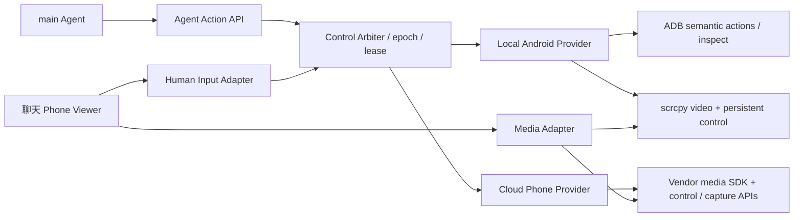

# Phone Use 接管与实时操作：实测、根因与 V2 方案

后续实现：本机视频与持续触控已落地，见 [V2 视频实现与验收](phone-use-video-v2.md)。以下保留本轮研究时的截图基线与原始方案。

日期：2026-10-23。本文区分已验证的截图降级优化与尚未实现的视频/云手机方案。目标是共享同一套控制权和会话语义，让本机与云端使用各自合适的媒体和输入实现。

## 1. 当前实际链路

观看：聊天右侧 PhoneLivePanel → HTTP frame → PhoneRuntime.liveFrame → 串行 I/O → Driver.observe → Android CLI / uiautomator 布局 → foreground app → PNG screencap → rotation → Blob URL → img。完成一次后还等 1 秒才发下一次请求。

人工输入：pointerdown 仅记录坐标；pointerup 才把整次手势分类成 tap / longPress / swipe → HTTP control → 校验 epoch、浏览器独占租约、frameSeq → 再完整 observe → 验证整棵 UI 布局一致 → adb shell input → 固定等待 350ms → 再完整 observe → 才响应。前端同时锁住操作且不刷新画面。拖动过程中没有 DOWN/MOVE/UP 输入，手机不会跟手。

接管：服务端先增 epoch、暂停运行预算、取消模型预测、等待已派发 I/O 收敛，再授予人工控制；退出接管保持暂停；交还时完整观察并唤醒等待中的工具。若 main 已结束回复，交还提交一个幂等会话输入。这个控制权基础值得保留，不需要让 AutoGLM 负责判断是否接受用户接管。

当前问题：

- 画面、原生语义观察、输入共用慢路径，观看也会占用执行队列。
- 人工动作必须等前后两次布局分析；原生 UI 动画、时钟等变化也可能导致误拒绝。
- 长按在抬手后才重新注入同等时长的长按，用户等待被重复计算。
- 请求期间鼠标操作被丢弃；手势抬手后才执行，无法支持跟手拖动、连续输入、多指操作。
- 控件挤占画面；1280×720、420px 侧栏接管后，手机内容实测约 123×274 CSS px。
- 模型/人工共用动作预算；长时间人工使用可能耗尽 Agent 的任务额度。
- 控制、观看、设备连接三个状态尚未充分分开。`completed` 也不等于已关闭设备会话。

## 2. 基线实测

本机 Android 15 模拟器 emulator-5554，1080×2400，系统设置页面。真实 Gateway、真实 ADB；点击仅落在无副作用的页面标题区域。不是模型推理耗时，也不是云手机性能。

| 项目 | 基线样本 |
| --- | --- |
| 原生完整 observe | 1265 / 1300 / 1233 ms |
| frame HTTP，新采集为主 | 180 / 1128 / 1140 / 1061 / 1097 ms；180ms 样本受正在进行的共享采集影响 |
| 人工点击 HTTP 完整响应 | 4103 / 5128 / 5366 ms |
| paused 状态接管 | 5 ms；不代表正在执行输入时也可立即接管 |
| 每张 PNG | 约 145 KB |

原来的画面有效更新间隔接近“约 1.1 秒采集 + 1 秒等待”，约 0.5 FPS。API 返回的截图年龄不等同于手势到呈现延迟。后续指标必须分别记录 capture、input ack、decode 和 present。

优化后同类请求为 443 / 438 / 384 ms；快采集单独实测 338 / 388 / 450 / 426 / 393 ms。这里只比较相同 API 的应答时间，不能解释为 0.4 秒内已经显示结果。

可重复测量：在测试聊天让 main 打开并 pause，退出人工接管后运行 `node --import tsx scripts/benchmark-phone-live.mts <conversationId>`。脚本仅接受限制为系统设置的本地模拟器，会点击设置页标题区域三次，再释放为暂停；不使用真实模型，不记录截图和文本。

浏览器 E2E 验证了只读点击不注入输入、人工离散点击 / 滑动 / 长按、约 50 秒接管闲置期间动作与模型请求不增长，以及第二客户端接管返回 409 `PHONE_CONTROL_BUSY`。设置搜索跳转到范围外的 `com.google.android.settings.intelligence` 后被拒绝，不计为文本输入通过；修正恢复逻辑后可显式回到授权设置根页面。取消不再导致渲染崩溃。交还后真实 AutoGLM 以 4 次请求继续并关闭会话；自动完成标记仍为 unverified，Android 15 由原生 UI 独立确认。85 项定向测试、根 / Web 类型检查、Web 构建、定向 ESLint 与差异检查通过。

以上保留该阶段测量和 E2E 摘要，逐次运行记录不纳入仓库。样本很小，只用于复现瓶颈；不能据此宣称生产 P95。

## 3. 参考项目核查

### AutoGLM-GUI

核查 commit `a0c874d824e4ece0b28370e8806c13866fef00d5`：

- [ScrcpyPlayer](https://github.com/suyiiyii/AutoGLM-GUI/blob/a0c874d824e4ece0b28370e8806c13866fef00d5/frontend/src/components/ScrcpyPlayer.tsx)：Socket.IO WebSocket 接收配置和视频包，WebCodecs 解码、Canvas 渲染；连接要求 maxSize 1280、bitRate 4Mbps。鼠标映射到设备坐标，MOVE 每 50ms 节流，滚轮聚合后发 swipe；不支持时有截图降级。
- [媒体服务](https://github.com/suyiiyii/AutoGLM-GUI/blob/a0c874d824e4ece0b28370e8806c13866fef00d5/AutoGLM_GUI/socketio_server.py)：流生命周期和视频包独立于任务；每设备有互斥处理。不是 WebRTC 视频实现。
- [输入接口](https://github.com/suyiiyii/AutoGLM-GUI/blob/a0c874d824e4ece0b28370e8806c13866fef00d5/AutoGLM_GUI/api/control.py)、[ADB touch](https://github.com/suyiiyii/AutoGLM-GUI/blob/a0c874d824e4ece0b28370e8806c13866fef00d5/AutoGLM_GUI/adb_plus/touch.py)：真实 DOWN/MOVE/UP；该版本通过 REST 和每事件 ADB 子进程执行，并非直接使用 scrcpy 的持久控制 socket。不能把它描述为完整低延迟控制通道。
- [任务续接](https://github.com/suyiiyii/AutoGLM-GUI/blob/a0c874d824e4ece0b28370e8806c13866fef00d5/AutoGLM_GUI/task_manager.py)：保存 takeover 会话，下一次任务可走 continue_with。

参考其媒体/输入分离、持续触摸、可见性管理；不照搬宽松的媒体入口、启动时清理其他 scrcpy 进程或按请求执行 MOVE 的方式。xopc 有既有认证、共享设备租约和多个观看窗口，需要适配自身边界。

### Open-AutoGLM

核查 commit `86f55382982fb054e8fc98ca80609dff8a2cdc3c`：[动作处理](https://github.com/zai-org/Open-AutoGLM/blob/86f55382982fb054e8fc98ca80609dff8a2cdc3c/phone_agent/actions/handler.py) 把 Take_over 交给回调，默认在终端等待用户处理后继续。适合参考模型动作协议与人工介入语义；该实现本身不是可直接复用的浏览器视频播放器和远程触控系统。

### 云手机官方能力

- [阿里云无影 Web SDK](https://help.aliyun.com/en/ecp/web-sdk-of-cloudphone)：通过 ticket/authCode 建立会话，SDK 负责媒体和交互，存在多种协议与部署形态。其分发条款与版本需要单独确认，不能直接把离线包打进 xopc 的开源发行物。
- [腾讯云手机 Web SDK](https://cloud.tencent.cn/document/product/1801/122862)：实例 accessToken、媒体、鼠标/键盘/touch、截图等能力。文档说明 destroy 为客户端断开，云端检测心跳后才释放，不能把调用 destroy 当成云端输入权限已经撤销的确认。

两家均需使用具体产品/地域/账号可用能力进行适配，不能假设所有“云手机”都暴露相同 ADB、视频或强制撤销接口。本轮没有云账号或云实例，未进行云端联调。

## 4. 本轮落地：让截图降级模式可用

- Driver 分离 `capture` 与 `observe`。前者采像素、前台应用和屏幕几何，不读取 accessibility；采集前后检查前台 app，过渡帧拒绝显示。Agent 和文本输入继续完整观察。
- liveFrame 使用快采集，单会话合并并发请求；按需缓存，不在隐藏面板持续采集。
- 人工点按、返回、滑动使用快采集校验应用、尺寸、旋转、frameSeq、租约与 epoch；不再要求动态 UI 的整棵布局完全一致。模型坐标仍保留严格重新观察。
- 人工输入不使用 Agent 的固定 350ms 等待，也不等待输入后的完整布局分析才响应。输入后作废旧像素，由独立刷新采集新画面。
- 接管时以 250ms 为目标轮询间隔，观看为 800ms；请求不重叠，实际帧率受采集耗时限制。输入等待期间继续刷新，完成后主动刷新。
- 压缩顶部和底部控件，文本输入按需展开；明确标注“截图模式”。
- 修正 cancel 返回裸 report 导致前端读取 report.deviceName 崩溃的问题，所有控制响应保持完整 live state。
- 发现并修复拒绝页面无法恢复：新增 recover 操作，仅人工租约持有者可以显式返回设备已授权应用的根页面；恢复时使用 clear-top / single-top 移除其上层 Activity，普通 Agent launch 不改变任务栈策略；不显示/发布被拒绝应用的像素，不开放任意应用或 shell。
- 文本发送失败保留原文，成功后才清空；Enter 提交避开 IME composing。
- 保留最近 10 秒、最多 128 个帧元数据，避免多个观看端或更高刷新率过早淘汰手势开始帧；像素仍只留最新一份。

这不是视频流，也没有实现持续触控。仍只有单次 tap/swipe/longPress、返回、非密码文本；请求期间仍不接受下一次离散输入。不可声称已达到原生手机操作体验。

## 5. 最终架构：三个通道、一个控制权仲裁器



**媒体通道**：仅负责授权观看、协商、视频与观测指标；不能因为播放视频就获得控制权。每设备复用一个本地编码源，多观看端共享。观看不占动作串行锁。

**人工输入通道**：常驻连接直接发 pointer DOWN/MOVE/UP/CANCEL、按键、滚轮、IME commit。事件不经过 AutoGLM，不为每个 MOVE 启动 ADB 或截图。正常情况下不等上一个 MOVE 的 round trip 才发送下一个。

**模型观察/动作通道**：AutoGLM 按任务需要拿稳定截图，必要时获取原生文本；不追逐视频每一帧。人工控制期间拒绝 Agent 注入与模型采集；交还后重新采集，旧坐标失效。模型配置独立于设备厂商。

控制权状态与媒体状态分开：`agent → acquiring → human → returning → agent`，另有 paused / ended / faulted；媒体单独表示 connecting / playing / stalled / disconnected。所有按钮由服务端确认状态决定。

## 6. 可扩展的 Provider 与前端 Renderer

后端提供概念契约，后续实现时落成共享类型：

```ts
interface PhoneProvider {
  kind: 'local-adb' | 'aliyun' | 'tencent' | string;
  capabilities(deviceId: string): Promise<PhoneCapabilities>;
  inspect(deviceId: string, signal: AbortSignal): Promise<Observation>;
  executeAgent(deviceId: string, action: AgentAction, lease: ControlLease): Promise<ActionAck>;
  beginView(deviceId: string, audience: ViewerIdentity): Promise<MediaDescriptor>;
  acquireHuman(deviceId: string, lease: ControlLease): Promise<HumanChannel>;
  revokeHuman(channel: HumanChannel): Promise<RevocationAck>;
}
```

设备主键始终是 xopc deviceId，厂商 binding 分别存 local serial / cloud instanceId、region、accountRef。serial 不应继续承担统一设备协议的含义。能力至少包含 video transports、touch/multiTouch、keyboard/text、capture、nativeInspect、forcedControlRevoke、screenGeometry。

前端统一 PhoneViewer，Renderer 可为：

1. LocalScrcpyRenderer：H.264 WebSocket + WebCodecs/Canvas，首选本机和 ADB Runner。
2. VendorSdkRenderer：阿里云/腾讯云 SDK，复用其媒体协议、浏览器支持及弱网机制。
3. SnapshotRenderer：明确标注低帧率的降级观看/离散操作。

不要求所有厂商统一成自建 WebRTC 服务，也不把厂商 SDK 混入聊天组件。公开的跨域网关使用 HTTPS；运行时检测 VideoDecoder、编码支持和 SDK 能力。不支持时明确降级，不把截图展示成流畅视频。

模型截图优先走 Gateway 的 provider capture API；SDK Canvas 可能跨域污染，不能假设可任意导出作为模型输入。签名截图地址只允许由后端受信 Provider 生成并受限获取。

## 7. 本机媒体与输入实现

使用固定版本 scrcpy server，核验来源和 hash，按设备启动独立实例及随机转发端口，只管理本会话创建的进程/转发。评估 @yume-chan 的 Node ADB/scrcpy 与 WebCodecs 包，先做 PoC 验证 Node 运行时与打包；不要仅凭类型声明就替换当前生产 driver。

媒体：长边约 1280、20–30 FPS 起步，码率约 2–4Mbps，依据测量自适应；保持源 PTS 和本地接收/呈现时间。配置包与 IDR 先于解码；慢消费者限制缓冲，H.264 不能任意丢参考 P 帧，积压时丢到下一关键帧并请求 IDR。断流重连清理旧 decoder 和旧 input channel。

输入：Gateway 与设备之间优先使用 scrcpy 持久控制 socket；Browser 与 Gateway 使用独立、已授权、可靠有序的控制通道。pointer capture 后 DOWN 立即注入，MOVE 30–60Hz 合并最新坐标，UP/CANCEL 不丢失；窗口失焦、断连、切换设备时发送 cancel/release all。不支持连续输入的设备只暴露离散手势能力。

事件包括 leaseId、epoch、inputSeq、pointerId、geometryVersion 和时间；去重/拒绝陈旧输入，ACK 至少区分 accepted 与 injected，不能把发出 HTTP 请求等同已落到设备。MOVE 可合并，DOWN/UP、按键和文本不能随意合并/重放。视频包和 MOVE 不逐条写 SQLite；只汇总手势/操作审计，控制租约由独立心跳续期。队列超限停止接受新手势并提示，不无限积压旧点击。

按视频内容矩形映射坐标，统一规范化坐标，到 adapter 最后一步才转换设备像素。处理信箱边、屏幕旋转、裁剪、DPR、设备分辨率变化；geometryVersion 改变时取消旧手势。文本使用 IME commit；本机无可用输入法时说明能力限制。

## 8. 接管、交还与云端 fencing

接管：原子推进 epoch → 禁止新 Agent action → 中断待返回预测 → 等待已注入动作收敛 → 取消残留触点 → Provider 确认人工 channel → 才显示“你正在操作”。等待中继续视频，不把超时当成功。unknown dispatch 进入核查状态。

交还：停止接收新人工手势 → 发 UP/CANCEL、flush 已接受事件 → 撤销人工 channel → Provider 确认撤销 → epoch 再推进 → 稳定新截图和语义观察 → 唤醒原工具，或幂等提交 main 续接输入。不得自动重放旧 Agent 坐标。

云 SDK 若把输入直接发厂商，Gateway 自己改 epoch 并不能阻止旧 SDK 继续发输入。必须验证厂商的短时会话、只读能力、服务端断连或撤销机制。仅前端 disableControl / destroy 不构成可信撤销。若厂商不能确认撤销，则保持 paused，等待其 TTL/断连确认；不能一边让旧 SDK 自动重连，一边恢复 Agent。

云厂商长期 AccessKey/SecretId 保存在 Gateway 凭据系统；前端只收到实例范围、短时有效的媒体/控制票据。重连必须重新核验租约，不能沿用旧控制票据。云实例的释放计费操作与“关闭观看”分开，避免关闭面板误销毁实例。

真实 E2E 复现了设置搜索跳转到单独系统包而被拒绝的问题。需要按安装信息建立可解释的“应用组 / companion packages”，由设备设置页明确展示并授权；不能把 Android Settings 的搜索与所有系统包默认放行。当前仅 com.android.settings 的环境不把搜索文本输入计为 E2E 通过，恢复入口只解决困在拒绝页面的问题。

设备访问继续由 phone_use 工具权限控制；应用范围、人工输入权限、媒体可见范围分别表达。当前受限应用策略不因性能优化而扩大。未来若提供人工全手机权限，应由用户明确选择，不能静默把 Agent 的应用范围也放开。

## 9. 接管 UI

让手机画面占据主区域：顶部一行设备与连接状态，下一行观看/接管；底部只留交还、返回和更多。输入框按需展开，放大画面有明确按钮，提供 100% / 适应窗口；小屏可以完整手机工作区操作。

分别显示画面连接、控制权、操作反馈。接管等待、拒绝、被另一窗口占用可见；“退出接管”始终保持暂停。正常操作显示触点反馈；错误不挤压画面尺寸。模型名和详细执行记录放展开层。

区分人工输入与 Agent 动作计数/预算。人工连续 MOVE 不作为模型动作扣额度，但需独立速率、时长与资源上限。等待用户期间冻结模型执行计时，保留明确的会话最大有效期和过期提示。

## 10. 验收门槛与阶段

以下是目标，不是本轮已达指标：

| 指标 | 本机视频目标 | 云端目标 |
| --- | --- | --- |
| 视频 | 20–30 FPS | 按 SDK 能力，目标 ≥20 FPS |
| 输入到可见反馈 P95 | ≤150ms | 同地域正常网络 ≤300ms，弱网可降级 |
| 首帧 | ≤1.5s | ≤3s，厂商建链单独计时 |
| 接管确认 | 无在途动作时 ≤300ms | 含厂商授权目标 ≤1s；不能以超时冒充成功 |
| 交还 | 撤销确认后重新观察，显示进度 | 同左，SDK 自动重连不得越权 |

端到端测试至少覆盖：聊天创建 → 仅查看不注入 → 接管 → 点击、持续拖动、长按、滚轮、返回、文本 → 18 秒以上空闲保活 → 双窗口互斥 → 退出保持暂停 → 交还后 main 重新观察、继续并关闭；另外验证旋转、分辨率变化、取消手势、隐藏页面、设备掉线、权限变化、重复操作 ID、断流重连、未知输入结果及模型迟到输出。

性能验收需至少 60 秒动态画面、≥30 个输入样本、真实呈现时间与 SDK/设备注入日志相互对照。云端还需实测 RTT、丢包、票据过期、强制撤销、SDK 自重连；没有云实例不能标记云端 E2E 通过。

阶段：P0 本轮截图路径优化与真实链路复测；P1 本机 scrcpy + 持久触控 PoC 及性能门槛；P2 Provider/Renderer 与控制仲裁协议正式收敛；P3 按可用账号逐个验证云手机 SDK，优先证明 fencing，再开放人工输入。未达门槛继续明确展示截图降级，不宣传原生般流畅。

## 11. 本轮最终 E2E 结果

测试聊天：`1570f646-4369-4b89-a168-70608f108b39`。多轮会话用于对照与逐项修复，没有更换用户聊天模型或扩展设备的应用授权。

- 仅查看点击：动作数保持 4，未注入手机输入。
- 人工返回、正反离散滑动、长按：服务端记录完成；长按仍是抬手后重新注入，持续跟手未通过/未实现。
- 人工空闲 50.396 秒：租约保持 human，Agent 动作与模型请求数不变；第二客户端接管返回 409 PHONE_CONTROL_BUSY。
- 系统搜索文本输入：被跨包策略阻断，未计为成功。问题及应用组方案已记录；未为测试放宽应用范围。
- 受限页恢复：初版普通 launch 未恢复，修正根页面任务栈策略后，真实前台回到 SettingsHomepageActivity，画面恢复。
- 停止：复现并修正 renderer 崩溃；复测显示已结束，不再读取不存在的 report。
- 退出接管：保留 paused；交还通过界面触发 main 的续接输入。最终会话 `aaa74c00-701f-47bd-bf46-a5839748290f` 使用真实 AutoGLM 4 次模型请求，执行 Agent tap / swipe，读取 Android 15 后 close。
- AutoGLM 自报完成原本是 model_finished_unverified；随后另行从原生 UI 读取 Android version 与 15 匹配。未把工具原始 verified 标志改写成通过。
- 新增可重复基准脚本实跑通过，3 次人工点击应答为 428 / 422 / 403ms；脚本完成后释放为暂停。
- 85 项相关自动化测试、核心类型检查、Web 类型检查/构建、相关 ESLint 和 diff 检查通过。

未验收：真正视频流、持续触控、滚轮、多指、中文 IME、旋转和弱网性能门槛、云端 SDK。后续按第 10 节执行，不能沿用本轮截图模式的结果宣称这些能力已通过。
