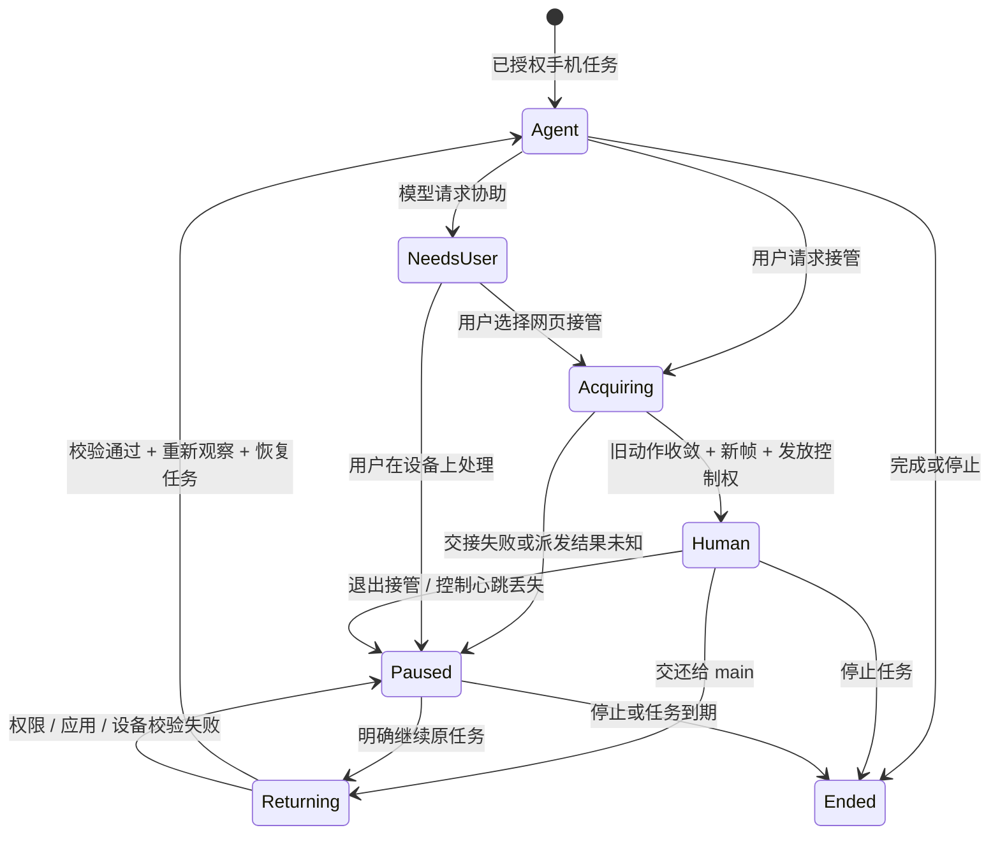

# 对话中的手机实时面板

状态：2026-10-23 首版已接入产品并完成本机模拟器 / AutoGLM 联调。HTML 原型仍使用演示数据，产品聊天面板显示真实手机画面。

首版实现：会话绑定的右侧 phone 标签、宽屏自动展开、窄屏入口、只读观看、人工点击/滑动/长按/返回/非密码输入、控制心跳、退出保持暂停、交还重新观察、运行中工具续接与空闲 main 的幂等唤起。状态采用约 1.2 秒 HTTP 轮询，帧按采集耗时自适应刷新（每次完成后间隔 1 秒），未接入下文规划的 WebSocket 事件 / 连续视频。隐私遮屏开关、完整触摸流与云手机 runner 尚未实现；密码 / 验证码应在设备本地处理。

已验证：仅查看点击没有输入；人工滑动/点击实际落到模拟器；接管时没有新增模型请求或 Agent 输入；交还后真实 AutoGLM 继续，最终原生 UI 证据确认 Android 15；main 关闭会话并释放设备。

## 产品决策

在聊天右侧工作区增加「手机」标签页，展示当前对话正在操作的真实手机画面。聊天保留目标、简短进度和结果；画面、当前动作、暂停和停止集中在右侧。复用已有文件 / 浏览器 / 侧边对话的工作区，不增加第二套抽屉。

默认首先交付准实时画面，目标约 1 FPS，动作前后及时刷新；界面显示实际采集时间。它用于理解 Agent 正在做什么，不承诺视频级流畅度。连续视频留作后续独立能力，保持同一面板和会话授权模型。

## 桌面布局

- 聊天区域保留至少 420px；手机面板建议宽 400–480px，用户可拖动分隔线调整。接入 RightWorkspace 时为 phone 类型增加专用尺寸策略，不能直接沿用现有最小 460px / 默认 60% 的文件预览策略。
- 顶部沿用工作区标签栏：「文件」「手机 · 测试手机」，支持收起、关闭、放大。
- 面板头部：手机名称、连接状态、当前操作者 main；AutoGLM 模型名放在可展开详情中，避免挤占画面。
- 中央为等比例屏幕：contain 显示，保留真实分辨率比例，黑边不参与坐标换算；不套厚重拟物手机壳。初始连接使用固定比例 skeleton，避免画面跳动。
- 屏幕上方展示「正在操作 / 已暂停 / 等待你处理 / 已结束」；下方明确显示「最近画面 · 0.8 秒前」。采集超过阈值后改为「画面延迟」，绝不能把旧画面标成实时。
- 画面下方展示一个当前步骤，例如「正在点击 Android version」。可展开最近动作列表；只有确实获得 action target / 坐标时才显示轻量点击光标，不能从文字猜坐标。
- 底部固定操作区：「接管操作」「暂停」「停止」。默认仅查看；接管交接完成后允许网页点击、滑动和有限输入。交还后重新观察再继续，详见本文接管设计。

## 从聊天自动打开

1. Agent 调用 discover：聊天显示「正在连接手机」，不提前打开空面板。
2. open 成功，并绑定当前 conversationId / phoneSessionId：新增或复用该手机标签。右侧未打开时自动展开；如果用户正查看文件，则只出现新标签和轻提示，不抢走当前文件。
3. 第一帧通过访问校验后展示；切换至手机标签后开始持续订阅。不要抢走输入框焦点。
4. 用户主动收起后，本轮后续更新不反复打开。聊天进度卡保留「查看手机」入口。
5. 切换其他对话后不展示上一对话的手机；后台执行按现有任务规则继续。重新进入原对话可以恢复订阅。
6. 浏览器刷新后仅恢复标签和会话 ID，并重新向服务端确认状态；不得恢复过期授权、旧截图或假定设备仍在线。

## 聊天消息的配合

手机调用聚合为一张简洁的操作卡：手机名、当前步骤、已完成动作数、耗时和「查看手机」。原始参数、调试错误和详细工具记录继续收在展开层，不把长链路日志铺满聊天。

示例：正在查看 Android 版本 · 本机 Android 测试手机 · 6 次操作 · 查看手机。

最后回复提供结论与依据，例如「Android 15，已在关于手机页面读取」。不要把模型自行结束等同于已验证。原生 UI 文本证据、模型推断和 expectText 自动匹配需区分；中英文界面导致 expectText 未命中时仍可展示实际 UI 依据。

## 状态与操作

| 状态 | 画面与文案 | 可用操作 |
| --- | --- | --- |
| 连接中 | 屏幕比例 skeleton，正在连接手机 | 停止 |
| 执行中 | 最近画面、采集时间、当前动作 | 暂停、停止、放大 |
| 已暂停 | 冻结执行，画面可继续经授权刷新；提示 Agent 不会继续操作 | 继续、停止 |
| 等待你处理 | 明确登录 / 验证 / 手动确认原因 | 在模拟器或真机上处理后继续、停止 |
| 画面延迟 / 订阅断开 | 保留最后画面并叠加时间和状态；与设备离线分开表示 | 重连画面、暂停、停止 |
| 设备离线 / 权限变化 | 清除画面，显示具体恢复建议 | 重新连接 / 前往手机管理 |
| 操作失败 | 展示可读原因和失败步骤；已经失败释放的会话不能原地继续 | 重新打开会话后重试 |
| 已结束 | 停止采集。仍打开的面板可在当前标签内短暂保留最后画面，明确标为已结束 | 收起、查看结果 |
| 历史对话 | 只显示操作摘要，没有伪实时画面 | 新建手机操作 |

收起 / 关闭面板仅停止观看，不终止 Agent；「停止」才取消操作并释放设备。停止等待正在派发的单次输入收敛，不能声称撤销已发生的点击。

暂停必须经服务端确认且 active 执行收敛，才能进入可手动处理状态。Agent 此时收到暂停/等待提示；继续后必须重新观察。现有 resume 不应被宣传为自动恢复完整任务，需保存 pending goal / runId，并通过已有任务机制恢复，或提示 Agent 再次 run。

## 窄屏

根据聊天容器可用宽度选择布局，而非只看整屏宽度。可用宽度不足约 900px 时，手机以全屏工作区展示，顶部「返回聊天」；聊天中保留带状态的入口，避免将手机缩成不可读的小窗。移动端不自动遮住聊天，显示「手机正在操作 · 查看」后由用户打开。所有图标有名称，主要按钮最小 44px，状态变化用单一 aria-live 提示，帧刷新不逐帧播报。

## 现有实现的约束

- `src/phone/runtime.ts` 已有观察、执行、暂停和关闭，以及独占设备租约。
- `preview()` 会独立申请租约，Agent 执行期间不可并发使用；`previewSession()` 又明确拒绝 active 会话。所以不能让右侧每秒轮询现有管理截图接口。
- 当前管理页会话 owner 为 phone-settings:principal:id，聊天工具 owner 为 conversationId。知道会话 UUID 并不意味着具备访问权，不能直接复用管理页 owner 拼接规则。
- `publish()` 目前写操作报告，不是实时推送。repo.report 只存元数据，不存截图。
- 原有 observe 会在使用后清零帧缓冲区；如果要提供预览，必须在受控缓存中复制一份并单独管理生命周期。

## 后端方案

增加 PhoneObservationHub 与独立的会话视图服务，保持 PhoneRuntime 是唯一设备执行协调者。

1. 执行产生的有效 observation 交给 Hub，共享给模型和已授权观看者，避免 UI 自己 acquire 第二份设备租约。
2. 有可见观看者时，在执行间隙通过同一协调器补采帧；同一设备只有一个采集任务。原生 UI 观察 / 动作优先，不能为画面轮询阻塞或改变动作时序。
3. 第一期目标 1 FPS，按采集耗时自适应降低频率；等待模型时也能显示最近画面。若只能拿到动作间的帧，明确标注最近画面，不冒充连续视频。
4. 每帧携带 frameSeq、capturedAt、phoneSessionId、width、height、rotation、package；状态 / 动作事件独立维护 revision。预览帧不能替代动作前的新观察。
5. 每设备最多保留最近一帧及正在传输的一帧。慢客户端丢旧帧，不堆积；原始模型帧不压缩改写，单独生成展示缩略帧。
6. 无观看者、标签不可见或关闭后停止补采；执行本身仍照常观察。断开观看不取消任务。
7. close 后停止新帧，内存最后帧最多保留 30 秒、受原权限保护，超时销毁；不进入 SQLite、聊天 transcript、普通日志、浏览器持久存储或分享导出。
8. 当前 app 脱离 allowlist、设备权限/Agent 绑定变化或注销时，立即撤销观看权限、清帧。用户接管遇到系统授权页时显示受限状态，不自动扩大白名单。

### 建议接口（新增，非现有）

- `GET /api/sessions/:conversationId/phone`：该会话可见的活动手机 session、状态、设备显示名、观看与控制权限；无活动会话返回空。
- `GET /api/sessions/:conversationId/phone/:phoneSessionId/frame?after=:frameSeq`：带鉴权的最新帧；返回 frameSeq / capturedAt 元数据，无新帧 204，结束后超过保留期 410。使用 fetch → Blob URL，避免把令牌放在图片地址中；响应 no-store。
- `POST /api/sessions/:conversationId/phone/:phoneSessionId/control`：仅 pause / resume / cancel，携带 expectedRevision 与幂等 operationId；服务端校验身份、会话访问权、Agent 设备授权、当前租约和状态。
- 已有 realtime 连接增加会话级 phone 状态与 frame-ready 元数据事件。复用现有 WebSocket 连接，但必须扩展 topic/event schema 和订阅授权；不能向全局广播截图或设备列表。
- 客户端收到 frame-ready 后拉取最新帧；同一时刻最多一个请求，落后的 seq 丢弃。断线后先重新拉状态，再订阅最新 revision，取消旧请求。
- 第一版可以用状态推送 + HTTP 帧拉取；它不要求另起视频服务。后续连续视频通道独立评估编码、带宽、输入控制和云手机供应商能力，复用同一 UI 与授权。

只授权 conversation 参与者观看仍不足以默认暴露手机：第一版限 Gateway owner + 原对话绑定的 Agent 设备授权。共享链接、游客、普通频道参与者均不继承画面权限。后续多用户扩展应引入显式 phone.view / phone.control 能力，而非放松现有管理员边界。

## 前端改动范围

- `web/src/stores/right-workspace-store.ts`：WorkspaceTab 增加 phone；按 conversation + phoneSession 去重。只持久化标签元数据，刷新后重新鉴权。
- `web/src/features/right-workspace/right-workspace.tsx`：phone 内容分支、独立尺寸规则和窄屏展示，不展示文件树。
- 新增 `web/src/features/phone/`：PhoneLivePanel、PhoneFrame、PhoneActionStatus、会话状态 / 画面订阅 hook；管理页可共享纯画面组件。
- 聊天工具事件驱动首次 open 和进度卡；服务端独立事件作为执行期状态来源，不能等 run 工具最终返回才刷新。
- 后端 phone contracts / runtime / driver 增加共享观察与状态事件，新增会话视图 route、lazy-bundle matcher 与映射测试；真实 Gateway 鉴权联调不可省略。

## 交付顺序和验收

第一阶段：右侧画面、动作状态、时间、仅查看 / 接管 / 交还完整状态机、有限网页操作、窄屏切换、鉴权与断线恢复。先支持原子点击、滑动、返回；不提供录屏回放与历史截图。

第二阶段：根据首期实测决定是否引入连续视频、完整触摸流、多设备标签、显式截图保存。云手机接入应通过 runner 能力声明支持截图或视频，不假定所有供应商可直连 ADB。

验收必须覆盖：从聊天 main 发起后可见真实 AutoGLM 画面；截图订阅不触发额外模型调用或抢占租约；输入期间可持续看状态；暂停应答后不再注入新动作；关闭面板不取消任务；停止确实释放设备；切对话不串图；刷新/断线/离线有可辨识状态；历史与分享不暴露帧；浅深色与窄屏可读；包权限撤销后不再显示旧图。

## 参考项目：事实与采用建议

调研时间：2026-10-23，主分支可能继续变化。以下只描述已检查的文档和代码，不把前端控件等同于完整服务端互斥保证。

| 项目 | 检查到的设计 | xopc 的采用方式 |
| --- | --- | --- |
| Open-AutoGLM | Take_over 调用 takeover_callback，默认实现阻塞等待用户按回车；回调返回后继续外层步骤循环并重新截图。Interact 是需要用户交互的结果，与 Take_over 的阻塞回调不同 | 采用请求人工协助 → 等待 → 显式交还 → 新观察的生命周期，用异步会话状态实现，不阻塞 Gateway 线程 |
| AutoGLM-GUI | README 描述 scrcpy 实时视频、点击/滑动、坐标转换，以及自动/视频/截图显示模式。DeviceMonitor 的 ScrcpyPlayer 显式 enableControl=true；这个调用点没有绑定 Agent 是否暂停 | 采用画面与操作反馈、视频不可用时截图降级；新增服务端控制权仲裁，不能只用 enableControl 布尔值保护 |
| AutoGLM-GUI | useTaskSessionConversation 接到 takeover 事件后进入 waitingForUserInteraction 并显示提示；用户再次发送“继续”等输入时提交下一项任务 | 采用明确的等待提示；xopc 的继续要绑定原 run / goal / session，不能让每次“继续”成为无关联的新任务 |

来源：
- [Open-AutoGLM ActionHandler：接管回调与 Interact](https://github.com/zai-org/Open-AutoGLM/blob/main/phone_agent/actions/handler.py)
- [Open-AutoGLM Agent：每一步重新观察与执行循环](https://github.com/zai-org/Open-AutoGLM/blob/main/phone_agent/agent.py)
- [AutoGLM-GUI 手动控制说明](https://github.com/suyiiyii/AutoGLM-GUI#手动控制模式)
- [AutoGLM-GUI DeviceMonitor](https://github.com/suyiiyii/AutoGLM-GUI/blob/main/frontend/src/components/DeviceMonitor.tsx)
- [AutoGLM-GUI ScrcpyPlayer](https://github.com/suyiiyii/AutoGLM-GUI/blob/main/frontend/src/components/ScrcpyPlayer.tsx)
- [AutoGLM-GUI 任务交互 hook](https://github.com/suyiiyii/AutoGLM-GUI/blob/main/frontend/src/hooks/useTaskSessionConversation.ts)

## 接管行为：交互契约

### 区分观看模式和执行状态

「仅查看 / 接管操作」是用户对画面的交互方式，不是 Agent 的 observe / control 工具模式。仅查看时 Agent 可以正常执行任务；禁止将它映射成 mode=observe 再尝试启动应用。

服务端分开保存：

- taskState：ready / running / paused / needs_user / completed / cancelled / failed。
- controlOwner：agent / human / none，外加 humanPrincipalId、humanClientId、leaseExpiresAt 和 controlEpoch。
- viewMode：前端仅查看或正在接管，只是服务端控制权的投影，不能凭前端状态获得输入权限。
- handoff：idle / acquiring / returning，用于屏蔽交接期间的两侧输入。

同时只有一个控制者。controlOwner=agent 不代表模型请求正在发送；controlOwner=human 时禁止新的手机模型请求与 Agent 输入，main 可继续聊天但不得另开手机会话绕过占用。

### 默认仅查看

面板明确标注「仅查看 · main 正在操作」。画面点击不向手机发送事件；滚轮用于面板滚动，不偷走页面滚动。可放大、暂停、停止，以及点「接管操作」。仅查看不会新增手机工具权限，也不会自动订阅其他会话的设备。

如果任务本来要求只观察且没有控制授权，接管按钮禁用并提示原因；用户主动请求接管可发起正常的控制授权流程，不能通过前端切换绕过 Agent 原来的禁用策略。

### 用户主动接管

1. 点击「接管操作」，进入「正在交接」，立即禁用画面和重复请求，不弹没有意义的二次确认。
2. 服务端冻结任务推进和自动重试，先递增 controlEpoch，使已在途的旧预测立即失效；中止模型请求并清除尚未执行的动作。
3. 对已经发到 ADB / runner 的输入进行收敛等待。取消请求不等于撤回点击。若派发结果不明，保持 paused / outcome_unknown，先重新观察和确认实际状态，不能直接发放人工输入权。
4. 没有未决输入后，同一设备租约内部将 agent 控制权交给此浏览器用户，不释放租约让其他任务抢入。返回带 epoch 的短期控制授权，不把 token 放进 URL 或浏览器持久存储。
5. 采集新帧，面板显示「你正在操作 · main 已暂停」，之后才解锁画面。聊天同步一条简短事件「你已接管手机，任务已暂停」。

### 接管期间能做什么

首期支持点击、原子拖动滑动、长按与返回；输入框在能力允许时显示，文本经明确“发送到手机”按钮提交。没有输入法能力时引导在本机模拟器或真机上输入，不能执行任意 shell 命令安装或切换键盘。

- 屏幕指针与用户动作仅用于反馈；未经用户请求不把接管输入作为给模型的新指令。
- Home / 多任务 / 跨应用导航按现有 allowlist 与 runner 能力决定是否可用。当前只授权设置时，Home 不应作为无条件可用的按钮。
- 前端只在实际画面内容矩形内换算坐标，排除黑边；结合 frameSeq / 原分辨率 / rotation 验证。横竖屏或几何变化立刻取消待发送手势，要求新帧后重试。
- 输入请求携带 operationId / controlEpoch / frameSeq。服务端再次检查新鲜度、前台应用、控制租约和用户身份；拒绝过期输入。不对超时的点击、发送或滑动自动重放。
- 点击与滑动只是输入派发成功，不宣称业务操作已完成。
- 中文输入依赖经用户启用的输入法能力；密码 / 验证码优先在设备本地处理。接管时停止发帧给模型、避免记录输入；这不等于自动隐藏最终屏幕上明文显示的敏感内容。
- 提供「隐私处理」开关：暂停服务端画面推送并清除帧缓存，用户在设备本地完成。交还之前提示返回非敏感页面；未退出隐私处理不得自动恢复模型视觉请求。

### 退出接管与交还不同

「退出接管」：收回此浏览器的输入权，手机保持暂停 / 仅查看，不继续 Agent。用于用户想结束手动操作但还没决定下一步。

「交还给 main」：等待最后一条用户输入完成，失效化人工 controlEpoch，收敛手势并清除队列；重新检查设备与应用白名单，采集全新观察，保留任务目标、剩余预算与必要的非敏感执行摘要，再恢复 Agent 控制权与任务推进。允许附加一句备注，例如“已登录，继续原任务”，但不要求每次都填。

如果用户已到别的页面，Agent 必须基于新观察重新规划。不能使用接管前保存的坐标继续点击，不能因接管重置模型调用和动作预算。任务在接管期间被取消或超时则提示新建任务，不自动重开。

### 模型请求人工协助

收到 Take_over：进入 needs_user，控制权置 none 并保存原因、原目标和续接点，通知 main 和前端，停止手机模型推理；面板显示「需要你处理：登录 / 验证码等」。用户可选「在网页接管」或「在设备上处理」。用户明确“交还并继续”后才恢复。

Interact：优先映射为聊天中的提问 / 选项，不强制要求接管手机。当前适配器把 Take_over 与 Interact 都归为 needsUser，后续需补充 needsUser.kind=takeover|question|confirmation，保留协议差异。敏感动作确认又是独立的 approve/reject 操作，不应等同于获取整台手机控制权。

模型请求协助本身不能授予新权限。没有网页接管权限、云手机不支持输入、系统页不在白名单时，显示准确原因和可行的设备本地处理途径，不暗中扩大访问范围。

## 控制权状态转换

## 断线与多窗口

- 观看者可以有多个，但当前仅 Gateway owner 范围内，只有一个 human 控制客户端。
- 第二窗口看到「正在被另一窗口接管」，只能观看；不得用新请求静默夺取输入权。
- 人工控制使用独立短心跳，例如每 5 秒续约、15 秒无心跳撤销输入权。参数为初始建议，按网络与 runner 实测调整。
- 关闭面板、切换到不可见的控制标签、浏览器失焦过久或离开页面时，先尽力退出接管；服务端心跳到期兜底，保持暂停，绝不默认交回 Agent。
- 刷新浏览器必须重新取得服务端控制权；离线队列不补发。设备断连立即停输入，不影响用户继续在聊天询问恢复办法。
- 原有 15 分钟会话上限也覆盖人工等待；需要保留任务更久时显式续期，不能悄悄无限延长设备占用。

## 接管新增接口与能力

在前述会话级路由下新增，均为设计中的接口：

- `POST .../takeover`：expectedRevision + operationId，返回 acquiring 或已取得控制权；完成通过状态事件通知。授权与状态变化必须在同一串行协调器内完成。
- `POST .../input`：仅接收结构化 tap / swipe / longPress / back / typeText，不接受 shell；校验 controlEpoch、用户、客户端、设备租约、frameSeq 和 foreground policy。
- `POST .../control-heartbeat`：只延长当前人工控制，不扩大 scope 或会话时长。
- `POST .../release-control`：失效化人工授权，保持 paused。
- `POST .../handback`：失效化人工授权，重新观察并排队恢复原任务；支持非敏感备注。
- 所有动作事件注明 actor=agent|human、revision 与结果；仅记录类型和时间，不把键入文本或截图持久化。

Runner 分别声明 screenshot、video、tap、swipe、longPress、textInput、back 等能力。云手机先通过 provider SDK / 会话代理接入；可观看不等于可接管。视频解码/传输通道不直接拥有输入权限，scrcpy 控制端必须由同一控制权协调器限制。

## 接管验收补充

从聊天触发 → 仅查看不注入输入 → 接管等待在途动作 → 用户点击可见变化 → Agent 同时零输入/零新模型请求 → 交还重新观察 → 继续原目标 → 停止释放租约。

额外覆盖双窗口抢控、交接时模型返回、动作超时未知、旋转/黑边、页面切后台、输入请求超时重发、隐私处理、未授权 app、云 runner 仅截图、验证码设备本地处理。特别验证：暂停后 main 再次调用 phone_use run 不得恢复执行；只有显式 handback / resume 控制动作可以撤销人工等待状态。
