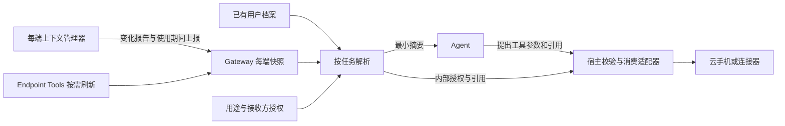

# 用户实时环境与跨设备使用方案

日期：2026-10-25。状态：每端基础上下文、Web 前台授权位置共享、无影云手机定位同步及恢复链路已实现。原生移动端共享 UI、后台持续采集和通用个人数据授权仍为后续设计。下文先列当前实现范围，后续章节描述完整目标架构，未列入实现范围的契约不能作为当前版本 API 使用。

## 首期实现范围

当前已接入 Web、桌面渲染入口、浏览器扩展侧栏、Android、iOS 和 Harmony 的时区及 locale 上报，以及独立的前台/后台可用性心跳。共享 TypeScript publisher 与各原生端在使用期间每 15 秒检查上报，基础设置每 60 秒重采。Web 在可见性/焦点变化时立即刷新，扩展按侧栏活动维持有期限的可用性；原生端按系统前台状态采样，系统挂起后以服务端 45 秒期限兜底。

服务端实现 `GET /api/user-context/environment`、`GET /api/user-context/environment/endpoints/:endpointId`、`POST /api/user-context/environment/reports` 和 `POST /api/user-context/environment/heartbeats`，均接入鉴权、设备归属和 lazy-bundle。写入还要求当前 endpoint turn claim 和连接 epoch，单次载荷最多 16 KiB。缓存限于当前进程，最多 256 个在线端的记录，每端保留最近 64 个报告摘要回执；断开、替换或撤销连接使视图失效。

首期 wire report 使用 `values + cleared + capturedAt` 表达同一次采集，提供 full 替换与 patch 基线校验。客户端当前发送 full；patch 中未更新字段保留原采样时间和期限。连接查询返回 epoch、revision 和两个序号基线，允许 publisher 在同一连接重建后继续上报。服务端按每个字段保存采集与接收时间，不用心跳延长字段有效期，也不因相同样本换 reportId 而续期。

已启用字段白名单为 `environment.timezone`、`environment.locale` 和 `device.power`，其中 power 契约可接收有限电量/充电读数，各端本轮定时采集只发送前两个字段；设备电量继续可通过已有工具按需读取。未知字段、位置、任意用户 ID 和自由文本扩展均被上报 schema 拒绝。暂未实现通用位置采集/上报授权，因此没有将单次位置工具的结果留存或升级成连续共享。

消息接受时，Gateway 从已验证的来源端选取当前快照并冻结在已有 `device_context` 内，不新增客户端可伪造的身份字段或修改输入重试语义。进入 Agent 时再按字段及来源可用期限去除过期值。稳定 system prompt 只增加来源、鲜度与权限规则，动态快照走已有低信任来源数据容器；不合并其他端、不覆盖用户档案。客户端指定历史 contextRevision、每次模型请求的实时刷新以及跨端来源选择仍是后续扩展。

云手机现已通过专门的位置共享接口同步；Agent 不提交原始坐标、不获得任意 shell。下文 `context.resolve`、`phone.apply_environment`、`phone.start_task` 和通用 grant API 仍为设计，当前具体 API 及生命周期见下一节。原先默认 unsupported 的通用 `PhoneEnvironmentAdapter` 保留；实际位置使用独立的受限 Wuying 适配器。

## 已实现的位置共享与恢复

Web 手机面板增加“共享当前位置”：先明确披露来源、云手机与 App 接收范围，再由用户点击“同意并共享”触发系统定位授权。支持默认大概位置（端侧及 Gateway 均按 0.02 度网格取整、精度至少 3 km）与精确位置，单次采样或最多 5 分钟前台持续共享。持续共享每 10 秒重新采集；样本单独 30 秒过期，普通心跳不会续期。页面隐藏、组件卸载、用户停止、系统权限拒绝/撤销、源连接失效均停止共享；不支持权限事件的平台由下一次采样失败或样本期限兜底。

| 当前 API | 行为 |
| --- | --- |
| `POST /api/user-context/environment/location-shares` | 当前源 endpoint claim + conversationId + 可选 phoneId + precision/mode/durationMs + disclosureVersion，创建有期限的用途授权 |
| `GET /api/user-context/environment/location-shares?endpointId=…&conversationId=…` | 仅返回归属当前调用者的安全摘要；不返回坐标 |
| `POST /api/user-context/environment/location-shares/:id/samples` | 当前连接 claim、有序 sequence、WGS84 新采样；校验来源、期限、精度、重放及前台状态 |
| `DELETE /api/user-context/environment/location-shares/:id` | 立即使引用失效、取消在途操作，再执行远端恢复；重复撤销可重试清理 |
| `GET /api/phone/devices/:id/environment` | 管理员查询应用/清理状态，无原始坐标；supported 仅表示设备类型可尝试，实际镜像仍须探测 |
| `POST /api/phone/devices/:id/environment/cleanup` | 管理员显式重试待完成的定位恢复 |

授权最多 15 分钟，当前 UI 最多 5 分钟；每进程最多 64 份共享。授权绑定源连接 epoch、会话和目标手机，不随重连自动复活。原始用户采样只在内存中消费，消息上下文仅注入 source、精度、时间、状态及不透明 valueRef；注入时再次去除过期引用。共享不会创建长期位置记忆。客户端发出的历史快照不会在撤销后改写，执行仍依赖宿主当前状态校验。

无影适配器复用已注册的 aliyun-adb 连接和密钥。先检查 Android SDK ≥31、`persist.location.data` 为三数字加 `wgs`，再与实际 Android GPS 回读比较以确定经纬度顺序（允许虚拟 GPS 的 15 m 抖动）；顺序不唯一、缺少 GPS 或未知格式均拒绝写入。写入和恢复都要求属性与 GPS 回读一致，不能仅凭 setprop 成功认定生效。已在当前已注册的 SDK 31 实例完成临时测试位置写入、GPS 回读及原基线恢复验证；尚未逐个第三方 App 验证，也不保证所有无影镜像通用。

手机环境写入复用设备租约和串行 I/O，绑定会话与设备 revision。首次应用需暂停正在运行的 Agent，已验证共享的刷新可继续；位置更新会使旧画面和预测失效。应用前持久记录 pending；应用后 verified；失败或结果不确定进入 cleanup_pending。用户样本不持久化，原云手机基线使用 AES-256-GCM 加密保存于 SQLite 清理台账，独立密钥存于本机 credentials 目录，恢复并验证成功即删除台账。

样本过期、撤销、源离线、任务结束/取消、设备解绑及 Gateway 正常退出触发恢复原定位。进程异常退出后，Gateway 启动时发现台账即启动手机环境服务并重试；依赖环境的手机操作在恢复前受到阻止。断网或镜像/设备 revision 变化保留 cleanup_pending，不宣称清理成功，也不在此时删除恢复所需凭据。恢复后原任务仍需新鲜授权样本才能继续；用户显式人工查看和取消保持可用。第三方 App 已经保存的历史数据无法撤回。

当前没有全局环境设置页、跨端任选位置来源、原生 Android/iOS/Harmony 的新共享 UI、锁屏后台定位，或基于真实传感器证明的防伪定位。移动浏览器通过同一 Web 面板使用；需要 HTTPS 或浏览器认可的安全上下文。

实现位置：`packages/endpoint-tools-protocol/src/context.ts`、`packages/endpoint-tools-client/src/context.ts`、`src/endpoint-tools/context-store.ts`、`src/gateway/hono/routes/endpoint-environment.ts`、`src/agent/source-context/device-environment.ts`、`src/phone/environment-adapter.ts`，以及各端原有 Host/Realtime 入口。

采用每端维护自身上下文的架构：各端在使用期间维护并提交自己的环境快照，Gateway 保存每端最新有效视图，按消息来源、任务和授权选取信息，Agent 理解上下文并提出工具调用，宿主校验后将信息应用到云手机或其他目标。现有 User Context 承担档案和统一查询边界，Endpoint Tools 承担交互式采集，Phone Use 承担云手机执行。

各端上下文独立存在，不将多个端的最新字段无条件合并为“用户当前位置”。长期档案、端侧观测、消息快照和执行设备环境分别维护；统一解析器在使用时建立它们之间的关联。端侧采集权限、上报权限和接收方使用权限分别校验。

云端 Gateway 维护的是有依据且可能过期的用户环境视图。它不能把自身 IP、服务器时区、云手机 GPS 或最近一台在线设备的状态认作用户当前物理状态，也不能证明传感器读数绝对真实。

## 现有基础与缺口

以下结论基于当前工作区源码。知识图谱的部分符号与文件已落后于工作区，定位后以实际源码核对。

| 现有能力 | 代码依据 | 对本方案的影响 |
| --- | --- | --- |
| 全局用户档案和用户理解 | `src/user-context/domain.ts`、`owner.ts`、`runtime.ts` | 已有 timezone、locale、accessibility，以及有效期、证据、敏感等级等用户理解字段；身份当前固定为 `local-owner`，运行时全局共享 |
| 用户上下文访问边界 | `src/user-context/access-policy.ts`、`identity-bindings.ts` | 当前按 owner、直聊和会话开关限制；新环境读取仍须经过这条边界 |
| 消息入口环境 | `packages/gateway-contract/src/session-input-command.ts`、`web/src/features/endpoint-tools/turn-environment.ts` | 已有带 capturedAt 的 timezone、locale；这是消息来源快照，不能变成永不过期的用户全局事实 |
| 设备身份和请求验证 | `src/gateway/security/gateway-principal.ts`、`device-request-proof.ts` | 复用 owner/device 身份、配对和请求证明；签名证明来源和完整性，不证明 GPS 的物理真实性 |
| 跨设备目标选择 | `src/endpoint-tools/target-resolver.ts`、`capability-catalog.ts` | 已区分 turn_origin 与 session_bound；应扩展解析用途，不能把执行目标改成采集来源 |
| 端侧位置采集 | `packages/endpoint-tools-protocol/src/location.ts`；Web、Android、iOS、Harmony 的位置适配器 | 已有 WGS84、精度、采集时间和单次前台确认，无需重建采集基础 |
| 位置受限处理 | `src/endpoint-tools/location-task.ts`、`src/agent/external-tools/endpoint-provider.ts` | 当前只支持 weather/nearby；原始坐标瞬时消费，不返回模型或写入历史，30 秒内有效。新方案必须保留旧行为 |
| 跨设备位置授权 | `src/endpoint-tools/grant-service.ts` | 当前是 60 秒、单次、绑定连接的内存 grant；不是通用、持久的个人数据授权 |
| 设备与外部传感器读数 | `src/endpoint-tools/result-projector.ts` | 已有来源、capturedAt、receivedAt、validUntil 包装，可统一语义 |
| 个人资源 | `packages/endpoint-tools-protocol/src/personal.ts`、`src/user-context/sources/types.ts` | 已有联系人、日历、文件、相机等受限能力，以及学习来源的同意回执；资源访问不能等同于全量同步 |
| 阿里云云手机 | `src/phone/cloud-adb.ts`、`cloud-adb-connection.ts`、`contracts.ts`；`docs/phone-use.md` | 已有 aliyun-adb 连接和凭据管理，无需为位置同步额外要求阿里云 AccessKey |

主要缺口是每端上下文契约及生命周期、使用期间的上报协议、稳定用户与设备归属解析、按目的授权、Agent 上下文投影，以及向执行设备应用和清理的适配层。

## 身份与部署边界

必须分别记录四个对象：信息描述谁、由谁采集、由哪个 Gateway 协调、最终交给谁使用。

| 标识 | 含义 |
| --- | --- |
| userId | 被描述的人。首期映射现有 `local-owner`，从服务端身份关系解析 |
| devicePrincipalId | 已配对采集设备的稳定身份；endpointId 和 connectionId 是在线连接身份 |
| subjectRef | 具体被观测对象，例如一部手机、房间传感器；不能默认都是用户本人 |
| consumerRef | 被授权使用信息的任务、连接器或具体云手机 |

设备另有服务器管理的用途角色：`personal-carried`、`personal-stationary`、`execution-virtual`、`environment-sensor`、`unknown`。角色由用户配置，不接受客户端自行声明为可信用户位置。手机被标记为随身设备仍只是可解释的关联依据，不是人在设备旁边的证明。

一个人可以有多个设备和入口；多个 Agent 仍共享同一人的环境基础，但按任务授权隔离使用。会话 ID、Agent ID、设备 ID 均不能替代 userId。家庭成员、群聊其他人和共享设备不能按 IP、昵称或同一云账号自动合并为 owner。

云端单用户 Gateway 与本地单用户 Gateway 使用同一语义。共享多用户 Gateway 另需完成认证主体到 userId、会话、设备、资料和查询的全链路隔离；目前固定 owner 的实现不能通过新增 userId 字段就宣称支持多租户。首期明确仅支持一个 owner。

## 信息分类与采集范围

每个端维护有界、按字段分类的本端视图；Gateway 提供统一查询，但保留各端边界。个人资源只保存引用，不将通讯录、文件正文和传感器历史塞进上下文。

| 类别 | 例子 | 更新和存储 | 使用边界 |
| --- | --- | --- | --- |
| 长期档案与偏好 | 称呼、语言、惯用时区、单位、无障碍偏好 | 用户编辑后持久保存，带 revision；复用用户档案 | 惯用时区与当前设备时区分别存在 |
| 保存的个人地点 | 家、公司、常用收货地址、门牌及联系人 | 显式保存的独立资源，受限读取 | 当前 GPS 不等于收货地址；下单前选择对应地址 |
| 实时物理环境 | 位置、精度；后续可选海拔、移动状态 | 按需读取或有时限共享，原始值默认仅内存 | 位置来自哪台设备必须可见；不能用记忆补全 |
| 当前入口环境 | 时区、locale、平台、前台状态 | 消息快照或设备状态变化 | 系统 locale 不等于回复语言偏好；入口环境不自动改长期档案 |
| 设备运行状态 | 电量、充电、联网类型、可用能力 | 短期读数，归属于设备 | 手机电量不能表示用户忙闲；不采集 Wi-Fi 密码、完整 SSID/BSSID 列表 |
| 个人资源 | 联系人、日历空闲段、选中文件、照片 | 按需、限定字段/时间范围的资源引用 | 日历优先空闲摘要；不默认复制通讯录或相册 |
| 当前工作内容 | 用户共享的页面、选区、屏幕和剪贴板 | 明确共享的单次快照 | 不因打开 App 自动上传剪贴板或全屏；模型文本中的指令不构成授权 |
| 外部环境资源 | 家庭温湿度、智能设备状态 | 已配对资源观测，带地点和设备归属 | 家里的传感器不代表用户当前所在环境 |
| 高敏感个人资料 | 健康数据、证件、支付和账户凭据 | 以后按专门领域契约设计；凭据留在密钥服务 | 不纳入首期自动收集或通用环境字段 |

首期覆盖位置、当前时区、locale、设备状态，以及已有档案的统一解析；联系人、日历、文件保留现有按需能力并统一授权及来源说明，暂不增加健康、持续录音或后台屏幕采集。

## 每端上下文结构与存储

定义三层结构：端侧 `EndpointContextReport` 是上报载荷，Gateway 的 `EndpointContextSnapshot` 是校验后的每端视图，`TaskContextView` 是面向某轮 Agent 和某个消费目的的投影。现有消息输入中的 `EndpointContext` 仍维持已有含义，新契约使用不同名称并独立协商版本。

| 分区 | 典型字段 | 归属与含义 |
| --- | --- | --- |
| environment | timezone、locale、单位设置 | 本端设置，不自动覆盖用户偏好 |
| device | platform、power、network、availability | 本端状态；平台和能力声明要与已验证注册信息交叉检查 |
| physical | location、可选传感器读数 | 被观测对象是来源设备或绑定资源；位置必须包含 WGS84、精度和采集时间 |
| sharedResources | 页面、选区、文件、联系人、日历查询结果的引用 | 仅含用户共享或已授权的有界资源，不自动采集内容 |
| execution | 当前应用、控制状态、已应用环境的回执引用 | 仅执行端使用；由 Gateway runner 或受信适配器维护，不参与推断用户当前位置 |

端侧上报的结构示意如下。各分区采用字段白名单和固定 schema，示例不是允许任意对象的 wire schema。

```typescript
interface EndpointContextReport {
  version: 1;
  reportId: string;
  connectionEpoch: string; // Issued by Gateway for this authenticated connection.
  sequence: number;
  baseRevision: number | null; // null for full replacement.
  mode: 'full' | 'patch';
  fields: Array<{
    key: string; // Registered key, e.g. environment.timezone or physical.location.
    state: 'available' | 'unavailable' | 'denied' | 'unsupported' | 'cleared';
    capturedAt: number;
    value?: unknown; // Validated by the registered field schema.
    collectionRef?: string; // Required for fields needing collection/upload consent.
  }>;
}
```

消息所属 endpoint、device principal、userId、设备角色和 connectionId 从已认证连接解析，不由载荷决定。connectionEpoch 也必须与当前连接一致。字段的 collectionRef 证明本次采集及上报处于允许范围，不能取代消费者授权。location 的值复用现有 WGS84 样本契约；不接受模型或任意端自创坐标系名称。

校验后的每端快照结构为：

```typescript
interface EndpointContextSnapshot {
  version: 1;
  contextId: string;
  userId: string;
  source:
    | { kind: 'endpoint'; devicePrincipalId: string; endpointId: string; connectionEpoch: string }
    | { kind: 'phone_runner'; phoneId: string; runnerEpoch: string };
  revision: number;
  lastSeenAt: number;
  lastReportAt: number;
  fields: Record<string, EnvironmentObservation<unknown>>;
  fieldStates: Record<string, {
    status: 'unavailable' | 'denied' | 'unsupported' | 'cleared';
    observedAt: number;
  }>;
}
```

一个稳定设备 principal 可以有多个端或连接视图，例如 App 和浏览器；首期分别维护，不按 IP 或昵称自动去重。云手机不必伪装成已连接的移动端：Gateway 的 Phone runner 为其维护执行视图，以设备记录作为来源，不能冒用用户手机的 principal。

source 的两种类型分别使用认证 endpoint 或注册 phone 作为缓存键；runner 的 epoch 由宿主管理。`lastSeenAt` 对 endpoint 表示最近有效心跳，对 runner 表示最近成功连接探测，均不能代替具体字段的采集时间。

定义字段注册目录，逐项声明 schema、单位、坐标系、敏感等级、可用来源、默认有效期、处理区域和允许消费者。客户端不能上传任意键并要求模型信任它。位置样本应作为一个整体保存，不能将不同时间的 latitude、longitude、accuracy 拼接。

拟议观测契约如下；这是内部数据结构，不是可由客户端自由填写的完整请求。

```typescript
interface EnvironmentObservation<T> {
  id: string;
  userId: string;
  key: string; // e.g. physical.location or device.power
  subjectRef: string;
  source: {
    sourceKind: 'endpoint' | 'phone_runner';
    sourceRef: string; // Validated endpoint or registered execution device.
    connectionEpoch: string;
    method: 'os_sensor' | 'device_setting' | 'user_declared' | 'derived' | 'adapter_readback';
    sequence: number;
  };
  value: T;
  capturedAt: number;
  receivedAt: number;
  validUntil: number;
  quality: { accuracyMeters?: number; precision?: 'approximate' | 'precise' };
  collectionGrantId?: string; // Optional only for basic environment under its disclosure policy.
  schemaVersion: number;
  revision: number;
}
```

userId、来源连接、receivedAt、采集授权、revision、validUntil 由服务端验证或生成。端侧观测从已认证端点归属解析，执行观测从已注册手机及 runner 归属解析；两者不能互换。地理数据统一以 WGS84 和米作为内部契约；转换只在消费适配器执行，保留原坐标系、转换方法和版本。已降精度读数不得重新标为精确定位。

建议沿用 SQLite 持久化角色/设备归属、共享授权、字段策略及审计元数据。精确位置、屏幕、剪贴板等原始短期载荷默认放有界内存缓存；每用户、字段、来源只保留最新候选，限制数量和大小，不记录轨迹。重启后该类值变为 unknown，不能从聊天、日志或备份恢复为当前位置。

长期档案继续复用现有存储；具体地址等新增受限资源采用单独存储和密钥管理。首期不增加精确位置的持久化。如果以后确需跨重启保留，必须另行选择加密载荷、独立密钥、保留期限及备份恢复过滤策略，不能因 TTL 就声称磁盘/WAL/备份已安全擦除。

观测状态与可用性在解析时计算：`fresh`、`stale`、`unavailable`、`denied`、`unsupported`、`conflict`。最后见过的值可以显示为“上次更新于……”，但不能作为 fresh 返回。

## 使用期间的上报机制

每端维护本地 `EndpointContextManager`，职责限于采集、按字段更新时间、停止共享和提交报告。它不决定其他设备如何使用信息。Gateway 负责校验、接收确认、逐端缓存和消费者解析；两侧都执行授权到期和字段清理。

“使用期间”指已连接且满足对应授权前台条件的客户端会话。打开 App 不自动授予位置、剪贴板或个人资源读取权限。首期定时上报仅在可见/前台使用期间运行；不承诺浏览器后台或锁屏后的固定频率。

| 触发 | 端侧动作 | Gateway 行为 |
| --- | --- | --- |
| 已认证连接建立、版本协商完成 | 提交完整快照；先读取基础设置，敏感字段须先检查共享授权 | 建立新 epoch 和 revision，返回确认；旧连接不能继续写入 |
| 发消息、回前台、系统设置变化 | 更新允许的字段并尽快提交；消息关联已确认 revision | 冻结本条消息使用的版本；不以未来快照重解释历史消息 |
| 使用期间定时器 | 心跳与按字段到期重采；仅上报已变化或新采样字段 | 更新在线状态或字段状态；不能用心跳延长字段有效期 |
| 已授权位置共享中 | 前台按配置重采、节流上报；不并行堆积定位请求 | 验证用途、精度、采样时间和额度；没有新样本则旧值自然过期 |
| 任务执行前需要新鲜信息 | 处理 Gateway 的有界刷新请求 | 按需调用现有 Endpoint Tools；返回等待、拒绝或不可用，不绕过端侧确认 |
| 离开前台、停止共享、OS 撤权 | 停止相关采集并提交字段清除/权限变化；清理本地短期值 | 立即停止相应消费及在途处理；未收到事件时由前台心跳期限和 TTL 兜底 |
| 重连或恢复网络 | 新 epoch、重新评估权限，提交完整快照 | 不重放旧敏感报告、不恢复已消费授权，不将旧样本当新样本 |

首期建议值：使用期间心跳每 15 秒，45 秒未收到则来源可用性转为 unknown/offline；基础设置每 60 秒核对并按变化上报，鲜度窗口 5 分钟；电量按系统事件或每 20 秒重采，鲜度 30 秒；位置仅在授权共享中以 10 秒为目标间隔请求更新，鲜度继续保持现有 30 秒。实际采样可能更慢，精度与权限可能变化，不能为满足定时器重复标记 capturedAt。单次共享不启动持续定位定时器。

这些数值是首期配置默认值，必须由功耗、网络和真机测试调整。位置精度、来源和用途不满足时，返回不可用而不是延长 TTL。网络类型等低频字段按事件更新并设置独立鲜度，不强行与高频电量共用采样频率。

协议以每端 full/patch 报告和服务端 revision 确认为基础。full 表示替换全部可上报字段，未出现字段清除；patch 中未出现字段保持原值及原 capturedAt，显式 `cleared` 才删除。报告原子验证和应用：未知字段、非法载荷、过期授权或错误基线均不部分写入。拒绝错误报告不得刷新 lastReportAt；认证有效的心跳只能更新 lastSeenAt。

同一 epoch 内 sequence 严格递增。相同 reportId 且内容相同返回原确认；相同 ID 内容不同拒绝；旧序号拒绝。patch 的 baseRevision 不匹配时请求 full，不按字段盲目合并。客户端维持有界队列，变化可合并为后续 full，丢弃过期敏感采样。重试使用新的传输 proof，同时保持业务 reportId 和原始采集时间。

心跳使用独立的 heartbeatSequence，在同一 epoch 内单调递增，不占用报告 sequence 或推进 context revision；重放的旧心跳不能延长在线期限。端侧退出前台事件仅可收紧可用性，恢复前台需要当前连接的新鲜事件/心跳，不能由缓存报告恢复。

消息默认只引用已确认的 `endpointId + contextRevision`，并携带现有白名单 `endpointContext` 作为本条消息的基础环境快照。报告仍在途时不无限阻塞发消息，缺少数据明确标记，并在真正消费前刷新。客户端不能指定不属于当前来源的 revision。运行中的任务不会因别的端后台上报自动切换信息来源。

## 授权和处理区域

OS 权限表示应用可以访问设备能力；xopc 共享授权表示哪些数据可以交给哪些消费者。读取、短期保存、模型披露、第三方发送、设备应用、长期记忆是不同动作。

拟议 `EnvironmentGrant` 绑定 userId、发起设备、来源设备、字段/精度、purpose、consumerRef、会话或任务、共享模式、expiresAt、revision、revokedAt。支持 `once`、`while_in_use`、`until_time`；后台持续采集另行评估，不能自动升级。

例如用户选择“将本次位置同步到云手机 A 用于查附近餐厅”，同一授权可以覆盖完整已说明链路，流程中无需再次询问相同动作。但它不能用于云手机 B、健康分析、永久保存或下周的自动任务。已有 weather/nearby 单次授权也不能自动升级为云手机转发授权。

消费者必须精确到用途和目标。天气供应商、地图供应商和云手机都是数据接收方；模型仅收到城市或“定位可用”时，不需要得到原始坐标。云手机 GPS 属于设备级状态，目标设备中其他有权限的应用也可能读取，不能宣称仅指定 App 可见。

`local_only` 必须解释为具体信任边界。对于云端 Gateway，“只在 Gateway 内处理”仍表示数据离开物理手机；禁止离开端侧时，应在端侧处理并只返回允许的结果，或返回无法满足。不能直接把现有学习处理策略名称套到全部环境能力。

撤销增加授权 revision 并使所有相关缓存、待执行任务和租约立即不可再消费；取消在途采集/转发。已经送到第三方、云手机或模型的数据无法保证撤回。长期用户理解、向量索引、压缩摘要和 dreaming 不自动摄入原始实时观测。

## 统一解析与任务使用

新增 `UserEnvironmentResolver`，所有聊天、自动化、Phone Use、天气、地图和连接器通过同一边界读取。调用明确包含：信息语义、userId、来源要求、purpose、consumer、conversation/run、maxAge、精度要求、是否允许刷新、是否允许降级。

输出为带原因的解析结果，以及有界、不可转授的值引用。模型可以提出“需要当前位置”，但不能改 userId、任意指定 endpointId、扩大 grant、构造 shell，或凭文本绕过接收方限制。

解析顺序如下：

1. 区分 `current_physical_location`、用户指定目的地、保存地点、执行设备位置。用户说“查杭州天气”应直接查杭州，不触发定位。
2. 验证会话访问、任务主体、用途和接收方，再筛选满足授权的来源与候选。无权限和无数据不能对无权调用者泄露不同主体的存在信息。
3. 当前任务明确选择的来源优先；否则使用当前已验证的随身入口设备；否则使用用户明确设定的随身主设备。会话执行绑定和最近在线设备不自动成为用户物理信息来源。
4. 检查 grant、采集时间、服务端时钟、精度和来源角色。多个同优先级可信候选明显冲突时返回 conflict，由用户选来源；不把坐标平均、不让最新上报无条件覆盖。
5. 缺少合格数据时，在允许范围向指定端点请求新样本；需要交互、端点离线、权限拒绝或任务无人值守时返回结构化原因。不能回退 Gateway IP、云手机 GPS、家庭地址或旧聊天内容。
6. 生成任务视图并绑定 observation revision、grant revision 和消费者。执行外部动作前再次校验授权、有效期和目标租约；任务内更新须显式建立新视图，避免来源悄悄切换。

字段有效期按上报机制中的默认值和具体用途取更严格者。天气等允许更长或更粗粒度的需求，后续按用途显式配置。已过期的设备时区/locale 只可作为历史值显示；回复若改用长期档案，必须标注为偏好来源。以上为初始策略，不是平台保证。

客户端 capturedAt 与服务端 receivedAt 都保留，授权到期只按服务端时钟判定。使用请求 nonce、连接 epoch 和序号处理重放与乱序；序号只能在各自连接内比较，重连需重新确认来源。校准时钟仅改善采集时间判断，不能把最后已知的旧 GPS 样本刷新成新样本。未来时间、过大偏差和不合理采样年龄直接拒绝或要求重采。

设备断线后禁止继续采集；已收到样本能否在剩余 TTL 内消费由 grant 模式明确约束。`while_in_use` 离开前台即停止；once 的任务引用可以在已授权期限内完成单次动作。无论哪种模式，都不能因重连恢复已经撤销或消费的单次授权。

模型上下文只默认注入解释所需摘要，例如“来自随身手机，20 秒前，精度约 30 米，已授权本次云手机任务”。原始坐标通过宿主内部引用交给适配器。截图、地图页面、搜索结果仍可能间接暴露地理信息，因此视觉模型和第三方处理也必须计入披露范围，不能承诺模型永远无法看到位置。

时间语义分别处理：回复格式可跟随入口 locale；回复语言优先用户偏好；提醒采用创建时明确的 IANA timezone。已有定时任务不因用户旅行自动重排，除非用户选择“跟随当前时区”，届时还需定义 DST、重复/缺失时间和断线行为。

## Agent 上下文结构与注入方式

Agent 每次请求模型前，由宿主构建或刷新 `TaskContextView`。它只包含本轮已选来源的基础环境、当前目标和允许该模型看到的有界信息，不注入全部在线端的完整快照。

```json
{
  "version": 1,
  "viewRef": "task_context_123",
  "viewRevision": 3,
  "origin": { "deviceRef": "device_phone_1", "contextRevision": 12 },
  "environment": { "timezone": "Asia/Shanghai", "locale": "zh-CN" },
  "location": {
    "status": "fresh",
    "sourceDeviceRef": "device_phone_1",
    "ageSeconds": 8,
    "accuracyMeters": 25,
    "precision": "precise",
    "ref": "location_ref_123"
  },
  "executionTarget": { "phoneRef": "phone_A" },
  "permittedUses": [
    { "purpose": "phone_task", "consumerRef": "phone_A", "fields": ["physical.location"] }
  ]
}
```

宿主内部引用绑定 user、conversation、run、来源/观测 revision、授权 revision、purpose、consumer、到期时间和使用次数。引用是服务端记录的随机句柄，不是可由模型编辑的权限声明。模型只看到已过滤的可选来源、目标和工具；不知道引用也不能枚举其他用户的数据。

| 注入位置 | 内容与规则 |
| --- | --- |
| 稳定 system prompt | 信息来源解释、引用使用规则、不可把执行设备当成人、工具参数与错误恢复规则；不拼接原始端侧文本 |
| 本轮结构化上下文 | `TaskContextView`，作为框架支持的独立数据消息或受信宿主上下文容器提供；按当前请求替换，不逐轮追加完整设备快照 |
| 工具结果 | 刷新、解析、应用后的有界状态和引用；遵守真实工具调用协议，不伪造 tool call ID 或结果来源 |
| 历史记录 | 本条消息当时的安全摘要、来源和 revision；旧引用不因历史重放恢复权限，不从中复原原始敏感载荷 |

如果模型框架只能用 system 消息携带动态数据，先由宿主白名单投影为有限枚举、校验后的 timezone/locale、数字和不透明引用，再放入明确分隔的数据区域。不能把“加标签/JSON 转义”视为能安全提升任意网页、昵称、选区内容到系统指令层；此类文本留在低信任的用户共享资源或工具消息中。

默认不向模型注入精确经纬度、完整地址、原始联系人或剪贴板。模型确需某字段时，使用独立的字段披露授权；无法满足时返回原因。被授权模型调用之外的日志、遥测、进度和长期记忆不继承披露权限。稳定系统前缀可缓存，动态视图不能错误复用其他用户、其他 run 或过期版本。

同一任务的多个模型请求可刷新鲜度状态，但保持来源选择和任务语义。模型请求发出时 fresh 不保证工具执行时仍 fresh，宿主仍在执行边界复核。超过上下文预算时先移除不相关设备和字段，保留来源、时效、授权状态及引用；数据缺失要明确，不让模型补造。

## 模型调用云手机的参数与校验

模型选择目标、用途和任务目标，宿主负责取得真实值、格式转换、鉴权及执行顺序。下列为拟议 Agent 工具，与前文拟议 HTTP API 对应；名称与参数不能直接用于当前版本。

| 工具 | 模型可提交的参数 | 宿主返回 |
| --- | --- | --- |
| `context.resolve` | `requirements`、`purpose`、经权限过滤的 `consumerRef`；可选 `sourceDeviceRef` | 新鲜度、必要摘要和限定消费者的字段引用；缺数据时给出可恢复原因 |
| `phone.apply_environment` | `phoneRef`、`purpose`、`bindings`，每项仅含注册字段名和 `valueRef` | 应用状态、verification 状态、applicationRef、到期时间；不回传原始坐标 |
| `phone.start_task` | `phoneRef`、`goal`、`environmentApplicationRef` | 任务引用和状态；不接受模型绕过必需环境前置条件 |

`context.resolve` 的 requirements 只能使用注册语义，例如 `current_physical_location`；maxAge、精度要求等可作为请求限制，但不得放宽服务端策略。不带来源时按统一解析器规则选择；接收方未确定或没有转发授权时，只返回能力状态，不能签发任意云手机可用的通用位置引用。

示例中假定用户已授权云手机 A 使用本次位置，模型先请求任务所需信息：

```json
{
  "tool": "context.resolve",
  "arguments": {
    "requirements": ["current_physical_location"],
    "purpose": "phone_task",
    "consumerRef": "phone_A"
  }
}
```

宿主返回 `location_ref_123` 后，模型提出应用请求：

```json
{
  "tool": "phone.apply_environment",
  "arguments": {
    "phoneRef": "phone_A",
    "purpose": "phone_task",
    "bindings": [
      { "field": "physical.location", "valueRef": "location_ref_123" }
    ]
  }
}
```

模型不能提交经纬度替代 valueRef、任意 shell、ADB endpoint、私钥、userId、grantId、租约 token 或伪造消费者权限。需要用户明确指定地点的任务使用另一种 `specified_place` 资源引用，不将模型生成的坐标标记为用户当前物理位置。时区或 locale 使用自己的字段引用，并分别检查用户授权和适配器能力。

宿主执行校验流程固定如下：

1. **参数与主体**：严格 schema、字段白名单和数量上限；从实际调用上下文取得 user、conversation、run，验证工具可用性、会话访问和 phoneRef 归属。
2. **引用绑定**：查找 valueRef，核对当前主体、run、purpose、目标手机、允许字段和引用版本；伪造、跨任务或跨接收方引用拒绝。
3. **来源与时效**：检查所选设备角色、观测 revision、采样年龄、有效期、精度、坐标系、来源前台/连接要求。不能改用云手机或另一台用户设备补足。
4. **授权**：检查采集/上报授权及消费者授权仍有效、未撤销、未被其他操作消费，精度及披露范围未扩大；一次授权原子预留，避免并发重复使用。
5. **设备能力与并发**：确认具体镜像的适配器支持字段及清理，获取与现有控制协调器一致的手机级独占租约，固定目标设备 revision 和 fencing token。
6. **实际应用**：在外部写入前再次检查授权和租约；从内部缓存取值、按受限命令模板转换执行。依照现有 external operation 机制，由宿主生成逻辑操作幂等键及参数摘要，模型不管理幂等标识。
7. **验证与回执**：区分命令确认、属性回读、应用级可用性。只有达到该任务规定验证级别才返回可消费的 applicationRef；否则返回 pending/unknown/failed 等状态。
8. **启动与清理**：`phone.start_task` 核对回执所属 phone/run、环境 revision、租约、授权、有效期和验证级别后才启动位置相关操作。结束、撤销和超时进入恢复清理流程。

建议结果码为 `CONTEXT_STALE`、`SOURCE_UNAVAILABLE`、`CONTEXT_CONFLICT`、`GRANT_REQUIRED`、`GRANT_REVOKED`、`REFERENCE_SCOPE_MISMATCH`、`PHONE_ENV_UNSUPPORTED`、`PHONE_BUSY`、`APPLICATION_PENDING`、`APPLICATION_UNKNOWN`、`CLEANUP_PENDING`。仅返回调用者有权知道的来源详情。模型遇到这些状态可申请刷新、请用户选来源或报告等待，不能通过改参数绕过。

同一逻辑操作重试复用原幂等记录和回执，不再次消费 once 授权；一次授权在取得样本后如何覆盖应用和任务启动，由同一个有界工作流持有，不能每一步都重新发起授权。超时不表示写入未发生，unknown 状态先核对再决定重试。新任务使用新引用与授权范围。

位置依赖是宿主的任务前置条件，而非仅在提示词中提醒模型。首期保守地对携带位置应用的任务，在环境未验证、过期或被撤销时暂停后续手机动作并请求刷新；不依赖模型自行判断“下一步是否还需要位置”。未来允许一次采样固定为任务地点时，应使用明确的任务地点语义及授权期限，不冒称持续当前位置。

## 跨端采集与消息协议



保留 Endpoint Tools 为唯一交互式端侧能力链路。主动报告走既有认证基础上的专用有界上下文报告契约；按需采集走现有 Endpoint invocation，结果进入同一每端快照。两条路径使用同一采集器、字段校验、授权及投影，不新建设备执行运行时。不能只给现有 locationRequestSchema 增加任意 purpose，或将 confirmation 改为 never；客户端提示、Host 校验、Gateway policy、投影和授权必须一并设计。

现有 weather/nearby 工具维持原始值不持久化和单次确认承诺。云手机用途先增加有界的环境采集/消费路径，其输出由宿主拦截并保存为短期引用，不经普通工具结果进入模型历史。原始采样、错误、onUpdate、结构化结果和审计均需验证不泄漏坐标。

消息里的 `endpointContext` 继续只承担有界来源快照，敏感环境通过独立引用关联。历史消息重试保持首次接受的来源与快照；若操作时已过期，重新采集并记录新操作引用，不改写历史消息。实时语音、CLI、渠道消息和自动化也调用同一解析器；无来源设备时明确 unknown/system。

拟议 API 分工：

| API | 作用 |
| --- | --- |
| `GET /api/user-context/environment` | 返回当前调用者可见的字段摘要、来源、状态及共享关系，默认不返回精确载荷 |
| `GET /api/user-context/environment/endpoints/:endpointId` | 返回有权限访问的单端快照投影、revision 和状态，不能通过此接口获得未经披露的原始敏感值 |
| `POST /api/user-context/environment/reports` | 接收当前认证端的 full/patch 报告并返回 revision；首期用于前台使用期间上报 |
| `POST /api/user-context/environment/heartbeats` | 接收有序前台心跳，只更新连接可用性，不更新字段采样时间 |
| `POST /api/user-context/environment/grants` | 创建明确字段、来源、用途、目标和期限的授权；限制为 owner 或具备等价授权的用户操作 |
| `DELETE /api/user-context/environment/grants/:id` | 幂等撤销并触发缓存、任务和应用租约失效 |
| `POST /api/user-context/environment/requests` | 请求某个已授权端点刷新观测；返回 requestId 和等待/拒绝等状态，不在 HTTP 中长期阻塞 |
| `POST /api/phone/devices/:id/environment-applications` | 以内部引用申请已授权字段的应用租约，不接受任意 shell 或任意用户的 observationId |

reports 和 heartbeats 复用已认证 HTTP 请求链路；通过 connectionEpoch 和序号关联当前 endpoint。首期不另建 WebSocket，不引入独立 observations API。之后若移到现有 realtime 通道，必须保留相同确认、乱序、撤销和重连语义。后台持续采集须使用现有文档划分的 durable job/event 契约，并逐平台验证生命周期；不能把 WebSocket 连接或前台工具做成隐藏后台轮询。

新 API 必须经过现有设备认证、请求证明和 scope 检查，核对 Hono lazy-bundle 顺序与匹配，并测试真实鉴权请求路径。不能仅验证观察引用存在而略过 user、purpose、consumer 和 revision。

## 无影云手机应用与恢复

先复用现有 aliyun-adb 连接，不要求用户重复录入 AccessKey，也不引入第二套手机注册。增加按设备能力声明的 `PhoneEnvironmentAdapter`：支持字段、坐标契约、应用、回读、恢复和恢复验证。位置、时区、locale 分别声明支持，不能因支持 GPS 就承诺全部可同步。

阿里云官方确认可通过 `setprop persist.location.data` 修改 GPS，但公开 FAQ 没有给出值格式、坐标系、更新频率和清除语义。因此定位适配器在对应产品及镜像完成验证前保持 unsupported，不能猜参数或把属性写入成功当成 App 定位成功。[阿里云说明](https://www.alibabacloud.com/help/zh/ecp/cloud-phone-faq)

完整路径为：用户选择随身设备和云手机 → 共享并授权此次用途 → 新鲜样本进入短期缓存 → resolver 生成引用 → 获得云手机级独占环境租约 → 记录原环境及操作阶段 → 应用 → 回读/应用级验证 → 执行任务 → 恢复或清除并验证 → 结束租约。

GPS 和系统时区通常是整个执行设备的状态，多个任务即便使用不同 App 也不能同时写入不同值。应用租约绑定 user、phone、run、grant revision 和递增 fencing token，协调 Agent 和人工控制；过期 worker 不得覆盖新任务的状态。记录 `pending/applied/unknown/cleanup_pending/clean`，网络超时视为 unknown，先核对实际状态再决定是否重试。

Gateway 中观测 TTL 到期不会自动清除云手机 GPS。任务结束、用户撤销、租约超时或进程重启时，都要处理外部残留。持久化无原始坐标的清理台账；原基线如果无法在允许期限内安全保存并恢复，使用已验证的清除操作。清除能力也没有验证时，不允许共享实例进入自动转发模式。

清理失败、断线或重启发现未终结租约时，将设备标记为待清理，暂停依赖该环境的任务和向其他主体交付；恢复连接后完成验证才解除。仅凭软件标志不能阻止已获得独立 ADB 或控制台权限的人读取实例，因此共享实例还需在部署层约束并发访问；首期优先使用 owner 独享实例。

同步状态须分别显示“正在采集”“正在应用”“已写入但尚未验证”“任务可用”“已停止共享，清理待完成”。不复制本地 IP、SIM、IMEI 或账户身份来模拟用户；系统位置同步也不改变云手机网络出口和第三方 App 账户中的地址。

## 用户界面与持续共享

在已有用户设置中增加“环境与共享”区域，展示每类信息的来源设备、上次更新时间、精度/范围、使用者和到期时间。用户可以指定随身主设备、选择本次来源、停止某个共享或删除已保存地点。

共享默认按任务申请；可选“本次”“使用期间”“直到指定时间”。已经授权的范围内自动复用，不重复确认相同目的；精度、接收方或用途扩大时申请新的授权。设备离线或不在前台时给出准确原因，不让 Agent 不断重试权限弹窗。

Web 用浏览器前台定位；原生移动端复用已有平台适配器。持续后台定位受到系统权限和调度限制，不能承诺固定间隔、锁屏后永远在线或实时精确。Android 普通后台更新可能很稀疏；Apple 后台更新也需对应系统配置和生命周期处理。[Android 后台定位](https://developer.android.com/develop/sensors-and-location/location/background)、[Apple 后台定位](https://developer.apple.com/documentation/corelocation/handling-location-updates-in-the-background)

浏览器位置有采集时间和精度，使用 WGS84；高精度只是请求提示。位置共享应说明用途、保留和接收方，任务结束后默认丢弃原始值。[W3C Geolocation](https://www.w3.org/TR/geolocation/)

## 实施阶段与验收

| 阶段 | 交付 | 验收门槛 |
| --- | --- | --- |
| P0 | 每端上下文结构、用户/设备角色、字段目录、授权契约、resolver 和威胁/失效场景 | 云端与本地部署语义一致；所有新契约标注为拟议，不改变旧权限 |
| P1 | 单 owner、每端管理器、前台报告/心跳/按需刷新、Agent 任务视图 | 无原始位置持久化或默认提示词泄漏；报告幂等、乱序、字段鲜度、身份和多设备冲突有确定结果 |
| P2 | 模型引用参数、宿主校验、无影位置适配器、单次应用租约及清理恢复 | 指定镜像真机验证格式、坐标系、实际 App 生效、任务前置条件、撤销、断线和重启清理；未过关不开放该能力 |
| P3 | 授权内跨任务短期复用、保存地点引用、个人资源统一视图 | 不改变原始工具承诺；地址/位置、日历/忙闲、来源/执行目标分别处理 |
| P4 | 有时限持续共享、端侧事件及后台任务 | 各平台真实设备验证功耗、后台限制、断线和系统撤权；不以轮询替代可靠生命周期 |

测试至少覆盖以下场景：

- Gateway 在海外、手机在上海、云手机在杭州：位置来自所选手机；服务端和执行设备不成为候选。
- 从电脑发消息，指定手机为信息来源、云手机为执行目标：两个绑定独立，任一离线都不悄悄换设备。
- 两台随身设备读数冲突、用户换手机、共享设备属于其他家庭成员：明确来源选择和身份隔离。
- 样本过期、时间漂移、乱序、重放、断线、重连、重启：旧信息不能复活为当前位置。
- full 替换、patch 基线错误、重复 reportId、非法字段、权限失效、确认丢失：快照原子更新，未更新字段不延长 TTL。
- 心跳正常但 GPS 采集失败：端可以在线，位置仍须过期；基础设置上报不能刷新位置时间。
- 消息先于报告到达、输入重试、长任务多轮模型请求：历史快照冻结，当前工具调用按实际有效期复核。
- 恶意设备昵称、页面或选区包含指令：不进入受信系统规则；动态上下文缓存不跨用户或任务混用。
- 用户只给大概位置或拒绝授权：尊重精度，允许不依赖位置的任务继续；需要精确位置的任务返回不满足。
- 只授权天气却请求云手机转发、Agent 试图指定其他 userId/consumer：拒绝扩大用途。
- 并行任务写同一云手机、旧任务晚到、写入回执丢失、清理失败：租约、fencing 和恢复状态有效。
- 模型提交原始坐标、任意 shell、其他任务的引用、其他手机的回执或未验证回执：严格拒绝，不启动依赖定位的操作。
- 撤销授权与外部写入竞争：执行前再校验，在途动作进入清理，不声称可撤回第三方已获数据。
- 精确坐标不进入日志、进度、普通工具结果、transcript、摘要、记忆、向量索引和错误；截图等间接披露经过消费策略。
- 用户出差、指定异地天气、切换语言、已有定时任务、下单收货：分别使用当前环境、任务参数、偏好或显式资源。
- 实际鉴权 HTTP 请求通过 lazy-bundle 到达接口；无权主体不能枚举其他人的来源、授权和缓存。

首期不需要通用事件溯源系统、独立微服务、全量传感器遥测或多用户改造。以现有 User Context、Endpoint Tools、Phone Use 和 SQLite 为基础，先交付最小的身份、观测、授权、解析和应用恢复闭环。

## 待验证事项

1. 对接的无影产品和 Android 镜像，GPS 属性值格式、坐标系、清除及应用刷新行为。需要账号内实例验证或厂商确认；公开 FAQ 不足以确定。
2. 真实手机端前后台、低精度授权、系统撤权和节电模式下的行为；已有适配器源码不能替代平台验收。
3. 多用户共享 Gateway 是否会成为近期产品目标；若会，先独立规划当前固定 owner 和全局运行时的隔离迁移。
4. 云手机是否 owner 独享，以及是否存在绕过 xopc 的控制台/ADB 并发访问；这决定应用租约能够保障的范围。
