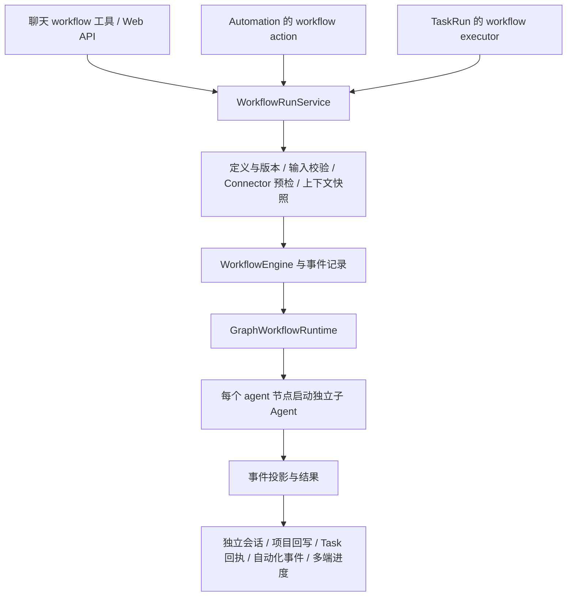

# Workflow 是否退出 xopc：研究与决策讨论稿

日期：2026-10-23。代码基准：`42a6465ff` 加本次调研时已有的工作区修改。

状态：移除方向已由用户确定；具体范围与验收以[实施计划](./workflow-removal-implementation-plan-2026-10-23.md)为准。移除已实施，实际结果见[验收记录](./workflow-removal-acceptance-2026-10-23.md)。本文下方的源码路径与统计描述删除前状态，不代表现行功能。未运行付费模型评测，未增加数据库迁移。源码中的知识图谱 MCP 工具在当前会话不可用，使用文件检索和源码阅读作为替代。

用户已明确的实施约束：彻底删除 Workflow 相关功能、数据、schema、配置、协议、文案及历史迁移中的专属逻辑。不设计数据迁移、旧版本兼容、历史数据适配、过渡执行引擎或替代名称下的相同实现。本约束替代此前讨论中的迁移与兼容选项；移除决定已实施，不保留迁移或兼容层。

## 1. 建议与结论的置信边界

**建议把移除独立 Workflow 产品与 DAG 执行子系统作为优先方向。** xopc 可以围绕主 Agent 循环、Task/TaskRun、Skills、工具和 Automation 收敛，按需要保留有边界的委派能力。

理由并非“多 Agent 已经过时”，而是当前 Workflow 的独有用户价值尚不足以证明其维护成本合理：16 个内置定义全部是同一个四 Agent 分析模板；Task 和 Automation 已有独立执行路径；本机默认数据库没有 Workflow 使用记录；相关实现同时跨越后端、Web、三端移动应用、协议和存储。

这不是已经证明“删除后质量一定更好”。当前没有同模型、同权限、同输入下的架构对照评测，也没有其他安装实例的使用数据。这些是效果判断的证据边界，不构成引入迁移或兼容层的理由；用户已明确不需要这些机制。

需要保留的是任务持久化、确认与权限、取消、预算、证据、结果交付等能力。它们有各自的运行语义，不能因为部分代码使用 Workflow 名字就连带删除。

## 2. 这些文章在讨论什么背景

### 2.1 从预定义路径到模型自己决定下一步

2024 年的 [Building effective agents](https://www.anthropic.com/research/building-effective-agents) 明确区分了两种架构：Workflow 由代码预先指定执行路径；Agent 根据观察结果动态选择步骤和工具。前者适合清楚、稳定的步骤，后者适合需要灵活调整的任务。共同原则始终是采用能解决问题的最简单实现。

因此，固定流程并非理论上没有价值。真正需要追问的是：**流程固定是业务约束，还是我们替模型预先安排的思考习惯？**

- “审核通过后才能支付”“对同一订单只执行一次扣款”属于系统应强制执行的业务不变量。
- “先规划，再让三名专家分析，再让另一名专家总结”通常只是推理组织方式，需要用实际收益证明其价值。

把后一类移入 Skills 很自然；把前一类只写进 Skill 会降低保障，应由工具与执行层校验。

### 2.2 多 Agent 研究系统解决的是搜索广度与上下文容量

[2025 年的 Research 系统](https://www.anthropic.com/research/multi-agent-research-system) 面对的是开放式研究：不同线索能独立探索，子 Agent 能消化大量材料，再交回紧凑结果。文中报告的优势来自特定研究任务与配置，并伴随显著 token 投入；不能推广成所有业务都需要多 Agent。

它与“普通邮件起草也固定启动四个 Agent”之间，没有直接的论证关系。多视角的名称并不自动意味着工作可以有效独立：若各分支需要大量相同事实和用户上下文，重复检索与交接可能占据主要成本。

[2026 年 1 月的多 Agent 指南](https://claude.com/resources/articles/building-multi-agent-systems-when-and-how-to-use-them) 把适用条件归纳为上下文保护、可并行工作和有实际收益的专门化。它并未要求取消所有子 Agent；它要求每个额外上下文窗口有具体用途。

### 2.3 商业 Agent 的主问题是连续会话中的共享状态

[2026 年 9 月的 commerce agents 文章](https://claude.com/resources/articles/the-anatomy-of-effective-commerce-agents) 讨论的是购物、客服、商家运营等紧密耦合的交互。用户偏好、订单、购物车和上一轮约束需要连续共享；按领域拆成 Agent 容易出现交接信息丢失。其建议是主循环加 Skills 与业务工具，独立研究等任务仍可委派。

这里的企业对比属于作者报告的部署经验，不是对 xopc 的实验，也不是所有模型、权限和任务分布下的通用性能保证。

### 2.4 10 月文章把变化总结为减少不必要的编排

[2026 年 10 月 22 日的主文](https://claude.com/resources/articles/building-agents-when-to-fold-subagents-into-your-main-agent-loop) 主张把紧密耦合的路由、规划和领域说明收回一个循环，按需披露知识与工具；保留能证明独立上下文价值的子 Agent。它同时要求预算、校验和写入边界留在执行层。

对 xopc 的启示是：用户目标和当前证据应决定下一步；不应仅因为某个能力被命名为“规划”“审查”就强制启动新的 Agent。**“单主循环”也允许多次工具调用、工具并行和按需委派，并不等于单次 LLM 调用。**

### 2.5 其他引用的具体作用和限制

| 引用 | 对架构讨论的作用 | 不能据此推出的结论 |
| --- | --- | --- |
| [迁移工具包](https://github.com/anthropics/single-agent-loop-kit) `[2]/[12]` | 先建立端到端基线，逐个合并或折叠，检查每个任务的变化；仓库声明是非持续维护的参考实现 | 安装工具包后可以自动决定删除全部功能 |
| [上下文工程](https://claude.dev/blog/the-new-rules-of-context-engineering-for-claude-5-generation-models/) `[6]` | 删除重复、冲突和过度约束的指令，使用按需加载；80% 是 Claude Code 特定模型与评测的结果 | xopc 应削减相同比例，或删除权限与恢复机制 |
| [Task budgets](https://platform.claude.com/docs/en/build-with-claude/task-budgets) `[7]` | 提供整个 Agent 回合的建议性 token 预算，帮助模型安排工作 | 代替宿主硬预算、费用结算和取消机制 |
| [Tool search](https://platform.claude.com/docs/en/agents-and-tools/tool-use/tool-search-tool) `[9]` | 工具定义按需发现，减少常驻上下文 | 必须为每组工具建立一个 Agent，或所有 provider 都支持同一服务端实现 |
| [Seeing like an agent](https://claude.dev/blog/seeing-like-an-agent/) `[10]` | 工具随模型能力变化，允许模型主动构建上下文；文章本身也保留文档检索子 Agent | 所有自动上下文注入和子 Agent 都应取消 |
| [Commands](https://code.claude.com/docs/en/commands) `[11]` | Claude Code 命令入口的使用参考 | 对 xopc 是否保留 Workflow 的独立实验证据 |

`[5]` 与 `[8]` 重复，`[2]` 与 `[12]` 重复。这些资料中有多个互相引用的来源，不能视为十次独立实验。

## 3. xopc 当前 Workflow 究竟实现了什么

### 3.1 运行路径



源码证据：

- [定义与节点类型](/Users/micjoyce/develop/github/xopc/src/workflows/domain/definition.ts)：只有 input、agent、decision、merge、output 五类节点；带图坐标、模型、工具集、输出 schema 等配置。
- [图运行器](/Users/micjoyce/develop/github/xopc/src/workflows/runtime/graph-workflow-runtime.ts:24)：内存中维护 pending/completed/outputs，按依赖运行，支持分支和并发。
- [子 Agent 适配器](/Users/micjoyce/develop/github/xopc/src/agent/workflow/subagent-runner.ts)：通过现有 `createDelegateChildHandle` 创建隔离执行上下文，默认限制本地写入、命令等能力。
- [运行服务](/Users/micjoyce/develop/github/xopc/src/workflows/service/workflow-run-service.ts)：连接 Agent 配置、Task、项目、Connector、上下文和存储。
- [会话桥接](/Users/micjoyce/develop/github/xopc/src/workflows/service/workflow-session-bridge.ts)：建立专用会话，写入终态展示内容、父会话链接，并触发项目记忆和 Task 完成处理。

这是一套完整产品子系统，不是移除一个 `workflow()` 函数即可完成的变化。

### 3.2 最值得质疑的是 16 个内置模板

[内置模板生成器](/Users/micjoyce/develop/github/xopc/src/agent/workflow/builtins/index.ts:165) 中的所有定义都调用同一个 `createParallelGraph`：

```text
input → 三个不同视角的 Agent → merge → 一个汇总 Agent → output
```

16 个名称是：`audit_repo`、`client_proposal`、`competitor_scan`、`content_draft`、`content_repurpose`、`debug_incident`、`decision_compare`、`implementation_plan`、`inbox_triage`、`meeting_prep`、`multi_perspective_review`、`offer_design`、`pr_review`、`release_check`、`research`、`weekly_review`。

每个模板都是四个子 Agent，节点的 `maxIterations` 都为 12。这里的四个是 Agent 循环数量，不是固定四次模型调用，也不能直接换算成四倍费用。

这带来三个问题：

1. 简单任务也固定支付三个分析分支和一次汇总的启动与上下文成本。
2. “多视角”通过 prompt 标签实现，未必对应独立数据、权限或知识边界。
3. 主会话的连续历史没有因为存在 Workflow 就自动传入全部节点；节点主要依赖目标、输入、选定上下文和模板指定的前驱输出。遗漏的信息需要显式补入。

`research` 和 `audit_repo` 的某些任务可能从并行探索获益；这最多支持按需委派，不足以支持把所有 16 类任务固化成独立 Workflow 产品。

### 3.3 它有价值，但这些价值并非都需要 Workflow 身份

| 现有能力 | 实际价值 | 退出 Workflow 后的归属建议 |
| --- | --- | --- |
| 可复用领域方法 | 保留用户偏好、检查清单和做事方式 | 经筛选的 Skills / 参考文件 |
| 独立研究和审查 | 隔离噪声、独立证据、并行探索 | 现有 `delegate_task`，按必要性调用 |
| 后台执行及运行记录 | 请求结束后仍可跟踪、取消、交付 | Task/TaskRun 与已有运行基础设施 |
| 定时、Webhook、事件触发 | 决定什么时候执行 | Automation |
| 项目和笔记上下文 | 约束范围与引用材料 | 项目/Task 上下文与按需检索工具 |
| 连接与权限检查 | 判断能否访问或写入 | Connector、工具策略和 Agent 执行层 |
| 结果、证据、项目更新 | 解释做了什么、是否达成目标 | Task 回执与项目更新 |
| 图编辑、图节点进度 | 用户直接指定并检查执行拓扑 | 唯一明显需要放弃的产品体验；需确认是否仍有明确用户需求 |

这些归属用于判断其他存活能力的职责，不是把 Workflow 自动转换成其他对象的要求。删除时验证上下文、连接身份、交付目的地、结果验证和取消传播的现有通用路径；不为旧 Workflow 定义增加转换或适配代码。

### 3.4 它目前也不是完整的持久化流程引擎

[重启协调代码](/Users/micjoyce/develop/github/xopc/src/workflows/service/workflow-run-service.ts:604) 会将被网关重启中断的运行标记为失败，而非从最后成功节点自动恢复。图节点状态与中间结果的实际执行状态保存在运行器内存中；持久化事件便于查询、投影和诊断，并不自动提供外部副作用的 exactly-once 保证。

当前节点类型也没有显式人工等待节点。不能为了保留尚未实现的审批、长事务和可靠恢复能力，就把现有图引擎认定为不可替代。

`tokenBudget` 从服务传到引擎和运行选项，但图运行器没有读取它。它不能被当作这套图执行器已落实全局 token 硬预算的证据；通用子 Agent/模型调用层可能仍有各自限制。

## 4. 可替代的基础已经存在

### 4.1 Task 并不依赖 Workflow 才能运行 Agent

[TaskRunDispatcher](/Users/micjoyce/develop/github/xopc/src/tasks/task-run-dispatcher.ts:15) 直接领取 `executorKind: 'agent'` 的任务，包含租约、心跳、会话准备、Agent 执行、中断判断和失败回执。独立的 [Task 上下文组装](/Users/micjoyce/develop/github/xopc/src/tasks/task-context-assembler.ts) 已提供目标、验收条件、约束和运行结果等信息。

Workflow 则在 [自己的 dispatchTaskRuns](/Users/micjoyce/develop/github/xopc/src/workflows/service/workflow-run-service.ts:83) 中领取 `executorKind: 'workflow'`。这是两种执行后端，而非 Task 只能通过 Workflow 实现。

### 4.2 Automation 已有直接 Agent action

[AutomationActionExecutor](/Users/micjoyce/develop/github/xopc/src/automations/service/action-executor.ts:126) 分别注册 agent、workflow、browser_automation、task_command 和 system。移除 workflow action 并不需要移除调度、事件触发或普通 Agent 自动化。

但直接 agent 和 workflow 当前采用不同的重试安全策略。删除 workflow action 及其专属数据，不把原有动作改写成 Agent 或保留重试适配；存活的 Agent 自动化继续遵循自身策略。

### 4.3 按需工具发现与委派已有实现

[Tool search 扩展](/Users/micjoyce/develop/github/xopc/src/agent/embedded/tool-search-extension.ts:9) 已通过 pi 实现 deferred 工具发现；[delegate_task](/Users/micjoyce/develop/github/xopc/src/agent/tools/delegate-tool.ts:76) 支持独立上下文、能力收窄、研究 checkpoint、预算等级及隔离工作区实现。

因此，无须为了保留这些能力而继续保留可视化 DAG 产品。另一方面，`delegate_task` 当前声明 `supportsParallel: false`，不能在尚未验证的情况下承诺它已等价替代图运行器的并行分支吞吐。是否需要补足并发，应由研究任务的评测结果决定。

## 5. 维护面与本机使用情况

### 5.1 维护面的量级

对 Git 已跟踪的文本文件做大小写不敏感的 `workflow` 词法扫描，共命中 610 个文件：src 243、web 149、apps 45、docs 92、packages 15，其余分布在扩展、评测、脚本和根文档等位置。

**610 是检索候选集，不是待删除文件数。** 它包含 GitHub Actions workflow、OAuth flow、普通文档中的工作步骤等无关用法。不能把“关键字零命中”设为全仓验收条件。

四个主要目录的统计包含测试、空行和注释：

| 目录 | 文件数 | 行数 |
| --- | ---: | ---: |
| `src/workflows` | 45 | 6,840 |
| `src/agent/workflow` | 21 | 2,929 |
| `web/src/features/workflows` | 52 | 8,953 |
| `web/src/features/chat/workflow` | 14 | 2,916 |
| 合计 | 132 | 21,638 |

[Workflow API](/Users/micjoyce/develop/github/xopc/src/gateway/hono/routes/workflows.ts) 另有 27 个直接注册的 HTTP handler，覆盖定义、草稿、修订、运行、取消、产物、重试与 replay。上述数字不包含全部外部集成代码，也不是承诺可删掉相同行数。

### 5.2 默认数据库的只读盘点

读取 `/Users/micjoyce/.xopc/xopc.db`，通过 SQLite URI `mode=ro` 和 `PRAGMA query_only=ON` 获取聚合统计。未读取用户会话正文、凭据或工作流输入内容。版本从项目的 `schema_meta` 读取，为 259；项目不使用 `PRAGMA user_version` 作为实际版本来源。

| 对象 | 本机数量 |
| --- | ---: |
| workflow_runs / workflow_events | 0 / 0 |
| workflow_context_snapshots / project_workflow_presets | 0 / 0 |
| durable_state 内名称含 workflow 的 namespace 记录 | 0 |
| workflow-run / workflow-subagent 会话 | 0 |
| workflow action 的 Automation，以及引用 workflow 的 trigger | 0 / 0 |
| 历史 AutomationRun 中的 workflow 引用 | 0 |
| 有非空 workflow default/allowed 策略的 Agent / 全局默认 | 0 / 0 |
| TaskRun | 11，全部 agent 执行器，其中 5 succeeded、6 failed |

本进程没有设置 `XOPC_STATE_DIR`、`XOPC_CONFIG` 或 `XOPC_CONFIG_PATH`。这仍不能证明其他网关进程、远程环境和用户安装实例都使用该数据库，也不能证明历史功能从未被使用。

## 6. 如果决定移除，范围应该如何界定

本节是后续实施计划需要覆盖的边界，不是已批准的删除清单或执行顺序。

### 6.1 退出范围

- Workflow 定义、模板、草稿、修订、registry、图校验、引擎、事件投影、运行服务、上下文快照和专用回写。
- `workflow`、`workflow_manage`、`/workflow`、TUI 专用命令，以及工具发现元数据、手册、提示词中对这些产品入口的说明。
- Gateway 路由、lazy-bundle 注册、运行服务创建、重启协调、专用事件与监听。
- Task 的 workflow 执行器分支，Automation 的 workflow action 与 workflow.run.completed 事件依赖。
- Web 工作流页面、图编辑、项目运行入口、聊天卡片、导航、推荐、翻译与相关测试。
- Android、iOS、HarmonyOS 的运行列表、详情、网络接口、模型、导航与消息跳转；渠道扩展中的 Workflow 进度输出。
- gateway-contract 中的 workflow 资源类型、会话身份、Home attention、Task 和 Automation 契约分支；实时事件及调用端同步检查。
- 专属 Skill `skills/engineering/workflow-authoring`、帮助文档、产品说明、演示、脚本与评测样例中的功能宣传和调用。

### 6.2 先清理被 Workflow 名称覆盖的通用语义

[Gateway 普通 Task 执行](/Users/micjoyce/develop/github/xopc/src/gateway/service.ts:847) 的会话输入也标记为 `origin: { type: 'system', source: 'workflow' }`。这并不等于运行了 DAG。移除时必须把这类来源语义改到合适的 Task/系统执行身份，并同步 active execution、输入队列和授权判断。

不要删除主 Agent、通用 child-agent-factory、delegate_task、通用进度与预算、研究 checkpoint、Task 依赖、Automation、Connector、Activity、Session、项目上下文和记忆系统。需要按引用拆出仍被使用的部分，不能仅按目录名称删除。

`src/computer/flows.ts` 是有验证条件的电脑操作导航提示，`src/browser/recordings` 是浏览器录制能力；它们与这里的 DAG Workflow 属于不同子系统。本轮判断不包含删除它们。OAuth、GitHub Actions 和普通代码控制流也不在范围内。

### 6.3 数据库不止四张表

[schema.sql](/Users/micjoyce/develop/github/xopc/src/storage/sqlite/schema.sql) 可确认的专用表是：`workflow_runs`、`workflow_events`、`workflow_context_snapshots`、`project_workflow_presets`，以及对应索引。

还需要覆盖：

- `durable_state` 中 `workflow-definitions`、`workflow-revisions`、`workflow-drafts` namespace。只处理专属 namespace，保留通用表。
- `sessions` 的四个 `workflow_*` 字段、专用类型、来源、标签和 custom data；`automation_runs.workflow_run_id`。
- `task_runs.executor_kind` 的 CHECK、`home_attention_acknowledgements.subject_kind` 的 CHECK，以及 action/contract/profile 等 JSON 内的引用。
- Agent 配置现在还保存在 `agents.overrides_json` 与 `agent_catalog_settings.defaults_json`。只清理 xopc.json 会遗漏权威配置。
- Activity、对象关联、项目更新、记忆证据、历史 transcript 与结果链接中的 Workflow 身份；需要进一步做语义依赖清单，不能通配替换普通文本。
- `~/.xopc/agents/<id>/workflows/runs/<runId>/artifacts` 等专属文件路径，以及旧客户端书签和深链接。

按用户要求，Workflow 专属历史数据、产物及引用也在清除范围，不转换为普通任务、会话或其他历史结果，不保留用于继续解释旧数据的适配器。删除范围按对象归属与引用关系确定；普通用户文本中的通用词语、无关模块和无关用户数据不因词法命中被删除。

### 6.4 清除 schema 与历史迁移中的专属逻辑

当前是 [v217 基线加顺序迁移到 v259](/Users/micjoyce/develop/github/xopc/src/storage/sqlite/migrations/runner.ts:20)。`220_normalize_timestamps.sql` 等历史迁移仍创建 Workflow 列。因此，仅删除当前 schema 字段是不完整的，还要清除历史 SQL、迁移测试和相关初始化路径中的 Workflow 专属逻辑，确保初始化过程不会重新创建它。

已确定的约束：

1. 不新增 Workflow 数据迁移、导出转换或旧 schema 兼容逻辑。
2. 不以支持历史安装为由保留 Workflow 专属表、字段、枚举、namespace 或迁移分支。
3. 混合迁移文件只移除 Workflow 专属部分，保留其他模块所需逻辑；完全专属文件及其注册、测试一并处理。
4. 现有开发数据库的 Workflow 结构与数据属于实施时一次性清除的对象，清理动作不作为长期运行时适配机制留在系统中。
5. 验收覆盖干净初始化、通用存储完整性和其他模块正常运行；旧 Workflow 数据可读、旧客户端兼容及旧 Workflow 升级不属于验收目标。

具体如何整理基线与初始化链，在实施计划中以不残留 Workflow 专属逻辑为准，不再设计兼容路径。通用数据库版本管理不因本次清除而一并删除。

## 7. 本轮应该讨论的决定，以及之后才做的计划

### 7.1 三个选项

| 选项 | 收益 | 代价 | 判断 |
| --- | --- | --- | --- |
| 维持现状，仅优化模板 | 保留全部图编辑能力 | 继续维护重复执行路径和多端功能 | 当前证据下不优先 |
| 停止展示，后台继续保留引擎 | 短期界面收敛较快 | 状态、schema、工具、协议债务仍在 | 用户已排除 |
| 彻底清除 Workflow 产品、执行后端与专属数据 | 统一执行、降低认知和维护成本 | 放弃图编排体验及旧 Workflow 数据兼容 | **推荐目标；按无迁移、无兼容约束制定计划** |

推荐的用户模型是：Chat 接收请求，Task 表达需要持续跟进的目标，TaskRun 记录执行，Automation 负责触发，Skills 提供方法，工具负责操作与校验。主 Agent 根据任务决定是否调用有边界的委派工具。

不要把原来的图节点直接改名为 Task 节点后再重造一套强制 DAG，也不必给所有普通聊天请求额外建立 Task。保留用户确实需要的持续任务和后台结果语义即可。

### 7.2 先决定“是否移除”的三个判断条件

1. **产品定位**：xopc 是否要对用户提供可编辑的流程拓扑与固定节点执行契约？如果答案是明确需要，图产品本身就有独立价值，不能仅凭模型更强而删除。如果没有这种明确需求，当前实现更像个人 Agent 产品中的额外编排平台。
2. **清除范围**：盘点当前实施环境中专属数据、对象和引用，确保删除完整。其他环境的使用情况可作为产品价值证据，不据此增加旧数据迁移或兼容要求。
3. **完成质量**：代表性任务在主循环中是否能完成，失败是否可解释、可恢复？保留最小的端到端验证，避免把原来的固定图删掉后，才发现资料、权限或交付目标没有被接上。

### 7.3 方向确认后再展开的实施计划

后续计划应包含四个有退出条件的工作包，具体文件和 PR 切分在方向确认后制定：

1. **清除清单**：列出功能代码、配置、数据结构、专属数据、协议消费者、文案及历史迁移残留，标明与通用能力的边界。
2. **任务能力验证**：选择有代表性的案例，覆盖普通写作、会议准备、项目审查、深度研究、长上下文约束、定时触发、取消、中断、连接失效和结果交付，验证存活的主循环与 Task/Automation 路径。不自动转换旧定义，不批量生成替代 Skills。
3. **彻底删除**：删除产品入口、执行后端、专属工具、契约、多端分支和所有 Workflow 适配逻辑；通用执行语义直接纠正到所属模块，不保留隐藏引擎或改名复制品。
4. **数据清除与验收**：清除专属存储结构、记录、文件与引用；清理初始化及历史迁移中的专属逻辑；检查存储完整性、外键、真实 Gateway、Web、移动端和渠道结果。最终系统不具备 Workflow 功能，也不保留其迁移、兼容或历史数据解释逻辑。

评测重点应是任务是否达成、事实和证据是否充分、用户约束是否保留、外部副作用是否可确认，以及延迟、模型请求数、token、费用。**不应要求“主循环每次绝不委派”，也不能把“回答写得更长”当作质量更好。** xopc 支持不同 provider，验证必须覆盖实际目标模型，不能只依赖 Claude 的文章结论。

用户已确定移除。本文保留调研依据；后续执行以实施计划为准，不再把是否保留可视化 Workflow 设为待决事项，也不要求额外付费架构对照评测才能开始。本轮不执行删除。
