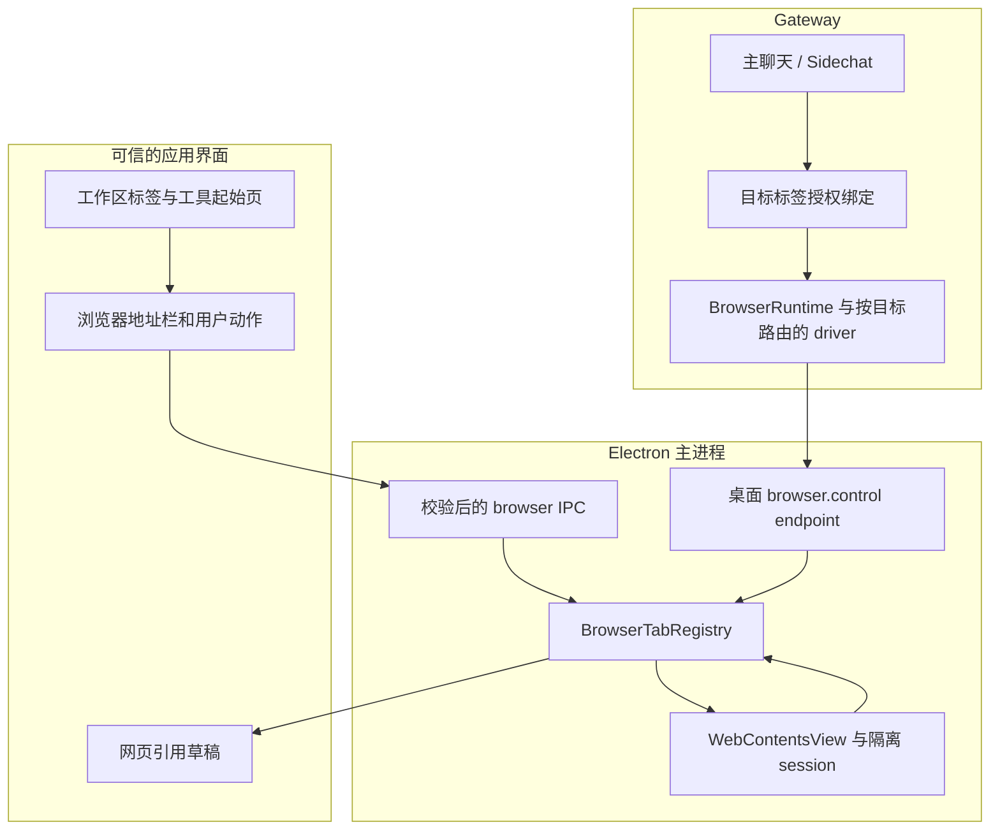

# 统一工具工作区与内置浏览器设计

后续安装包验收：见 [Electron 打包后验收记录](./electron-packaged-acceptance-2026-10-18.md)，最终 DMG 的 84 项原生检查全部通过。

最终验收（2026-10-18）：70 项 Electron 原生检查全部通过，详见 [完整验证记录](./electron-workspace-e2e-2026-10-18.md)。

最新顶栏交互以 [三入口设计](./workspace-header-three-actions.md) 为准。

实施更新（2026-10-18）：B1 核心用户浏览已接入，原生 Electron 验收结果与边界见 [内置浏览器实现与 E2E](./embedded-browser-implementation-and-e2e.md)。B2 网页引用和 Agent 接管仍属后续阶段。

状态：整体方案与后续浏览器实施设计。日期：2026-10-18。

本方案补充并修订 [右侧文件与 Sidechat 工作区计划](./right-workspace-tabs-design-and-plan.md)。左侧主聊天、右侧工作区、混合标签和 Sidechat 生命周期继续成立。根据用户新增的 Codex 截图，将「＋」从动作菜单升级为工具起始页，浏览器纳入后续统一工具体系。浏览器引擎和 Agent 接管尚待实施，不能因存在浏览器自动化工具就宣称已支持内嵌网页。

## 1. 统一产品结构

工作区是一套容器，文件预览、文件浏览、Sidechat、浏览器以及后续终端/变更视图是不同类型的标签内容。上方的标签栏负责切换和管理，下面的工具栏随类型变化；只有浏览器有地址栏，只有文件有路径面包屑。

```text
┌────────┬───────────────────┬────────────────────────────────────────┐
│ 导航栏 │ 主聊天            │ 报告.md × │ 侧聊 × │ 网页 × │ ＋  ⋯ 列表 放大 数量│
│        │                   ├────────────────────────────────────────┤
│        │ 消息              │ 当前标签的工具栏                       │
│        │                   ├────────────────────────────────────────┤
│        │                   │ 当前工具内容                           │
│        │                   │ 文件预览时可在最右侧展开项目文件树     │
│        ├───────────────────┤                                        │
│        │ 主聊天输入框      │                                        │
└────────┴───────────────────┴────────────────────────────────────────┘
```

### 顶部控件的统一语义

| 控件 | 行为 |
| --- | --- |
| 内容标签 | 单行排列，活动标签使用轻边框和较亮表面；标签 X 只关闭该内容 |
| ＋ | 插入并激活一个“新标签页”，显示工具起始页，不直接新建侧聊 |
| ⋯ | 工作区操作：打开文件、新建侧聊、恢复宽度、收起；后续按能力增加浏览器入口 |
| 标签列表 | 按当前顺序展示所有标签，完整标题与运行/待处理状态；溢出时仍能访问 |
| 放大/还原 | 扩大整个右侧工作区，不关闭左侧主聊天或后台任务；还原恢复原分栏 |
| 数量/收起 | 显示当前主会话的标签数量，按钮提示“收起工作区”；不使用 X 冒充收起 |

文件树为可选辅助区域，不是每个文件 Tab 内重复挂载的控件。“文件”工具标签可以全宽浏览文件树；单击文件时创建/激活文件预览 Tab。工具起始页、文件浏览页和文件内容页都可以作为标签存在。

这修订了原计划“不设置文件浏览 Tab”的首期取舍：用户现在明确给出工具起始页参考，保留文件工具页能避免在切换工具时失去入口；关闭全部标签仍回到紧凑文件树首页。

## 2. 工具起始页

点击＋立即产生一个可关闭的新标签，内容采用截图中的低密度卡片布局。

| 区域 | 内容与规则 |
| --- | --- |
| 浏览入口 | 桌面浏览器能力就绪后展示“搜索或输入网址”；输入不会即时上传，Enter 才执行 |
| 工具 | 文件、Sidechat；终端、变更、笔记仅在当前运行环境真正支持时出现 |
| 继续查看 | 当前主会话已打开的文件、侧聊和网页，使用真实标题/图标；不生成虚假推荐 |
| 最近访问/固定站点 | 浏览器阶段再提供，范围和清除入口明确；不默认读取系统浏览器历史 |

首期文件与侧聊实现中，只提供已支持工具，不展示不能执行的“浏览器”“Changes”或“New page”卡片。现有 Electron 终端入口若暂时仍打开主聊天的底部 Dock，需要明确目标，不能伪装成已经实现的终端内容 Tab。

用户在起始页选择工具后：

- 文件：当前新标签原位变为文件浏览标签；已有该范围的文件浏览标签时直接激活已有标签。
- Sidechat：创建成功后原位替换新标签；失败保留起始页和重试提示。请求期间用户已切到其他标签时，新侧聊加入原工作区但不抢焦点。
- 浏览器：提交地址后原位变为网页 Tab，加载与失败都留在该 Tab 内。
- 开始一个工具不会清空主聊天、其他侧聊或任何未发送草稿。

## 3. 浏览器标签的交互

### 3.1 地址栏和导航

```text
┌───────────────────────────────────────────────────────────────┐
│ 网页标题 × │ 文件 × │ 侧聊 × │ ＋          ⋯ 列表 放大 标签数  │
├───────────────────────────────────────────────────────────────┤
│ 后退 前进 │ 刷新/停止 │ 搜索或输入网址 │ 引用网页 │ 控制状态 ⋯  │
├───────────────────────────────────────────────────────────────┤
│                                                               │
│                     内置网页内容                              │
│                                                               │
└───────────────────────────────────────────────────────────────┘
```

- 地址栏由用户编辑的文本与已提交 URL 分开，导航失败不丢输入；失焦时显示当前实际地址。
- 明确 URL、域名、IP、localhost 按地址导航；普通文本使用用户选定的搜索引擎。未选定引擎时提供选择，不悄悄把输入送往某个供应商；首期不做远程联想。
- 非 http(s) 地址只交给明确的应用协议/文件打开流程，不把 `file:`、`javascript:`、`data:` 当普通站点加载。
- 后退/前进操作网页自己的历史；工作区标签切换和聊天路由历史独立。地址栏修改不导致整个 React 页面跳转。
- 刷新在加载中变为停止；成功标题/favicon 更新当前标签，失败用错误页提供重试、修改地址和系统浏览器打开。
- 网页请求打开新窗口时，由受控策略转为同一工作区的新浏览器标签。弹窗和 OAuth 需专项验证，不能为支持它们放开任意新窗口创建。
- 从主聊天点击普通外链，首期保留原外部打开习惯，增加“在工作区打开”动作；用户明确选择默认内置后再改变默认行为。Cmd/Ctrl+点击和外部打开入口继续可达。
- 普通链接导航保留完整 URL 语义，不为了去重丢失 query/hash。相同 URL 可以有多个浏览器标签；这是网页的独立历史/表单状态，不能套用文件的强去重策略。

### 3.2 网页、文件与 Sidechat 联动

| 用户动作 | 结果 |
| --- | --- |
| “引用网页到主聊天” | 捕获标题、URL、必要正文/选区和时间，形成可预览的冻结引用，仅加入草稿 |
| “引用网页到来源侧聊” | 显式添加到该侧聊草稿，不发送到当前碰巧聚焦的其他输入框 |
| 在侧聊里打开网页 | 创建网页 Tab 并记录来源侧聊；关闭网页后优先回到来源 |
| 打开项目 HTML | 继续默认使用现有 sandbox 文件预览；需真实应用环境时使用明确的本地站点地址打开浏览器 |
| 网页下载文件 | 原生下载流程展示目标、进度和失败；完成后可打开文件 Tab/显示所在目录 |
| 上传文件 | 用户使用原生选择器；Agent 上传走已有文件根与动作策略，不因网页可见就获得任意文件访问 |

网页读取与引用复用现有 `BrowserPageContextInput`、source context 和草稿预览能力。必须验证 Sidechat 输入协议是否接收相同 envelope；若尚不支持，首期用明确的有界文本引用适配，不能静默丢掉来源元数据或自动带入全部页面。

### 3.3 用户浏览、引用与 Agent 控制分离

1. **用户浏览**：手动打开和使用网页，不自动把 DOM、截图、Cookie 或表单内容传给 Agent。
2. **引用网页**：用户明确捕获一个有界快照，先显示草稿预览；页面随后变化不会改写已冻结引用。
3. **Agent 操作此标签**：明确授权目标标签及模式，绑定到主会话或指定 Sidechat；显示可见的控制状态及“停止接管”。

权限按 browserTabId + endpointId + documentId/origin + conversationId 绑定。标签导航、跨站、过期、关闭及主会话变化需要重新验证；不得使用“当前活动标签”代替授权标签。

同一网页一次只允许一个 Agent/Sidechat 持有写操作租约。用户接管暂停新的自动化写入；已在执行的动作支持取消，后续观察使用新 revision，不重放旧页面元素引用。页面引用授权不等于写操作授权。

关闭运行中的网页标签时，明确会取消其关联自动化；普通网页关闭还需处理站点 beforeunload。收起工作区只隐藏网页，不取消 Agent 的已授权任务；非活动网页的自动化与媒体策略另见第 7 节。

## 4. 仓库能力核对

| 当前能力 | 代码位置 | 对内置浏览器的意义 |
| --- | --- | --- |
| Electron 主窗外链处理 | `electron/main.ts` 的 `attachExternalUrlHandlers` | 当前外链交给系统浏览器，没有内置网页内容区 |
| 桌面可信 renderer IPC | `electron/preload.ts`、`electron/ipc/trusted-renderer.ts` | 可增加受控 browser IPC，不能把现有完整 preload 暴露给站点 |
| 自动化统一执行策略 | `src/browser/runtime/browser-runtime.ts` | 可复用 URL、风险和会话规则，仍需连接到实际内嵌标签 |
| 浏览器驱动 | `src/browser/drivers/create-driver.ts`、`browser-driver.ts` | 现有 extension、Playwright/CDP、remote 路线；尚无 Electron 内嵌标签路线 |
| 认证的浏览器控制传输 | `packages/browser-control-contract` | 有 `browser.control` endpoint 合约，可扩展桌面承载，不必暴露公网 CDP |
| 标签绑定 | `src/storage/sqlite/browser-tab-binding-repository.ts` | 已有 endpoint/tab/window/document/origin 和 conversation 绑定；需验证桌面接入与 Sidechat 归属 |
| 网页引用 | `src/agent/source-context/browser-page.ts`、`web/src/features/chat/context/` | 可复用快照和草稿预览，避免重造模型上下文协议 |
| 现有本地 HTML 预览 | `web/src/features/preview-runtime/html-preview-frame.tsx` | 继续服务文件预览，不升级成任意网站浏览器 |

关键差距：`BrowserRuntime` 当前缓存一个 driver，驱动接口 kind 仅有 playwright/extension。桌面内嵌标签与外部扩展同时存在时，必须支持按目标/会话选择后端，不能全局切换配置而影响正在运行的其他浏览器任务。

## 5. 技术选型

推荐桌面端使用 Electron `WebContentsView`。它由 main process 创建，通过 `contentView` 和 `setBounds` 放到右侧工作区网页内容矩形内。[Electron 官方 API](https://www.electronjs.org/docs/latest/api/web-contents-view)

| 路线 | 适用性 | 决策 |
| --- | --- | --- |
| React iframe 加载任意网站 | 受站点 CSP/frame 限制，登录、弹窗与原生能力难统一 | 不作为通用内置浏览器 |
| Electron `<webview>` | 可嵌入，但官方对其架构稳定性有明确提醒 | 不作为新实现默认路线，优先 WebContentsView |
| Electron WebContentsView | 原生 Chromium 网页视图，宿主管理生命周期和权限 | 桌面首选 |
| 系统浏览器 + 既有扩展 | 用户继续使用现有登录环境，可提供绑定/引用和受控自动化 | Web 端及桌面回退路线 |
| 远端浏览器画面流 | 能跨端显示完整浏览器，但增加流媒体、输入、登录与部署复杂度 | 后续独立阶段，不纳入首期 |

`<webview>` 的官方建议见 [Electron 文档](https://www.electronjs.org/docs/latest/api/webview-tag)。此选型是针对 xopc 当前 Electron 架构的判断，不推断 Codex 使用了哪种内部技术。

## 6. 分层架构



### 6.1 UI 层

工作区标签联合类型逐步扩展为：home、files、file、sidechat、browser；terminal、changes、note 在真实能力接入后再增加。

browser 标签壳层保存 workspaceTabId、browserTabId、标题、图标状态、所属主会话和返回来源。URL/导航能力/加载错误由浏览器领域 controller 维护；Cookie、DOM、原生 webContents 对象不放进 Zustand 或 sessionStorage。

新增 browser controller 负责 IPC 命令与事件、地址编辑、引用、权限/接管状态。文件树在浏览器标签下默认隐藏，用户可展开辅助树以打开/上传文件；不能让树切换悄悄改变浏览器导航。

### 6.2 Electron main 层

建议新增 `electron/browser/`，集中管理：

- `BrowserTabRegistry`：opaque tabId → view/webContents、窗口、所属范围、partition、生命周期、操作租约。
- `browser-ipc`：create、navigate、back、forward、reload/stop、setBounds、setVisible、close、captureContext；所有调用验证可信宿主 sender 和 tab 所属窗口。
- 导航状态事件：标题、favicon、URL、canGoBack/Forward、loading、loadError、crash、download、权限请求、关闭请求结果；带 tabId、navigation generation，丢弃过期事件。
- 网站权限、下载、新窗口、外部协议和原生关闭流程。
- 浏览器 endpoint：只接受已认证、已授权且明确绑定的目标动作，不开放任意 JS/任意 IPC。

网页视图不加载应用完整 preload。使用 `nodeIntegration: false`、`contextIsolation: true`、sandbox，保留 webSecurity；站点权限按实际 origin 处理。远程内容与宿主 API 的隔离及 IPC sender 校验遵循 [Electron 官方安全指引](https://www.electronjs.org/docs/latest/tutorial/security)。

### 6.3 布局同步与原生层叠

WebContentsView 不是 React DOM。不能假设 CSS z-index、圆角、overflow 或 portal 会自动作用于原生网页视图。

- React 用 ResizeObserver/布局调度上报可信内容矩形；main 校验、裁剪到窗口内容 bounds，并在布局变化时更新 view bounds。
- 工具栏和标签栏始终位于原生网页矩形之外；边界包含标题栏、窗口缩放和系统 DPI 的验证。
- 非活动标签或工作区隐藏时隐藏/移除 view 的展示关系，保留其 webContents；关闭时才明确销毁资源。
- 原生网页矩形之上的 DOM 对话框、下拉或临时文件树，需要 host 层 overlay 协调：展示覆盖层期间隐藏 guest，用快照/占位托底，关闭覆盖层后恢复。不能通过不断增加 z-index 修复。
- 窗口最小化、全屏、拖分隔线、路由切换、文件放大、Sidechat 审批弹窗都必须触发同步；页面自身绘制迟缓时不得盖住宿主确认或停止接管入口。

### 6.4 Agent 控制接入

优先复用现有认证 endpoint transport 和 BrowserRuntime 策略，新增桌面 browser provider/driver 适配；先做可行性验证再确定具体复用 ExtensionDriver 的程度，不能伪装成 Chrome 扩展绕过端点身份校验。

1. 将 BrowserRuntime 的单 driver 缓存改为按目标后端的 session 路由，保持现有 extension/CDP/remote 行为兼容。
2. 桌面 endpoint 校验 principal、endpoint、browserTabId、documentId/origin、conversation/Sidechat 和租约。
3. Electron 的观察与操作实现需匹配现有 observation/ref/revision 合约；重新导航使旧 ref 失效，返回可恢复的 stale observation 错误。
4. 不因内嵌浏览器上线就打开全局 remote-debugging-port；首期通过宿主内部观察/调试接口和认证 endpoint 提供能力，所需 API 在目标 Electron 版本上验证。
5. 现有全局 `browser.enabled`、URL 策略、上传根、动作风险与审批继续生效；“停止接管”撤销租约和取消后续动作，不删除用户登录环境。

## 7. 生命周期、登录与权限

| 对象/操作 | 规则 |
| --- | --- |
| browserTabId | main 生成且不复用，关联窗口与主会话；React 标签 id 与实际网页实例 id 分开 |
| 登录 profile | 专用的持久 partition，与应用宿主/Gateway 隔离；可在同一用户明确选定 profile 内复用登录，不复用 Chrome 默认 profile |
| 主会话/Sidechat | Tab 归属不等于控制授权；从侧聊打开或引用网页不自动共享登录凭证/操作权限 |
| 切换内容标签 | 保留网页历史、表单和进程；隐藏展示，不盲目销毁 |
| 切换主会话或收起工作区 | 隐藏对应视图；已授权自动化按任务策略继续，可在入口看到运行/待处理提示 |
| 后台媒体 | 默认阻止意外后台音频；对已播放内容提供明确静音/暂停控制，不能宣称 mute 等于暂停所有站点活动 |
| 资源回收 | 无运行/未提交保护的后台页面可进入可恢复挂起，显示“重新加载”；Agent 运行或表单保护页不被静默销毁 |
| 应用重启 | 可恢复非敏感标题及经策略筛选的 URL，但不是恢复完整导航历史、POST/表单和正在运行的动作 |
| 敏感 URL | 登录回调、凭证 query、一次性链接不写入最近访问/持久标签状态；日志进行脱敏 |
| 清除浏览数据 | 明确作用的浏览 profile；清除站点登录不会顺带重置主应用身份或其他网关 |
| 网关切换/退出 | 清理授权绑定与可见上下文；浏览 profile 不自动继承给不同应用用户 |

人工输入的 localhost 开发站点需要正常工作；Agent 访问仍服从现有私网策略。相关来源校验分别实施，不为方便本地预览全局放宽 Agent URL 限制；重定向和新窗口也校验。

证书错误、摄像头/麦克风/地理位置、下载目标、外部协议等使用明确的原生/宿主交互，不静默绕过或自动授予。网站不获取 Gateway token、应用 IPC、任意文件路径和本机工具能力。

## 8. 桌面与 Web 能力矩阵

| 能力 | Electron 桌面 | 普通 Web |
| --- | --- | --- |
| 文件/Sidechat 混合标签 | 支持 | 支持 |
| 工具起始页 | 支持 | 支持，按环境展示入口 |
| 任意网站内嵌浏览 | WebContentsView 阶段实现 | 不承诺；系统浏览器/扩展衔接 |
| 用户浏览与登录 | 专用 Chromium profile | 用户系统浏览器的既有环境 |
| 网页引用到聊天 | 显式快照 | 既有扩展捕获或手动提供链接 |
| Agent 操作指定标签 | 桌面 endpoint + 显式绑定阶段实现 | 既有扩展/CDP/remote 路线 |
| 真实远程浏览画面 | 后续可选 | 后续独立方案 |

普通 Web 上若提供输入网址入口，应明确“在浏览器打开”；不能展示假地址栏或用被站点拒绝的 iframe 当作完整浏览器。链接应保留浏览器原生语义和打开选项。

## 9. 分阶段实施与验收

### U0：统一工作区基础，当前实施范围

- 完成文件与 Sidechat 的混合标签和旧能力回归。
- ＋进入工具起始页，文件工具标签、轻量标签栏、完整标签列表、工作区放大/还原。
- 文件树与内容分离，保存/关闭保护，后台侧聊状态和明确引用目标。
- 不展示尚无真实实现的浏览器/终端内容标签。

### B0：桌面原型与能力验证

- 用本地测试站点验证 WebContentsView 的创建、导航、登录 partition、主窗 bounds 与销毁。
- 重点验证 overlay、DPI、分栏拖动、最小化/恢复、native beforeunload、OAuth、新窗口、下载和崩溃恢复。
- 验证现有浏览器 observation/ref 契约能否由 Electron 内部接口稳定实现；输出适配差距清单。
- 阶段门槛：网页不能覆盖宿主确认 UI，关闭可释放进程/监听，页面无法调用应用 preload API。

### B1：用户可用的内置浏览器

- 接入 browser 类型标签、地址栏、前进后退、刷新/停止、加载/错误、外部打开。
- 支持工具起始页地址输入和显式“在工作区打开”链接动作。
- 完成 profile、权限、下载、站点弹窗、关闭保护和恢复策略。
- 阶段门槛：桌面真实网站与本地开发站点可用；Web 环境准确降级；文件、侧聊和主聊天能力无回归。

### B2：网页引用与指定 Tab 的 Agent 操作

- 复用网页快照协议、草稿预览；主聊天/来源侧聊目标明确，不自动发送。
- 接通桌面 browser.control endpoint、目标后端路由、绑定授权、读写租约、接管/停止和审批。
- 阶段门槛：Agent 只操作授权目标；用户切 Tab 不改变目标；跨站、重导航、撤销和重连使失效授权/ref 无法继续使用。

### B3：按实际需求扩展工具

- 将已有终端 Dock 的 session controller 与工作区 terminal view 分离；移动显示位置不重建 PTY，不复制 terminal runtime。
- Changes 复用现有变更/评审能力，明确工作目录和 Git baseline；New page 复用笔记能力，先明确保存位置与未保存保护。
- 固定站点、最近访问、页内查找、会话恢复和远端浏览画面按后续需求推进，不扩大 U0/B1 首期范围。

### 验收补充

1. ＋新标签 → 工具 → 文件/侧聊/网页的原位转换正确，创建失败和晚到结果不抢焦点。
2. 标签溢出列表可显示全名与状态；放大/还原、关闭内容和收起工作区有不同结果。
3. 网页前进后退与聊天路由历史互不干扰；Enter 前不发送搜索输入。
4. 登录跨标签复用仅在选定 profile 内；不同应用身份、宿主和网页隔离。
5. 主聊天/Sidechat 草稿、审批和流式运行不因网页切换而丢失。
6. 只浏览不上传上下文；引用形成快照；Agent 控制授权可明确撤销。
7. DOM 弹窗、临时文件树、原生网页和拖动遮罩层级正确。
8. 浏览器关闭失败/取消 beforeunload 不删除工作区标签；自动化停止与标签关闭顺序可验证。
9. 新窗口、下载、上传、权限、证书、localhost、重定向、崩溃、休眠与断线恢复有真实联调覆盖。
10. 升级已有浏览器驱动路由时，extension/CDP/remote 回归通过；若新增 Gateway API，同步 lazy matcher 与真实认证路径测试。

## 10. 建议实施落点

- `web/src/features/right-workspace/`：工具起始页、类型化标签、工具视图注册、布局和 overlay 协调。
- `web/src/features/browser/`：browser controller、地址栏、权限/状态反馈和网页引用。
- `electron/browser/`：原生 view registry、partition、导航/下载/权限、IPC、endpoint adapter。
- `electron/preload.ts` 与前端 Electron 类型声明：仅向可信宿主提供 narrow browser bridge。
- `packages/browser-control-contract/`：必要的桌面目标能力描述、版本和 observation 合约扩展。
- `src/browser/`：按目标选择 provider/driver，保留现有策略和其他驱动。
- `src/storage/sqlite/browser-tab-binding-repository.ts`：复用或扩展桌面目标绑定及撤销语义；数据库变更遵循当前迁移机制。

浏览器新增工作应先完成 B0，再细化实现任务。当前文件/Sidechat 的统一工作区可独立交付，不依赖浏览器内核接入完成。
