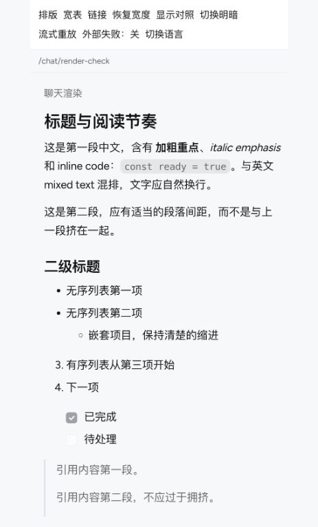
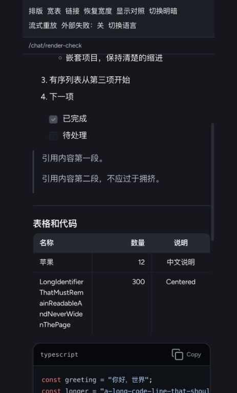
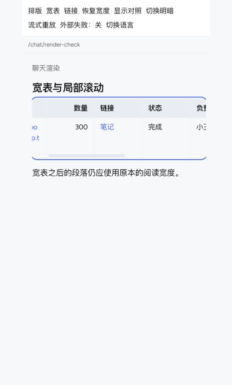
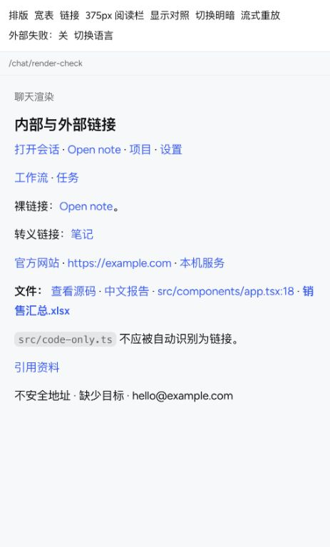

# Web Chat 消息渲染实施记录

日期：2026-10-13。对应[技术方案](./web-chat-message-rendering-technical-design.md)。P0–P6 的运行代码已落地，聊天采用单一路径；本记录区分实现完成与尚未量化的发布预算。

## 阶段结果

| 阶段 | 实施结果 |
| --- | --- |
| P0 | 合成正文/代码/长文和真实 MessageList/store 浏览器基准；保存旧 renderer 基线；parse p95、页面级 LongTask/CLS 观测 |
| P1 | Streamdown 2.7.0 + CJK 1.0.4；项目拥有链接、图片、代码和 Mermaid 组件；原始 HTML 显示为文字；sanitize 与 URL 策略显式配置 |
| P2 | Immer 只复制实际变化的 part 路径；本地 WeakMap part 身份沿流式更新、克隆和 snapshot 合并继承；历史前插复用未变化行 |
| P3 | 会话外壳、消息行、part/text run 分别订阅；文字通知按 rAF 合并，后台 50ms fallback，终态立即通知；普通文字 delta 不使历史列表重新遍历 |
| P4 | 单一呈现调度器按 backlog 追赶，250ms 积压强制收敛；中文分词、完整 grapheme；新增文字 600ms opacity 渐显；最多 256 个活动动画；初始历史不重播 |
| P5 | 开源 react-virtuoso 4.18.16，共用原滚动根；初次展示 ≥300 行的主聊天开启窗口，当前挂载期间锁定模式；全文查找先挂载目标，再收集 Range 高亮 |
| P6 | 新渲染器默认；移除聊天 HTML 分块、重复 Markdown 修补、整个 session 的帧订阅与旧环境变量回滚逻辑；完整 Web 回归及 production build |

## 实际架构与设计调整

`ChatSessionStore` 仍是唯一消息状态源。没有再维护一份规范化消息数据：WeakMap 缓存 row/part 查找索引，selector 缓存外壳快照，part hooks 读取权威内容。这样保留已有 run/cursor/offset、导出、持久化和恢复动作，避免两套数据同步。业务 mutator 通过 Immer draft 执行，不需要同时迁移全部流式回调。

partId 存在 WeakMap，消息行继续使用已有 renderKey。part 身份不写入 transcript、复制/导出结果或 API payload。相同文字的不同 part 仍具有不同身份；内容 hash 仅用于富内容缓存，不充当 React key。

Streamdown 单独负责 Markdown 分块。项目移除了外层稳定块/尾块的重复解析。引用式链接与脚注采用同一 renderer 中的完整文档策略，保持跨块语义；该策略不执行文字渐显。并非所有 Markdown 都可增量解析，单个超长段落仍有全文解析成本。

项目 rehype 插件仅包装新增/仍在动画中的 text 节点，已稳定文字合并成普通文本；动画完成后清理 span，正在选择文字时延后清理。React StrictMode 的 effect 重放会取消前一次动画，不会突破活动动画限额。Streamdown 2.7.0 按插件名称缓存 processor（100 项 LRU）；插件名包含 block 实例身份及初始/动画模式，避免不同块的闭包状态相互污染。

代码 fence 未闭合时显示完整源码，闭合且邻近/可见时复用现有 preview lease 调度高亮/图表。超过 100KiB UTF-8 不执行高亮，不截断文字或复制内容。结果缓存统一限制为 8MiB/256 项 LRU，缓存仅存净化后的 markup。highlight.js 与 Mermaid 懒加载；不可取消的绘图结果通过 effect generation 丢弃。Mermaid 继续使用项目 CSS 变量，主题变化无需重新绘图。生成的高亮/SVG 仍使用经过净化的 HTML 插入，其 React 宿主稳定；聊天 Markdown 正文已不使用 HTML 字符串替换。

文件/图片异步结果检查当前会话范围、请求 generation 和卸载状态，图片 blob URL 在卸载或来源变化时释放。局部 ErrorBoundary 保留可选择的原始内容，图表失败保留源码并可手动重试。

虚拟列表不启用独立 `followOutput`。现有滚动控制器通过 viewport adapter 调用尾部定位；Virtuoso 管理行高度和 prepend 补偿，原 scrollHeight/reading-anchor 补偿在虚拟模式跳过。查找/时间线定位先明确暂停跟随，避免测量变化把阅读者拉回尾部。普通模式用 rowId + 相对偏移恢复阅读位置。

选择消息文字或聚焦行内控件时临时扩大窗口，保持交互节点挂载；选区折叠/焦点离开后收回。此时可能暂时挂载更多历史，这是保留浏览器原生选择行为的取舍。模式按首次展示锁定：已经以普通模式打开的会话后来超过阈值，不在当前交互中替换 DOM。侧边聊天未接入全文查找与 viewport adapter，继续普通列表。

## Legacy 清理边界

删除 `use-frame-chat-session.ts`、旧聊天 streaming block builder、`prepareStreamingMarkdown` 与其专属测试；删除 `VITE_PERSONAL_PROGRESSIVE_RESPONSE` 回滚逻辑。聊天 renderer barrel 只导出新适配层，没有 legacy/streamdown 双实现开关。

共享静态文档 Markdown、marked、DOMPurify 仍有非聊天文档/预览消费者，予以保留。Mermaid 导出、工作区路径解析、app-link、安全净化和 preview scheduler 属于复用的业务能力，不复制成第二套实现。

## 验证与复现

```sh
pnpm run test:web
pnpm --dir web run lint
pnpm --dir web run type-check
pnpm --dir web run build
node scripts/test-chat-rendering.mjs final
```

浏览器脚本使用 release Vite build、React Compiler、playwright-core 和本机 Chrome，不请求真实模型或生产服务。正文、代码、长文各预热一次后记录 10 次。另对 100/300/1000 行消息执行 100 个 delta，检查最终文字完整、未挂载行定位、选择后滚动仍保留节点、前插 20 行后可见锚点 ≤2px。渐显使用真实 Web Animations/computed opacity 观察，并核对活动动画 ≤256、终态不遗留包装 span。

Vitest 新增/扩展覆盖：copy-on-write 与 part 身份、无 payload 身份泄漏、row/session selector、帧合并/后台/StrictMode/终态、Markdown 安全与引用、中文强调、escaped xopc 链接、回调更新、未闭合与 >100KiB 代码、中文/emoji 渐显与限额、阅读锚点及虚拟滚动注册清理。原有流式恢复、工具、review、消息时间和历史合并测试一并运行。

最终完整 Web 回归：428 个测试文件、2040 条测试通过；lint、TypeScript 检查、production build 和 git diff --check 通过。

最终数值见下方及[原始报告](./chat-rendering-results/final.json)。已有构建警告涉及大 chunk 和其他功能的无效动态导入；不是编译失败。

## 基准解释与边界

`commitMs` 测量调用 `flushSync(root.render)` 的同步耗时，**不是整个解析/异步高亮/真实绘制的总时间**。`deltaMs` 测量 store mutation 与同步通知，**不等于 receive→DOM 延迟**。`mountMs` 是初始同步挂载，虚拟列表需要后续 effect/测量，必须同时看 `readyMs`（出现首批行并经过下一帧）。不能用虚拟列表的亚毫秒空壳挂载宣称完整历史已经显示。

[baseline.json](./chat-rendering-results/baseline.json) 和 [streamdown.json](./chat-rendering-results/streamdown.json) 是 renderer-only harness，JS gzip 总量分别约 877KiB、1016KiB（约 +140KiB）。最终 harness 额外引入真实 MessageList/store/工具/附件等完整消息依赖，因此最终约 2MiB 的 gzip 总量不能和 renderer-only 的 877KiB 比较为首屏增量。这也没有证明技术方案的 chat 首屏 +50KiB 预算通过；Streamdown 增加解析依赖是明确成本，高亮/图表继续 lazy。

本次尚未量化端到端 receive→DOM p95、输入交互延迟、强制 GC 后的长期堆趋势与 chat 首屏 chunk 对比，亦未进行 Safari/Firefox 真浏览器验收。上述预算不能宣称已通过。引用式文档与单条超长回复仍可能需要较多 DOM/解析；窗口化限制历史行，不会虚拟化一条消息的每个 Markdown 块。

## 本机结果

最终 Chrome 155.0.8059.40，1280×800，未施加 CPU throttling；正式 report 中记录浏览器实际版本和 dirty 工作区状态。

| renderer 场景 | 旧同步提交 p95 | 最终同步提交 p95 | 最终 DOM 节点 |
| --- | ---: | ---: | ---: |
| 连续混合正文 | 0.4ms | 2.5ms | 243 |
| 约 21KiB 代码 | 35.1ms | 10.1ms | 2115 |
| 300 段单条长文 | 20.8ms | 24.9ms | 903 |

三组各 10 次正式样本均无 >50ms LongTask，检查未丢失或重复可见文字。正文在 16ms 同步提交预算内，代码耗时降低；长文同步提交增加约 20%，**没有满足原设计“全部场景不恶化超过 10%”的门槛**。React Markdown 的稳定节点、安全语义和渐显增加了处理成本，此报告不将其掩盖为全面性能提升，也不把尚未测量的总解析时延判为通过。

| 实际 MessageList/store | 首批行 + 下一帧 readyMs | store delta p95 | tail DOM 节点 |
| --- | ---: | ---: | ---: |
| 100 行普通列表 | 74.2ms | 0.7ms | 2385 |
| 300 行窗口 | 97.2ms | 0.3ms | 367 |
| 1000 行窗口 | 88.4ms | 0.2ms | 367 |

窗口化前的单次控制测量：1000 行普通列表同步挂载约 353.9ms、23,534 个 DOM 节点、store delta p95 约 1.3ms。此值来自窗口实施前的诊断，不属于 renderer-only baseline；不把单次测量比较作为稳定倍数承诺。最终长历史尾部挂载 13 行，普通阅读时 DOM 不再随已加载历史总行数线性增加。300/1000 行均成功定位未挂载的第 50 行，选择并滚动后选区节点保持连接，前插 20 行可见锚点实测偏移 0px。

真实动画抽样为 39 个 active animation，computed opacity 处于 0–1；终态 span 清理成功，浏览器 pageerror 为 0。参考[渐显截图](./chat-rendering-results/final-streaming.png)与[历史定位截图](./chat-rendering-results/final-history.png)。

## 二次效果验收

后续链接与排版复查修复了外链错误反馈、脚注/中文 fragment 定位、内部 ID 与文件路径识别的优先级、裸 JSX/TSX 文件名、列表标记、表格独立滚动和代码重复 padding，并恢复无语言标签 Mermaid 识别。细节及截图见下方“链接与排版复查”。上述早期基准 JSON 保留其测量时版本；不能将它们当作新增修复后的重新测量。

## 链接与排版复查

日期：2026-10-13。复查使用项目真实 React 组件、全局样式、Figtree 字体和合成 Markdown 样例，不调用模型或修改真实会话。

### 修复结果

| 发现的问题 | 修复 |
| --- | --- |
| 外部打开失败只有 title 提示 | 恢复可见、可访问的错误反馈；忽略旧请求返回，内容替换后清理错误 |
| 脚注被识别为外部 HTTP 链接，sanitize 后 ID 与引用不匹配 | 生成消息独立的 fragment ID；引用、回链和 ARIA 引用同步映射；在当前消息内滚动/聚焦，保留聊天路由 |
| 中文或包含百分号的脚注跳转失败 | 优先匹配实际 DOM ID，再尝试 URI 解码后的 ID；增加中文、百分号和 `.md` 标识用例 |
| `report.md` 等文件形状的内部对象 ID 可能误判为工作区文件 | 已知 app 路由优先于文件识别；链接与图片在 reference 解析完成后分别归一化，避免图片引用被改成 app 路由 |
| 裸 `.tsx/.jsx` 文件名没有自动链接 | 修复扩展名正则的短前缀重叠，保留完整路径与行号 |
| 无序列表圆点、有序列表序号被 Tailwind reset 隐藏 | 恢复 disc/decimal 和嵌套 circle/square；任务列表维持 checkbox |
| 窄阅读栏里表格标题和数字被拆成多行 | 保留语义 table，在独立可聚焦容器中横向滚动；每列最小 6rem，数字列不换行 |
| 高亮代码同时受 pre/code padding 与滚动影响 | pre 统一负责内边距与滚动，移除 code 的重复 padding/scrollport |
| 无语言标签 Mermaid 未继承旧识别行为 | 提取共享轻量 source detector，仅识别支持的图表头，不影响明确命名的其他语言 |

另保留链接的描述性 title，规范化同源绝对 hash 路由；清理无调用点的旧 `markdown-stream-tail` CSS。

### 链接行为核对

| 类型 | 验证内容与结果 |
| --- | --- |
| 内部会话 | xopc deep link、裸链接、尖括号、转义链接和 reference link 均生成内部 href 并路由到目标会话 |
| 内部产物 | 笔记、任务、项目、工作流、自动化、本地应用沿用项目 opener；聊天中保留 note/task/preview 模式，设置与编辑页仍正常导航 |
| 文件 | 中文文件名、相对路径、绝对路径、file URL、xopc workspace URL、行号、空格编码；浏览器点击回调收到正确的 path/kind/line |
| 外部 URL | HTTP(S)、localhost 服务、query/hash 和中文参数；保持 `_blank`、noopener/noreferrer，使用现有 Electron bridge/browser opener |
| 修饰键 | Ctrl/⌘/Shift 点击不被普通 opener 截获，保留浏览器原生行为 |
| 不支持或危险协议 | 缺少目标的 xopc、javascript、mailto 等维持不可操作的普通文字，不添加可用性噪音 |
| 脚注 | 当前消息内定位、回链、中文标识、独立 ID、焦点；不打开外部页面或改变 HashRouter 路由 |

[浏览器采集的链接属性](./chat-rendering-results/review-links.json)包含 16 个预期链接；流式完成后的动画包装 span 为 0。单元测试进一步覆盖 ID 形状、reference image、描述性 title、过期错误与两个消息之间的 fragment 隔离。

### 排版与视觉检查

检查了浅色/深色、中英混排、强调、段落、h1–h5、引用、嵌套列表、从 3 开始的有序列表、任务列表、表格对齐、长代码、Mermaid 和流式追加。正文沿用真实聊天的 16px / 27px 行高；首段与段落间距保持既有阅读节奏。

在 375px **阅读容器**中（不是完整手机设备仿真），实际消息内容宽 347px，scrollWidth 同为 347px。8 列宽表内部宽 768px，可通过键盘横向滚动，消息本身不超宽；长代码仅 pre 横向滚动。3 列表格标题不拆字，300 保持一行。脚注跳转后 document hash 保持不变，焦点落在当前消息对应脚注。

浏览器为 Codex 内置浏览器；深浅样例已实际观察。本轮新打开的 Gateway 页面停留在令牌登录界面，因此没有验证鉴权后的真实文件读取/业务详情加载；文件回调与路由目标已在真实组件中验证。服务端文件存在性不属于本轮已通过结论。

效果截图：









### 复现

```sh
pnpm --dir web run dev --host 127.0.0.1 --port 4217 --strictPort
# /src/visual-tests/chat-markdown-review/index.html
pnpm run test:web
pnpm --dir web run lint
pnpm --dir web run type-check
pnpm --dir web run build
```

新链接兼容测试迁移了共享文档渲染器的既有用例，继续覆盖应用路由与聊天内预览语义；没有重新引入聊天 legacy renderer。

最终验证：当前工作区完整 Web 回归 **430 个测试文件、2095 条测试通过**；lint、TypeScript 编译检查、production build 与 git diff --check 通过。构建仍有项目既有的大 chunk/无效动态导入提示。

## 流式完成时的高度与滚动稳定性

日期：2026-10-13。针对短回答完成时高度回缩、随后向下追尾的问题，修复主聊天和共享滚动控制器中的完成路径。

### 原因与修复

| 原因 | 修复 |
| --- | --- |
| 流式光标单独占据 12px 高度和 8px gap，结束后移除 | 光标定位在正文尾部既有留白内，不参与消息高度计算；减少动态效果时停止闪烁 |
| 结束状态已提交，调度器仍通过 passive effect 才补齐最终正文 | 完成时直接渲染完整 source，与结束状态同次提交；effect 负责调度器收尾和完成通知 |
| 首次可见正文仍需一次 effect 更新，等待占位与正文之间多一轮布局 | 会话正文的首次非空提交直接显示当前 source，后续增量保留原有调度 |
| 回复留白只能减少，耗尽后无法吸收等待占位或 Markdown 高度收缩 | 在最近一次回复的高度范围内恢复留白，上限仍为视口高度的 10% 且最多 64px；向上阅读时不改留白 |
| 同一消息完成后的增长只等 ResizeObserver 下一帧追尾 | 绘制前重新测量消息增长与完成状态；主聊天和侧边聊天显式传递 streaming，覆盖消息壳数组保持稳定的情况 |
| 全局减少动态效果规则为所有元素设置 0.01ms transition-duration，意外激活留白高度过渡 | 留白使用 transition-none，完成时立即应用高度 |
| 虚拟列表先等待 rAF 测量行高，滚动控制器又排一帧追尾 | 虚拟行在 ResizeObserver 中直接发布尺寸；滚动控制器在同一绘制周期跟随已测量的增长，留白写入仍合并到原有调度 |

清理原先只能递减的 replyRemainingRef 和占据文档流的光标分支。既有块级 Markdown 渲染器、链接处理与排版样式继续复用。

### 验证

使用生产构建中的真实 MessageList、Markdown 调度器、虚拟列表和滚动控制器，输入为合成中文文本，不调用模型或访问真实会话。

Chrome 155.0.8059.40 共 **32 个场景**：12 / 300 条历史消息、普通 / Personal 模式、原文结束 / 结束时补入正文、跟随末尾 / 向上阅读、正常动态效果 / 减少动态效果。跟随场景先确认视口处于项目既有的末尾阈值内，再触发完成。

- 原文结束时普通消息行保持 **67px → 67px**，Personal 行保持 **27px → 27px**；完成前后 scrollTop 不变。
- 最终正文在首次完成提交中已完整可见；新增文字引起的实际高度增长在首个绘制周期内完成滚动校正。
- 按绘制帧采样，完成后的额外滚动最大 **0px**，向上阅读时位置漂移最大 **0px**；浏览器错误为 0。
- 单元回归覆盖完成正文原子提交、首次正文提交、留白耗尽后的收缩恢复、消息壳数组稳定时的完成重测，以及阅读位置保护。

[浏览器采集结果](./chat-rendering-results/completion-stability.json)保留完成前、首次提交、首次绘制和最终几何数据。

完整 Web 回归 **432 个测试文件、2114 条测试通过**；lint、TypeScript 编译、生产构建和 git diff --check 通过。

### 复现

```sh
node scripts/test-chat-completion.mjs
pnpm run test:web
pnpm --dir web run lint
pnpm --dir web run build
```

浏览器脚本使用本机 Chrome，通过 playwright-core 运行。完整逐帧数据和截图写入临时结果目录；临时构建与浏览器在退出时清理。浏览器验证范围为 Chrome，未运行 Safari / Firefox 或真实模型请求。
