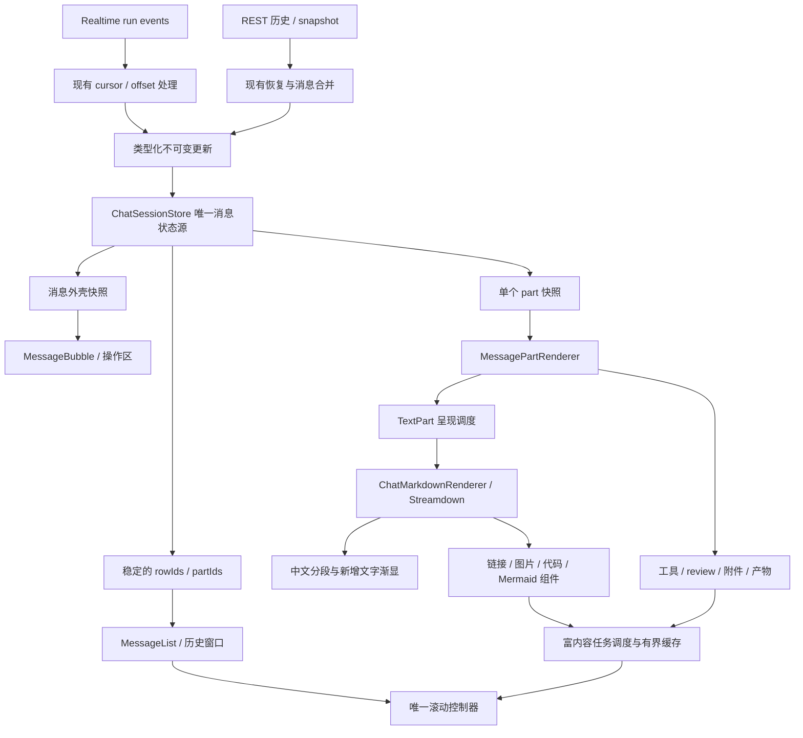

# Web Chat 消息渲染技术方案

> 日期：2026-10-13  
> 状态：P0–P6 已实施；验证结果和测量范围见[实施记录](./web-chat-message-rendering-implementation.md)  
> 范围：`web/` Gateway Console 的消息展示、Markdown、流式呈现、复杂内容与滚动  
> 关联：[Codex 流式文字动画调研](./codex-streaming-text-animation-research.md)

## 1. 目标与决策

将 Chat 消息展示升级为结构化、局部更新、可恢复的 React 渲染链路。首先保证内容正确、交互稳定和更新范围可控，再增加柔和的尾部渐显。

采用以下决策：

1. 保留现有 Gateway REST/realtime、会话隔离、运行管理与历史恢复语义。本项目不引入 AI SDK transport 或替换为 assistant-ui runtime。
2. 新建项目拥有的 `ChatMarkdownRenderer`，采用 Streamdown 作为 Markdown 内核。第三方组件只在适配层内出现。
3. 消息列表、消息外壳、内容 part 分别订阅稳定快照；文字增量不使列表重新遍历历史，不克隆未变化 part。
4. 新路径由 Streamdown 单独负责 Markdown 分块与块级缓存，移除外层重复分块；呈现调度仍由 xopc 单独负责。
5. 代码、图表、附件、产物使用项目 React 组件和统一异步调度，不在每次 HTML 更新后重复注入控件。
6. 第一阶段保留普通列表；长历史虚拟化在身份、滚动和基线稳定后实施。
7. 建立事件重放、浏览器性能和正确性回归，按可量化结果切换默认实现。

非目标：修改后端消息存储、SQLite schema、模型输出协议、移动端渲染；支持执行模型输出的 JSX/MDX；迁移所有非聊天 Markdown 预览；重做 Chat 产品视觉。

## 2. 现状与问题依据

代码知识图谱工具在本次会话不可用，以下分析来自本地源码。问题属于代码结构风险，尚未通过基准量化。

| 模块 | 已有能力 | 改造关注点 |
| --- | --- | --- |
| `messages/messages.types.ts` | 文字、思考、工具、图片、review 等结构化 content；文字有可选 `segmentId`，消息有 `renderKey` | 非文字 part 缺少统一展示身份，生命周期与内容更新耦合 |
| `messages/message-sender.ts`、`agent-stream-messaging-callbacks.ts` | send/resume 共用回调；按 run 接收流式事件 | 保留现有 cursor/offset 恢复规则，逐步改为类型化状态更新 |
| `session/chat-session-store.ts` | 隔离各会话，合并历史、乐观消息与流式尾部 | `mutateSessionStreaming` 克隆当前消息所有 content；部分更新全量克隆消息列表 |
| `session/use-frame-chat-session.ts` | rAF 合并展示通知，50ms 后台 fallback | 当前订阅整个 session slice，局部增量仍向上层传播 |
| `session/chat-session-view.ts` | committed + streaming 视图、尾部合并 | 增量时构造显示数组；需要把结构变化和内容变化分开 |
| `messages/thinking-blocks.ts` | 优先用 `renderKey` 作为行身份 | 无 key 时回退 timestamp + 数组下标，历史 prepend 可能改变身份 |
| `messages/message-content-renderer.tsx` | 工作区引用、产物、按段显示 | 合并文本并用 `block-${i}` 渲染；需保留来源身份而非依赖下标 |
| `components/markdown/parse-markdown.ts` | marked、GFM、中文标点 strong 修复、xopc 链接、highlight.js、稳定块拆分 | marked 扩展不是可直接迁移的 remark 插件，需要行为兼容测试 |
| `components/markdown/markdown-view.tsx` | DOMPurify、安全链接、图片、代码复制、Mermaid 导出 | `dangerouslySetInnerHTML` 替换变化块内部 DOM，附属 DOM/effect 重复运行 |
| `messages/use-progressive-streaming-markdown.ts` | 初始快照不重播，渐进提交，终态 flush | 保留正确性；提交大小目前基于全文长度而非 backlog |
| `scroll/use-chat-scroll-viewport.ts` | Following/Reading、回复预留空间、ResizeObserver、加载历史补偿 | 新列表与异步内容仍须遵循现有阅读位置语义 |
| `messages/message-list.tsx` | memo 行、只向活动行传流式状态 | 普通 `list.map`；已加载历史全部保留 DOM |
| `product-delivery/inline-preview-scheduler.tsx` | near/visible 调度，最多 2 个活跃预览，隐藏页暂停 | 应复用其策略，避免再建立竞争资源的预览调度器 |
| `components/markdown/streaming-render-metrics.ts` | 开发态 parse/commit/backlog/longtask/layout-shift 指标 | 缺少分位数、组件更新计数、端到端展示延迟与可重复场景 |

目前外层 block memo 只避免未变化块再次解析，不代表全文分块过程是增量解析。新库同样需要测量分块成本，不能以“使用 memo”推断整条链路复杂度与文档长度无关。

## 3. 技术选型

| 决策 | 选择 | 原因与约束 |
| --- | --- | --- |
| Markdown 内核 | Streamdown | 官方 AI SDK 示例已采用；支持流式语法处理、React 树和块级缓存 |
| 富内容组件 | xopc 组件注册表 | 保留文件打开、产物、复制、导出、主题和本地化 |
| 中文语法 | `@streamdown/cjk` + 必要的项目 remark 兼容插件 | 对照现有中文 strong 测试，不能默认行为完全相同 |
| 中文动画 | 项目 rehype 插件与 React span 组件 | 内置 word 分段当前按空白；不满足连续中文和完整 emoji grapheme 的要求 |
| 初期高亮 | 复用 highlight.js，改为独立懒加载组件 | 不同时引入 Shiki 与现有语言库，控制 bundle 和行为变化 |
| Mermaid | 复用现有 render/export/preview | 不重复引入另一套 Mermaid 实现和弹窗 |
| 数学公式 | 后续按需求接入 | 本次先保证现有能力；不默认加载 KaTeX |
| 状态管理 | 现有 Zustand 内迁移为局部不可变更新和细粒度订阅 | 保留业务动作与恢复语义，避免双状态源 |
| 历史虚拟化 | 后续使用开源 `react-virtuoso` 的通用 Virtuoso 适配 | 动态高度适配需要实测；不默认引入商业 `@virtuoso.dev/message-list` |

依赖只通过 pnpm 管理。实施时查询已发布稳定版本并固定直接依赖版本、提交 lockfile；已核验并锁定已发布 Streamdown 2.7.0、CJK 1.0.4、react-virtuoso 4.18.16。React peer 支持 18/19，但依然必须验证项目的 React 19、React Compiler、Vite 8 和 Tailwind v4 构建。

Streamdown 集成先经过 P1 适配验证：组件扩展、BlockComponent、rehype 插件顺序、引用链接、初始快照、主题变更都必须通过。仅使用锁定版本公开 API，不读取私有 exports、不修改 node_modules。按用户要求删除聊天 legacy 路径；扩展能力在项目适配层解决，不 fork 第三方核心。

## 4. 目标架构



责任分工：

- Store 负责收到什么、如何恢复及最终内容，不等待动画。
- Render selector 负责身份、结构和不可变快照，不解析 Markdown。
- Text presentation 负责展示前缀与动画基线，不修改原文。
- Markdown adapter 负责语法、组件、安全和样式，不读取业务 store 或发起 send/resume。
- Rich content scheduler 负责可见性、资源预算、异步失效；滚动控制器负责视口位置。

## 5. 数据与订阅契约

### 5.1 身份分为四级

| 身份 | 作用 | 生成与复用规则 |
| --- | --- | --- |
| `conversationId` | 会话隔离 | 继续使用稳定 UUID，不从 ID 解析 Agent 或渠道 |
| `rowId` | 显示行 | 以现有 `renderKey` 为基础；乐观→确认、streaming→committed、历史合并继续复用 |
| `partId` | 原始内容块 | 文字优先 segmentId，工具优先 toolCallId/id，review 优先 reviewId；其余在首次接纳时分配本地 ID |
| `textRunId` / segment key | 连续文字展示组及渐显片段 | 由首个来源 part 身份和局部递增 ID 构成，追加与 presentation 变化不重新分配 |

以上身份均包含会话/行命名空间，避免多个 turn 的相同工具或 segment id 冲突。数组下标、时间戳和全文 hash 不作为唯一身份。

历史缺少 part ID 时，在规范化入口分配身份，随后随对象或展示元数据保存。snapshot 合并先复用现有行匹配结果，再按已有业务 ID、类型、顺序和来源边界匹配 part；相同文本可能出现多次，不可仅用内容相等合并。遇到歧义分配新身份并立即展示，不猜测并播放旧文字动画。页面重载可以重建本地 ID，因为初始历史不播放动画。

相邻文字可以继续组成一个 Markdown text run，保留现有展示语义。组内维护来源 partId 与字符区间，工具/思考/产物边界不跨越；改变 narration/answer 状态不改变 textRunId。历史引用定义能影响前文，不能把每个文字 delta 独立解析为 Markdown。

### 5.2 展示模型

以下类型是设计契约，不是已存在的接口：

```typescript
type PartStatus = 'waiting' | 'streaming' | 'settled' | 'stopped' | 'error';

type RenderPart = {
  id: string;
  rowId: string;
  kind: MessageContent['type'] | 'attachment' | 'product';
  revision: number;
  status: PartStatus;
  payload: MessageContent | MessageAttachment; // 实施时按 kind 收窄联合类型
};

type RenderRow = {
  id: string;
  role: Message['role'];
  partIds: readonly string[];
  metadata: MessageRowMetadata; // 项目内部类型，含时间、turn、操作权限等
};

type ConversationRenderState = {
  rowIds: readonly string[];
  rowsById: Readonly<Record<string, RenderRow>>;
  partsById: Readonly<Record<string, RenderPart>>;
};
```

采用引用稳定的不可变快照：文字增量只更新目标 part、revision 和必要的 run 状态；rowIds、该行 partIds、其他 part 和历史行快照保持原引用。新增 part 才改变该行结构，新增/删除/分组变化才改变列表结构。

`useChatRows(conversationId)` 订阅 rowIds；`useChatRow(rowId)` 订阅外壳元数据与 partIds；`useChatPart(partId)` 订阅单个 part。权限或全局主题变化允许相关组件更新，但不是每个 token 的依赖。

### 5.3 唯一状态源与迁移方式

P2 初期仍以现有 `Message[]/streamingMsg` 为业务真相：给 content 分配身份并实现 copy-on-write 更新，先让非目标 part 引用稳定。暂不复制一套可独立修改的 render store。

P3 在同一个 `ChatSessionStore` 内把渲染实体规范化，原动作统一通过类型化 reducer 更新。旧 `Message[]` 接口成为按需、缓存的兼容 selector，供导出或尚未迁移的消费者使用；不能在每个 token 后为整个会话重建兼容数组。切换逐个完成，没有两套同时写入的消息存储。

渲染索引随同一次 store commit 原子更新。selector 只读取，不在 React render 中修改 Map、分配 ID 或产生副作用。StrictMode 重入与被放弃的并发 render 不得推进身份/动画状态。

上层 `useChatSession`/`chat-page` 同时拆开 metadata、sending/streaming、progress 和 rows 订阅；仅优化 MessageBubble 而继续在页面顶层订阅整个 slice，达不到局部更新目标。

### 5.4 类型化更新

将热路径从任意 `mutator(msg)` 逐步迁移到 `appendTextDelta`、`updateToolPart`、`appendThinkingDelta`、`finishTextPart`、`finalizeRun` 等明确动作，浅拷贝命中的对象和路径。现有 mutator 临时保留给低频分支，迁移结束删除热路径全量 clone。

网络事件顺序、cursor 去重、offset 恢复继续由现有消息接入逻辑处理。不得用文字内容重叠算法代替已有 authoritative offset。身份字段不改变协议 offset 的 UTF-16 计数单位。

## 6. Markdown 适配层

新增 `web/src/features/chat/rendering/markdown/chat-markdown-renderer.tsx`，输入原始 Markdown、part/textRun 身份、streaming 状态、是否首次快照、工作区文件/image callbacks 和展示策略。

### 6.1 分块只有一个拥有者

新路径将完整 text run 交给 Streamdown，不再调用现有 `buildStreamingMarkdownRenderBlocks` 后嵌套多个 Streamdown。使用公开 BlockComponent 扩展放置局部动画基线、错误边界和指标，第三方内部实现对业务层不可见。

初期由 Streamdown 内置分块负责，验证块 key、引用定义、setext heading、列表和表格跨 delta 变化。若引用式链接/脚注不能跨块正确解析，该 text run 从首次挂载就使用同一组件内的完整文档解析策略，并禁用不安全的块冻结；不能流式结束才切换并重建所有节点。未闭合语法仅用于临时展示，终态必须恢复原始 Markdown 的真实解析结果。

流式期间及本次挂载后的完成态保持同一 renderer 和分块容器；从历史首次打开时可选择 static，但不把活动组件在结束时换成另一个实现或改变 root key。移除动画 spans 时验证选区与布局；如果会破坏选区，延迟到选区释放或组件卸载，不强行清理。

### 6.2 项目组件映射

| Markdown 节点 | React 组件职责 |
| --- | --- |
| `a` | 复用 app-link resolver 与工作区路径解析，保留修饰键/中键行为和行号跳转 |
| `img` | 复用工作区图片加载、预览、失败状态；blob URL 正确释放 |
| `pre/code` | 区分行内代码与 fence，代码复制、语言展示、懒加载高亮 |
| mermaid fence | 复用现有绘图、预览、PNG/SVG 下载、失败降级 |
| `table` | 保持现有排版与横向滚动；宽表不挤压外层消息列表 |
| p/headings/list/blockquote | 沿用 markdown.css 与 globals.css 语义 token |

DOM 后处理逐步改成组件 lifecycle。链接、图片等纯解析 helper 抽成可复用模块，避免复制路径规则。产物/工具/思考仍使用结构化 part renderer，不转换成 Markdown 标签。

Streamdown 控件默认关闭，由项目组件明确启用已有操作；不额外增加默认弹窗、复制按钮或新的配色体系。通过 components 覆盖内置样式；确实必要的第三方 CSS 变量只在适配层映射已有语义 token，不成为第二套产品 token。

### 6.3 语法和安全兼容

把现有 parse-markdown/app-links/markdown-view 安全与链接测试转为两条路径共用的行为用例：中文标点 strong、escaped xopc link、裸 xopc URL、代码中的 URL 不改写、工作区相对/绝对路径、图片、HTML 示例、危险 URL 等。

默认延续当前原生 HTML 显示为文字的语义。明确配置 remark/rehype 管线，不直接采用 Streamdown 默认 raw HTML 行为；禁用 raw HTML 解释并对照测试确认“显示为文字”而非静默丢弃。自定义 rehypePlugins 会替换默认数组，因此必须明确保留 sanitizer 和 URL 策略。

允许的内部协议先通过项目解析器规范化为受控导航意图或安全 URL，再通过 sanitizer。UI 不通过“允许全部协议”恢复 xopc 链接。工作区图片和文件引用由受控 React callback 处理；属性白名单仅保留项目确实使用的字段。

注入动画属性发生在安全检查之后，仅对受控文字节点执行。Mermaid SVG 和高亮 HTML 继续独立净化；React renderer 不自动保证这些生成内容安全。保留现有授权/API访问路径。

## 7. 流式呈现和尾部动画

### 7.1 调度与真相分离

Store 收到 delta 后立即更新完整内容；TextPart 维护可见前缀。复制/导出以 store 中原始文本为准。run 状态、abort、错误和工具事件不等待文字动画。

P1 保留现有 progressive scheduler，避免同时调整解析与节奏。P4 再改为基于未展示 backlog 的算法：以约 120ms 追赶时间为初始参数，按 elapsed 与 backlog 算下一次提交量，结合实测解析成本降低提交频率；保持完整 grapheme 边界。参数属于待调优值，不作为 Codex 精确复刻。

展示更新最多每帧一次，常规 Markdown 提交初始预算 32–64ms。只保留一个呈现队列，不叠加 Streamdown/服务端的打字队列。最旧积压超过 250ms、后台恢复或积压异常大时优先完整展示并取消积压部分动画，避免越输出越滞后。

首次挂载/恢复 snapshot 立即展示现有内容，后续增量才动画；completed/failed/aborted 时立即 flush 收到的完整文本，清理 timer/rAF。suspended 表示等待而非完成，保持可恢复身份，不虚构工具已成功或消息已完成。

### 7.2 中文与新旧内容判定

新路径关闭内置 animated，使用单一项目动画插件，避免文字被两次拆分。插件在 sanitized HAST 文字节点上运行，跳过 pre、SVG、Math、annotation 与图表内容；行内代码可以随正文渐显。

`Intl.Segmenter` word 粒度处理中文和混合语言，grapheme 粒度保障 emoji/组合字符不拆开。对正在增长的末尾词，保留旧片段身份；追加字符可作为新的展示片段，不通过改变旧 key 重播整词。遇到分词结果重划，复用相同前缀，旧字符无动画，必要时只重建尾部。

每个 text run 保存首次快照基线、已提交的可见文字区间和有限的尾部动画记录。Markdown 源位置优先作为映射依据；经链接改写/CJK修复/补全的内容需要保留位置映射。无法安全映射时比较规范化可见文字的已提交前缀并保守地跳过已有内容。源字符数与显示字符数不能直接等同。

稳定 React key 用于节点复用，动画 ledger 用于判断是否新增：Markdown 的 plain→strong/link 会改变祖先结构，即使相同 key 也可能 remount，此时 ledger 必须阻止旧内容再次渐显。无须承诺任何 Markdown 结构变化都保留同一 DOM 节点，但应保留内容、视口与旧文字的可读性。

ledger 只在 commit 后推进；插件对同一 render 输入返回一致结果。替换文本、retry 新 run 或截断时增加 presentation generation，取消旧动画并立即展示替换快照，然后只对新 generation 的增量播放。

### 7.3 动画预算

- 初始 opacity 0→1，时长 600ms，可在 500–700ms 内视觉调优；不默认加入 blur 或位移。
- Live streaming 额外 stagger 为 0，保持“更新节奏 + 重叠渐显”的软尾部效果。
- prefers-reduced-motion 立即展示；离屏 part 和隐藏页不进行逐词动画。
- 只保留最近新增区域的动画 spans，已完成内容在合适时机合并为普通 text；不为整段长历史常驻逐字符 DOM。
- 待播放单位上限初始 256；超过上限合并新片段或直接展示，不排成长时间动画队列。
- 内容 DOM 从插入时占据真实空间，opacity 不改变行高；不得用高度增长逐字动画代替文本渲染。

## 8. 复杂内容、缓存与错误恢复

### 8.1 任务调度

复用现有 near/visible 和最多 2 个活跃预览策略，抽出适合代码/图表的任务 lease。优先级：手动触发 > 可见 > 邻近；隐藏页暂停新任务。不同 iframe 预览与 CPU 渲染任务可设不同类别配额，但共享一个调度入口，避免多套“各自最多 2 个”失控叠加。

代码 fence 未闭合时显示原始代码；闭合后可见时才高亮。超大代码先提供完整可滚动纯文本和复制，高亮阈值初始 100KiB UTF-8，仅限制高亮而不截断内容。闭合早于 run 结束的代码块允许提前高亮。

Mermaid 在 fence 完成且接近视口或手动展开时渲染。图表任务不可取消时丢弃过期结果；不把主线程不可中断调用包装 Promise 后宣称已经消除阻塞。仅在基准证明必要且库支持时引入 Worker。

任务携带 conversationId、partId/blockId、revision、theme、generation。异步完成后逐项核对，过期结果不写回。卸载释放 lease、observer、event listener、blob URL 和任务订阅。

### 8.2 有界缓存

缓存 key 包含内容版本/摘要、语言、主题与 renderer version；权限相关文件/图片缓存还包含工作区/会话范围。hash 只用于缓存，不用于 React identity。避免缓存携带旧 locale/callback 的整棵 React 树。

初始预算：渲染结果缓存每会话最多 8MiB、整个页面最多 32MiB，采用大小和数量双约束 LRU；可取消的离屏任务优先清理。图片/SVG/iframe 的实际浏览器内存额外单独测量，以上预算只覆盖可统计的数据，不等同总内存。

### 8.3 错误边界

每个文字 text run 和复杂 part 放置局部错误边界，异常降级为可选中、可复制的原始内容及简短失败提示。边界以 part revision/generation 重置，支持显式重试，不让持久失败形成自动重试循环。

ErrorBoundary 捕获 render 错误；Promise rejection、事件回调、绘图失败必须显式捕获。失败日志只记录 renderer、阶段、revision、耗时、输入长度及一行错误摘要，不记录完整消息或凭证。同一失败按 generation 去重。

## 9. 滚动与长历史

### 9.1 第一阶段保持现有滚动控制器

滚动跟随与 Markdown 渲染解耦，保持现有发送时的问题定位和回复预留空间。

- Following：内容高度增长合并到 rAF 调整，避免多个 effect 同时控制 scrollTop。
- Reading：用户向上滚动、展开历史内容或正在选择文本时保持阅读位置；回到底部或点击按钮恢复跟随。
- Prepend：记录第一个可见 rowId 和其相对视口偏移；加载后恢复该锚点，不能只依赖 scrollHeight 差值。
- 异步图片/图表完成：Following 跟随，Reading 保持原锚点；图片预留已知尺寸或合理占位。
- 字体/主题/宽度变化：重新测量高度，恢复 rowId 锚点，不把尺寸变化当新消息。

### 9.2 P5 历史窗口

使用项目 `ChatMessageViewport` 封装普通列表和开源 Virtuoso，滚动控制器仅调用统一的 scrollToRow/scrollToEnd/readAnchor 接口。虚拟列表模式由控制器协调，不能让旧 scrollTop effect 与虚拟器同时拥有位置控制权。

在 P5 基准后确定阈值，初始评估 300 个已加载显示行或 20,000 个消息 DOM 元素。模式在会话初次展示时选定并锁定，本次会话停留期间不因阈值变化直接替换列表；离开再打开可以重新选择。普通模式持续增长先暂停离屏重内容，避免模式切换造成选区丢失。

时间分隔、任务触发合并、尾部临时状态、回复预留空间都进入统一 row descriptor；不通过 index DOM id 定位业务消息。搜索/引用跳转改为 rowId 定位，先加载需要的历史页，再滚动并挂载目标。

虚拟化验收必须覆盖上下滚动、prepending、超高单条消息、响应持续增高、折叠工具、图片加载、键盘焦点和选区。存在选区/焦点的行保持挂载。浏览器原生页面查找无法覆盖卸载历史，因此启用默认虚拟化前必须提供会话全文查找并可定位未挂载行；整会话复制/导出继续从 store 获取。能力未齐时保留普通列表默认。

虚拟化限制已挂载行数，不能解决一条特别长回复的全部 DOM 成本；长代码内部滚动和按块调度需单独验证。首期不增加第二层块级虚拟化。

## 10. 性能与稳定性验收

所有数值是拟定预算，不是已测收益。P0 保存 baseline 和机器/浏览器/build 信息后，P1 校准预算；不得为了让报告通过而在测试后调宽阈值。测量 release build，开发态 React Compiler/StrictMode 调试结果不当作发布性能。

### 10.1 可重复场景

| 场景 | 输入规模与事件形态 | 必须验证 |
| --- | --- | --- |
| 中英混合正文 | 10,000 grapheme；5/20/100ms delta，以及 2KiB burst | 首次响应、展示延迟、连续中文/emoji、末尾渐显 |
| 长单块正文 | 50,000 grapheme，无段落边界 | 尾部 parse 成本、退化策略、不丢字 |
| 代码 | 20KiB 多语言、200KiB 单 fence | 闭合前纯文本、按需高亮、复制完整 |
| 表格/图表 | 200 行表格、10 个 Mermaid 块 | 横向滚动、调度限额、导出、过期结果丢弃 |
| 混合活动 | 文字 + thinking + 50 个工具事件 + review + 附件 | 仅目标 part 更新、内容顺序正确 |
| 长历史 | 100/300/1,000 显示行 + prepend 50 行 | 历史不重解析、锚点、DOM 与内存 |
| 恢复 | snapshot + 重放事件 + 新增 delta | 延续现有 cursor/offset 行为、不重复文字 |
| 生命周期 | abort/error/suspend/resume、A→B→A、隐藏页恢复 | final flush、隔离、身份、清理 |

fixtures 使用合成内容和固定事件序列，不调用真实模型。重放原始事件顺序与时间戳，不用生产用户消息填充基准。

### 10.2 指标与门槛

| 指标 | 拟定验收 |
| --- | --- |
| 内容正确性 | 重放后原始文字与预期逐字符相同；copy/export 一致；无跨会话污染 |
| 热路径更新范围 | 纯文字 delta 不更换 rowIds/其他 part 引用；历史 Markdown parse 与历史 row render 增量计数为 0（排除主题、locale、权限变化） |
| 文本提交额外延迟 | 前台、仅正文标准场景 receive→DOM commit p95 ≤150ms；积压超 250ms 触发追赶，不持续堆积 |
| 动画视觉延迟 | 分别记录开始出现和完全不透明时间；完整显现预算为提交延迟 + 所选 fade 时长，不把 600ms 渐显误判为 150ms 调度失败 |
| 前台 commit 耗时 | 标准正文 fixture p95 ≤16ms；复杂 fixture 单独报告，不用平均值掩盖峰值 |
| 主线程长任务 | 标准正文 fixture 无渲染链路新增的 >50ms 长任务；大图表等独立报告并降级/调度 |
| 性能不回退 | 固定 fixture 的 parse+render 总时间、输入交互延迟 p95 相对 baseline 不恶化 >10%；至少 10 次记录中位数/p95 |
| Reading 锚点 | prepend/图片完成/工具展开后同一可见 row 偏移误差 ≤2px，持续累积不漂移 |
| 生命周期资源 | 连续切换 20 次后活跃监听器/timer/任务回到预期；缓存不超预算，堆内存完成 GC 后无持续增长趋势 |
| Bundle | 单独报告首屏与 chat 懒加载 chunk 的 gzip 差异；初始 chat chunk 增量预算 50KiB，高亮/图表保持 lazy，超预算须说明并优化 |

DOM insert/commit 不是屏幕实际呈现。浏览器 harness 在 commit 后的帧观测正文，用截图抽样核验 opacity 影响；将 receive→DOM、首次 opacity >0 的呈现和完全不透明分开报告。完全不透明按 computed opacity ≥0.99 判定，结合视觉抽样确认可读性，不用一个未定义的“可读”时间替代不同指标。后台 tab 不承诺同样时延，但回到前台必须立即收敛。

### 10.3 指标归属

扩展现有 streaming metrics，增加 revision、row/part 更新计数、解析/commit p50/p95、backlog age、rich-task/caches 和错误计数。LongTask/CLS 是页面窗口指标，不能归因于每个同时活跃的 stream；保留页面级数据，再用性能 mark/trace 关联具体任务。不要将自动滚动带来的全部视觉位移混成 Markdown 错误。

默认只在开发/显式基准开启详细采样；常规路径保留低开销错误和计数，不为每个 token 上报日志。基准结果保存为 JSON 和简短报告，包含 git revision、renderer 版本、浏览器版本、viewport、CPU throttling、动画开关和 fixture seed。

### 10.4 回归层次

- Vitest：身份与 copy-on-write、selectors、offset 恢复、Markdown 兼容、动画 ledger、异步 generation、错误降级。
- jsdom/React：跨 delta 节点复用、plain→strong 不重播、终态 flush、StrictMode、历史 prepend key、callbacks 更新。
- Playwright Chromium：真实选择/复制、动态高度、滚动、视觉渐显和性能；再用项目支持的浏览器做兼容验证。
- 固定快照：light/dark、375px/1280px、reduced-motion、初始/流式/完成/失败态；动画中间态使用可控时钟取样。

复用 root Vitest web project 和已安装 playwright-core；浏览器脚本参考 `scripts/test-onboarding-visual.mjs` 的本地 Vite harness。新增脚本不依赖模型、API key 或用户真实服务。

## 11. 文件边界与实施顺序

阶段表为原设计顺序；实际文件位置和差异见实施记录。

| 阶段 | 工作与主要文件 | 依赖与完成条件 |
| --- | --- | --- |
| P0 基线与语料 | 扩展 `components/markdown/streaming-render-metrics.ts`；新增 `web/src/visual-tests/chat-rendering/`、`scripts/test-chat-rendering.mjs` 与合成 fixtures | 保存 legacy release baseline、兼容用例与事件预期 |
| P1 Markdown 适配 | 新增 `features/chat/rendering/markdown/`，接入 message-content-renderer；复用 internal-links、app-link、mermaid 等 helper | 固定版本集成验证、安全/语法/交互通过；关闭动画，性能无显著回退 |
| P2 身份与不可变 part | 改 `messages.types.ts`、`streaming.ts`、`chat-session-store.ts`、agent-messages 与 callbacks；新增 identity/reducer 测试 | 所有热路径 part 身份稳定、只复制命中路径，恢复行为通过 |
| P3 局部订阅 | 新增 `rendering/message-render-selectors.ts` 与 hooks，迁移 use-chat-session/chat-page/message-list/bubble/content | row/part 单独订阅，结构引用测试与历史零更新基准通过 |
| P4 调度、动画与重内容 | 新增 presentation/animation helpers、part-error-boundary、code-block；扩展现有 preview scheduler/cache | 中文/emoji 动画、单一调度、过期任务、资源预算与端到端延迟通过 |
| P5 长历史窗口 | 新增 `rendering/chat-message-viewport.tsx`，改 scroll geometry/controller、查找定位 | 仅在基准需要时引入 Virtuoso；查找/选择/锚点齐备后才开启默认 |
| P6 默认切换与清理 | 新 chat renderer 默认，清除聊天旧 HTML 注入与重复分块、兼容动作 | 完整 web 回归、build/lint/typecheck、基准和视觉验收通过 |

P1 与 P2 可分别形成独立 PR，但本方案不要求并行代理工作。P4 动画必须在身份和订阅稳定后默认开启。P5 不阻塞 P1–P4 的收益交付；若普通列表满足实际历史规模，可保留该阶段条件执行。

非聊天 `MarkdownView` 暂时保留。确认调用点都迁移后才删除对应 helper/依赖，不能因为聊天不再使用 HTML 就全局删除 DOMPurify/marked。

## 12. 切换、回退与发布

按照用户“有 legacy 逻辑则删除”的指示，聊天只保留 Streamdown 路径，不新增 legacy/streamdown 双实现开关。删除旧聊天 HTML 分块、手工补齐 Markdown、整会话帧订阅和个人聊天渐进显示回滚环境变量。非聊天文档预览仍使用其独立渲染器，不能删除其他业务仍使用的 marked/DOMPurify。

渐显受 reduced-motion、后台页和 256 个活动动画预算限制；积压追赶和终态 flush 保证原文完整。高亮/图表失败保持源码可读；局部 ErrorBoundary 防止故障扩散。回退使用 Git 版本回退，不维护两套运行逻辑。本次不涉及数据库或 Gateway 协议迁移。

## 13. 实施入口与尚需验证项

从 P0 和 P1 开始。以下项目属于明确的集成验证，而不是需要用户补充的需求：

- 锁定发布版本下的 BlockComponent/plugin 顺序，以及中文分段和初始 baseline 的扩展能力。
- 引用式链接/脚注在 streaming 分块中的行为；必要时使用完整文档策略。
- 现有 escaped xopc link、中文标点 strong 和路径 linkification 在 remark 管线的等价性。
- 主题、locale、callbacks 改变时第三方 memo 是否正确响应；不要用动态 root key 解决问题而重播历史。
- 既有 performance metrics 的页面级归属，以及目标设备上的预算。
- 长历史虚拟化所需查找/定位体验与动态高度能力。

实施结果、已验证范围和尚未量化的发布预算记录在实施记录中；未测指标不作为已通过结论。

## 14. 外部依据

文档/源码检索日期：2026-10-13。第三方 main 和文档可能先于发布版本，实施时以锁定包为准。

- [AI SDK：Markdown Chatbot with Streamdown](https://ai-sdk.dev/cookbook/next/markdown-chatbot-with-memoization)：官方示例选择 Streamdown，支持流式语法与块缓存。
- [Streamdown configuration](https://streamdown.ai/docs/configuration)：components、BlockComponent、分块策略和插件接口。
- [Streamdown animation](https://streamdown.ai/docs/animation)：rehype 文字节点渐显、动画配置和跳过的元素。
- [Streamdown animation source](https://github.com/vercel/streamdown/blob/main/packages/streamdown/lib/animate.ts)：当前 word 分段和已显示文字判断；不依赖私有 timeline。
- [Streamdown CJK](https://streamdown.ai/docs/plugins/cjk)：CJK 强调及自动链接解析，与动画分词是不同能力。
- [Streamdown security](https://streamdown.ai/docs/security)：sanitizer、URL 策略、自定义 plugins 替换默认数组。
- [Streamdown memoization](https://streamdown.ai/docs/memoization)：块级缓存；具体性能仍通过项目基准验证。
- [Streamdown package source](https://github.com/vercel/streamdown/blob/main/packages/streamdown/package.json)：React peer 和依赖；main version 不是发布状态证据。
- [assistant-ui selectors](https://www.assistant-ui.com/docs/api-reference/utilities/miscellaneous)：结构行与内容更新分离的设计参考。
- [React memo](https://react.dev/reference/react/memo)：稳定 props、局部状态与 profiler 验证。
- [react-virtuoso](https://github.com/petyosi/react-virtuoso)、[Virtuoso Message List](https://virtuoso.dev/message-list/)：通用开源虚拟列表与商业消息列表是不同包。
