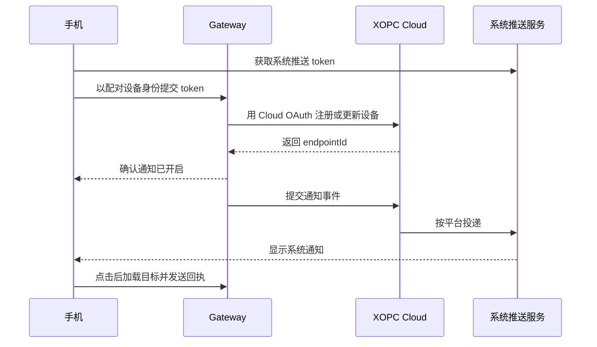

# XOPC Cloud 统一移动推送

XOPC Cloud 在 `xopc-platform` 提供统一的 `/v1/push` 服务。手机把系统推送 token 提交给已配对的 Gateway，由 Gateway 向 Cloud 注册设备并提交通知事件。生产环境沿用现有 Cloud 域名和鸿蒙推送队列，逐步扩展到 iOS 和 Android。

## 服务边界

| 组件 | 职责 |
| --- | --- |
| 手机 | 请求系统通知权限，将新建或刷新的 token 提交给配对的 Gateway；用户点击后打开对应目标页面并发送回执 |
| Gateway | 验证配对设备身份，向 Cloud 注册或撤销设备；保存端点 ID、通知偏好和业务事件；请求投递并接收点击回执 |
| XOPC Cloud | 验证 Gateway 授权，加密保存 token，维护绑定与投递队列，按平台发送并处理重试和失效 token |

## 注册、投递与回执

1. 手机取得系统推送 token 后，调用配对 Gateway 的 `PUT /api/devices/me/push` 提交 token、平台、通知权限和语言。Gateway 使用已认证的设备身份确定 `deviceId`，并用配对记录校验平台。
2. Gateway 使用自身 Cloud OAuth 的 `push:manage` 权限调用现有 `PUT /v1/push/endpoints`，提交 `gatewayId`、`deviceId`、平台、token 和厂商所需环境信息。Cloud 在同一授权和配对设备下幂等更新绑定并返回 `endpointId`。Gateway 确认配对仍有效，保存端点 ID 和通知偏好，再向手机确认开启。token 轮换沿用此接口并保持端点 ID 稳定，厂商失效响应只注销对应的 token 版本。
3. Gateway 按设备偏好筛选事件，向现有 `POST /v1/push/deliveries` 提交 `endpointId`、`eventId`、语言、有效期和结构化目标。Cloud 校验端点归属，以授权、端点和事件去重，返回 `202` 表示已入队。厂商接收与用户点击分别记录。通知栏显示通用文案，任务标题和对话内容由手机进入应用后向对应 Gateway 加载。
4. 通知只携带 `gatewayId`、`eventId` 与结构化目标。手机用它找到本地已配对的 Gateway，支持进程冷启动和应用已运行两种情况。打开任务就进任务详情，打开对话就进对应对话。实际点击后调用现有 `POST /api/notifications/:eventId/ack`。Gateway 按事件和配对设备去重。Gateway 暂时不可达时，手机保留回执并在重新连通后重试。
5. 手机关闭通知、取消配对或 Gateway 撤销设备时，Gateway 立即停发并向 Cloud 撤销对应绑定。Cloud 停止该端点的待投递任务。撤销请求可安全重试，其他 Gateway 的绑定独立管理。注册续期与重新开关通知都沿用同一套接口。

## 三端接入

| 平台 | 手机获取 token | Cloud 投递 |
| --- | --- | --- |
| 鸿蒙 | Push Kit | 沿用现有生产配置。工作任务和自动化工作提醒使用 `WORK`，其他通知沿用 `MARKETING` |
| iOS | APNs | `ai.xopc.xopc` 开启 Push Notifications capability，按签名构建选择 APNs 环境，Cloud 持有 APNs 凭证。 [APNs 注册](https://developer.apple.com/documentation/usernotifications/registering-your-app-with-apns) · [APNs 发送](https://developer.apple.com/documentation/usernotifications/sending-notification-requests-to-apns) |
| Android | FCM；无 GMS 的发行渠道接入相应厂商通道 | GMS 渠道使用 FCM HTTP v1，Android 13 及以上申请通知权限。厂商实现同一 Cloud 适配接口，按安装包及 token 类型选择投递。 [Android FCM 接入](https://firebase.google.com/docs/cloud-messaging/android/get-started) · [FCM HTTP v1](https://firebase.google.com/docs/cloud-messaging/send/v1-api) |

厂商凭证由 Cloud 统一管理。Cloud 统一处理短时网络故障、限流、有效期、无效 token 和发送状态。Gateway 在注册请求中转发 token，SQLite 只保存端点引用和通知偏好。手机复用 Gateway 配对身份，Cloud OAuth 凭证由 Gateway 持有。

## 厂商配置

- 鸿蒙沿用 Cloud 上的 `XOPC_HARMONY_PUSH_*` 配置。
- iOS 在 Cloud 配置 `XOPC_APNS_TEAM_ID`、`XOPC_APNS_KEY_ID` 和 `XOPC_APNS_KEY_FILE`。使用独立沙盒密钥时另外配置 `XOPC_APNS_SANDBOX_KEY_ID` 与 `XOPC_APNS_SANDBOX_KEY_FILE`。启用推送的签名构建使用 `XOPC_APP_ENTITLEMENTS=XopcMobile/XopcMobilePush.entitlements`，并将 `XOPC_APNS_ENTITLEMENT` 和 `XOPC_APNS_ENVIRONMENT` 设为与 provisioning profile 对应的 `development` / `sandbox` 或 `production` / `production`。普通构建沿用原有签名能力。
- Android GMS 构建把 Firebase 的 `google-services.json` 放在 `apps/mobile-android/app/`，Cloud 使用同一 Firebase 项目的 `XOPC_FCM_SERVICE_ACCOUNT`。该文件为受信的服务账号 JSON 路径。无 GMS 的发行渠道仍需接入和验证相应厂商适配器。

## 迁移与验收

1. 在现有鸿蒙链路上扩展 Cloud 的端点模型和队列，再将 Gateway 的注册、设备筛选与撤销逻辑扩展到 iOS 和 Android。沿用现有注册接口和鸿蒙配对绑定，保留设备的通知偏好。
2. 核对 iOS 签名与 APNs 生产凭证、Firebase Android 应用和 Cloud 发送授权。Android 的非 GMS 发行渠道按需接入厂商项目与凭证。三端各自支持通知开关、token 轮换、解除配对和点击回执。
3. 真机验证系统通知、后台与冷启动跳转、Gateway 离线后的回执补发、权限撤销、设备撤销和跨 Gateway 隔离。验收记录分别标明 Cloud 已入队、厂商已接收、真机已显示、点击已回执。Android 按实际发行渠道验收，FCM 真机结果覆盖 GMS 渠道。
